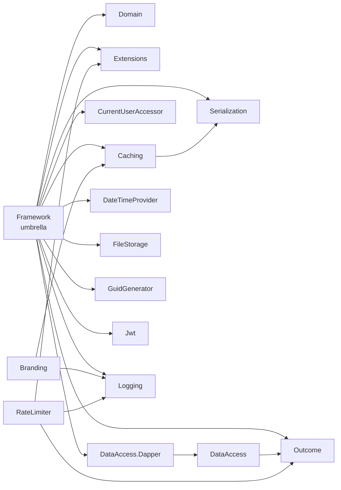

# ImanSoftware Platform

[](https://dotnet.microsoft.com/)
[](LICENSE.txt)
[](https://www.nuget.org/profiles/ImanSoftware)
[](https://github.com/ImanEstiri)

**Small, independent .NET libraries for the problems every backend project solves again and again: results and errors, CQRS, caching, data access, JWT, rate limiting, file storage, and more.**

Every module is its own NuGet package. Install only what you need, or use the umbrella package `ImanSoftware.Framework` to get the core modules with a single registration call.

---

## Why this repo

- **Pick only what you need.** Each package has a narrow purpose and a small dependency surface.
- **Interface-first.** Every service is an interface with a default implementation you can replace, so everything is easy to mock in tests.
- **One consistent style.** Errors flow through the `Outcome` type, services are registered with `Add...()` extension methods, and every default can be overridden.
- **Built for real apps.** Sequential GUIDs for database-friendly keys, `Dapper` data access with transaction scopes, Persian (Jalali) date helpers, and more.

---

## Packages

| Package | NuGet | What it does |
|---|---|---|
| [`ImanSoftware.Outcome`](src/ImanSoftware.Outcome) |  | Result pattern (`Outcome`, `Outcome<T>`, `OutcomeError`) and typed exceptions that convert to results. |
| [`ImanSoftware.CQRS`](src/ImanSoftware.CQRS) |  | `ICommand`, `IQuery` and their handlers on top of MediatR. |
| [`ImanSoftware.Domain`](src/ImanSoftware.Domain) |  | `BaseEntity<TId>`, `TaggedEntity` and ready-made value objects: `Money`, `Address`, `Coordinates`, `DateRange`, `EmailAddress`, `PhoneNumber`, `Tag`. |
| [`ImanSoftware.Extensions`](src/ImanSoftware.Extensions) |  | Extension methods for `string`, `DateTime` (including Persian calendar), `Enum`, `IEnumerable`, `Exception`, `object`. |
| [`ImanSoftware.Caching`](src/ImanSoftware.Caching) |  | `ICacheService` on `IMemoryCache` with `GetOrSet`. |
| [`ImanSoftware.Serialization`](src/ImanSoftware.Serialization) |  | `IImanJsonSerializer` with `System.Text.Json` and `Newtonsoft.Json` providers. |
| [`ImanSoftware.Logging`](src/ImanSoftware.Logging) |  | `ILoggerAdapter<T>`: a thin logger abstraction with scopes and standard levels. |
| [`ImanSoftware.DataAccess`](src/ImanSoftware.DataAccess) |  | Database-agnostic abstractions: `ISqlDataAccessor`, `IDbConnectionFactory`, `ITransactionScope`. |
| [`ImanSoftware.DataAccess.Dapper`](src/ImanSoftware.DataAccess.Dapper) |  | Dapper implementation of `ImanSoftware.DataAccess`. |
| [`ImanSoftware.Jwt`](src/ImanSoftware.Jwt) |  | Token generation and validation, plus ASP.NET Core middleware. |
| [`ImanSoftware.CurrentUserAccessor`](src/ImanSoftware.CurrentUserAccessor) |  | `ICurrentUserAccessor<TUserId>` backed by `HttpContext`. |
| [`ImanSoftware.RateLimiter`](src/ImanSoftware.RateLimiter) |  | Named policies, four strategies, response headers, metrics. Built on ASP.NET Core rate limiting. |
| [`ImanSoftware.FileStorage`](src/ImanSoftware.FileStorage) |  | Local file operations (`IFileStorage`) and upload/download (`IFileTransfer`), also usable without DI. |
| [`ImanSoftware.GuidGenerator`](src/ImanSoftware.GuidGenerator) |  | Sequential (index-friendly) and random GUID generators. |
| [`ImanSoftware.DateTimeProvider`](src/ImanSoftware.DateTimeProvider) |  | `IDateTimeProvider` so time can be controlled in tests. |
| [`ImanSoftware.Branding`](src/ImanSoftware.Branding) |  | Blazor badge component (see the [note on remote data](#imansoftwarebranding)). |
| [`ImanSoftware.Framework`](src/ImanSoftware.Framework) |  | Umbrella package: one `AddImanFramework(options)` call for the core modules. |

> **Requirements:** .NET 10 SDK. All projects target `net10.0`.

### How the packages relate



`CQRS`, `RateLimiter` and `Branding` are **not** part of the umbrella package; install them separately.

---

## Installation

Install only what you need:

```bash
dotnet add package ImanSoftware.Outcome
dotnet add package ImanSoftware.Caching
dotnet add package ImanSoftware.DataAccess.Dapper
```

Or take the umbrella package for the core modules:

```bash
dotnet add package ImanSoftware.Framework
```

---

## Quick start

### Outcome (result pattern)

Return an `Outcome<T>` instead of throwing or returning `null`.

```csharp
using ImanSoftware.Outcomes;

public Outcome<Product> GetProduct(int id)
{
    var product = _repository.Find(id);

    return product is null
        ? Outcome.Failure<Product>(new OutcomeError("Product not found", "PRODUCT_NOT_FOUND", OutcomeErrorType.NotFound))
        : Outcome.Successful(product);
}

var result = GetProduct(42);

if (result.IsSuccess)
    Console.WriteLine(result.Data.Name);     // Data throws if the outcome is a failure
else
    Console.WriteLine($"{result.Error.Code}: {result.Error.Message}");
```

Typed exceptions derive from `FrameworkException` and convert to an outcome with `ex.ToResult()` or `ex.ToResult<T>()`. Error categories: `Failure`, `Validation`, `Problem`, `NotFound`, `Conflict`, `InquiryError`.

### CQRS

```csharp
using ImanSoftware.CQRS;
using ImanSoftware.CQRS.DependencyInjection;

builder.Services.AddCqrs([typeof(Program).Assembly]);

public record GetProductQuery(int Id) : IQuery<Outcome<Product>>;

public class GetProductHandler : IQueryHandler<GetProductQuery, Outcome<Product>>
{
    public Task<Outcome<Product>> Handle(GetProductQuery query, CancellationToken ct) { /* ... */ }
}
```

### Caching

```csharp
using ImanSoftware.Caching;

builder.Services.AddCacheService();

var product = _cache.GetOrSet($"product:{id}", () => LoadProduct(id), TimeSpan.FromMinutes(5));
```

`AddCacheService()` registers `IMemoryCache`, the serializer, and an in-memory `ICacheService`. Pass a custom implementation type to plug in another provider (for example Redis).

### Data access with Dapper

```csharp
using ImanSoftware.DataAccess.Dapper;

builder.Services.AddDapperDataAccess(
    builder.Configuration.GetConnectionString("DefaultConnection")
    ?? throw new InvalidOperationException("Connection string 'DefaultConnection' was not found."));
```

```csharp
public class ProductRepository(ISqlDataAccessor db)
{
    public Task<Outcome<Product>> GetAsync(int id) =>
        db.QuerySingleAsync<Product>("GetProductById", new { Id = id }, CommandType.StoredProcedure);

    public async Task<Outcome> UpdateStockAsync(int id, int stock)
    {
        var scope = await db.BeginTransactionAsync();
        if (scope.IsFailure) return Outcome.Failure(scope.Error);

        using var tx = scope.Data;
        var result = await db.ExecuteAsync(
            "UpdateProductStock", new { Id = id, Stock = stock },
            CommandType.StoredProcedure, tx.Transaction);

        if (result.IsFailure)
        {
            await tx.RollbackAsync();
            return Outcome.Failure(result.Error);
        }

        await tx.CommitAsync();
        return Outcome.Successful();
    }
}
```

Never commit real connection strings. Use user secrets or environment variables.

### JWT

```csharp
using ImanSoftware.Jwt;
using ImanSoftware.AspNetCore.Middlewares;

builder.Services.AddJwtTokenService(new JwtOptions
{
    SecretKey = builder.Configuration["Jwt:SecretKey"]!,   // keep out of source control
    Issuer = "MyApp",
    Audience = "MyApp.Users",
    ExpiryMinutes = 120
});

app.UseRouting();
app.UseJwtAuthentication();   // reads the bearer token and sets HttpContext.User
```

```csharp
string token = _jwt.GenerateToken([new Claim(ClaimTypes.NameIdentifier, userId.ToString())]);
```

### Rate limiting

```csharp
using ImanSoftware.RateLimiter;
using ImanSoftware.RateLimiter.Core.Enums;
using ImanSoftware.RateLimiter.Core.Models;
using ImanSoftware.RateLimiter.Infrastructure;
using ImanSoftware.RateLimiter.Attributes;

builder.Services.AddImanRateLimiter(options =>
{
    options.DefaultPolicy = new RateLimitPolicy
    {
        PermitLimit = 100,
        Window = TimeSpan.FromMinutes(1),
        Strategy = RateLimiterStrategy.SlidingWindow,
        PartitionBy = RateLimitPartitionBy.IpAddress
    };

    options.Policies["login"] = new RateLimitPolicy { PermitLimit = 5, Window = TimeSpan.FromMinutes(1) };
});

app.UseImanRateLimiter();

[EnableImanRateLimiting(PolicyName = "login")]
public class AuthController : ControllerBase { /* ... */ }
```

| Strategies | Partition keys |
|---|---|
| `FixedWindow`, `SlidingWindow`, `TokenBucket`, `Concurrency` | `IpAddress`, `UserId`, `ApiKey`, `Endpoint`, `Custom` |

Responses include rate-limit headers by default. Limits are enforced in memory per application instance.

### File storage

```csharp
using ImanSoftware.FileStorage;

// With DI
builder.Services.AddImanFileStorage();                       // IFileStorage: read, write, move, delete, enumerate
builder.Services.AddImanFileTransfer(o =>                    // IFileTransfer: upload / download
{
    o.RootPath = "uploads";
    o.MaxFileSize = 10 * 1024 * 1024;
    o.AllowedExtensions = [".jpg", ".png", ".pdf"];
});

// Without DI (console apps, scripts)
var storage = ImanFileStorageFactory.CreateStorage();
var transfer = ImanFileStorageFactory.CreateTransfer(o => o.RootPath = "uploads");
```

### Smaller helpers

```csharp
using ImanSoftware.Extensions;

"HelloWorld".ToSnakeCase();       // "hello_world"
"Hello World".ToKebabCase();      // "hello-world"
DateTime.Now.StartOfWeek();
birthDate.Age();
date.ToPersianDateString();       // Jalali calendar
OrderStatus.Shipped.GetDescription();
```

```csharp
builder.Services.AddCurrentUserAccessor();                   // ICurrentUserAccessor<TUserId>
builder.Services.AddLoggerAdapter();                         // ILoggerAdapter<T>
var userId = _currentUser.GetCurrentUserId();                // Guid? / int? / string?
```

### ImanSoftware.Branding

```csharp
using ImanSoftware.Branding.DependencyInjection;

builder.Services.AddImanBranding();
```

```razor
@using ImanSoftware.Branding
<ImanSoftwareBadge ProjectId="your-project-id" />
```

The badge **requests its content from `https://imansoftware.ir/api/badge`** (3-second timeout, cached for 12 hours) and falls back to a built-in default text if the request fails. You can change the endpoint, cache duration and default text through `BrandingOptions`.

---

## The umbrella package

`ImanSoftware.Framework` bundles Outcome, Domain, Extensions, Caching, CurrentUserAccessor, DataAccess.Dapper, DateTimeProvider, FileStorage, GuidGenerator, Jwt, Logging and Serialization, and registers them through one entry point:

```csharp
using ImanSoftware.Framework.FrameworkDependencyInjection;

builder.Services.AddImanFramework(new ImanFrameworkDependencyInjectionOptions
{
    AddCacheService = true,
    AddJwtService = true,
    JwtConfigureOptions = builder.Configuration.GetSection("Jwt").Get<JwtOptions>(),
    AddDapperDataAccess = true,
    DapperConnectionString = builder.Configuration.GetConnectionString("DefaultConnection")
});

builder.Services.AddLoggerAdapter();   // Logging is not registered by AddImanFramework
```

| Option | Default | Notes |
|---|---|---|
| `AddDateTimeProvider` | `true` | `DateTimeProviderCustomImplementation` overrides it |
| `AddGuidGenerator` | `true` | `GuidGeneratorImplementationType`: `Sequential` (default) or `Random` |
| `AddCurrentUserAccessor` | `true` | Open generic `ICurrentUserAccessor<>` |
| `AddJsonSerializer` | `true` | `SerializationImplementationType`: `Newtonsoft` (default) or `SystemText` |
| `AddCacheService` | `false` | In-memory by default |
| `AddJwtService` | `false` | Requires `JwtConfigureOptions` or a custom implementation |
| `AddDataAccess` | `false` | Requires `DataAccessConnectionString` and a custom registration |
| `AddDapperDataAccess` | `false` | Requires `DapperConnectionString` |
| `AddFileStorage` | `false` | General file operations, no configuration needed |
| `AddFileTransfer` | `false` | Requires `FileTransferConfigureOptions` (or a custom registration) |

To replace a default, set the matching `...CustomImplementation` property (`typeof(MyService)`) or `...CustomRegistration` delegate.

---

## Build from source

```bash
dotnet restore ImanSoftware.Platform.slnx
dotnet build ImanSoftware.Platform.slnx --configuration Release
```

Package versions are managed centrally in `Directory.Packages.props`, and shared build settings live in `Directory.Build.props`. Each package is versioned independently in its own `.csproj`, and `publish.ps1` packs and pushes packages to NuGet.

## Repository layout

```text
.
├── ImanSoftware.Platform.slnx
├── Directory.Build.props
├── Directory.Packages.props
├── nuget.config
├── publish.ps1
└── src/
    ├── ImanSoftware.Branding/
    ├── ImanSoftware.Caching/
    ├── ImanSoftware.CQRS/
    ├── ImanSoftware.CurrentUserAccessor/
    ├── ImanSoftware.DataAccess/
    ├── ImanSoftware.DataAccess.Dapper/
    ├── ImanSoftware.DateTimeProvider/
    ├── ImanSoftware.Domain/
    ├── ImanSoftware.Extensions/
    ├── ImanSoftware.FileStorage/
    ├── ImanSoftware.Framework/
    ├── ImanSoftware.GuidGenerator/
    ├── ImanSoftware.Jwt/
    ├── ImanSoftware.Logging/
    ├── ImanSoftware.Outcome/
    ├── ImanSoftware.RateLimiter/
    └── ImanSoftware.Serialization/
```

## Contributing

Issues and pull requests are welcome. Please open an issue first for larger changes, keep each package focused, and include tests for new behavior.

## License

Released under the MIT License. See [LICENSE.txt](LICENSE.txt).

---

Made by [Iman Estiri](https://github.com/ImanEstiri) in Iran 🇮🇷
