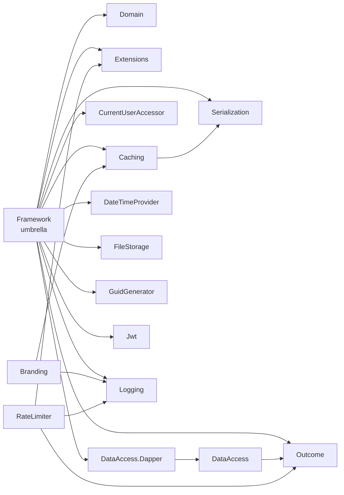

### LICENSE 

```text 
MIT License

Copyright (c) [2026] [Iman Estiri]

Permission is hereby granted, free of charge, to any person obtaining a copy
of this software and associated documentation files (the "Software"), to deal
in the Software without restriction, including without limitation the rights
to use, copy, modify, merge, publish, distribute, sublicense, and/or sell
copies of the Software, and to permit persons to whom the Software is
furnished to do so, subject to the following conditions:

The above copyright notice and this permission notice shall be included in all
copies or substantial portions of the Software.

THE SOFTWARE IS PROVIDED "AS IS", WITHOUT WARRANTY OF ANY KIND, EXPRESS OR
IMPLIED, INCLUDING BUT NOT LIMITED TO THE WARRANTIES OF MERCHANTABILITY,
FITNESS FOR A PARTICULAR PURPOSE AND NONINFRINGEMENT. IN NO EVENT SHALL THE
AUTHORS OR COPYRIGHT HOLDERS BE LIABLE FOR ANY CLAIM, DAMAGES OR OTHER
LIABILITY, WHETHER IN AN ACTION OF CONTRACT, TORT OR OTHERWISE, ARISING FROM,
OUT OF OR IN CONNECTION WITH THE SOFTWARE OR THE USE OR OTHER DEALINGS IN THE
SOFTWARE.

``` 


### nuget 

```xml 
<?xml version="1.0" encoding="utf-8"?>

<configuration>
	<packageSources>
		<clear />
		<!-- منبع اصلی: mirror داخلی که به nuget.org وصل می‌شود -->
		<!--<add key="LiaraMirror" value="https://package-mirror.liara.ir/repository/nuget/index.json" protocolVersion="3" />-->
		<!-- اگر mirror در دسترس نبود، می‌توانید این خط را به‌طور موقت با HTTP فعال کنید -->
		 <add key="nuget" value="https://api.nuget.org/v3/index.json" protocolVersion="3" /> 
	</packageSources>
	<packageSourceMapping>
		<packageSource key="nuget">
			<package pattern="*" />
		</packageSource>
	</packageSourceMapping>
</configuration>
``` 


### publish 

```powershell 
param(
    [Parameter(Mandatory = $true)]
    [string]$ProjectName,

    [switch]$SkipPush
)

$ErrorActionPreference = "Stop"

$solutionRoot      = $PSScriptRoot
$projectPath       = Join-Path $solutionRoot "src\$ProjectName"
$artifactsPath     = Join-Path $solutionRoot "artifacts\$ProjectName"
$srcRoot           = Join-Path $solutionRoot "src"
$packagesPropsPath = Join-Path $solutionRoot "Directory.Packages.props"

# ===================================================================
# Logging helpers
#   Write-Step   -> yellow : status / decision messages
#   Write-Action -> blue   : "about to run a command" announcements
#   (actual command output is left uncolored / default terminal color)
#   Add-Summary  -> records a line for the final summary block
# ===================================================================

$script:summary = @()

function Write-Step {
    param([Parameter(Mandatory = $true)][string]$Message)
    Write-Host $Message -ForegroundColor Yellow
}

function Write-Action {
    param([Parameter(Mandatory = $true)][string]$Message)
    Write-Host $Message -ForegroundColor Blue
}

function Add-Summary {
    param([Parameter(Mandatory = $true)][string]$Message)
    $script:summary += $Message
}

function Show-Summary {
    Write-Host ""
    Write-Host "===================== Summary =====================" -ForegroundColor Cyan
    if ($script:summary.Count -eq 0) {
        Write-Host " (nothing was recorded)" -ForegroundColor Cyan
    } else {
        foreach ($line in $script:summary) {
            Write-Host " - $line" -ForegroundColor Cyan
        }
    }
    Write-Host "=====================================================" -ForegroundColor Cyan
}

function Bump-PatchVersion {
    param([Parameter(Mandatory = $true)][string]$Version)

    if ($Version -notmatch '^(?<major>\d+)\.(?<minor>\d+)\.(?<patch>\d+)(?<suffix>[-+].*)?$') {
        throw "Version '$Version' is not in a recognizable Major.Minor.Patch format."
    }

    $major  = $Matches['major']
    $minor  = $Matches['minor']
    $patch  = [int]$Matches['patch'] + 1
    $suffix = $Matches['suffix']

    return "$major.$minor.$patch$suffix"
}

function Get-CsprojVersion {
    param([Parameter(Mandatory = $true)][string]$Path)
    [xml]$xml = Get-Content $Path
    $value = $xml.Project.PropertyGroup.Version | Where-Object { $_ } | Select-Object -First 1
    # Explicit cast: the pipeline above can hand back a wrapped value that
    # later fails when assigned to an XmlAttribute (e.g. Directory.Packages.props),
    # even though it prints/concatenates fine everywhere else.
    return [string]$value
}

function Set-CsprojVersion {
    param(
        [Parameter(Mandatory = $true)][string]$Path,
        [Parameter(Mandatory = $true)][string]$NewVersion
    )
    [xml]$xml = Get-Content $Path
    $propertyGroup = $xml.Project.PropertyGroup | Where-Object { $_.Version } | Select-Object -First 1

    if (-not $propertyGroup) {
        throw "Could not find a <PropertyGroup> with a <Version> element in $Path"
    }

    $propertyGroup.Version = [string]$NewVersion
    $xml.Save($Path)
}

function Test-HasPackageReference {
    param(
        [Parameter(Mandatory = $true)][string]$Path,
        [Parameter(Mandatory = $true)][string]$Name
    )
    [xml]$xml = Get-Content $Path
    $refs = $xml.Project.ItemGroup.PackageReference | Where-Object { $_.Include -eq $Name }
    return [bool]$refs
}

# Runs an external process under a hard, PowerShell-enforced wall-clock timeout.
# This exists because "dotnet nuget push --timeout N" only bounds the actual
# upload request — the preceding service-index lookup (GET .../v3/index.json)
# has its own internal ~100s timeout that --timeout does NOT control. If the
# process doesn't exit in time we kill the whole process tree (dotnet can spawn
# child processes) via taskkill /T /F so nothing is left running in the background.
#
# Uses System.Diagnostics.Process directly (not the Start-Process cmdlet) because
# Start-Process -PassThru combined with output redirection can unreliably report
# ExitCode even after the process has exited successfully.
function ConvertTo-ArgumentString {
    param([string[]]$Arguments)
    return ($Arguments | ForEach-Object {
        if ($_ -match '[\s"]') {
            '"' + ($_ -replace '"', '\"') + '"'
        } else {
            $_
        }
    }) -join ' '
}

function Invoke-ProcessWithTimeout {
    param(
        [Parameter(Mandatory = $true)][string]$FilePath,
        [Parameter(Mandatory = $true)][string[]]$ArgumentList,
        [Parameter(Mandatory = $true)][int]$TimeoutSeconds
    )

    $psi = New-Object System.Diagnostics.ProcessStartInfo
    $psi.FileName               = $FilePath
    $psi.Arguments              = ConvertTo-ArgumentString -Arguments $ArgumentList
    $psi.UseShellExecute        = $false
    $psi.RedirectStandardOutput = $true
    $psi.RedirectStandardError  = $true
    $psi.CreateNoWindow         = $true

    $proc = New-Object System.Diagnostics.Process
    $proc.StartInfo = $psi

    $stdOutBuilder = New-Object System.Text.StringBuilder
    $stdErrBuilder = New-Object System.Text.StringBuilder

    $outEvent = Register-ObjectEvent -InputObject $proc -EventName OutputDataReceived -Action {
        if ($EventArgs.Data) { $Event.MessageData.AppendLine($EventArgs.Data) | Out-Null }
    } -MessageData $stdOutBuilder

    $errEvent = Register-ObjectEvent -InputObject $proc -EventName ErrorDataReceived -Action {
        if ($EventArgs.Data) { $Event.MessageData.AppendLine($EventArgs.Data) | Out-Null }
    } -MessageData $stdErrBuilder

    try {
        $proc.Start() | Out-Null
        $proc.BeginOutputReadLine()
        $proc.BeginErrorReadLine()

        $exited = $proc.WaitForExit($TimeoutSeconds * 1000)

        if (-not $exited) {
            try {
                Start-Process -FilePath "taskkill.exe" -ArgumentList "/PID $($proc.Id) /T /F" -NoNewWindow -Wait -ErrorAction SilentlyContinue | Out-Null
            } catch {}
            Start-Sleep -Milliseconds 300
        } else {
            # Blocks only until the already-exited process's streams finish flushing.
            $proc.WaitForExit()
        }
    }
    finally {
        Unregister-Event -SourceIdentifier $outEvent.Name -ErrorAction SilentlyContinue
        Unregister-Event -SourceIdentifier $errEvent.Name -ErrorAction SilentlyContinue
        Remove-Job $outEvent, $errEvent -Force -ErrorAction SilentlyContinue
    }

    if ($stdOutBuilder.Length -gt 0) { Write-Host $stdOutBuilder.ToString().TrimEnd() }
    if ($stdErrBuilder.Length -gt 0) { Write-Host $stdErrBuilder.ToString().TrimEnd() }

    if (-not $exited) {
        return [PSCustomObject]@{ TimedOut = $true; ExitCode = $null }
    }

    return [PSCustomObject]@{ TimedOut = $false; ExitCode = $proc.ExitCode }
}

# ===================================================================
# Main
# ===================================================================

try {
    if (-not (Test-Path $projectPath)) {
        Write-Error "No project named '$ProjectName' found under src/: $projectPath"
    }

    # ===== API Key =====
    # Recommendation: do NOT hardcode the key in this file. Set it once, outside of git:
    #   setx NUGET_API_KEY "your-real-key-here"
    # Then close and reopen your terminal / Visual Studio so the new value is loaded.
    $ApiKey = $env:NUGET_API_KEY

    if ([string]::IsNullOrWhiteSpace($ApiKey)) {
        Write-Error "Environment variable NUGET_API_KEY is not set. Run 'setx NUGET_API_KEY your-key' and restart your terminal."
    }

    # Note: previous builds are kept intentionally, so you have a local history
    # of every version ever packed. We don't delete anything here.
    if (-not (Test-Path $artifactsPath)) {
        Write-Step "artifacts folder for $ProjectName does not exist yet; creating $artifactsPath"
        New-Item -Path $artifactsPath -ItemType Directory | Out-Null
    }

    $csprojPath = Join-Path $projectPath "$ProjectName.csproj"

    if (-not (Test-Path $csprojPath)) {
        Write-Error "Could not find project file: $csprojPath"
    }

    # ---------------------------------------------------------------
    # Part 1: pack (auto-bumping the patch version if it was already packed)
    # ---------------------------------------------------------------

    $version = Get-CsprojVersion -Path $csprojPath

    if (-not $version) {
        Write-Error "Could not read <Version> from $csprojPath. Make sure it's set explicitly in the project file."
    }

    $originalVersion = $version

    Write-Step "checking artifact/$ProjectName for any $version output."
    $expectedNupkg = Join-Path $artifactsPath "$ProjectName.$version.nupkg"

    while (Test-Path $expectedNupkg) {
        $previous = $version
        $version  = Bump-PatchVersion -Version $version
        Write-Step "auto bumping version for $ProjectName from $previous to $version"
        Add-Summary "Version auto-bumped: $previous -> $version (an artifact for $previous already existed)"
        Write-Step "checking artifact/$ProjectName for any $version output."
        $expectedNupkg = Join-Path $artifactsPath "$ProjectName.$version.nupkg"
    }

    Write-Step "version $version is free; no existing artifact found."

    if ($version -ne $originalVersion) {
        Set-CsprojVersion -Path $csprojPath -NewVersion $version
        Write-Step "updated <Version> in $csprojPath : $originalVersion -> $version"
        Add-Summary "csproj updated: $ProjectName Version $originalVersion -> $version"
    } else {
        Add-Summary "Version used: $ProjectName $version (no bump needed)"
    }

    Write-Action "packing $ProjectName v$version ..."
    dotnet pack $projectPath -c Release --output $artifactsPath
    if ($LASTEXITCODE -ne 0) {
        Add-Summary "FAILED: dotnet pack for $ProjectName v$version"
        Write-Error "Pack failed."
    }
    Add-Summary "Packed: $ProjectName v$version -> $artifactsPath"

    # Multiple versions may already sit in this folder from previous runs.
    # The one we just built is always the most recently modified file, so we
    # sort by LastWriteTime and take the newest — nothing else gets touched.
    $nupkg = Get-ChildItem -Path $artifactsPath -Filter "*.nupkg" |
        Sort-Object LastWriteTime -Descending |
        Select-Object -First 1

    if (-not $nupkg) {
        Write-Error "No .nupkg file was found after packing."
    }

    $snupkgPath = Join-Path $artifactsPath "$ProjectName.$version.snupkg"

    Write-Step "package built: $($nupkg.Name)"

    if ($SkipPush) {
        Write-Step "SkipPush is set; packed only, not pushed. Directory.Packages.props and dependent projects were NOT updated."
        Add-Summary "Push skipped (-SkipPush): $($nupkg.Name) left in $artifactsPath"
        return
    }

    # ---------------------------------------------------------------
    # Push (15s timeout; on failure, remove the artifacts we just built
    # so the next run doesn't see a "used" version and bump for no reason)
    # ---------------------------------------------------------------

    Write-Action "pushing package to nuget ..."

    $pushTimeoutSeconds = 15
    $pushArgs = @(
        'nuget', 'push', $nupkg.FullName,
        '--source', 'https://api.nuget.org/v3/index.json',
        '--api-key', $ApiKey,
        '--skip-duplicate',
        '--timeout', "$pushTimeoutSeconds"
    )

    $pushResult = Invoke-ProcessWithTimeout -FilePath 'dotnet' -ArgumentList $pushArgs -TimeoutSeconds $pushTimeoutSeconds

    if ($pushResult.TimedOut) {
        Write-Step "push did not finish within ${pushTimeoutSeconds}s; the dotnet process was forcefully terminated."
        Add-Summary "Push timed out after ${pushTimeoutSeconds}s (process killed): $ProjectName v$version"
    } elseif ($pushResult.ExitCode -ne 0) {
        Write-Step "push failed (exit code $($pushResult.ExitCode))."
        Add-Summary "Push failed (exit code $($pushResult.ExitCode)): $ProjectName v$version"
    }

    if ($pushResult.TimedOut -or $pushResult.ExitCode -ne 0) {
        Write-Step "removing the artifacts just built for v$version so the version isn't wasted."

        if (Test-Path $nupkg.FullName) {
            Remove-Item $nupkg.FullName -Force
            Write-Step "removed $($nupkg.Name)"
            Add-Summary "Removed after failed push: $($nupkg.Name)"
        }
        if (Test-Path $snupkgPath) {
            Remove-Item $snupkgPath -Force
            Write-Step "removed $(Split-Path $snupkgPath -Leaf)"
            Add-Summary "Removed after failed push: $(Split-Path $snupkgPath -Leaf)"
        }

        Add-Summary "FAILED: dotnet nuget push for $ProjectName v$version"
        Write-Error "Push failed."
    }

    Write-Step "$($nupkg.Name) was successfully published to NuGet.org."
    Add-Summary "Pushed to NuGet.org: $($nupkg.Name)"

    # ---------------------------------------------------------------
    # Part 2: sync Directory.Packages.props with the version we just pushed
    # ---------------------------------------------------------------

    Write-Step "checking Directory.Packages.props for an existing $ProjectName entry."

    if (-not (Test-Path $packagesPropsPath)) {
        Write-Error "Directory.Packages.props not found at $packagesPropsPath"
    }

    [xml]$propsXml = Get-Content $packagesPropsPath

    $existingEntry = $propsXml.Project.ItemGroup.PackageVersion |
        Where-Object { $_.Include -eq $ProjectName } |
        Select-Object -First 1

    if ($existingEntry) {
        $oldPropsVersion = $existingEntry.Version
        if ($oldPropsVersion -eq $version) {
            Write-Step "Directory.Packages.props already has $ProjectName = $version; nothing to change."
            Add-Summary "Directory.Packages.props: $ProjectName already at $version"
        } else {
            $existingEntry.Version = [string]$version
            $propsXml.Save($packagesPropsPath)
            Write-Step "updating $ProjectName in Directory.Packages.props from $oldPropsVersion to $version"
            Add-Summary "Directory.Packages.props updated: $ProjectName $oldPropsVersion -> $version"
        }
    } else {
        Write-Step "$ProjectName not found in Directory.Packages.props; adding a new entry."
        $itemGroup = $propsXml.Project.ItemGroup | Select-Object -First 1
        if (-not $itemGroup) {
            $itemGroup = $propsXml.CreateElement("ItemGroup")
            $propsXml.Project.AppendChild($itemGroup) | Out-Null
        }

        $newEntry = $propsXml.CreateElement("PackageVersion")
        $newEntry.SetAttribute("Include", $ProjectName)
        $newEntry.SetAttribute("Version", $version)
        $itemGroup.AppendChild($newEntry) | Out-Null

        $propsXml.Save($packagesPropsPath)
        Write-Step "added new entry to Directory.Packages.props: $ProjectName = $version"
        Add-Summary "Directory.Packages.props: added new entry $ProjectName = $version"
    }

    # ---------------------------------------------------------------
    # Part 3: bump the patch version of every project under ./src that
    # depends on $ProjectName. They are NOT packed/pushed here.
    # ---------------------------------------------------------------

    Write-Step "scanning $srcRoot for projects that reference $ProjectName ..."

    $candidateCsprojFiles = Get-ChildItem -Path $srcRoot -Filter "*.csproj" -Recurse |
        Where-Object { $_.FullName -ne $csprojPath }   # skip the package's own csproj

    $bumpedProjects = @()

    foreach ($file in $candidateCsprojFiles) {
        if (-not (Test-HasPackageReference -Path $file.FullName -Name $ProjectName)) {
            continue
        }

        $depVersion = Get-CsprojVersion -Path $file.FullName
        if (-not $depVersion) {
            Write-Step "skipping $($file.Name): references $ProjectName but has no <Version> to bump."
            Add-Summary "Skipped (no <Version>): $($file.Name)"
            continue
        }

        $newDepVersion = Bump-PatchVersion -Version $depVersion
        Set-CsprojVersion -Path $file.FullName -NewVersion $newDepVersion
        $bumpedProjects += [PSCustomObject]@{ Name = $file.BaseName; Old = $depVersion; New = $newDepVersion }
        Write-Step "bumping dependent project $($file.BaseName) from $depVersion to $newDepVersion"
        Add-Summary "Dependent project bumped: $($file.BaseName) $depVersion -> $newDepVersion"
    }

    if ($bumpedProjects.Count -eq 0) {
        Write-Step "no dependent projects found under $srcRoot."
        Add-Summary "No dependent projects found under src/ referencing $ProjectName"
    } else {
        Write-Step "bumped patch version for $($bumpedProjects.Count) dependent project(s)."
        Write-Step "NOTE: these projects were only version-bumped, not packed or pushed."
        Write-Step "NuGet.org indexing can take a few minutes. Wait until $ProjectName v$version"
        Write-Step "is resolvable (dotnet restore succeeds) before running .\publish.ps1 for them:"
        foreach ($p in $bumpedProjects) {
            Write-Step "    .\publish.ps1 -ProjectName $($p.Name)"
        }
    }
}
finally {
    Show-Summary
}
``` 


### README 

````markdown 
# ImanSoftware Platform

[](https://dotnet.microsoft.com/)
[](LICENSE.txt)
[](https://www.nuget.org/profiles/ImanSoftware)
[](https://github.com/ImanEstiri)

**Small, independent .NET libraries for the problems every backend project solves again and again: results and errors, CQRS, caching, data access, JWT, rate limiting, file storage, and more.**

Every module is its own NuGet package. Install only what you need, or use the umbrella package `ImanSoftware.Framework` to get the core modules with a single registration call.

---

## Why this repo

- **Pick only what you need.** Each package has a narrow purpose and a small dependency surface.
- **Interface-first.** Every service is an interface with a default implementation you can replace, so everything is easy to mock in tests.
- **One consistent style.** Errors flow through the `Outcome` type, services are registered with `Add...()` extension methods, and every default can be overridden.
- **Built for real apps.** Sequential GUIDs for database-friendly keys, `Dapper` data access with transaction scopes, Persian (Jalali) date helpers, and more.

---

## Packages

| Package | NuGet | What it does |
|---|---|---|
| [`ImanSoftware.Outcome`](src/ImanSoftware.Outcome) |  | Result pattern (`Outcome`, `Outcome<T>`, `OutcomeError`) and typed exceptions that convert to results. |
| [`ImanSoftware.CQRS`](src/ImanSoftware.CQRS) |  | `ICommand`, `IQuery` and their handlers on top of MediatR. |
| [`ImanSoftware.Domain`](src/ImanSoftware.Domain) |  | `BaseEntity<TId>`, `TaggedEntity` and ready-made value objects: `Money`, `Address`, `Coordinates`, `DateRange`, `EmailAddress`, `PhoneNumber`, `Tag`. |
| [`ImanSoftware.Extensions`](src/ImanSoftware.Extensions) |  | Extension methods for `string`, `DateTime` (including Persian calendar), `Enum`, `IEnumerable`, `Exception`, `object`. |
| [`ImanSoftware.Caching`](src/ImanSoftware.Caching) |  | `ICacheService` on `IMemoryCache` with `GetOrSet`. |
| [`ImanSoftware.Serialization`](src/ImanSoftware.Serialization) |  | `IImanJsonSerializer` with `System.Text.Json` and `Newtonsoft.Json` providers. |
| [`ImanSoftware.Logging`](src/ImanSoftware.Logging) |  | `ILoggerAdapter<T>`: a thin logger abstraction with scopes and standard levels. |
| [`ImanSoftware.DataAccess`](src/ImanSoftware.DataAccess) |  | Database-agnostic abstractions: `ISqlDataAccessor`, `IDbConnectionFactory`, `ITransactionScope`. |
| [`ImanSoftware.DataAccess.Dapper`](src/ImanSoftware.DataAccess.Dapper) |  | Dapper implementation of `ImanSoftware.DataAccess`. |
| [`ImanSoftware.Jwt`](src/ImanSoftware.Jwt) |  | Token generation and validation, plus ASP.NET Core middleware. |
| [`ImanSoftware.CurrentUserAccessor`](src/ImanSoftware.CurrentUserAccessor) |  | `ICurrentUserAccessor<TUserId>` backed by `HttpContext`. |
| [`ImanSoftware.RateLimiter`](src/ImanSoftware.RateLimiter) |  | Named policies, four strategies, response headers, metrics. Built on ASP.NET Core rate limiting. |
| [`ImanSoftware.FileStorage`](src/ImanSoftware.FileStorage) |  | Local file operations (`IFileStorage`) and upload/download (`IFileTransfer`), also usable without DI. |
| [`ImanSoftware.GuidGenerator`](src/ImanSoftware.GuidGenerator) |  | Sequential (index-friendly) and random GUID generators. |
| [`ImanSoftware.DateTimeProvider`](src/ImanSoftware.DateTimeProvider) |  | `IDateTimeProvider` so time can be controlled in tests. |
| [`ImanSoftware.Branding`](src/ImanSoftware.Branding) |  | Blazor badge component (see the [note on remote data](#imansoftwarebranding)). |
| [`ImanSoftware.Framework`](src/ImanSoftware.Framework) |  | Umbrella package: one `AddImanFramework(options)` call for the core modules. |

> **Requirements:** .NET 10 SDK. All projects target `net10.0`.

### How the packages relate



`CQRS`, `RateLimiter` and `Branding` are **not** part of the umbrella package; install them separately.

---

## Installation

Install only what you need:

```bash
dotnet add package ImanSoftware.Outcome
dotnet add package ImanSoftware.Caching
dotnet add package ImanSoftware.DataAccess.Dapper
```

Or take the umbrella package for the core modules:

```bash
dotnet add package ImanSoftware.Framework
```

---

## Quick start

### Outcome (result pattern)

Return an `Outcome<T>` instead of throwing or returning `null`.

```csharp
using ImanSoftware.Outcomes;

public Outcome<Product> GetProduct(int id)
{
    var product = _repository.Find(id);

    return product is null
        ? Outcome.Failure<Product>(new OutcomeError("Product not found", "PRODUCT_NOT_FOUND", OutcomeErrorType.NotFound))
        : Outcome.Successful(product);
}

var result = GetProduct(42);

if (result.IsSuccess)
    Console.WriteLine(result.Data.Name);     // Data throws if the outcome is a failure
else
    Console.WriteLine($"{result.Error.Code}: {result.Error.Message}");
```

Typed exceptions derive from `FrameworkException` and convert to an outcome with `ex.ToResult()` or `ex.ToResult<T>()`. Error categories: `Failure`, `Validation`, `Problem`, `NotFound`, `Conflict`, `InquiryError`.

### CQRS

```csharp
using ImanSoftware.CQRS;
using ImanSoftware.CQRS.DependencyInjection;

builder.Services.AddCqrs([typeof(Program).Assembly]);

public record GetProductQuery(int Id) : IQuery<Outcome<Product>>;

public class GetProductHandler : IQueryHandler<GetProductQuery, Outcome<Product>>
{
    public Task<Outcome<Product>> Handle(GetProductQuery query, CancellationToken ct) { /* ... */ }
}
```

### Caching

```csharp
using ImanSoftware.Caching;

builder.Services.AddCacheService();

var product = _cache.GetOrSet($"product:{id}", () => LoadProduct(id), TimeSpan.FromMinutes(5));
```

`AddCacheService()` registers `IMemoryCache`, the serializer, and an in-memory `ICacheService`. Pass a custom implementation type to plug in another provider (for example Redis).

### Data access with Dapper

```csharp
using ImanSoftware.DataAccess.Dapper;

builder.Services.AddDapperDataAccess(
    builder.Configuration.GetConnectionString("DefaultConnection")
    ?? throw new InvalidOperationException("Connection string 'DefaultConnection' was not found."));
```

```csharp
public class ProductRepository(ISqlDataAccessor db)
{
    public Task<Outcome<Product>> GetAsync(int id) =>
        db.QuerySingleAsync<Product>("GetProductById", new { Id = id }, CommandType.StoredProcedure);

    public async Task<Outcome> UpdateStockAsync(int id, int stock)
    {
        var scope = await db.BeginTransactionAsync();
        if (scope.IsFailure) return Outcome.Failure(scope.Error);

        using var tx = scope.Data;
        var result = await db.ExecuteAsync(
            "UpdateProductStock", new { Id = id, Stock = stock },
            CommandType.StoredProcedure, tx.Transaction);

        if (result.IsFailure)
        {
            await tx.RollbackAsync();
            return Outcome.Failure(result.Error);
        }

        await tx.CommitAsync();
        return Outcome.Successful();
    }
}
```

Never commit real connection strings. Use user secrets or environment variables.

### JWT

```csharp
using ImanSoftware.Jwt;
using ImanSoftware.AspNetCore.Middlewares;

builder.Services.AddJwtTokenService(new JwtOptions
{
    SecretKey = builder.Configuration["Jwt:SecretKey"]!,   // keep out of source control
    Issuer = "MyApp",
    Audience = "MyApp.Users",
    ExpiryMinutes = 120
});

app.UseRouting();
app.UseJwtAuthentication();   // reads the bearer token and sets HttpContext.User
```

```csharp
string token = _jwt.GenerateToken([new Claim(ClaimTypes.NameIdentifier, userId.ToString())]);
```

### Rate limiting

```csharp
using ImanSoftware.RateLimiter;
using ImanSoftware.RateLimiter.Core.Enums;
using ImanSoftware.RateLimiter.Core.Models;
using ImanSoftware.RateLimiter.Infrastructure;
using ImanSoftware.RateLimiter.Attributes;

builder.Services.AddImanRateLimiter(options =>
{
    options.DefaultPolicy = new RateLimitPolicy
    {
        PermitLimit = 100,
        Window = TimeSpan.FromMinutes(1),
        Strategy = RateLimiterStrategy.SlidingWindow,
        PartitionBy = RateLimitPartitionBy.IpAddress
    };

    options.Policies["login"] = new RateLimitPolicy { PermitLimit = 5, Window = TimeSpan.FromMinutes(1) };
});

app.UseImanRateLimiter();

[EnableImanRateLimiting(PolicyName = "login")]
public class AuthController : ControllerBase { /* ... */ }
```

| Strategies | Partition keys |
|---|---|
| `FixedWindow`, `SlidingWindow`, `TokenBucket`, `Concurrency` | `IpAddress`, `UserId`, `ApiKey`, `Endpoint`, `Custom` |

Responses include rate-limit headers by default. Limits are enforced in memory per application instance.

### File storage

```csharp
using ImanSoftware.FileStorage;

// With DI
builder.Services.AddImanFileStorage();                       // IFileStorage: read, write, move, delete, enumerate
builder.Services.AddImanFileTransfer(o =>                    // IFileTransfer: upload / download
{
    o.RootPath = "uploads";
    o.MaxFileSize = 10 * 1024 * 1024;
    o.AllowedExtensions = [".jpg", ".png", ".pdf"];
});

// Without DI (console apps, scripts)
var storage = ImanFileStorageFactory.CreateStorage();
var transfer = ImanFileStorageFactory.CreateTransfer(o => o.RootPath = "uploads");
```

### Smaller helpers

```csharp
using ImanSoftware.Extensions;

"HelloWorld".ToSnakeCase();       // "hello_world"
"Hello World".ToKebabCase();      // "hello-world"
DateTime.Now.StartOfWeek();
birthDate.Age();
date.ToPersianDateString();       // Jalali calendar
OrderStatus.Shipped.GetDescription();
```

```csharp
builder.Services.AddCurrentUserAccessor();                   // ICurrentUserAccessor<TUserId>
builder.Services.AddLoggerAdapter();                         // ILoggerAdapter<T>
var userId = _currentUser.GetCurrentUserId();                // Guid? / int? / string?
```

### ImanSoftware.Branding

```csharp
using ImanSoftware.Branding.DependencyInjection;

builder.Services.AddImanBranding();
```

```razor
@using ImanSoftware.Branding
<ImanSoftwareBadge ProjectId="your-project-id" />
```

The badge **requests its content from `https://imansoftware.ir/api/badge`** (3-second timeout, cached for 12 hours) and falls back to a built-in default text if the request fails. You can change the endpoint, cache duration and default text through `BrandingOptions`.

---

## The umbrella package

`ImanSoftware.Framework` bundles Outcome, Domain, Extensions, Caching, CurrentUserAccessor, DataAccess.Dapper, DateTimeProvider, FileStorage, GuidGenerator, Jwt, Logging and Serialization, and registers them through one entry point:

```csharp
using ImanSoftware.Framework.FrameworkDependencyInjection;

builder.Services.AddImanFramework(new ImanFrameworkDependencyInjectionOptions
{
    AddCacheService = true,
    AddJwtService = true,
    JwtConfigureOptions = builder.Configuration.GetSection("Jwt").Get<JwtOptions>(),
    AddDapperDataAccess = true,
    DapperConnectionString = builder.Configuration.GetConnectionString("DefaultConnection")
});

builder.Services.AddLoggerAdapter();   // Logging is not registered by AddImanFramework
```

| Option | Default | Notes |
|---|---|---|
| `AddDateTimeProvider` | `true` | `DateTimeProviderCustomImplementation` overrides it |
| `AddGuidGenerator` | `true` | `GuidGeneratorImplementationType`: `Sequential` (default) or `Random` |
| `AddCurrentUserAccessor` | `true` | Open generic `ICurrentUserAccessor<>` |
| `AddJsonSerializer` | `true` | `SerializationImplementationType`: `Newtonsoft` (default) or `SystemText` |
| `AddCacheService` | `false` | In-memory by default |
| `AddJwtService` | `false` | Requires `JwtConfigureOptions` or a custom implementation |
| `AddDataAccess` | `false` | Requires `DataAccessConnectionString` and a custom registration |
| `AddDapperDataAccess` | `false` | Requires `DapperConnectionString` |
| `AddFileStorage` | `false` | General file operations, no configuration needed |
| `AddFileTransfer` | `false` | Requires `FileTransferConfigureOptions` (or a custom registration) |

To replace a default, set the matching `...CustomImplementation` property (`typeof(MyService)`) or `...CustomRegistration` delegate.

---

## Build from source

```bash
dotnet restore ImanSoftware.Platform.slnx
dotnet build ImanSoftware.Platform.slnx --configuration Release
```

Package versions are managed centrally in `Directory.Packages.props`, and shared build settings live in `Directory.Build.props`. Each package is versioned independently in its own `.csproj`, and `publish.ps1` packs and pushes packages to NuGet.

## Repository layout

```text
.
├── ImanSoftware.Platform.slnx
├── Directory.Build.props
├── Directory.Packages.props
├── nuget.config
├── publish.ps1
└── src/
    ├── ImanSoftware.Branding/
    ├── ImanSoftware.Caching/
    ├── ImanSoftware.CQRS/
    ├── ImanSoftware.CurrentUserAccessor/
    ├── ImanSoftware.DataAccess/
    ├── ImanSoftware.DataAccess.Dapper/
    ├── ImanSoftware.DateTimeProvider/
    ├── ImanSoftware.Domain/
    ├── ImanSoftware.Extensions/
    ├── ImanSoftware.FileStorage/
    ├── ImanSoftware.Framework/
    ├── ImanSoftware.GuidGenerator/
    ├── ImanSoftware.Jwt/
    ├── ImanSoftware.Logging/
    ├── ImanSoftware.Outcome/
    ├── ImanSoftware.RateLimiter/
    └── ImanSoftware.Serialization/
```

## Contributing

Issues and pull requests are welcome. Please open an issue first for larger changes, keep each package focused, and include tests for new behavior.

## License

Released under the MIT License. See [LICENSE.txt](LICENSE.txt).

---

Made by [Iman Estiri](https://github.com/ImanEstiri) in Iran 🇮🇷

```` 


### SECURITY 

````markdown 
# Security Policy

## Reporting a Vulnerability

If you discover a security vulnerability, please **do not** open a public issue.
Instead, email us at **contact.imanestiri@gmail.com**.

## Secrets Management

This repository does **not** contain any hardcoded API keys or secrets.

```` 


### tree-view-result 

```text 
Folder PATH listing for volume Local Disk
Volume serial number is C0AD-37BC
G:.
|   .gitattributes
|   .gitignore
|   code-dump-result.md
|   code-dump.bat
|   Directory.Build.props
|   Directory.Packages.props
|   icon.png
|   ImanSoftware.Platform.slnx
|   LICENSE.txt
|   nuget.config
|   publish.ps1
|   README.md
|   tree-view-result.txt
|   tree-view.bat
|   
+---artifacts
|   +---ImanSoftware.Branding
|   |       ImanSoftware.Branding.1.0.0.nupkg
|   |       ImanSoftware.Branding.1.0.0.snupkg
|   |       ImanSoftware.Branding.1.0.1.nupkg
|   |       ImanSoftware.Branding.1.0.1.snupkg
|   |       ImanSoftware.Branding.1.0.10.nupkg
|   |       ImanSoftware.Branding.1.0.10.snupkg
|   |       ImanSoftware.Branding.1.0.11.nupkg
|   |       ImanSoftware.Branding.1.0.11.snupkg
|   |       ImanSoftware.Branding.1.0.12.nupkg
|   |       ImanSoftware.Branding.1.0.12.snupkg
|   |       ImanSoftware.Branding.1.0.2.nupkg
|   |       ImanSoftware.Branding.1.0.2.snupkg
|   |       ImanSoftware.Branding.1.0.3.nupkg
|   |       ImanSoftware.Branding.1.0.3.snupkg
|   |       ImanSoftware.Branding.1.0.4.nupkg
|   |       ImanSoftware.Branding.1.0.4.snupkg
|   |       ImanSoftware.Branding.1.0.5.nupkg
|   |       ImanSoftware.Branding.1.0.5.snupkg
|   |       ImanSoftware.Branding.1.0.6.nupkg
|   |       ImanSoftware.Branding.1.0.6.snupkg
|   |       ImanSoftware.Branding.1.0.7.nupkg
|   |       ImanSoftware.Branding.1.0.7.snupkg
|   |       ImanSoftware.Branding.1.0.8.nupkg
|   |       ImanSoftware.Branding.1.0.8.snupkg
|   |       ImanSoftware.Branding.1.0.9.nupkg
|   |       ImanSoftware.Branding.1.0.9.snupkg
|   |       
|   +---ImanSoftware.Caching
|   |       ImanSoftware.Caching.1.0.0.nupkg
|   |       ImanSoftware.Caching.1.0.0.snupkg
|   |       ImanSoftware.Caching.1.0.1.nupkg
|   |       ImanSoftware.Caching.1.0.1.snupkg
|   |       ImanSoftware.Caching.1.0.2.nupkg
|   |       ImanSoftware.Caching.1.0.2.snupkg
|   |       
|   +---ImanSoftware.CQRS
|   |       ImanSoftware.CQRS.1.0.0.nupkg
|   |       ImanSoftware.CQRS.1.0.0.snupkg
|   |       
|   +---ImanSoftware.CurrentUserAccessor
|   |       ImanSoftware.CurrentUserAccessor.1.0.0.nupkg
|   |       ImanSoftware.CurrentUserAccessor.1.0.0.snupkg
|   |       
|   +---ImanSoftware.DataAccess
|   |       ImanSoftware.DataAccess.1.0.0.nupkg
|   |       ImanSoftware.DataAccess.1.0.0.snupkg
|   |       
|   +---ImanSoftware.DataAccess.Dapper
|   |       ImanSoftware.DataAccess.Dapper.1.0.0.nupkg
|   |       ImanSoftware.DataAccess.Dapper.1.0.0.snupkg
|   |       
|   +---ImanSoftware.DateTimeProvider
|   |       ImanSoftware.DateTimeProvider.1.0.0.nupkg
|   |       ImanSoftware.DateTimeProvider.1.0.0.snupkg
|   |       
|   +---ImanSoftware.Domain
|   |       ImanSoftware.Domain.1.0.0.nupkg
|   |       ImanSoftware.Domain.1.0.0.snupkg
|   |       ImanSoftware.Domain.1.0.1.nupkg
|   |       ImanSoftware.Domain.1.0.1.snupkg
|   |       ImanSoftware.Domain.1.0.2.nupkg
|   |       ImanSoftware.Domain.1.0.2.snupkg
|   |       ImanSoftware.Domain.1.0.4.nupkg
|   |       ImanSoftware.Domain.1.0.4.snupkg
|   |       ImanSoftware.Domain.1.0.5.nupkg
|   |       ImanSoftware.Domain.1.0.5.snupkg
|   |       ImanSoftware.Domain.1.0.6.nupkg
|   |       ImanSoftware.Domain.1.0.6.snupkg
|   |       
|   +---ImanSoftware.Extensions
|   |       ImanSoftware.Extensions.1.0.0.nupkg
|   |       ImanSoftware.Extensions.1.0.0.snupkg
|   |       ImanSoftware.Extensions.1.0.1.nupkg
|   |       ImanSoftware.Extensions.1.0.1.snupkg
|   |       ImanSoftware.Extensions.1.0.2.nupkg
|   |       ImanSoftware.Extensions.1.0.2.snupkg
|   |       ImanSoftware.Extensions.1.0.3.nupkg
|   |       ImanSoftware.Extensions.1.0.3.snupkg
|   |       ImanSoftware.Extensions.1.0.4.nupkg
|   |       ImanSoftware.Extensions.1.0.4.snupkg
|   |       
|   +---ImanSoftware.FileStorage
|   |       ImanSoftware.FileStorage.1.0.0.nupkg
|   |       ImanSoftware.FileStorage.1.0.0.snupkg
|   |       ImanSoftware.FileStorage.1.0.1.nupkg
|   |       ImanSoftware.FileStorage.1.0.1.snupkg
|   |       ImanSoftware.FileStorage.2.0.0.nupkg
|   |       ImanSoftware.FileStorage.2.0.0.snupkg
|   |       ImanSoftware.FileStorage.2.1.0.nupkg
|   |       ImanSoftware.FileStorage.2.1.0.snupkg
|   |       ImanSoftware.FileStorage.2.1.1.nupkg
|   |       ImanSoftware.FileStorage.2.1.1.snupkg
|   |       
|   +---ImanSoftware.Framework
|   |       ImanSoftware.Framework.1.0.0.nupkg
|   |       ImanSoftware.Framework.1.0.0.snupkg
|   |       ImanSoftware.Framework.1.0.1.nupkg
|   |       ImanSoftware.Framework.1.0.1.snupkg
|   |       ImanSoftware.Framework.1.0.10.nupkg
|   |       ImanSoftware.Framework.1.0.10.snupkg
|   |       ImanSoftware.Framework.1.0.11.nupkg
|   |       ImanSoftware.Framework.1.0.11.snupkg
|   |       ImanSoftware.Framework.1.0.4.nupkg
|   |       ImanSoftware.Framework.1.0.4.snupkg
|   |       ImanSoftware.Framework.1.0.5.nupkg
|   |       ImanSoftware.Framework.1.0.5.snupkg
|   |       ImanSoftware.Framework.1.0.6.nupkg
|   |       ImanSoftware.Framework.1.0.6.snupkg
|   |       ImanSoftware.Framework.1.0.8.nupkg
|   |       ImanSoftware.Framework.1.0.8.snupkg
|   |       ImanSoftware.Framework.1.0.9.nupkg
|   |       ImanSoftware.Framework.1.0.9.snupkg
|   |       
|   +---ImanSoftware.GuidGenerator
|   |       ImanSoftware.GuidGenerator.1.0.0.nupkg
|   |       ImanSoftware.GuidGenerator.1.0.0.snupkg
|   |       
|   +---ImanSoftware.Jwt
|   |       ImanSoftware.Jwt.1.0.0.nupkg
|   |       ImanSoftware.Jwt.1.0.0.snupkg
|   |       
|   +---ImanSoftware.Logging
|   |       ImanSoftware.Logging.1.0.0.nupkg
|   |       ImanSoftware.Logging.1.0.0.snupkg
|   |       ImanSoftware.Logging.1.0.1.nupkg
|   |       ImanSoftware.Logging.1.0.1.snupkg
|   |       
|   +---ImanSoftware.Outcome
|   |       ImanSoftware.Outcome.1.0.1.nupkg
|   |       ImanSoftware.Outcome.1.0.1.snupkg
|   |       ImanSoftware.Outcome.1.0.2.nupkg
|   |       ImanSoftware.Outcome.1.0.2.snupkg
|   |       ImanSoftware.Outcome.1.0.3.nupkg
|   |       ImanSoftware.Outcome.1.0.3.snupkg
|   |       
|   +---ImanSoftware.RateLimiter
|   |       ImanSoftware.RateLimiter.1.0.0.nupkg
|   |       ImanSoftware.RateLimiter.1.0.0.snupkg
|   |       ImanSoftware.RateLimiter.1.0.1.nupkg
|   |       ImanSoftware.RateLimiter.1.0.1.snupkg
|   |       ImanSoftware.RateLimiter.1.0.2.nupkg
|   |       ImanSoftware.RateLimiter.1.0.2.snupkg
|   |       ImanSoftware.RateLimiter.1.0.3.nupkg
|   |       ImanSoftware.RateLimiter.1.0.3.snupkg
|   |       ImanSoftware.RateLimiter.1.0.4.nupkg
|   |       ImanSoftware.RateLimiter.1.0.4.snupkg
|   |       ImanSoftware.RateLimiter.1.0.5.nupkg
|   |       ImanSoftware.RateLimiter.1.0.5.snupkg
|   |       
|   \---ImanSoftware.Serialization
|           ImanSoftware.Serialization.1.0.0.nupkg
|           ImanSoftware.Serialization.1.0.0.snupkg
|           ImanSoftware.Serialization.1.0.1.nupkg
|           ImanSoftware.Serialization.1.0.1.snupkg
|           ImanSoftware.Serialization.1.0.2.nupkg
|           ImanSoftware.Serialization.1.0.2.snupkg
|           
\---src
    +---ImanSoftware.Branding
    |   |   ImanSoftware.Branding.csproj
    |   |   publish.bat
    |   |   README.md
    |   |   
    |   +---Abstractions
    |   |       IBrandingCache.cs
    |   |       IBrandingService.cs
    |   |       
    |   +---bin
    |   |   +---Debug
    |   |   |   |   ImanSoftware.Branding.1.0.11.nupkg
    |   |   |   |   ImanSoftware.Branding.1.0.11.snupkg
    |   |   |   |   ImanSoftware.Branding.1.0.12.nupkg
    |   |   |   |   ImanSoftware.Branding.1.0.12.snupkg
    |   |   |   |   
    |   |   |   \---net10.0
    |   |   |           ImanSoftware.Branding.deps.json
    |   |   |           ImanSoftware.Branding.dll
    |   |   |           ImanSoftware.Branding.pdb
    |   |   |           ImanSoftware.Branding.staticwebassets.endpoints.json
    |   |   |           ImanSoftware.Branding.staticwebassets.runtime.json
    |   |   |           ImanSoftware.Branding.xml
    |   |   |           
    |   |   \---release
    |   |       |   ImanSoftware.Branding.1.0.10.nupkg
    |   |       |   ImanSoftware.Branding.1.0.10.snupkg
    |   |       |   ImanSoftware.Branding.1.0.11.nupkg
    |   |       |   ImanSoftware.Branding.1.0.11.snupkg
    |   |       |   ImanSoftware.Branding.1.0.9.nupkg
    |   |       |   ImanSoftware.Branding.1.0.9.snupkg
    |   |       |   
    |   |       \---net10.0
    |   |               ImanSoftware.Branding.deps.json
    |   |               ImanSoftware.Branding.dll
    |   |               ImanSoftware.Branding.pdb
    |   |               ImanSoftware.Branding.staticwebassets.endpoints.json
    |   |               ImanSoftware.Branding.staticwebassets.runtime.json
    |   |               ImanSoftware.Branding.xml
    |   |               
    |   +---Components
    |   |       ImanSoftwareBadge.razor
    |   |       
    |   +---Core
    |   |       BadgeData.cs
    |   |       BrandingOptions.cs
    |   |       
    |   +---DependencyInjection
    |   |       DependencyInjection.cs
    |   |       
    |   +---Infrastructure
    |   |       BrandingCache.cs
    |   |       BrandingService.cs
    |   |       
    |   +---obj
    |   |   |   ImanSoftware.Branding.csproj.nuget.dgspec.json
    |   |   |   ImanSoftware.Branding.csproj.nuget.g.props
    |   |   |   ImanSoftware.Branding.csproj.nuget.g.targets
    |   |   |   project.assets.json
    |   |   |   project.nuget.cache
    |   |   |   
    |   |   +---Debug
    |   |   |   |   ImanSoftware.Branding.1.0.11.nuspec
    |   |   |   |   ImanSoftware.Branding.1.0.11.symbols.nuspec
    |   |   |   |   ImanSoftware.Branding.1.0.12.nuspec
    |   |   |   |   ImanSoftware.Branding.1.0.12.symbols.nuspec
    |   |   |   |   
    |   |   |   \---net10.0
    |   |   |       |   .NETCoreApp,Version=v10.0.AssemblyAttributes.cs
    |   |   |       |   EmbeddedAttribute.cs
    |   |   |       |   ImanSoft.D76467AF.Up2Date
    |   |   |       |   ImanSoftware.Branding.AssemblyInfo.cs
    |   |   |       |   ImanSoftware.Branding.AssemblyInfoInputs.cache
    |   |   |       |   ImanSoftware.Branding.assets.cache
    |   |   |       |   ImanSoftware.Branding.csproj.AssemblyReference.cache
    |   |   |       |   ImanSoftware.Branding.csproj.CoreCompileInputs.cache
    |   |   |       |   ImanSoftware.Branding.csproj.FileListAbsolute.txt
    |   |   |       |   ImanSoftware.Branding.dll
    |   |   |       |   ImanSoftware.Branding.GeneratedMSBuildEditorConfig.editorconfig
    |   |   |       |   ImanSoftware.Branding.GlobalUsings.g.cs
    |   |   |       |   ImanSoftware.Branding.pdb
    |   |   |       |   ImanSoftware.Branding.sourcelink.json
    |   |   |       |   ImanSoftware.Branding.xml
    |   |   |       |   rjsmcshtml.dswa.cache.json
    |   |   |       |   rjsmrazor.dswa.cache.json
    |   |   |       |   rpswa.dswa.cache.json
    |   |   |       |   staticwebassets.build.endpoints.json
    |   |   |       |   staticwebassets.build.json
    |   |   |       |   staticwebassets.build.json.cache
    |   |   |       |   staticwebassets.development.json
    |   |   |       |   staticwebassets.references.upToDateCheck.txt
    |   |   |       |   staticwebassets.removed.txt
    |   |   |       |   swae.build.ex.cache
    |   |   |       |   ValidatableTypeAttribute.cs
    |   |   |       |   
    |   |   |       +---ref
    |   |   |       |       ImanSoftware.Branding.dll
    |   |   |       |       
    |   |   |       +---refint
    |   |   |       |       ImanSoftware.Branding.dll
    |   |   |       |       
    |   |   |       \---staticwebassets
    |   |   |               msbuild.build.ImanSoftware.Branding.props
    |   |   |               msbuild.buildMultiTargeting.ImanSoftware.Branding.props
    |   |   |               msbuild.buildTransitive.ImanSoftware.Branding.props
    |   |   |               
    |   |   \---release
    |   |       |   ImanSoftware.Branding.1.0.10.nuspec
    |   |       |   ImanSoftware.Branding.1.0.10.symbols.nuspec
    |   |       |   ImanSoftware.Branding.1.0.11.nuspec
    |   |       |   ImanSoftware.Branding.1.0.11.symbols.nuspec
    |   |       |   ImanSoftware.Branding.1.0.12.nuspec
    |   |       |   ImanSoftware.Branding.1.0.12.symbols.nuspec
    |   |       |   ImanSoftware.Branding.1.0.9.nuspec
    |   |       |   ImanSoftware.Branding.1.0.9.symbols.nuspec
    |   |       |   
    |   |       \---net10.0
    |   |           |   .NETCoreApp,Version=v10.0.AssemblyAttributes.cs
    |   |           |   EmbeddedAttribute.cs
    |   |           |   ImanSoftware.Branding.AssemblyInfo.cs
    |   |           |   ImanSoftware.Branding.AssemblyInfoInputs.cache
    |   |           |   ImanSoftware.Branding.assets.cache
    |   |           |   ImanSoftware.Branding.csproj.AssemblyReference.cache
    |   |           |   ImanSoftware.Branding.csproj.CoreCompileInputs.cache
    |   |           |   ImanSoftware.Branding.csproj.FileListAbsolute.txt
    |   |           |   ImanSoftware.Branding.dll
    |   |           |   ImanSoftware.Branding.GeneratedMSBuildEditorConfig.editorconfig
    |   |           |   ImanSoftware.Branding.GlobalUsings.g.cs
    |   |           |   ImanSoftware.Branding.pdb
    |   |           |   ImanSoftware.Branding.sourcelink.json
    |   |           |   ImanSoftware.Branding.xml
    |   |           |   rjsmcshtml.dswa.cache.json
    |   |           |   rjsmrazor.dswa.cache.json
    |   |           |   rpswa.dswa.cache.json
    |   |           |   staticwebassets.build.endpoints.json
    |   |           |   staticwebassets.build.json
    |   |           |   staticwebassets.build.json.cache
    |   |           |   staticwebassets.development.json
    |   |           |   swae.build.ex.cache
    |   |           |   ValidatableTypeAttribute.cs
    |   |           |   
    |   |           +---ref
    |   |           |       ImanSoftware.Branding.dll
    |   |           |       
    |   |           +---refint
    |   |           |       ImanSoftware.Branding.dll
    |   |           |       
    |   |           \---staticwebassets
    |   |                   msbuild.build.ImanSoftware.Branding.props
    |   |                   msbuild.buildMultiTargeting.ImanSoftware.Branding.props
    |   |                   msbuild.buildTransitive.ImanSoftware.Branding.props
    |   |                   
    |   \---wwwroot
    +---ImanSoftware.Caching
    |   |   ImanSoftware.Caching.csproj
    |   |   publish.bat
    |   |   README.md
    |   |   
    |   +---Abstractions
    |   |       CacheServiceRegistration.cs
    |   |       ICacheService.cs
    |   |       
    |   +---bin
    |   |   +---Debug
    |   |   |   \---net10.0
    |   |   |           ImanSoftware.Caching.deps.json
    |   |   |           ImanSoftware.Caching.dll
    |   |   |           ImanSoftware.Caching.pdb
    |   |   |           ImanSoftware.Caching.xml
    |   |   |           
    |   |   \---Release
    |   |       \---net10.0
    |   |               ImanSoftware.Caching.deps.json
    |   |               ImanSoftware.Caching.dll
    |   |               ImanSoftware.Caching.pdb
    |   |               ImanSoftware.Caching.xml
    |   |               
    |   +---Infrastructure
    |   |       MemoryCacheService.cs
    |   |       
    |   \---obj
    |       |   ImanSoftware.Caching.csproj.nuget.dgspec.json
    |       |   ImanSoftware.Caching.csproj.nuget.g.props
    |       |   ImanSoftware.Caching.csproj.nuget.g.targets
    |       |   project.assets.json
    |       |   project.nuget.cache
    |       |   
    |       +---Debug
    |       |   \---net10.0
    |       |       |   .NETCoreApp,Version=v10.0.AssemblyAttributes.cs
    |       |       |   ImanSoft.0D5F876E.Up2Date
    |       |       |   ImanSoftware.Caching.AssemblyInfo.cs
    |       |       |   ImanSoftware.Caching.AssemblyInfoInputs.cache
    |       |       |   ImanSoftware.Caching.assets.cache
    |       |       |   ImanSoftware.Caching.csproj.AssemblyReference.cache
    |       |       |   ImanSoftware.Caching.csproj.CoreCompileInputs.cache
    |       |       |   ImanSoftware.Caching.csproj.FileListAbsolute.txt
    |       |       |   ImanSoftware.Caching.dll
    |       |       |   ImanSoftware.Caching.GeneratedMSBuildEditorConfig.editorconfig
    |       |       |   ImanSoftware.Caching.GlobalUsings.g.cs
    |       |       |   ImanSoftware.Caching.pdb
    |       |       |   ImanSoftware.Caching.sourcelink.json
    |       |       |   ImanSoftware.Caching.xml
    |       |       |   
    |       |       +---ref
    |       |       |       ImanSoftware.Caching.dll
    |       |       |       
    |       |       \---refint
    |       |               ImanSoftware.Caching.dll
    |       |               
    |       \---Release
    |           |   ImanSoftware.Caching.1.0.0.nuspec
    |           |   ImanSoftware.Caching.1.0.0.symbols.nuspec
    |           |   ImanSoftware.Caching.1.0.1.nuspec
    |           |   ImanSoftware.Caching.1.0.1.symbols.nuspec
    |           |   ImanSoftware.Caching.1.0.2.nuspec
    |           |   ImanSoftware.Caching.1.0.2.symbols.nuspec
    |           |   
    |           \---net10.0
    |               |   .NETCoreApp,Version=v10.0.AssemblyAttributes.cs
    |               |   ImanSoftware.Caching.AssemblyInfo.cs
    |               |   ImanSoftware.Caching.AssemblyInfoInputs.cache
    |               |   ImanSoftware.Caching.assets.cache
    |               |   ImanSoftware.Caching.csproj.AssemblyReference.cache
    |               |   ImanSoftware.Caching.csproj.CoreCompileInputs.cache
    |               |   ImanSoftware.Caching.csproj.FileListAbsolute.txt
    |               |   ImanSoftware.Caching.dll
    |               |   ImanSoftware.Caching.GeneratedMSBuildEditorConfig.editorconfig
    |               |   ImanSoftware.Caching.GlobalUsings.g.cs
    |               |   ImanSoftware.Caching.pdb
    |               |   ImanSoftware.Caching.sourcelink.json
    |               |   ImanSoftware.Caching.xml
    |               |   
    |               +---ref
    |               |       ImanSoftware.Caching.dll
    |               |       
    |               \---refint
    |                       ImanSoftware.Caching.dll
    |                       
    +---ImanSoftware.CQRS
    |   |   ImanSoftware.CQRS.csproj
    |   |   publish.bat
    |   |   README.md
    |   |   
    |   +---Abstractions
    |   |       ICommand.cs
    |   |       ICommandHandler.cs
    |   |       IQuery.cs
    |   |       IQueryHandler.cs
    |   |       
    |   +---bin
    |   |   +---Debug
    |   |   |   \---net10.0
    |   |   |           ImanSoftware.CQRS.deps.json
    |   |   |           ImanSoftware.CQRS.dll
    |   |   |           ImanSoftware.CQRS.pdb
    |   |   |           ImanSoftware.CQRS.xml
    |   |   |           
    |   |   \---Release
    |   |       \---net10.0
    |   |               ImanSoftware.CQRS.deps.json
    |   |               ImanSoftware.CQRS.dll
    |   |               ImanSoftware.CQRS.pdb
    |   |               ImanSoftware.CQRS.xml
    |   |               
    |   +---DependencyInjection
    |   |       CqrsServiceCollectionExtensions.cs
    |   |       
    |   +---Infrastructure
    |   |       MediatorExtensions.cs
    |   |       
    |   \---obj
    |       |   ImanSoftware.CQRS.csproj.nuget.dgspec.json
    |       |   ImanSoftware.CQRS.csproj.nuget.g.props
    |       |   ImanSoftware.CQRS.csproj.nuget.g.targets
    |       |   project.assets.json
    |       |   project.nuget.cache
    |       |   
    |       +---Debug
    |       |   \---net10.0
    |       |       |   .NETCoreApp,Version=v10.0.AssemblyAttributes.cs
    |       |       |   ImanSoft.E2C41746.Up2Date
    |       |       |   ImanSoftware.CQRS.AssemblyInfo.cs
    |       |       |   ImanSoftware.CQRS.AssemblyInfoInputs.cache
    |       |       |   ImanSoftware.CQRS.assets.cache
    |       |       |   ImanSoftware.CQRS.csproj.AssemblyReference.cache
    |       |       |   ImanSoftware.CQRS.csproj.CoreCompileInputs.cache
    |       |       |   ImanSoftware.CQRS.csproj.FileListAbsolute.txt
    |       |       |   ImanSoftware.CQRS.dll
    |       |       |   ImanSoftware.CQRS.GeneratedMSBuildEditorConfig.editorconfig
    |       |       |   ImanSoftware.CQRS.GlobalUsings.g.cs
    |       |       |   ImanSoftware.CQRS.pdb
    |       |       |   ImanSoftware.CQRS.sourcelink.json
    |       |       |   ImanSoftware.CQRS.xml
    |       |       |   
    |       |       +---ref
    |       |       |       ImanSoftware.CQRS.dll
    |       |       |       
    |       |       \---refint
    |       |               ImanSoftware.CQRS.dll
    |       |               
    |       \---Release
    |           |   ImanSoftware.CQRS.1.0.0.nuspec
    |           |   ImanSoftware.CQRS.1.0.0.symbols.nuspec
    |           |   
    |           \---net10.0
    |               |   .NETCoreApp,Version=v10.0.AssemblyAttributes.cs
    |               |   ImanSoftware.CQRS.AssemblyInfo.cs
    |               |   ImanSoftware.CQRS.AssemblyInfoInputs.cache
    |               |   ImanSoftware.CQRS.assets.cache
    |               |   ImanSoftware.CQRS.csproj.AssemblyReference.cache
    |               |   ImanSoftware.CQRS.csproj.CoreCompileInputs.cache
    |               |   ImanSoftware.CQRS.csproj.FileListAbsolute.txt
    |               |   ImanSoftware.CQRS.dll
    |               |   ImanSoftware.CQRS.GeneratedMSBuildEditorConfig.editorconfig
    |               |   ImanSoftware.CQRS.GlobalUsings.g.cs
    |               |   ImanSoftware.CQRS.pdb
    |               |   ImanSoftware.CQRS.sourcelink.json
    |               |   ImanSoftware.CQRS.xml
    |               |   
    |               +---ref
    |               |       ImanSoftware.CQRS.dll
    |               |       
    |               \---refint
    |                       ImanSoftware.CQRS.dll
    |                       
    +---ImanSoftware.CurrentUserAccessor
    |   |   ImanSoftware.CurrentUserAccessor.csproj
    |   |   publish.bat
    |   |   README.md
    |   |   
    |   +---Abstractions
    |   |       CurrentUserAccessorRegistration.cs
    |   |       ICurrentUserAccessor.cs
    |   |       
    |   +---bin
    |   |   +---Debug
    |   |   |   \---net10.0
    |   |   |           ImanSoftware.CurrentUserAccessor.deps.json
    |   |   |           ImanSoftware.CurrentUserAccessor.dll
    |   |   |           ImanSoftware.CurrentUserAccessor.pdb
    |   |   |           ImanSoftware.CurrentUserAccessor.xml
    |   |   |           
    |   |   \---Release
    |   |       \---net10.0
    |   |               ImanSoftware.CurrentUserAccessor.deps.json
    |   |               ImanSoftware.CurrentUserAccessor.dll
    |   |               ImanSoftware.CurrentUserAccessor.pdb
    |   |               ImanSoftware.CurrentUserAccessor.xml
    |   |               
    |   +---Infrastructure
    |   |       HttpContextUserAccessor.cs
    |   |       
    |   \---obj
    |       |   ImanSoftware.CurrentUserAccessor.csproj.nuget.dgspec.json
    |       |   ImanSoftware.CurrentUserAccessor.csproj.nuget.g.props
    |       |   ImanSoftware.CurrentUserAccessor.csproj.nuget.g.targets
    |       |   project.assets.json
    |       |   project.nuget.cache
    |       |   
    |       +---Debug
    |       |   \---net10.0
    |       |       |   .NETCoreApp,Version=v10.0.AssemblyAttributes.cs
    |       |       |   ImanSoft.70A5AAFE.Up2Date
    |       |       |   ImanSoftware.CurrentUserAccessor.AssemblyInfo.cs
    |       |       |   ImanSoftware.CurrentUserAccessor.AssemblyInfoInputs.cache
    |       |       |   ImanSoftware.CurrentUserAccessor.assets.cache
    |       |       |   ImanSoftware.CurrentUserAccessor.csproj.AssemblyReference.cache
    |       |       |   ImanSoftware.CurrentUserAccessor.csproj.CoreCompileInputs.cache
    |       |       |   ImanSoftware.CurrentUserAccessor.csproj.FileListAbsolute.txt
    |       |       |   ImanSoftware.CurrentUserAccessor.dll
    |       |       |   ImanSoftware.CurrentUserAccessor.GeneratedMSBuildEditorConfig.editorconfig
    |       |       |   ImanSoftware.CurrentUserAccessor.GlobalUsings.g.cs
    |       |       |   ImanSoftware.CurrentUserAccessor.pdb
    |       |       |   ImanSoftware.CurrentUserAccessor.sourcelink.json
    |       |       |   ImanSoftware.CurrentUserAccessor.xml
    |       |       |   
    |       |       +---ref
    |       |       |       ImanSoftware.CurrentUserAccessor.dll
    |       |       |       
    |       |       \---refint
    |       |               ImanSoftware.CurrentUserAccessor.dll
    |       |               
    |       \---Release
    |           |   ImanSoftware.CurrentUserAccessor.1.0.0.nuspec
    |           |   ImanSoftware.CurrentUserAccessor.1.0.0.symbols.nuspec
    |           |   
    |           \---net10.0
    |               |   .NETCoreApp,Version=v10.0.AssemblyAttributes.cs
    |               |   ImanSoftware.CurrentUserAccessor.AssemblyInfo.cs
    |               |   ImanSoftware.CurrentUserAccessor.AssemblyInfoInputs.cache
    |               |   ImanSoftware.CurrentUserAccessor.assets.cache
    |               |   ImanSoftware.CurrentUserAccessor.csproj.AssemblyReference.cache
    |               |   ImanSoftware.CurrentUserAccessor.csproj.CoreCompileInputs.cache
    |               |   ImanSoftware.CurrentUserAccessor.csproj.FileListAbsolute.txt
    |               |   ImanSoftware.CurrentUserAccessor.dll
    |               |   ImanSoftware.CurrentUserAccessor.GeneratedMSBuildEditorConfig.editorconfig
    |               |   ImanSoftware.CurrentUserAccessor.GlobalUsings.g.cs
    |               |   ImanSoftware.CurrentUserAccessor.pdb
    |               |   ImanSoftware.CurrentUserAccessor.sourcelink.json
    |               |   ImanSoftware.CurrentUserAccessor.xml
    |               |   
    |               +---ref
    |               |       ImanSoftware.CurrentUserAccessor.dll
    |               |       
    |               \---refint
    |                       ImanSoftware.CurrentUserAccessor.dll
    |                       
    +---ImanSoftware.DataAccess
    |   |   ImanSoftware.DataAccess.csproj
    |   |   publish.bat
    |   |   README.md
    |   |   
    |   +---Abstractions
    |   |       DataAccessRegistration.cs
    |   |       IDbConnectionFactory.cs
    |   |       ISqlDataAccessor.cs
    |   |       ITransactionScope.cs
    |   |       
    |   +---bin
    |   |   +---Debug
    |   |   |   \---net10.0
    |   |   |           ImanSoftware.DataAccess.deps.json
    |   |   |           ImanSoftware.DataAccess.dll
    |   |   |           ImanSoftware.DataAccess.pdb
    |   |   |           ImanSoftware.DataAccess.xml
    |   |   |           
    |   |   \---Release
    |   |       \---net10.0
    |   |               ImanSoftware.DataAccess.deps.json
    |   |               ImanSoftware.DataAccess.dll
    |   |               ImanSoftware.DataAccess.pdb
    |   |               ImanSoftware.DataAccess.xml
    |   |               
    |   \---obj
    |       |   ImanSoftware.DataAccess.csproj.nuget.dgspec.json
    |       |   ImanSoftware.DataAccess.csproj.nuget.g.props
    |       |   ImanSoftware.DataAccess.csproj.nuget.g.targets
    |       |   project.assets.json
    |       |   project.nuget.cache
    |       |   
    |       +---Debug
    |       |   \---net10.0
    |       |       |   .NETCoreApp,Version=v10.0.AssemblyAttributes.cs
    |       |       |   ImanSoft.47AA3A8A.Up2Date
    |       |       |   ImanSoftware.DataAccess.AssemblyInfo.cs
    |       |       |   ImanSoftware.DataAccess.AssemblyInfoInputs.cache
    |       |       |   ImanSoftware.DataAccess.assets.cache
    |       |       |   ImanSoftware.DataAccess.csproj.AssemblyReference.cache
    |       |       |   ImanSoftware.DataAccess.csproj.CoreCompileInputs.cache
    |       |       |   ImanSoftware.DataAccess.csproj.FileListAbsolute.txt
    |       |       |   ImanSoftware.DataAccess.dll
    |       |       |   ImanSoftware.DataAccess.GeneratedMSBuildEditorConfig.editorconfig
    |       |       |   ImanSoftware.DataAccess.GlobalUsings.g.cs
    |       |       |   ImanSoftware.DataAccess.pdb
    |       |       |   ImanSoftware.DataAccess.sourcelink.json
    |       |       |   ImanSoftware.DataAccess.xml
    |       |       |   
    |       |       +---ref
    |       |       |       ImanSoftware.DataAccess.dll
    |       |       |       
    |       |       \---refint
    |       |               ImanSoftware.DataAccess.dll
    |       |               
    |       \---Release
    |           |   ImanSoftware.DataAccess.1.0.0.nuspec
    |           |   ImanSoftware.DataAccess.1.0.0.symbols.nuspec
    |           |   
    |           \---net10.0
    |               |   .NETCoreApp,Version=v10.0.AssemblyAttributes.cs
    |               |   ImanSoftware.DataAccess.AssemblyInfo.cs
    |               |   ImanSoftware.DataAccess.AssemblyInfoInputs.cache
    |               |   ImanSoftware.DataAccess.assets.cache
    |               |   ImanSoftware.DataAccess.csproj.AssemblyReference.cache
    |               |   ImanSoftware.DataAccess.csproj.CoreCompileInputs.cache
    |               |   ImanSoftware.DataAccess.csproj.FileListAbsolute.txt
    |               |   ImanSoftware.DataAccess.dll
    |               |   ImanSoftware.DataAccess.GeneratedMSBuildEditorConfig.editorconfig
    |               |   ImanSoftware.DataAccess.GlobalUsings.g.cs
    |               |   ImanSoftware.DataAccess.pdb
    |               |   ImanSoftware.DataAccess.sourcelink.json
    |               |   ImanSoftware.DataAccess.xml
    |               |   
    |               +---ref
    |               |       ImanSoftware.DataAccess.dll
    |               |       
    |               \---refint
    |                       ImanSoftware.DataAccess.dll
    |                       
    +---ImanSoftware.DataAccess.Dapper
    |   |   ImanSoftware.DataAccess.Dapper.csproj
    |   |   publish.bat
    |   |   README.md
    |   |   
    |   +---bin
    |   |   +---Debug
    |   |   |   \---net10.0
    |   |   |           ImanSoftware.DataAccess.Dapper.deps.json
    |   |   |           ImanSoftware.DataAccess.Dapper.dll
    |   |   |           ImanSoftware.DataAccess.Dapper.pdb
    |   |   |           ImanSoftware.DataAccess.Dapper.xml
    |   |   |           
    |   |   \---Release
    |   |       \---net10.0
    |   |               ImanSoftware.DataAccess.Dapper.deps.json
    |   |               ImanSoftware.DataAccess.Dapper.dll
    |   |               ImanSoftware.DataAccess.Dapper.pdb
    |   |               ImanSoftware.DataAccess.Dapper.xml
    |   |               
    |   +---DependencyInjection
    |   |       DapperDataAccessRegistration.cs
    |   |       
    |   +---Infrastructure
    |   |       DapperConnectionFactory.cs
    |   |       DapperDataAccessor.cs
    |   |       DapperTransactionScope.cs
    |   |       
    |   \---obj
    |       |   ImanSoftware.DataAccess.Dapper.csproj.nuget.dgspec.json
    |       |   ImanSoftware.DataAccess.Dapper.csproj.nuget.g.props
    |       |   ImanSoftware.DataAccess.Dapper.csproj.nuget.g.targets
    |       |   project.assets.json
    |       |   project.nuget.cache
    |       |   
    |       +---Debug
    |       |   \---net10.0
    |       |       |   .NETCoreApp,Version=v10.0.AssemblyAttributes.cs
    |       |       |   ImanSoft.775C9275.Up2Date
    |       |       |   ImanSoftware.DataAccess.Dapper.AssemblyInfo.cs
    |       |       |   ImanSoftware.DataAccess.Dapper.AssemblyInfoInputs.cache
    |       |       |   ImanSoftware.DataAccess.Dapper.assets.cache
    |       |       |   ImanSoftware.DataAccess.Dapper.csproj.AssemblyReference.cache
    |       |       |   ImanSoftware.DataAccess.Dapper.csproj.CoreCompileInputs.cache
    |       |       |   ImanSoftware.DataAccess.Dapper.csproj.FileListAbsolute.txt
    |       |       |   ImanSoftware.DataAccess.Dapper.dll
    |       |       |   ImanSoftware.DataAccess.Dapper.GeneratedMSBuildEditorConfig.editorconfig
    |       |       |   ImanSoftware.DataAccess.Dapper.GlobalUsings.g.cs
    |       |       |   ImanSoftware.DataAccess.Dapper.pdb
    |       |       |   ImanSoftware.DataAccess.Dapper.sourcelink.json
    |       |       |   ImanSoftware.DataAccess.Dapper.xml
    |       |       |   
    |       |       +---ref
    |       |       |       ImanSoftware.DataAccess.Dapper.dll
    |       |       |       
    |       |       \---refint
    |       |               ImanSoftware.DataAccess.Dapper.dll
    |       |               
    |       \---Release
    |           |   ImanSoftware.DataAccess.Dapper.1.0.0.nuspec
    |           |   ImanSoftware.DataAccess.Dapper.1.0.0.symbols.nuspec
    |           |   
    |           \---net10.0
    |               |   .NETCoreApp,Version=v10.0.AssemblyAttributes.cs
    |               |   ImanSoftware.DataAccess.Dapper.AssemblyInfo.cs
    |               |   ImanSoftware.DataAccess.Dapper.AssemblyInfoInputs.cache
    |               |   ImanSoftware.DataAccess.Dapper.assets.cache
    |               |   ImanSoftware.DataAccess.Dapper.csproj.AssemblyReference.cache
    |               |   ImanSoftware.DataAccess.Dapper.csproj.CoreCompileInputs.cache
    |               |   ImanSoftware.DataAccess.Dapper.csproj.FileListAbsolute.txt
    |               |   ImanSoftware.DataAccess.Dapper.dll
    |               |   ImanSoftware.DataAccess.Dapper.GeneratedMSBuildEditorConfig.editorconfig
    |               |   ImanSoftware.DataAccess.Dapper.GlobalUsings.g.cs
    |               |   ImanSoftware.DataAccess.Dapper.pdb
    |               |   ImanSoftware.DataAccess.Dapper.sourcelink.json
    |               |   ImanSoftware.DataAccess.Dapper.xml
    |               |   
    |               +---ref
    |               |       ImanSoftware.DataAccess.Dapper.dll
    |               |       
    |               \---refint
    |                       ImanSoftware.DataAccess.Dapper.dll
    |                       
    +---ImanSoftware.DateTimeProvider
    |   |   ImanSoftware.DateTimeProvider.csproj
    |   |   publish.bat
    |   |   README.md
    |   |   
    |   +---Abstractions
    |   |       DateTimeProviderRegistration.cs
    |   |       IDateTimeProvider.cs
    |   |       
    |   +---bin
    |   |   +---Debug
    |   |   |   \---net10.0
    |   |   |           ImanSoftware.DateTimeProvider.deps.json
    |   |   |           ImanSoftware.DateTimeProvider.dll
    |   |   |           ImanSoftware.DateTimeProvider.pdb
    |   |   |           ImanSoftware.DateTimeProvider.xml
    |   |   |           
    |   |   \---Release
    |   |       \---net10.0
    |   |               ImanSoftware.DateTimeProvider.deps.json
    |   |               ImanSoftware.DateTimeProvider.dll
    |   |               ImanSoftware.DateTimeProvider.pdb
    |   |               ImanSoftware.DateTimeProvider.xml
    |   |               
    |   +---Infrastructure
    |   |       DefaultDateTimeProvider.cs
    |   |       
    |   \---obj
    |       |   ImanSoftware.DateTimeProvider.csproj.nuget.dgspec.json
    |       |   ImanSoftware.DateTimeProvider.csproj.nuget.g.props
    |       |   ImanSoftware.DateTimeProvider.csproj.nuget.g.targets
    |       |   project.assets.json
    |       |   project.nuget.cache
    |       |   
    |       +---Debug
    |       |   \---net10.0
    |       |       |   .NETCoreApp,Version=v10.0.AssemblyAttributes.cs
    |       |       |   ImanSoft.B5B5B424.Up2Date
    |       |       |   ImanSoftware.DateTimeProvider.AssemblyInfo.cs
    |       |       |   ImanSoftware.DateTimeProvider.AssemblyInfoInputs.cache
    |       |       |   ImanSoftware.DateTimeProvider.assets.cache
    |       |       |   ImanSoftware.DateTimeProvider.csproj.AssemblyReference.cache
    |       |       |   ImanSoftware.DateTimeProvider.csproj.CoreCompileInputs.cache
    |       |       |   ImanSoftware.DateTimeProvider.csproj.FileListAbsolute.txt
    |       |       |   ImanSoftware.DateTimeProvider.dll
    |       |       |   ImanSoftware.DateTimeProvider.GeneratedMSBuildEditorConfig.editorconfig
    |       |       |   ImanSoftware.DateTimeProvider.GlobalUsings.g.cs
    |       |       |   ImanSoftware.DateTimeProvider.pdb
    |       |       |   ImanSoftware.DateTimeProvider.sourcelink.json
    |       |       |   ImanSoftware.DateTimeProvider.xml
    |       |       |   
    |       |       +---ref
    |       |       |       ImanSoftware.DateTimeProvider.dll
    |       |       |       
    |       |       \---refint
    |       |               ImanSoftware.DateTimeProvider.dll
    |       |               
    |       \---Release
    |           |   ImanSoftware.DateTimeProvider.1.0.0.nuspec
    |           |   ImanSoftware.DateTimeProvider.1.0.0.symbols.nuspec
    |           |   
    |           \---net10.0
    |               |   .NETCoreApp,Version=v10.0.AssemblyAttributes.cs
    |               |   ImanSoftware.DateTimeProvider.AssemblyInfo.cs
    |               |   ImanSoftware.DateTimeProvider.AssemblyInfoInputs.cache
    |               |   ImanSoftware.DateTimeProvider.assets.cache
    |               |   ImanSoftware.DateTimeProvider.csproj.AssemblyReference.cache
    |               |   ImanSoftware.DateTimeProvider.csproj.CoreCompileInputs.cache
    |               |   ImanSoftware.DateTimeProvider.csproj.FileListAbsolute.txt
    |               |   ImanSoftware.DateTimeProvider.dll
    |               |   ImanSoftware.DateTimeProvider.GeneratedMSBuildEditorConfig.editorconfig
    |               |   ImanSoftware.DateTimeProvider.GlobalUsings.g.cs
    |               |   ImanSoftware.DateTimeProvider.pdb
    |               |   ImanSoftware.DateTimeProvider.sourcelink.json
    |               |   ImanSoftware.DateTimeProvider.xml
    |               |   
    |               +---ref
    |               |       ImanSoftware.DateTimeProvider.dll
    |               |       
    |               \---refint
    |                       ImanSoftware.DateTimeProvider.dll
    |                       
    +---ImanSoftware.Domain
    |   |   ImanSoftware.Domain.csproj
    |   |   publish.bat
    |   |   README.md
    |   |   
    |   +---Base
    |   |       BaseEntity.cs
    |   |       TaggedEntity.cs
    |   |       
    |   +---bin
    |   |   +---Debug
    |   |   |   \---net10.0
    |   |   |           ImanSoftware.Domain.deps.json
    |   |   |           ImanSoftware.Domain.dll
    |   |   |           ImanSoftware.Domain.pdb
    |   |   |           ImanSoftware.Domain.xml
    |   |   |           
    |   |   \---Release
    |   |       \---net10.0
    |   |               ImanSoftware.Domain.deps.json
    |   |               ImanSoftware.Domain.dll
    |   |               ImanSoftware.Domain.pdb
    |   |               ImanSoftware.Domain.xml
    |   |               
    |   +---Enums
    |   |       TagType.cs
    |   |       
    |   +---obj
    |   |   |   ImanSoftware.Domain.csproj.nuget.dgspec.json
    |   |   |   ImanSoftware.Domain.csproj.nuget.g.props
    |   |   |   ImanSoftware.Domain.csproj.nuget.g.targets
    |   |   |   project.assets.json
    |   |   |   project.nuget.cache
    |   |   |   
    |   |   +---Debug
    |   |   |   \---net10.0
    |   |   |       |   .NETCoreApp,Version=v10.0.AssemblyAttributes.cs
    |   |   |       |   ImanSoft.38C32AE8.Up2Date
    |   |   |       |   ImanSoftware.Domain.AssemblyInfo.cs
    |   |   |       |   ImanSoftware.Domain.AssemblyInfoInputs.cache
    |   |   |       |   ImanSoftware.Domain.assets.cache
    |   |   |       |   ImanSoftware.Domain.csproj.AssemblyReference.cache
    |   |   |       |   ImanSoftware.Domain.csproj.CoreCompileInputs.cache
    |   |   |       |   ImanSoftware.Domain.csproj.FileListAbsolute.txt
    |   |   |       |   ImanSoftware.Domain.dll
    |   |   |       |   ImanSoftware.Domain.GeneratedMSBuildEditorConfig.editorconfig
    |   |   |       |   ImanSoftware.Domain.GlobalUsings.g.cs
    |   |   |       |   ImanSoftware.Domain.pdb
    |   |   |       |   ImanSoftware.Domain.sourcelink.json
    |   |   |       |   ImanSoftware.Domain.xml
    |   |   |       |   
    |   |   |       +---ref
    |   |   |       |       ImanSoftware.Domain.dll
    |   |   |       |       
    |   |   |       \---refint
    |   |   |               ImanSoftware.Domain.dll
    |   |   |               
    |   |   \---Release
    |   |       |   ImanSoftware.Domain.1.0.0.nuspec
    |   |       |   ImanSoftware.Domain.1.0.0.symbols.nuspec
    |   |       |   ImanSoftware.Domain.1.0.1.nuspec
    |   |       |   ImanSoftware.Domain.1.0.1.symbols.nuspec
    |   |       |   ImanSoftware.Domain.1.0.2.nuspec
    |   |       |   ImanSoftware.Domain.1.0.2.symbols.nuspec
    |   |       |   ImanSoftware.Domain.1.0.3.nuspec
    |   |       |   ImanSoftware.Domain.1.0.3.symbols.nuspec
    |   |       |   ImanSoftware.Domain.1.0.4.nuspec
    |   |       |   ImanSoftware.Domain.1.0.4.symbols.nuspec
    |   |       |   ImanSoftware.Domain.1.0.5.nuspec
    |   |       |   ImanSoftware.Domain.1.0.5.symbols.nuspec
    |   |       |   ImanSoftware.Domain.1.0.6.nuspec
    |   |       |   ImanSoftware.Domain.1.0.6.symbols.nuspec
    |   |       |   
    |   |       \---net10.0
    |   |           |   .NETCoreApp,Version=v10.0.AssemblyAttributes.cs
    |   |           |   ImanSoftware.Domain.AssemblyInfo.cs
    |   |           |   ImanSoftware.Domain.AssemblyInfoInputs.cache
    |   |           |   ImanSoftware.Domain.assets.cache
    |   |           |   ImanSoftware.Domain.csproj.AssemblyReference.cache
    |   |           |   ImanSoftware.Domain.csproj.CoreCompileInputs.cache
    |   |           |   ImanSoftware.Domain.csproj.FileListAbsolute.txt
    |   |           |   ImanSoftware.Domain.dll
    |   |           |   ImanSoftware.Domain.GeneratedMSBuildEditorConfig.editorconfig
    |   |           |   ImanSoftware.Domain.GlobalUsings.g.cs
    |   |           |   ImanSoftware.Domain.pdb
    |   |           |   ImanSoftware.Domain.sourcelink.json
    |   |           |   ImanSoftware.Domain.xml
    |   |           |   
    |   |           +---ref
    |   |           |       ImanSoftware.Domain.dll
    |   |           |       
    |   |           \---refint
    |   |                   ImanSoftware.Domain.dll
    |   |                   
    |   \---ValueObjects
    |           Address.cs
    |           Coordinates.cs
    |           DateRange.cs
    |           EmailAddress.cs
    |           Money.cs
    |           PhoneNumber.cs
    |           Tag.cs
    |           
    +---ImanSoftware.Extensions
    |   |   ImanSoftware.Extensions.csproj
    |   |   publish.bat
    |   |   README.md
    |   |   
    |   +---bin
    |   |   +---Debug
    |   |   |   \---net10.0
    |   |   |           ImanSoftware.Extensions.deps.json
    |   |   |           ImanSoftware.Extensions.dll
    |   |   |           ImanSoftware.Extensions.pdb
    |   |   |           ImanSoftware.Extensions.xml
    |   |   |           
    |   |   \---Release
    |   |       \---net10.0
    |   |               ImanSoftware.Extensions.deps.json
    |   |               ImanSoftware.Extensions.dll
    |   |               ImanSoftware.Extensions.pdb
    |   |               ImanSoftware.Extensions.xml
    |   |               
    |   +---Extensions
    |   |       DateTimeExtensions.cs
    |   |       EnumerableExtensions.cs
    |   |       EnumExtensions.cs
    |   |       ExceptionExtensions.cs
    |   |       ObjectExtensions.cs
    |   |       StringExtensions.cs
    |   |       
    |   \---obj
    |       |   ImanSoftware.Extensions.csproj.nuget.dgspec.json
    |       |   ImanSoftware.Extensions.csproj.nuget.g.props
    |       |   ImanSoftware.Extensions.csproj.nuget.g.targets
    |       |   project.assets.json
    |       |   project.nuget.cache
    |       |   
    |       +---Debug
    |       |   \---net10.0
    |       |       |   .NETCoreApp,Version=v10.0.AssemblyAttributes.cs
    |       |       |   ImanSoft.A12C796F.Up2Date
    |       |       |   ImanSoftware.Extensions.AssemblyInfo.cs
    |       |       |   ImanSoftware.Extensions.AssemblyInfoInputs.cache
    |       |       |   ImanSoftware.Extensions.assets.cache
    |       |       |   ImanSoftware.Extensions.csproj.CoreCompileInputs.cache
    |       |       |   ImanSoftware.Extensions.csproj.FileListAbsolute.txt
    |       |       |   ImanSoftware.Extensions.dll
    |       |       |   ImanSoftware.Extensions.GeneratedMSBuildEditorConfig.editorconfig
    |       |       |   ImanSoftware.Extensions.GlobalUsings.g.cs
    |       |       |   ImanSoftware.Extensions.pdb
    |       |       |   ImanSoftware.Extensions.sourcelink.json
    |       |       |   ImanSoftware.Extensions.xml
    |       |       |   
    |       |       +---ref
    |       |       |       ImanSoftware.Extensions.dll
    |       |       |       
    |       |       \---refint
    |       |               ImanSoftware.Extensions.dll
    |       |               
    |       \---Release
    |           |   ImanSoftware.Extensions.1.0.0.nuspec
    |           |   ImanSoftware.Extensions.1.0.0.symbols.nuspec
    |           |   ImanSoftware.Extensions.1.0.1.nuspec
    |           |   ImanSoftware.Extensions.1.0.1.symbols.nuspec
    |           |   ImanSoftware.Extensions.1.0.2.nuspec
    |           |   ImanSoftware.Extensions.1.0.2.symbols.nuspec
    |           |   ImanSoftware.Extensions.1.0.3.nuspec
    |           |   ImanSoftware.Extensions.1.0.3.symbols.nuspec
    |           |   ImanSoftware.Extensions.1.0.4.nuspec
    |           |   ImanSoftware.Extensions.1.0.4.symbols.nuspec
    |           |   
    |           \---net10.0
    |               |   .NETCoreApp,Version=v10.0.AssemblyAttributes.cs
    |               |   ImanSoftware.Extensions.AssemblyInfo.cs
    |               |   ImanSoftware.Extensions.AssemblyInfoInputs.cache
    |               |   ImanSoftware.Extensions.assets.cache
    |               |   ImanSoftware.Extensions.csproj.CoreCompileInputs.cache
    |               |   ImanSoftware.Extensions.csproj.FileListAbsolute.txt
    |               |   ImanSoftware.Extensions.dll
    |               |   ImanSoftware.Extensions.GeneratedMSBuildEditorConfig.editorconfig
    |               |   ImanSoftware.Extensions.GlobalUsings.g.cs
    |               |   ImanSoftware.Extensions.pdb
    |               |   ImanSoftware.Extensions.sourcelink.json
    |               |   ImanSoftware.Extensions.xml
    |               |   
    |               +---ref
    |               |       ImanSoftware.Extensions.dll
    |               |       
    |               \---refint
    |                       ImanSoftware.Extensions.dll
    |                       
    +---ImanSoftware.FileStorage
    |   |   ImanSoftware.FileStorage.csproj
    |   |   publish.bat
    |   |   README.md
    |   |   
    |   +---Abstractions
    |   |       FileStorageRegistration.cs
    |   |       FileTransferRegistration.cs
    |   |       IDirectoryOperator.cs
    |   |       IFileDeleter.cs
    |   |       IFileDownloader.cs
    |   |       IFileInfoProvider.cs
    |   |       IFileMover.cs
    |   |       IFileReader.cs
    |   |       IFileStorage.cs
    |   |       IFileTransfer.cs
    |   |       IFileUploader.cs
    |   |       IFileWriter.cs
    |   |       
    |   +---bin
    |   |   +---Debug
    |   |   |   \---net10.0
    |   |   |           ImanSoftware.FileStorage.deps.json
    |   |   |           ImanSoftware.FileStorage.dll
    |   |   |           ImanSoftware.FileStorage.pdb
    |   |   |           ImanSoftware.FileStorage.xml
    |   |   |           
    |   |   \---Release
    |   |       \---net10.0
    |   |               ImanSoftware.FileStorage.deps.json
    |   |               ImanSoftware.FileStorage.dll
    |   |               ImanSoftware.FileStorage.pdb
    |   |               ImanSoftware.FileStorage.xml
    |   |               
    |   +---Core
    |   |       FileMetadata.cs
    |   |       FileTransferOptions.cs
    |   |       
    |   +---Factories
    |   |       ImanFileStorageFactory.cs
    |   |       
    |   +---Infrastructure
    |   |       LocalFileStorage.cs
    |   |       LocalFileTransfer.cs
    |   |       
    |   \---obj
    |       |   ImanSoftware.FileStorage.csproj.nuget.dgspec.json
    |       |   ImanSoftware.FileStorage.csproj.nuget.g.props
    |       |   ImanSoftware.FileStorage.csproj.nuget.g.targets
    |       |   project.assets.json
    |       |   project.nuget.cache
    |       |   
    |       +---Debug
    |       |   \---net10.0
    |       |       |   .NETCoreApp,Version=v10.0.AssemblyAttributes.cs
    |       |       |   ImanSoft.BD0FED5E.Up2Date
    |       |       |   ImanSoftware.FileStorage.AssemblyInfo.cs
    |       |       |   ImanSoftware.FileStorage.AssemblyInfoInputs.cache
    |       |       |   ImanSoftware.FileStorage.assets.cache
    |       |       |   ImanSoftware.FileStorage.csproj.AssemblyReference.cache
    |       |       |   ImanSoftware.FileStorage.csproj.CoreCompileInputs.cache
    |       |       |   ImanSoftware.FileStorage.csproj.FileListAbsolute.txt
    |       |       |   ImanSoftware.FileStorage.dll
    |       |       |   ImanSoftware.FileStorage.GeneratedMSBuildEditorConfig.editorconfig
    |       |       |   ImanSoftware.FileStorage.GlobalUsings.g.cs
    |       |       |   ImanSoftware.FileStorage.pdb
    |       |       |   ImanSoftware.FileStorage.sourcelink.json
    |       |       |   ImanSoftware.FileStorage.xml
    |       |       |   
    |       |       +---ref
    |       |       |       ImanSoftware.FileStorage.dll
    |       |       |       
    |       |       \---refint
    |       |               ImanSoftware.FileStorage.dll
    |       |               
    |       \---Release
    |           |   ImanSoftware.FileStorage.1.0.0.nuspec
    |           |   ImanSoftware.FileStorage.1.0.0.symbols.nuspec
    |           |   ImanSoftware.FileStorage.1.0.1.nuspec
    |           |   ImanSoftware.FileStorage.1.0.1.symbols.nuspec
    |           |   ImanSoftware.FileStorage.2.0.0.nuspec
    |           |   ImanSoftware.FileStorage.2.0.0.symbols.nuspec
    |           |   ImanSoftware.FileStorage.2.1.0.nuspec
    |           |   ImanSoftware.FileStorage.2.1.0.symbols.nuspec
    |           |   ImanSoftware.FileStorage.2.1.1.nuspec
    |           |   ImanSoftware.FileStorage.2.1.1.symbols.nuspec
    |           |   
    |           \---net10.0
    |               |   .NETCoreApp,Version=v10.0.AssemblyAttributes.cs
    |               |   ImanSoftware.FileStorage.AssemblyInfo.cs
    |               |   ImanSoftware.FileStorage.AssemblyInfoInputs.cache
    |               |   ImanSoftware.FileStorage.assets.cache
    |               |   ImanSoftware.FileStorage.csproj.AssemblyReference.cache
    |               |   ImanSoftware.FileStorage.csproj.CoreCompileInputs.cache
    |               |   ImanSoftware.FileStorage.csproj.FileListAbsolute.txt
    |               |   ImanSoftware.FileStorage.dll
    |               |   ImanSoftware.FileStorage.GeneratedMSBuildEditorConfig.editorconfig
    |               |   ImanSoftware.FileStorage.GlobalUsings.g.cs
    |               |   ImanSoftware.FileStorage.pdb
    |               |   ImanSoftware.FileStorage.sourcelink.json
    |               |   ImanSoftware.FileStorage.xml
    |               |   
    |               +---ref
    |               |       ImanSoftware.FileStorage.dll
    |               |       
    |               \---refint
    |                       ImanSoftware.FileStorage.dll
    |                       
    +---ImanSoftware.Framework
    |   |   ImanSoftware.Framework.csproj
    |   |   publish.bat
    |   |   README.md
    |   |   
    |   +---bin
    |   |   +---Debug
    |   |   |   \---net10.0
    |   |   |           ImanSoftware.Framework.deps.json
    |   |   |           ImanSoftware.Framework.dll
    |   |   |           ImanSoftware.Framework.pdb
    |   |   |           ImanSoftware.Framework.xml
    |   |   |           
    |   |   \---Release
    |   |       \---net10.0
    |   |               ImanSoftware.Framework.deps.json
    |   |               ImanSoftware.Framework.dll
    |   |               ImanSoftware.Framework.pdb
    |   |               ImanSoftware.Framework.xml
    |   |               
    |   +---FrameworkDependencyInjection
    |   |       FrameworkDependencyInjection.cs
    |   |       ImanFrameworkDependencyInjectionCustomImplementation.cs
    |   |       ImanFrameworkDependencyInjectionOptions.cs
    |   |       
    |   \---obj
    |       |   ImanSoftware.Framework.csproj.nuget.dgspec.json
    |       |   ImanSoftware.Framework.csproj.nuget.g.props
    |       |   ImanSoftware.Framework.csproj.nuget.g.targets
    |       |   project.assets.json
    |       |   project.nuget.cache
    |       |   
    |       +---Debug
    |       |   \---net10.0
    |       |       |   .NETCoreApp,Version=v10.0.AssemblyAttributes.cs
    |       |       |   ImanSoft.0327F692.Up2Date
    |       |       |   ImanSoftware.Framework.AssemblyInfo.cs
    |       |       |   ImanSoftware.Framework.AssemblyInfoInputs.cache
    |       |       |   ImanSoftware.Framework.assets.cache
    |       |       |   ImanSoftware.Framework.csproj.AssemblyReference.cache
    |       |       |   ImanSoftware.Framework.csproj.CoreCompileInputs.cache
    |       |       |   ImanSoftware.Framework.csproj.FileListAbsolute.txt
    |       |       |   ImanSoftware.Framework.dll
    |       |       |   ImanSoftware.Framework.GeneratedMSBuildEditorConfig.editorconfig
    |       |       |   ImanSoftware.Framework.GlobalUsings.g.cs
    |       |       |   ImanSoftware.Framework.pdb
    |       |       |   ImanSoftware.Framework.sourcelink.json
    |       |       |   ImanSoftware.Framework.xml
    |       |       |   
    |       |       +---ref
    |       |       |       ImanSoftware.Framework.dll
    |       |       |       
    |       |       \---refint
    |       |               ImanSoftware.Framework.dll
    |       |               
    |       \---Release
    |           |   ImanSoftware.Framework.1.0.0.nuspec
    |           |   ImanSoftware.Framework.1.0.0.symbols.nuspec
    |           |   ImanSoftware.Framework.1.0.1.nuspec
    |           |   ImanSoftware.Framework.1.0.1.symbols.nuspec
    |           |   ImanSoftware.Framework.1.0.10.nuspec
    |           |   ImanSoftware.Framework.1.0.10.symbols.nuspec
    |           |   ImanSoftware.Framework.1.0.11.nuspec
    |           |   ImanSoftware.Framework.1.0.11.symbols.nuspec
    |           |   ImanSoftware.Framework.1.0.4.nuspec
    |           |   ImanSoftware.Framework.1.0.4.symbols.nuspec
    |           |   ImanSoftware.Framework.1.0.5.nuspec
    |           |   ImanSoftware.Framework.1.0.5.symbols.nuspec
    |           |   ImanSoftware.Framework.1.0.6.nuspec
    |           |   ImanSoftware.Framework.1.0.6.symbols.nuspec
    |           |   ImanSoftware.Framework.1.0.8.nuspec
    |           |   ImanSoftware.Framework.1.0.8.symbols.nuspec
    |           |   ImanSoftware.Framework.1.0.9.nuspec
    |           |   ImanSoftware.Framework.1.0.9.symbols.nuspec
    |           |   
    |           \---net10.0
    |               |   .NETCoreApp,Version=v10.0.AssemblyAttributes.cs
    |               |   ImanSoftware.Framework.AssemblyInfo.cs
    |               |   ImanSoftware.Framework.AssemblyInfoInputs.cache
    |               |   ImanSoftware.Framework.assets.cache
    |               |   ImanSoftware.Framework.csproj.AssemblyReference.cache
    |               |   ImanSoftware.Framework.csproj.CoreCompileInputs.cache
    |               |   ImanSoftware.Framework.csproj.FileListAbsolute.txt
    |               |   ImanSoftware.Framework.dll
    |               |   ImanSoftware.Framework.GeneratedMSBuildEditorConfig.editorconfig
    |               |   ImanSoftware.Framework.GlobalUsings.g.cs
    |               |   ImanSoftware.Framework.pdb
    |               |   ImanSoftware.Framework.sourcelink.json
    |               |   ImanSoftware.Framework.xml
    |               |   
    |               +---ref
    |               |       ImanSoftware.Framework.dll
    |               |       
    |               \---refint
    |                       ImanSoftware.Framework.dll
    |                       
    +---ImanSoftware.GuidGenerator
    |   |   ImanSoftware.GuidGenerator.csproj
    |   |   publish.bat
    |   |   README.md
    |   |   
    |   +---Abstractions
    |   |       GuidGeneratorImpelementationType.cs
    |   |       GuidGeneratorRegistration.cs
    |   |       IGuidGenerator.cs
    |   |       
    |   +---bin
    |   |   +---Debug
    |   |   |   \---net10.0
    |   |   |           ImanSoftware.GuidGenerator.deps.json
    |   |   |           ImanSoftware.GuidGenerator.dll
    |   |   |           ImanSoftware.GuidGenerator.pdb
    |   |   |           ImanSoftware.GuidGenerator.xml
    |   |   |           
    |   |   \---Release
    |   |       \---net10.0
    |   |               ImanSoftware.GuidGenerator.deps.json
    |   |               ImanSoftware.GuidGenerator.dll
    |   |               ImanSoftware.GuidGenerator.pdb
    |   |               ImanSoftware.GuidGenerator.xml
    |   |               
    |   +---Infrastructure
    |   |       RandomGuidGenerator.cs
    |   |       SequentialGuidGenerator.cs
    |   |       
    |   \---obj
    |       |   ImanSoftware.GuidGenerator.csproj.nuget.dgspec.json
    |       |   ImanSoftware.GuidGenerator.csproj.nuget.g.props
    |       |   ImanSoftware.GuidGenerator.csproj.nuget.g.targets
    |       |   project.assets.json
    |       |   project.nuget.cache
    |       |   
    |       +---Debug
    |       |   \---net10.0
    |       |       |   .NETCoreApp,Version=v10.0.AssemblyAttributes.cs
    |       |       |   ImanSoft.283C27F8.Up2Date
    |       |       |   ImanSoftware.GuidGenerator.AssemblyInfo.cs
    |       |       |   ImanSoftware.GuidGenerator.AssemblyInfoInputs.cache
    |       |       |   ImanSoftware.GuidGenerator.assets.cache
    |       |       |   ImanSoftware.GuidGenerator.csproj.AssemblyReference.cache
    |       |       |   ImanSoftware.GuidGenerator.csproj.CoreCompileInputs.cache
    |       |       |   ImanSoftware.GuidGenerator.csproj.FileListAbsolute.txt
    |       |       |   ImanSoftware.GuidGenerator.dll
    |       |       |   ImanSoftware.GuidGenerator.GeneratedMSBuildEditorConfig.editorconfig
    |       |       |   ImanSoftware.GuidGenerator.GlobalUsings.g.cs
    |       |       |   ImanSoftware.GuidGenerator.pdb
    |       |       |   ImanSoftware.GuidGenerator.sourcelink.json
    |       |       |   ImanSoftware.GuidGenerator.xml
    |       |       |   
    |       |       +---ref
    |       |       |       ImanSoftware.GuidGenerator.dll
    |       |       |       
    |       |       \---refint
    |       |               ImanSoftware.GuidGenerator.dll
    |       |               
    |       \---Release
    |           |   ImanSoftware.GuidGenerator.1.0.0.nuspec
    |           |   ImanSoftware.GuidGenerator.1.0.0.symbols.nuspec
    |           |   
    |           \---net10.0
    |               |   .NETCoreApp,Version=v10.0.AssemblyAttributes.cs
    |               |   ImanSoftware.GuidGenerator.AssemblyInfo.cs
    |               |   ImanSoftware.GuidGenerator.AssemblyInfoInputs.cache
    |               |   ImanSoftware.GuidGenerator.assets.cache
    |               |   ImanSoftware.GuidGenerator.csproj.AssemblyReference.cache
    |               |   ImanSoftware.GuidGenerator.csproj.CoreCompileInputs.cache
    |               |   ImanSoftware.GuidGenerator.csproj.FileListAbsolute.txt
    |               |   ImanSoftware.GuidGenerator.dll
    |               |   ImanSoftware.GuidGenerator.GeneratedMSBuildEditorConfig.editorconfig
    |               |   ImanSoftware.GuidGenerator.GlobalUsings.g.cs
    |               |   ImanSoftware.GuidGenerator.pdb
    |               |   ImanSoftware.GuidGenerator.sourcelink.json
    |               |   ImanSoftware.GuidGenerator.xml
    |               |   
    |               +---ref
    |               |       ImanSoftware.GuidGenerator.dll
    |               |       
    |               \---refint
    |                       ImanSoftware.GuidGenerator.dll
    |                       
    +---ImanSoftware.Jwt
    |   |   ImanSoftware.Jwt.csproj
    |   |   publish.bat
    |   |   README.md
    |   |   
    |   +---Abstractions
    |   |       IJwtTokenService.cs
    |   |       JwtTokenServiceRegistration.cs
    |   |       
    |   +---bin
    |   |   +---Debug
    |   |   |   \---net10.0
    |   |   |           ImanSoftware.Jwt.deps.json
    |   |   |           ImanSoftware.Jwt.dll
    |   |   |           ImanSoftware.Jwt.pdb
    |   |   |           ImanSoftware.Jwt.xml
    |   |   |           
    |   |   \---Release
    |   |       \---net10.0
    |   |               ImanSoftware.Jwt.deps.json
    |   |               ImanSoftware.Jwt.dll
    |   |               ImanSoftware.Jwt.pdb
    |   |               ImanSoftware.Jwt.xml
    |   |               
    |   +---Core
    |   |       JwtTokenValidationResult.cs
    |   |       
    |   +---Infrastructure
    |   |       JwtOptions.cs
    |   |       JwtTokenService.cs
    |   |       
    |   +---Middlewares
    |   |       JwtMiddleware.cs
    |   |       UseMiddlewareExtensions.cs
    |   |       
    |   \---obj
    |       |   ImanSoftware.Jwt.csproj.nuget.dgspec.json
    |       |   ImanSoftware.Jwt.csproj.nuget.g.props
    |       |   ImanSoftware.Jwt.csproj.nuget.g.targets
    |       |   project.assets.json
    |       |   project.nuget.cache
    |       |   
    |       +---Debug
    |       |   \---net10.0
    |       |       |   .NETCoreApp,Version=v10.0.AssemblyAttributes.cs
    |       |       |   ImanSoft.5F04A12B.Up2Date
    |       |       |   ImanSoftware.Jwt.AssemblyInfo.cs
    |       |       |   ImanSoftware.Jwt.AssemblyInfoInputs.cache
    |       |       |   ImanSoftware.Jwt.assets.cache
    |       |       |   ImanSoftware.Jwt.csproj.AssemblyReference.cache
    |       |       |   ImanSoftware.Jwt.csproj.CoreCompileInputs.cache
    |       |       |   ImanSoftware.Jwt.csproj.FileListAbsolute.txt
    |       |       |   ImanSoftware.Jwt.dll
    |       |       |   ImanSoftware.Jwt.GeneratedMSBuildEditorConfig.editorconfig
    |       |       |   ImanSoftware.Jwt.GlobalUsings.g.cs
    |       |       |   ImanSoftware.Jwt.pdb
    |       |       |   ImanSoftware.Jwt.sourcelink.json
    |       |       |   ImanSoftware.Jwt.xml
    |       |       |   
    |       |       +---ref
    |       |       |       ImanSoftware.Jwt.dll
    |       |       |       
    |       |       \---refint
    |       |               ImanSoftware.Jwt.dll
    |       |               
    |       \---Release
    |           |   ImanSoftware.Jwt.1.0.0.nuspec
    |           |   ImanSoftware.Jwt.1.0.0.symbols.nuspec
    |           |   
    |           \---net10.0
    |               |   .NETCoreApp,Version=v10.0.AssemblyAttributes.cs
    |               |   ImanSoftware.Jwt.AssemblyInfo.cs
    |               |   ImanSoftware.Jwt.AssemblyInfoInputs.cache
    |               |   ImanSoftware.Jwt.assets.cache
    |               |   ImanSoftware.Jwt.csproj.AssemblyReference.cache
    |               |   ImanSoftware.Jwt.csproj.CoreCompileInputs.cache
    |               |   ImanSoftware.Jwt.csproj.FileListAbsolute.txt
    |               |   ImanSoftware.Jwt.dll
    |               |   ImanSoftware.Jwt.GeneratedMSBuildEditorConfig.editorconfig
    |               |   ImanSoftware.Jwt.GlobalUsings.g.cs
    |               |   ImanSoftware.Jwt.pdb
    |               |   ImanSoftware.Jwt.sourcelink.json
    |               |   ImanSoftware.Jwt.xml
    |               |   
    |               +---ref
    |               |       ImanSoftware.Jwt.dll
    |               |       
    |               \---refint
    |                       ImanSoftware.Jwt.dll
    |                       
    +---ImanSoftware.Logging
    |   |   ImanSoftware.Logging.csproj
    |   |   publish.bat
    |   |   README.md
    |   |   
    |   +---Abstractions
    |   |       ILoggerAdapter.cs
    |   |       LoggerAdapterRegistration.cs
    |   |       
    |   +---bin
    |   |   +---Debug
    |   |   |   \---net10.0
    |   |   |           ImanSoftware.Logging.deps.json
    |   |   |           ImanSoftware.Logging.dll
    |   |   |           ImanSoftware.Logging.pdb
    |   |   |           ImanSoftware.Logging.xml
    |   |   |           
    |   |   \---Release
    |   |       \---net10.0
    |   |               ImanSoftware.Logging.deps.json
    |   |               ImanSoftware.Logging.dll
    |   |               ImanSoftware.Logging.pdb
    |   |               ImanSoftware.Logging.xml
    |   |               
    |   +---Infrastructure
    |   |       LoggerAdapter.cs
    |   |       
    |   \---obj
    |       |   ImanSoftware.Logging.csproj.nuget.dgspec.json
    |       |   ImanSoftware.Logging.csproj.nuget.g.props
    |       |   ImanSoftware.Logging.csproj.nuget.g.targets
    |       |   project.assets.json
    |       |   project.nuget.cache
    |       |   
    |       +---Debug
    |       |   \---net10.0
    |       |       |   .NETCoreApp,Version=v10.0.AssemblyAttributes.cs
    |       |       |   ImanSoft.C51597BE.Up2Date
    |       |       |   ImanSoftware.Logging.AssemblyInfo.cs
    |       |       |   ImanSoftware.Logging.AssemblyInfoInputs.cache
    |       |       |   ImanSoftware.Logging.assets.cache
    |       |       |   ImanSoftware.Logging.csproj.AssemblyReference.cache
    |       |       |   ImanSoftware.Logging.csproj.CoreCompileInputs.cache
    |       |       |   ImanSoftware.Logging.csproj.FileListAbsolute.txt
    |       |       |   ImanSoftware.Logging.dll
    |       |       |   ImanSoftware.Logging.GeneratedMSBuildEditorConfig.editorconfig
    |       |       |   ImanSoftware.Logging.GlobalUsings.g.cs
    |       |       |   ImanSoftware.Logging.pdb
    |       |       |   ImanSoftware.Logging.sourcelink.json
    |       |       |   ImanSoftware.Logging.xml
    |       |       |   
    |       |       +---ref
    |       |       |       ImanSoftware.Logging.dll
    |       |       |       
    |       |       \---refint
    |       |               ImanSoftware.Logging.dll
    |       |               
    |       \---Release
    |           |   ImanSoftware.Logging.1.0.0.nuspec
    |           |   ImanSoftware.Logging.1.0.0.symbols.nuspec
    |           |   ImanSoftware.Logging.1.0.1.nuspec
    |           |   ImanSoftware.Logging.1.0.1.symbols.nuspec
    |           |   
    |           \---net10.0
    |               |   .NETCoreApp,Version=v10.0.AssemblyAttributes.cs
    |               |   ImanSoftware.Logging.AssemblyInfo.cs
    |               |   ImanSoftware.Logging.AssemblyInfoInputs.cache
    |               |   ImanSoftware.Logging.assets.cache
    |               |   ImanSoftware.Logging.csproj.AssemblyReference.cache
    |               |   ImanSoftware.Logging.csproj.CoreCompileInputs.cache
    |               |   ImanSoftware.Logging.csproj.FileListAbsolute.txt
    |               |   ImanSoftware.Logging.dll
    |               |   ImanSoftware.Logging.GeneratedMSBuildEditorConfig.editorconfig
    |               |   ImanSoftware.Logging.GlobalUsings.g.cs
    |               |   ImanSoftware.Logging.pdb
    |               |   ImanSoftware.Logging.sourcelink.json
    |               |   ImanSoftware.Logging.xml
    |               |   
    |               +---ref
    |               |       ImanSoftware.Logging.dll
    |               |       
    |               \---refint
    |                       ImanSoftware.Logging.dll
    |                       
    +---ImanSoftware.Outcome
    |   |   ImanSoftware.Outcome.csproj
    |   |   publish.bat
    |   |   README.md
    |   |   
    |   +---bin
    |   |   +---Debug
    |   |   |   \---net10.0
    |   |   |           ImanSoftware.Outcome.deps.json
    |   |   |           ImanSoftware.Outcome.dll
    |   |   |           ImanSoftware.Outcome.pdb
    |   |   |           ImanSoftware.Outcome.xml
    |   |   |           
    |   |   \---Release
    |   |       \---net10.0
    |   |               ImanSoftware.Outcome.deps.json
    |   |               ImanSoftware.Outcome.dll
    |   |               ImanSoftware.Outcome.pdb
    |   |               ImanSoftware.Outcome.xml
    |   |               
    |   +---Exceptions
    |   |       BadRequestException.cs
    |   |       BusinessRuleException.cs
    |   |       ConflictException.cs
    |   |       ForbiddenException.cs
    |   |       FrameworkException.cs
    |   |       NotFoundException.cs
    |   |       UnauthorizedException.cs
    |   |       ValidationException.cs
    |   |       
    |   +---obj
    |   |   |   ImanSoftware.Outcome.csproj.nuget.dgspec.json
    |   |   |   ImanSoftware.Outcome.csproj.nuget.g.props
    |   |   |   ImanSoftware.Outcome.csproj.nuget.g.targets
    |   |   |   project.assets.json
    |   |   |   project.nuget.cache
    |   |   |   
    |   |   +---Debug
    |   |   |   \---net10.0
    |   |   |       |   .NETCoreApp,Version=v10.0.AssemblyAttributes.cs
    |   |   |       |   ImanSoft.3E01336F.Up2Date
    |   |   |       |   ImanSoftware.Outcome.AssemblyInfo.cs
    |   |   |       |   ImanSoftware.Outcome.AssemblyInfoInputs.cache
    |   |   |       |   ImanSoftware.Outcome.assets.cache
    |   |   |       |   ImanSoftware.Outcome.csproj.CoreCompileInputs.cache
    |   |   |       |   ImanSoftware.Outcome.csproj.FileListAbsolute.txt
    |   |   |       |   ImanSoftware.Outcome.dll
    |   |   |       |   ImanSoftware.Outcome.GeneratedMSBuildEditorConfig.editorconfig
    |   |   |       |   ImanSoftware.Outcome.GlobalUsings.g.cs
    |   |   |       |   ImanSoftware.Outcome.pdb
    |   |   |       |   ImanSoftware.Outcome.sourcelink.json
    |   |   |       |   ImanSoftware.Outcome.xml
    |   |   |       |   
    |   |   |       +---ref
    |   |   |       |       ImanSoftware.Outcome.dll
    |   |   |       |       
    |   |   |       \---refint
    |   |   |               ImanSoftware.Outcome.dll
    |   |   |               
    |   |   \---Release
    |   |       |   ImanSoftware.Outcome.1.0.0.nuspec
    |   |       |   ImanSoftware.Outcome.1.0.0.symbols.nuspec
    |   |       |   ImanSoftware.Outcome.1.0.1.nuspec
    |   |       |   ImanSoftware.Outcome.1.0.1.symbols.nuspec
    |   |       |   ImanSoftware.Outcome.1.0.2.nuspec
    |   |       |   ImanSoftware.Outcome.1.0.2.symbols.nuspec
    |   |       |   ImanSoftware.Outcome.1.0.3.nuspec
    |   |       |   ImanSoftware.Outcome.1.0.3.symbols.nuspec
    |   |       |   
    |   |       \---net10.0
    |   |           |   .NETCoreApp,Version=v10.0.AssemblyAttributes.cs
    |   |           |   ImanSoftware.Outcome.AssemblyInfo.cs
    |   |           |   ImanSoftware.Outcome.AssemblyInfoInputs.cache
    |   |           |   ImanSoftware.Outcome.assets.cache
    |   |           |   ImanSoftware.Outcome.csproj.CoreCompileInputs.cache
    |   |           |   ImanSoftware.Outcome.csproj.FileListAbsolute.txt
    |   |           |   ImanSoftware.Outcome.dll
    |   |           |   ImanSoftware.Outcome.GeneratedMSBuildEditorConfig.editorconfig
    |   |           |   ImanSoftware.Outcome.GlobalUsings.g.cs
    |   |           |   ImanSoftware.Outcome.pdb
    |   |           |   ImanSoftware.Outcome.sourcelink.json
    |   |           |   ImanSoftware.Outcome.xml
    |   |           |   
    |   |           +---ref
    |   |           |       ImanSoftware.Outcome.dll
    |   |           |       
    |   |           \---refint
    |   |                   ImanSoftware.Outcome.dll
    |   |                   
    |   \---Outcome
    |           Outcome.cs
    |           OutcomeError.cs
    |           OutcomeErrorType.cs
    |           
    +---ImanSoftware.RateLimiter
    |   |   ImanSoftware.RateLimiter.csproj
    |   |   publish.bat
    |   |   README.md
    |   |   
    |   +---Abstractions
    |   |       IRateLimiterMetrics.cs
    |   |       IRateLimiterPolicy.cs
    |   |       
    |   +---Attributes
    |   |       EnableImanRateLimitingAttribute.cs
    |   |       
    |   +---bin
    |   |   +---Debug
    |   |   |   \---net10.0
    |   |   |           ImanSoftware.RateLimiter.deps.json
    |   |   |           ImanSoftware.RateLimiter.dll
    |   |   |           ImanSoftware.RateLimiter.pdb
    |   |   |           ImanSoftware.RateLimiter.xml
    |   |   |           
    |   |   \---Release
    |   |       \---net10.0
    |   |               ImanSoftware.RateLimiter.deps.json
    |   |               ImanSoftware.RateLimiter.dll
    |   |               ImanSoftware.RateLimiter.pdb
    |   |               ImanSoftware.RateLimiter.xml
    |   |               
    |   +---Core
    |   |   +---Enums
    |   |   |       RateLimiterStrategy.cs
    |   |   |       RateLimitPartitionBy.cs
    |   |   |       
    |   |   \---Models
    |   |           ImanRateLimiterOptions.cs
    |   |           RateLimitHeaders.cs
    |   |           RateLimitPolicy.cs
    |   |           
    |   +---Infrastructure
    |   |       DefaultRateLimiterPolicy.cs
    |   |       RateLimiterConfiguration.cs
    |   |       RateLimiterMetrics.cs
    |   |       RateLimiterServiceCollectionExtensions.cs
    |   |       
    |   +---Middlewares
    |   |       RateLimiterMiddleware.cs
    |   |       UseRateLimiterExtensions.cs
    |   |       
    |   \---obj
    |       |   ImanSoftware.RateLimiter.csproj.nuget.dgspec.json
    |       |   ImanSoftware.RateLimiter.csproj.nuget.g.props
    |       |   ImanSoftware.RateLimiter.csproj.nuget.g.targets
    |       |   project.assets.json
    |       |   project.nuget.cache
    |       |   
    |       +---Debug
    |       |   \---net10.0
    |       |       |   .NETCoreApp,Version=v10.0.AssemblyAttributes.cs
    |       |       |   ImanSoft.24DDBAC5.Up2Date
    |       |       |   ImanSoftware.RateLimiter.AssemblyInfo.cs
    |       |       |   ImanSoftware.RateLimiter.AssemblyInfoInputs.cache
    |       |       |   ImanSoftware.RateLimiter.assets.cache
    |       |       |   ImanSoftware.RateLimiter.csproj.AssemblyReference.cache
    |       |       |   ImanSoftware.RateLimiter.csproj.CoreCompileInputs.cache
    |       |       |   ImanSoftware.RateLimiter.csproj.FileListAbsolute.txt
    |       |       |   ImanSoftware.RateLimiter.dll
    |       |       |   ImanSoftware.RateLimiter.GeneratedMSBuildEditorConfig.editorconfig
    |       |       |   ImanSoftware.RateLimiter.GlobalUsings.g.cs
    |       |       |   ImanSoftware.RateLimiter.pdb
    |       |       |   ImanSoftware.RateLimiter.sourcelink.json
    |       |       |   ImanSoftware.RateLimiter.xml
    |       |       |   
    |       |       +---ref
    |       |       |       ImanSoftware.RateLimiter.dll
    |       |       |       
    |       |       \---refint
    |       |               ImanSoftware.RateLimiter.dll
    |       |               
    |       \---Release
    |           |   ImanSoftware.RateLimiter.1.0.0.nuspec
    |           |   ImanSoftware.RateLimiter.1.0.0.symbols.nuspec
    |           |   ImanSoftware.RateLimiter.1.0.1.nuspec
    |           |   ImanSoftware.RateLimiter.1.0.1.symbols.nuspec
    |           |   ImanSoftware.RateLimiter.1.0.2.nuspec
    |           |   ImanSoftware.RateLimiter.1.0.2.symbols.nuspec
    |           |   ImanSoftware.RateLimiter.1.0.3.nuspec
    |           |   ImanSoftware.RateLimiter.1.0.3.symbols.nuspec
    |           |   ImanSoftware.RateLimiter.1.0.4.nuspec
    |           |   ImanSoftware.RateLimiter.1.0.4.symbols.nuspec
    |           |   ImanSoftware.RateLimiter.1.0.5.nuspec
    |           |   ImanSoftware.RateLimiter.1.0.5.symbols.nuspec
    |           |   
    |           \---net10.0
    |               |   .NETCoreApp,Version=v10.0.AssemblyAttributes.cs
    |               |   ImanSoftware.RateLimiter.AssemblyInfo.cs
    |               |   ImanSoftware.RateLimiter.AssemblyInfoInputs.cache
    |               |   ImanSoftware.RateLimiter.assets.cache
    |               |   ImanSoftware.RateLimiter.csproj.AssemblyReference.cache
    |               |   ImanSoftware.RateLimiter.csproj.CoreCompileInputs.cache
    |               |   ImanSoftware.RateLimiter.csproj.FileListAbsolute.txt
    |               |   ImanSoftware.RateLimiter.dll
    |               |   ImanSoftware.RateLimiter.GeneratedMSBuildEditorConfig.editorconfig
    |               |   ImanSoftware.RateLimiter.GlobalUsings.g.cs
    |               |   ImanSoftware.RateLimiter.pdb
    |               |   ImanSoftware.RateLimiter.sourcelink.json
    |               |   ImanSoftware.RateLimiter.xml
    |               |   
    |               +---ref
    |               |       ImanSoftware.RateLimiter.dll
    |               |       
    |               \---refint
    |                       ImanSoftware.RateLimiter.dll
    |                       
    \---ImanSoftware.Serialization
        |   ImanSoftware.Serialization.csproj
        |   publish.bat
        |   README.md
        |   
        +---Abstractions
        |       IImanJsonSerializer.cs
        |       JsonSerializerRegistration.cs
        |       SerializationDefaultImpelementationType.cs
        |       
        +---bin
        |   +---Debug
        |   |   \---net10.0
        |   |           ImanSoftware.Serialization.deps.json
        |   |           ImanSoftware.Serialization.dll
        |   |           ImanSoftware.Serialization.pdb
        |   |           ImanSoftware.Serialization.xml
        |   |           
        |   \---Release
        |       \---net10.0
        |               ImanSoftware.Serialization.deps.json
        |               ImanSoftware.Serialization.dll
        |               ImanSoftware.Serialization.pdb
        |               ImanSoftware.Serialization.xml
        |               
        +---Infrastructure
        |       JsonSerializerFactory.cs
        |       NewtonsoftJsonSerializer.cs
        |       SystemTextJsonSerializer.cs
        |       
        \---obj
            |   ImanSoftware.Serialization.csproj.nuget.dgspec.json
            |   ImanSoftware.Serialization.csproj.nuget.g.props
            |   ImanSoftware.Serialization.csproj.nuget.g.targets
            |   project.assets.json
            |   project.nuget.cache
            |   
            +---Debug
            |   \---net10.0
            |       |   .NETCoreApp,Version=v10.0.AssemblyAttributes.cs
            |       |   ImanSoft.424B358E.Up2Date
            |       |   ImanSoftware.Serialization.AssemblyInfo.cs
            |       |   ImanSoftware.Serialization.AssemblyInfoInputs.cache
            |       |   ImanSoftware.Serialization.assets.cache
            |       |   ImanSoftware.Serialization.csproj.AssemblyReference.cache
            |       |   ImanSoftware.Serialization.csproj.CoreCompileInputs.cache
            |       |   ImanSoftware.Serialization.csproj.FileListAbsolute.txt
            |       |   ImanSoftware.Serialization.dll
            |       |   ImanSoftware.Serialization.GeneratedMSBuildEditorConfig.editorconfig
            |       |   ImanSoftware.Serialization.GlobalUsings.g.cs
            |       |   ImanSoftware.Serialization.pdb
            |       |   ImanSoftware.Serialization.sourcelink.json
            |       |   ImanSoftware.Serialization.xml
            |       |   
            |       +---ref
            |       |       ImanSoftware.Serialization.dll
            |       |       
            |       \---refint
            |               ImanSoftware.Serialization.dll
            |               
            \---Release
                |   ImanSoftware.Serialization.1.0.0.nuspec
                |   ImanSoftware.Serialization.1.0.0.symbols.nuspec
                |   ImanSoftware.Serialization.1.0.1.nuspec
                |   ImanSoftware.Serialization.1.0.1.symbols.nuspec
                |   ImanSoftware.Serialization.1.0.2.nuspec
                |   ImanSoftware.Serialization.1.0.2.symbols.nuspec
                |   
                \---net10.0
                    |   .NETCoreApp,Version=v10.0.AssemblyAttributes.cs
                    |   ImanSoftware.Serialization.AssemblyInfo.cs
                    |   ImanSoftware.Serialization.AssemblyInfoInputs.cache
                    |   ImanSoftware.Serialization.assets.cache
                    |   ImanSoftware.Serialization.csproj.AssemblyReference.cache
                    |   ImanSoftware.Serialization.csproj.CoreCompileInputs.cache
                    |   ImanSoftware.Serialization.csproj.FileListAbsolute.txt
                    |   ImanSoftware.Serialization.dll
                    |   ImanSoftware.Serialization.GeneratedMSBuildEditorConfig.editorconfig
                    |   ImanSoftware.Serialization.GlobalUsings.g.cs
                    |   ImanSoftware.Serialization.pdb
                    |   ImanSoftware.Serialization.sourcelink.json
                    |   ImanSoftware.Serialization.xml
                    |   
                    +---ref
                    |       ImanSoftware.Serialization.dll
                    |       
                    \---refint
                            ImanSoftware.Serialization.dll
                            

``` 


### tree-view 

```batch 
tree /F /A > tree-view-result.txt
``` 


### src > ImanSoftware.Branding > ImanSoftware.Branding 

```xml 
<Project Sdk="Microsoft.NET.Sdk.Razor">
  <PropertyGroup>
    <TargetFramework>net10.0</TargetFramework>
    <ImplicitUsings>enable</ImplicitUsings>
    <Nullable>enable</Nullable>
    <GeneratePackageOnBuild>true</GeneratePackageOnBuild>
  </PropertyGroup>
  <ItemGroup>
    <PackageReference Include="ImanSoftware.Caching" />
    <PackageReference Include="ImanSoftware.Logging" />
  </ItemGroup>
  <PropertyGroup>
    <PackageId>ImanSoftware.Branding</PackageId>
    <Version>1.0.14</Version>
    <Description>Display ImanSoftware branding badge with contact information in Blazor apps.</Description>
    <PackageTags>blazor;branding;badge;imansoftware</PackageTags>
  </PropertyGroup>
  <ItemGroup>
    <FrameworkReference Include="Microsoft.AspNetCore.App" />
  </ItemGroup>
</Project>
``` 


### src > ImanSoftware.Branding > publish 

```batch 
@echo off
setlocal

rem Auto-detect the project name from the folder this file lives in
for %%I in ("%~dp0.") do set "PROJECT_NAME=%%~nxI"

echo ==^> Publishing %PROJECT_NAME% ...

powershell -NoProfile -ExecutionPolicy Bypass -File "%~dp0..\..\publish.ps1" -ProjectName "%PROJECT_NAME%"
echo.
echo ==^> Done. Press any key to close this window...
pause >nul
endlocal
``` 


### src > ImanSoftware.Branding > README 

````markdown 
# ImanSoftware.Branding

**Version:** 1.0.0 | **Last Updated:** August 2026

> Display ImanSoftware branding badge with contact information in Blazor apps.

`ImanSoftware.Branding` is a lightweight, plug-and-play Blazor component that displays a customizable badge with developer branding and contact information. It fetches data from a remote API (with a fallback backup) and caches it using `ImanSoftware.Caching` for optimal performance.

---

## Installation

Install the package using the .NET CLI:

```bash
dotnet add package ImanSoftware.Branding
```

---

## Why ImanSoftware.Branding?

Adding developer or company branding to a Blazor app usually means hand-rolling a badge, a modal, an API call, and caching logic every single time.

This package provides all of that out of the box, so you can add a consistent, professional branding badge to any project with a single line of code.

Benefits include:

- One-line setup
- Smart caching for optimal performance
- Primary + backup API fallback
- Graceful degradation to a default/custom text
- Built-in logging for diagnostics
- Clean, modern modal for contact info
- Fully customizable styles, texts, and endpoints
- Works with Blazor Server and Blazor WebAssembly

---

# Features

- ✅ **One-line setup** – just call `AddImanBranding()` in your `Program.cs`.
- ✅ **Blazor compatible** – works with Blazor Server and Blazor WebAssembly.
- ✅ **Smart caching** – uses `ImanSoftware.Caching` (cache duration configurable).
- ✅ **API fallback** – Primary API (with `projectId`) + Backup API (without `projectId`).
- ✅ **Graceful degradation** – if both APIs fail, falls back to a default/custom text.
- ✅ **Built-in logging** – uses `ImanSoftware.Logging` for diagnostic messages.
- ✅ **Clean, modern modal** – displays developer contact info on click.
- ✅ **Fully customizable** – override styles, texts, and API endpoints.

---

# Quick Start

### 1. Register the service in `Program.cs`

```csharp
using ImanSoftware.Branding.DependencyInjection;

builder.Services.AddImanBranding();
```

You can optionally customize the behavior:

```csharp
builder.Services.AddImanBranding(options =>
{
    options.PrimaryApiUrl = "https://your-api.com/badge";
    options.BackupApiUrl = "https://your-backup.com/badge";
    options.DefaultBadgeText = "Built with ❤️ by ImanSoftware";
    options.CacheDuration = TimeSpan.FromHours(6);
    options.RequestTimeoutSeconds = 2;
});
```

### 2. Use the component in any `.razor` file

```razor
@using ImanSoftware.Branding.Components

<footer>
    <ImanSoftwareBadge ProjectId="my-project-id" />
</footer>
```

You can also override the fallback text:

```razor
<ImanSoftwareBadge ProjectId="my-project" CustomBadgeText="Custom Fallback Text" />
```

---

# Configuration

| Option | Description | Default |
| :--- | :--- | :--- |
| `PrimaryApiUrl` | Main API endpoint (receives `projectId`) | `https://imansoftware.ir/api/badge` |
| `BackupApiUrl` | Fallback endpoint (no `projectId` required) | `""` (disabled by default) |
| `DefaultBadgeText` | Text shown when both APIs fail | `"Designed & Developed by ImanSoftware"` |
| `CacheDuration` | How long to cache the badge data | `12 hours` |
| `RequestTimeoutSeconds` | Timeout for each HTTP request | `3 seconds` |

---

# API Response Format

Both APIs should return a JSON object matching this structure:

```json
{
  "developer": "Iman Estiri",
  "brand": "ImanSoftware",
  "website": "https://imansoftware.ir",
  "phone": "+98 912 XXX XXXX",
  "telegram": "@imanestiri",
  "email": "info@imansoftware.ir",
  "linkedin": "https://linkedin.com/in/imanestiri",
  "badgeText": "Designed & Developed by ImanSoftware"
}
```

> The `badgeText` field is displayed on the badge. All other fields appear in the modal.

---

# Styling

The badge and modal come with built-in, minimal styles. You can override them in your own CSS:

```css
.imansoftware-badge { /* your styles */ }
.modal-overlay { /* your styles */ }
.modal-content { /* your styles */ }
```

---

# How It Works

1. **On component initialization**:
   - Tries to get cached data for the given `ProjectId`.
   - If cached data exists → displays it immediately.
   - If not → calls `IBrandingService.GetBadgeDataAsync()`.
2. **BrandingService**:
   - First attempts the **Primary API** with `?projectId=...`.
   - If that fails, it tries the **Backup API** (if configured) without any query parameter.
   - If both fail → returns `null`.
3. **Caching**:
   - On success, the result is cached using `ImanSoftware.Caching` for the duration specified in `CacheDuration`.
4. **Display**:
   - If data is available, the badge text from `badgeText` is shown.
   - If no data is available, the fallback text (`DefaultBadgeText` or `CustomBadgeText`) is used.
5. **Modal**:
   - Clicking the badge opens a modal showing all contact information.

---

# Dependencies

| Package | Version |
| :--- | :--- |
| `ImanSoftware.Caching` | latest |
| `ImanSoftware.Logging` | latest |
| `Microsoft.Extensions.Http` | 8.0+ |
| `Microsoft.AspNetCore.Components` | 8.0+ |

---

# Complete Example

```razor
@page "/"
@using ImanSoftware.Branding.Components

<PageTitle>My Awesome App</PageTitle>

<h1>Welcome to My App</h1>

<footer style="margin-top: 50px; text-align: center;">
    <ImanSoftwareBadge ProjectId="awesome-app" />
</footer>
```

---

# Notes

- The `ProjectId` is **required** – it helps the Primary API return custom content per project.
- If you don't specify a `BackupApiUrl`, the fallback is completely skipped (no extra HTTP call).
- The package works in both **Blazor Server** and **Blazor WebAssembly** out of the box.

---

# Requirements

- .NET 8+
- .NET 9+
- .NET 10.0+

---

# Author

**Iman Estiri**

📧 contact.imanestiri@gmail.com

📧 dev.imanestiri@gmail.com

GitHub:

https://github.com/ImanEstiri

---

# License

This project is licensed under the MIT License.

```` 


### src > ImanSoftware.Branding > Abstractions > IBrandingCache 

```csharp 

namespace ImanSoftware.Branding;

public interface IBrandingCache
{
    Task<BadgeData?> GetAsync(string key);
    Task SetAsync(string key, BadgeData value);
}

``` 


### src > ImanSoftware.Branding > Abstractions > IBrandingService 

```csharp 

namespace ImanSoftware.Branding;

public interface IBrandingService
{
    Task<BadgeData?> GetBadgeDataAsync(string projectId, CancellationToken cancellationToken = default);
}
``` 


### src > ImanSoftware.Branding > Components > ImanSoftwareBadge 

```razor 
@namespace ImanSoftware.Branding
@inject IBrandingService BrandingService
@inject IBrandingCache Cache

@{
    var toggleId = $"imansoftware-toggle-{ProjectId ?? "default"}";
}

@if (!string.IsNullOrEmpty(_badgeText))
{
    <input type="checkbox" id="@toggleId" class="imansoftware-modal-toggle" />
    <label for="@toggleId" class="imansoftware-badge">
        <span>@_badgeText</span>
        <span class="badge-dot">⚡</span>
    </label>

    <div class="imansoftware-modal-overlay">
        <label for="@toggleId" class="imansoftware-modal-backdrop"></label>
        <div class="imansoftware-modal-content">
            <div class="imansoftware-modal-avatar">
                <span>⚡</span>
            </div>
            <h3>@_data.Brand</h3>
            <p class="modal-subtitle">توسعه‌دهنده: <strong>@_data.Developer</strong></p>

            <div class="modal-links">
                @if (!string.IsNullOrEmpty(_data.Website))
                {
                    <a href="@_data.Website" target="_blank" class="modal-link">
                        <span>🌐</span> وبسایت
                    </a>
                }
                @if (!string.IsNullOrEmpty(_data.Telegram))
                {
                    <a href="https://t.me/@_data.Telegram" target="_blank" class="modal-link">
                        <span>✈️</span> تلگرام
                    </a>
                }
                @if (!string.IsNullOrEmpty(_data.Email))
                {
                    <a href="mailto:@_data.Email" class="modal-link">
                        <span>📧</span> ایمیل
                    </a>
                }
                @if (!string.IsNullOrEmpty(_data.Phone))
                {
                    <a href="tel:@_data.Phone" class="modal-link">
                        <span>📞</span> تماس
                    </a>
                }
                @if (!string.IsNullOrEmpty(_data.LinkedIn))
                {
                    <a href="@_data.LinkedIn" target="_blank" class="modal-link">
                        <span>💼</span> لینکدین
                    </a>
                }
            </div>

            <label for="@toggleId" class="modal-close-btn">بستن</label>
        </div>
    </div>
}

<style>
    /* ========== Badge ========== */
    .imansoftware-badge {
        display: inline-flex;
        align-items: center;
        gap: 6px;
        cursor: pointer;
        padding: 6px 14px;
        background: linear-gradient(135deg, #667eea 0%, #764ba2 100%);
        color: #fff;
        border-radius: 20px;
        font-size: 13px;
        font-weight: 500;
        font-family: -apple-system, BlinkMacSystemFont, 'Segoe UI', Roboto, sans-serif;
        transition: all 0.3s ease;
        user-select: none;
        box-shadow: 0 2px 8px rgba(102, 126, 234, 0.3);
        text-decoration: none;
        margin: 0;
    }

        .imansoftware-badge:hover {
            transform: translateY(-2px);
            box-shadow: 0 4px 12px rgba(102, 126, 234, 0.5);
            color: #fff;
            text-decoration: none;
        }

        .imansoftware-badge .badge-dot {
            font-size: 14px;
            animation: iman-pulse 2s infinite;
        }

    @@keyframes iman-pulse {
        0%, 100% {
            opacity: 1;
        }

        50% {
            opacity: 0.6;
        }
    }

    /* ========== Checkbox (مخفی) ========== */
    .imansoftware-modal-toggle {
        display: none !important;
        position: absolute;
        opacity: 0;
        pointer-events: none;
    }

    /* ================================================================
           Modal Overlay
           - همیشه display: flex است تا transitionها کار کنند
           - با visibility + opacity مخفی/نمایان می‌شود
           - هنگام بستن، visibility با تأخیر ۰.۴s غیرفعال می‌شود
           ================================================================ */
    .imansoftware-modal-overlay {
        display: flex;
        position: fixed !important;
        top: 0 !important;
        left: 0 !important;
        right: 0 !important;
        bottom: 0 !important;
        width: 100vw !important;
        height: 100vh !important;
        z-index: 2147483647 !important;
        align-items: center;
        justify-content: center;
        padding: 20px;
        box-sizing: border-box;
        /* حالت مخفی */
        visibility: hidden;
        opacity: 0;
        pointer-events: none;
        /* انیمیشن بستن: opacity سریع، visibility با تأخیر */
        transition: opacity 0.3s cubic-bezier(0.4, 0, 0.2, 1), visibility 0s linear 0.4s;
    }

    .imansoftware-modal-toggle:checked ~ .imansoftware-modal-overlay {
        visibility: visible;
        opacity: 1;
        pointer-events: auto;
        /* انیمیشن باز شدن: visibility فوری */
        transition: opacity 0.3s cubic-bezier(0.4, 0, 0.2, 1), visibility 0s linear 0s;
    }

    /* ================================================================
           Backdrop
           - بلور و رنگ پس‌زمینه به صورت نرم transition می‌شوند
           ================================================================ */
    .imansoftware-modal-backdrop {
        position: absolute;
        top: 0;
        left: 0;
        width: 100%;
        height: 100%;
        text-decoration: none;
        cursor: pointer;
        will-change: backdrop-filter, background-color;
        /* حالت اولیه: کاملاً شفاف */
        background: rgba(15, 15, 30, 0);
        backdrop-filter: blur(0px) saturate(100%);
        -webkit-backdrop-filter: blur(0px) saturate(100%);
        transition: backdrop-filter 0.45s cubic-bezier(0.4, 0, 0.2, 1), -webkit-backdrop-filter 0.45s cubic-bezier(0.4, 0, 0.2, 1), background-color 0.45s cubic-bezier(0.4, 0, 0.2, 1);
    }

    .imansoftware-modal-toggle:checked ~ .imansoftware-modal-overlay .imansoftware-modal-backdrop {
        background: rgb(15 15 30 / 75%);
        backdrop-filter: blur(2px) saturate(180%);
        -webkit-backdrop-filter: blur(2px) saturate(180%);
    }

    /* ================================================================
           Modal Content
           - با transform + opacity به صورت نرم ظاهر/ناپدید می‌شود
           ================================================================ */
    .imansoftware-modal-content {
        position: relative;
        background: rgba(255, 255, 255, 0.98);
        padding: 32px 36px 28px;
        border-radius: 20px;
        max-width: 420px;
        width: 100%;
        box-shadow: 0 25px 70px rgba(0, 0, 0, 0.35), 0 0 0 1px rgba(255, 255, 255, 0.5) inset;
        text-align: center;
        font-family: -apple-system, BlinkMacSystemFont, 'Segoe UI', Roboto, sans-serif;
        direction: rtl;
        z-index: 1;
        box-sizing: border-box;
        /* حالت اولیه: کوچک و پایین‌تر */
        transform: scale(0.92) translateY(20px);
        opacity: 0;
        transition: transform 0.4s cubic-bezier(0.16, 1, 0.3, 1), opacity 0.3s cubic-bezier(0.4, 0, 0.2, 1);
    }

    .imansoftware-modal-toggle:checked ~ .imansoftware-modal-overlay .imansoftware-modal-content {
        transform: scale(1) translateY(0);
        opacity: 1;
        transition-delay: 0.05s;
    }

    /* ========== Avatar ========== */
    .imansoftware-modal-avatar {
        width: 64px;
        height: 64px;
        margin: -60px auto 16px;
        display: flex;
        align-items: center;
        justify-content: center;
        background: linear-gradient(135deg, #667eea 0%, #764ba2 100%);
        border-radius: 50%;
        box-shadow: 0 8px 24px rgba(102, 126, 234, 0.5);
        border: 4px solid #fff;
        font-size: 28px;
    }

    .imansoftware-modal-content h3 {
        margin: 0 0 6px 0;
        color: #2d3748;
        font-size: 22px;
        font-weight: 700;
    }

    .imansoftware-modal-content .modal-subtitle {
        margin: 0 0 20px 0;
        color: #718096;
        font-size: 14px;
    }

        .imansoftware-modal-content .modal-subtitle strong {
            color: #667eea;
            font-weight: 600;
        }

    /* ========== Links Grid ========== */
    .imansoftware-modal-content .modal-links {
        display: grid;
        grid-template-columns: repeat(2, 1fr);
        gap: 10px;
        margin-bottom: 20px;
    }

    .imansoftware-modal-content .modal-link {
        display: flex;
        align-items: center;
        justify-content: center;
        gap: 6px;
        padding: 10px 12px;
        color: #4a5568;
        background: #f7f8fc;
        text-decoration: none;
        border-radius: 10px;
        font-size: 13px;
        font-weight: 500;
        transition: all 0.2s ease;
        border: 1px solid transparent;
    }

        .imansoftware-modal-content .modal-link:hover {
            background: #667eea;
            color: #fff;
            transform: translateY(-2px);
            box-shadow: 0 6px 16px rgba(102, 126, 234, 0.35);
            text-decoration: none;
        }

        .imansoftware-modal-content .modal-link span {
            font-size: 15px;
        }

    /* ========== Close Button ========== */
    .imansoftware-modal-content .modal-close-btn {
        display: block;
        width: 100%;
        padding: 12px;
        background: linear-gradient(135deg, #667eea 0%, #764ba2 100%);
        color: #fff;
        border: none;
        border-radius: 10px;
        font-size: 14px;
        font-weight: 600;
        cursor: pointer;
        transition: all 0.2s ease;
        font-family: inherit;
        text-decoration: none;
        box-sizing: border-box;
        text-align: center;
    }

        .imansoftware-modal-content .modal-close-btn:hover {
            transform: translateY(-2px);
            box-shadow: 0 8px 20px rgba(102, 126, 234, 0.5);
            color: #fff;
            text-decoration: none;
        }

    /* ========== Responsive ========== */
    @@media (max-width: 480px) {
        .imansoftware-modal-content {
            padding: 28px 22px 22px;
            max-width: 100%;
        }

            .imansoftware-modal-content h3 {
                font-size: 18px;
            }

            .imansoftware-modal-content .modal-links {
                grid-template-columns: 1fr;
            }

        .imansoftware-badge {
            font-size: 12px;
            padding: 5px 12px;
        }
    }
</style>

@code {
    [Parameter] public string ProjectId { get; set; } = "default";
    [Parameter] public string? CustomBadgeText { get; set; }

    private static readonly BadgeData DefaultBadge = new(
        Developer: "Iman Estiri",
        Brand: "ImanSoftware",
        Website: "https://imansoftware.ir",
        Phone: "+989330884150",
        Telegram: "iman_estiri",
        Email: "contact.imanestiri@gmail.com",
        LinkedIn: "https://ir.linkedin.com/in/javad-estiri-bb3598229",
        BadgeText: "Designed & Developed by ImanSoftware");

    private BadgeData _data = DefaultBadge;
    private string _badgeText = string.Empty;

    protected override async Task OnInitializedAsync()
    {
        if (string.IsNullOrWhiteSpace(ProjectId))
        {
            _badgeText = CustomBadgeText ?? DefaultBadge.BadgeText;
            return;
        }

        var cacheKey = $"branding_{ProjectId}";
        var cached = await Cache.GetAsync(cacheKey);
        if (cached is not null)
        {
            _data = cached;
            _badgeText = _data.BadgeText ?? CustomBadgeText ?? DefaultBadge.BadgeText;
            return;
        }

        try
        {
            var result = await BrandingService.GetBadgeDataAsync(ProjectId);
            if (result is not null)
            {
                _data = result;
                await Cache.SetAsync(cacheKey, _data);
                _badgeText = _data.BadgeText ?? CustomBadgeText ?? DefaultBadge.BadgeText;
                return;
            }
        }
        catch { /* ignore */ }

        _data = DefaultBadge;
        _badgeText = CustomBadgeText ?? DefaultBadge.BadgeText;
    }
}
``` 


### src > ImanSoftware.Branding > Core > BadgeData 

```csharp 
namespace ImanSoftware.Branding;

public record BadgeData(
    string Developer,
    string Brand,
    string Website,
    string Phone,
    string Telegram,
    string Email,
    string LinkedIn,
    string BadgeText);
``` 


### src > ImanSoftware.Branding > Core > BrandingOptions 

```csharp 
namespace ImanSoftware.Branding;

public class BrandingOptions
{
    public string PrimaryApiUrl = "https://imansoftware.ir/api/badge";
    public string BackupApiUrl = ""; 
    public string DefaultBadgeText { get; set; } = "Designed & Developed by ImanSoftware";
    public TimeSpan CacheDurationHours { get; set; } = TimeSpan.FromHours(12);
    public int RequestTimeoutSeconds { get; set; } = 3;
}
``` 


### src > ImanSoftware.Branding > DependencyInjection > DependencyInjection 

```csharp 
using ImanSoftware.Branding.Infrastructure;
using Microsoft.Extensions.DependencyInjection;
using Microsoft.Extensions.DependencyInjection.Extensions;
using ImanSoftware.Caching;
using ImanSoftware.Logging;

namespace ImanSoftware.Branding.DependencyInjection;

public static class BrandingServiceCollectionExtensions
{
    public static IServiceCollection AddImanBranding(
        this IServiceCollection services,
        Action<BrandingOptions>? configure = null)
    {
        // 1. تنظیمات
        var options = new BrandingOptions();
        configure?.Invoke(options);
        services.AddSingleton(options);

        services.AddCacheService();
        services.AddLoggerAdapter();

        services.AddHttpClient<IBrandingService, BrandingService>();
        services.TryAddScoped<IBrandingCache, BrandingCache>();

        return services;
    }
}
``` 


### src > ImanSoftware.Branding > Infrastructure > BrandingCache 

```csharp 

using ImanSoftware.Caching; 

namespace ImanSoftware.Branding.Infrastructure;

internal class BrandingCache : IBrandingCache
{
    private readonly ICacheService _cache;
    private readonly BrandingOptions _options;

    public BrandingCache(ICacheService cache, BrandingOptions options)
    {
        _cache = cache;
        _options = options;
    }

    public async Task<BadgeData?> GetAsync(string key)
    {
        return await Task.FromResult(_cache.Get<BadgeData>(key));
    }

    public async Task SetAsync(string key, BadgeData value)
    {
        await Task.Run(() => _cache.Set(key, value, _options.CacheDurationHours));
    }
}
``` 


### src > ImanSoftware.Branding > Infrastructure > BrandingService 

```csharp 
using System.Text.Json;
using ImanSoftware.Logging;

namespace ImanSoftware.Branding.Infrastructure;

internal class BrandingService : IBrandingService
{
    private readonly HttpClient _httpClient;
    private readonly BrandingOptions _options;
    private readonly ILoggerAdapter<BrandingService>? _logger;

    public BrandingService(HttpClient httpClient, BrandingOptions options, ILoggerAdapter<BrandingService>? logger = null)
    {
        _httpClient = httpClient;
        _options = options;
        _logger = logger;
    }

    public async Task<BadgeData?> GetBadgeDataAsync(string projectId, CancellationToken cancellationToken = default)
    {
        try
        {
            var primaryUrl = $"{_options.PrimaryApiUrl}?projectId={Uri.EscapeDataString(projectId)}";
            using var cts = CancellationTokenSource.CreateLinkedTokenSource(cancellationToken);
            cts.CancelAfter(TimeSpan.FromSeconds(_options.RequestTimeoutSeconds));

            var response = await _httpClient.GetAsync(primaryUrl, cts.Token);
            if (response.IsSuccessStatusCode)
            {
                var json = await response.Content.ReadAsStringAsync(cts.Token);
                var data = JsonSerializer.Deserialize<BadgeData>(json);
                if (data is not null)
                    return data;
            }
        }
        catch (Exception ex)
        {
            _logger?.LogWarning("Failed to fetch from Primary API. Error : {ex} . Falling back to Backup." , ex);
        }

        try
        {
            using var cts = CancellationTokenSource.CreateLinkedTokenSource(cancellationToken);
            cts.CancelAfter(TimeSpan.FromSeconds(_options.RequestTimeoutSeconds));

            var response = await _httpClient.GetAsync(_options.BackupApiUrl, cts.Token);
            if (response.IsSuccessStatusCode)
            {
                var json = await response.Content.ReadAsStringAsync(cts.Token);
                var data = JsonSerializer.Deserialize<BadgeData>(json);
                if (data is not null)
                    return data;
            }
        }
        catch (Exception ex)
        {
            _logger?.LogWarning( "Failed to fetch from Backup API. Error : {ex}",ex);
        }

        return null;
    }
}
``` 


### src > ImanSoftware.Caching > ImanSoftware.Caching 

```xml 
<Project Sdk="Microsoft.NET.Sdk">
  <PropertyGroup>
    <TargetFramework>net10.0</TargetFramework>
    <ImplicitUsings>enable</ImplicitUsings>
    <Nullable>enable</Nullable>
  </PropertyGroup>
  <ItemGroup>
    <PackageReference Include="Microsoft.Extensions.Caching.Abstractions" />
    <PackageReference Include="Microsoft.Extensions.Caching.Memory" />
  </ItemGroup>
  <ItemGroup>
    <PackageReference Include="ImanSoftware.Serialization" />
  </ItemGroup>
  <PropertyGroup>
    <PackageId>ImanSoftware.Caching</PackageId>
    <Version>1.0.3</Version>
    <Description>In-memory caching abstraction built on IMemoryCache, with a clean GetOrSet pattern.</Description>
    <PackageTags>caching;memory;cache;abstraction;in-memory</PackageTags>
  </PropertyGroup>
</Project>
``` 


### src > ImanSoftware.Caching > publish 

```batch 
@echo off
setlocal

rem Auto-detect the project name from the folder this file lives in
for %%I in ("%~dp0.") do set "PROJECT_NAME=%%~nxI"

echo ==^> Publishing %PROJECT_NAME% ...

powershell -NoProfile -ExecutionPolicy Bypass -File "%~dp0..\..\publish.ps1" -ProjectName "%PROJECT_NAME%"
echo.
echo ==^> Done. Press any key to close this window...
pause >nul
endlocal
``` 


### src > ImanSoftware.Caching > README 

````markdown 
# ImanSoftware.Caching

**Version:** 1.0.0 | **Last Updated:** August 2026

> A lightweight and extensible caching abstraction for .NET with a default in-memory implementation.

`ImanSoftware.Caching` provides a clean caching API that decouples your application from any specific cache provider. The default implementation uses `IMemoryCache` and integrates with `IJsonSerializer` for flexible object serialization.

---

## Installation

Install the package using the .NET CLI:

```bash
dotnet add package ImanSoftware.Caching
```

---

## Why CacheService?

Caching is a common optimization, but coupling your application directly to a cache implementation makes future changes more difficult.

Instead of:

```csharp
_memoryCache.Set(key, value);
```

Use:

```csharp
_cache.Set(key, value);
```

This abstraction allows the underlying cache provider to change without affecting your business logic.

Benefits include:

- Clean architecture
- Improved application performance
- Dependency Injection friendly
- Easy unit testing
- Replaceable cache implementations

---

# Features

- ✅ `ICacheService` abstraction
- ✅ In-memory cache implementation
- ✅ Object serialization support
- ✅ Configurable expiration
- ✅ Thread-safe `GetOrSet()`
- ✅ Race condition protection
- ✅ Dependency Injection support
- ✅ Lightweight and extensible

---

# ICacheService

The core caching abstraction.

Available methods:

- `Get<T>()`
- `Set()`
- `Remove()`
- `Exists()`
- `GetOrSet()`

Example:

```csharp
_cache.Set("product", product);

var item = _cache.Get<Product>("product");

bool exists = _cache.Exists("product");

_cache.Remove("product");
```

---

# MemoryCacheService

The default implementation is built on top of `IMemoryCache`.

Features include:

- High-performance in-memory caching
- Automatic object serialization using `IJsonSerializer`
- Configurable expiration
- Thread-safe operations
- Suitable for ASP.NET Core applications

---

# Cache Expiration

Specify an expiration time when storing values.

```csharp
_cache.Set(
    "products",
    products,
    TimeSpan.FromMinutes(10));
```

Expired items are automatically removed by the underlying cache implementation.

---

# GetOrSet()

The `GetOrSet()` method simplifies cache-aside scenarios.

If the value exists, it is returned immediately.

Otherwise:

1. The factory function is executed.
2. The result is cached.
3. The cached value is returned.

```csharp
var product = _cache.GetOrSet(
    key,
    () => GetFromDatabase(id),
    TimeSpan.FromMinutes(5));
```

---

# Thread Safety

`GetOrSet()` uses synchronization internally to prevent multiple concurrent requests from executing the same expensive operation.

This helps prevent:

- Duplicate database queries
- Race conditions
- Cache stampedes

---

# Dependency Injection

Register the cache service in your application:

```csharp
services.AddCacheService();
```

After registration, `ICacheService` can be injected into any service.

---

# Example

```csharp
using ImanSoftware.Caching;

public class ProductService
{
    private readonly ICacheService _cache;

    public ProductService(ICacheService cache)
    {
        _cache = cache;
    }

    public async Task<Product> GetProductAsync(int id)
    {
        var key = $"product_{id}";

        return _cache.GetOrSet(
            key,
            () => GetFromDatabase(id),
            TimeSpan.FromMinutes(5));
    }
}
```

---

# Unit Testing

Because caching is abstracted behind an interface, it can easily be mocked.

```csharp
var mock = new Mock<ICacheService>();

mock.Setup(x =>
    x.Get<Product>("product_1"))
    .Returns(product);
```

This keeps your tests isolated from the underlying cache implementation.

---

# Design Goals

- High performance
- Clean abstraction
- Dependency Injection friendly
- Thread-safe operations
- Cache provider independent
- Lightweight
- Extensible
- Mock-friendly
- Clean Architecture compatible

---

# Requirements

- .NET Standard 2.0+
- .NET 6+
- .NET 7+
- .NET 8+
- .NET 9+
- .NET 10.0+

---

# Author

**Iman Estiri**

📧 contact.imanestiri@gmail.com

📧 dev.imanestiri@gmail.com

GitHub:

https://github.com/ImanEstiri

---

# License

This project is licensed under the MIT License.
```` 


### src > ImanSoftware.Caching > Abstractions > CacheServiceRegistration 

```csharp 
using ImanSoftware.Serialization;
using Microsoft.Extensions.DependencyInjection;
using Microsoft.Extensions.DependencyInjection.Extensions;

namespace ImanSoftware.Caching;

public static class CacheServiceRegistration
{
    public static IServiceCollection AddCacheService(
        this IServiceCollection services,
        Type? customImplementation = null)
    {
        services.AddImanSerialization(ImplementationType: SerializationDefaultImplementationType.SystemText);
        services.AddMemoryCache();
        if (customImplementation is not null)
        {
            services.AddSingleton(typeof(ICacheService), customImplementation);
        }
        else 
        {
            services.TryAddSingleton<ICacheService, MemoryCacheService>();
        }

        return services;
    }
}
``` 


### src > ImanSoftware.Caching > Abstractions > ICacheService 

```csharp 

namespace ImanSoftware.Caching;

/// <summary>
/// Contract for caching data with support for different providers (Memory, Redis, etc.).
/// </summary>
public interface ICacheService
{
    /// <summary>
    /// Gets a cached value by key.
    /// </summary>
    T? Get<T>(string key);

    /// <summary>
    /// Sets a value in the cache with an optional expiration time.
    /// </summary>
    void Set<T>(string key, T value, TimeSpan? expiration = null);

    /// <summary>
    /// Removes a value from the cache by key.
    /// </summary>
    void Remove(string key);

    /// <summary>
    /// Checks if a key exists in the cache.
    /// </summary>
    bool Exists(string key);

    /// <summary>
    /// Gets a value or sets it if not exists (atomic operation).
    /// </summary>
    T GetOrSet<T>(string key, Func<T> factory, TimeSpan? expiration = null);
}
``` 


### src > ImanSoftware.Caching > Infrastructure > MemoryCacheService 

```csharp 
using ImanSoftware.Serialization;
using Microsoft.Extensions.Caching.Memory;

namespace ImanSoftware.Caching;

/// <summary>
/// Implementation of ICacheService using IMemoryCache (in-memory caching).
/// Uses IJsonSerializer to store objects as JSON strings.
/// </summary>
internal class MemoryCacheService : ICacheService
{
    private readonly IMemoryCache _memoryCache;
    private readonly IImanJsonSerializer _jsonSerializer;

    public MemoryCacheService(IMemoryCache memoryCache, IImanJsonSerializer jsonSerializer)
    {
        _memoryCache = memoryCache;
        _jsonSerializer = jsonSerializer;
    }

    public T? Get<T>(string key)
    {
        var json = _memoryCache.Get<string>(key);
        if (json is null)
            return default;

        return _jsonSerializer.Deserialize<T>(json);
    }

    public void Set<T>(string key, T value, TimeSpan? expiration = null)
    {
        var json = _jsonSerializer.Serialize(value);
        var options = new MemoryCacheEntryOptions();

        if (expiration.HasValue)
            options.AbsoluteExpirationRelativeToNow = expiration.Value;

        _memoryCache.Set(key, json, options);
    }

    public void Remove(string key)
    {
        _memoryCache.Remove(key);
    }

    public bool Exists(string key)
    {
        return _memoryCache.TryGetValue(key, out _);
    }

    public T GetOrSet<T>(string key, Func<T> factory, TimeSpan? expiration = null)
    {
        // استفاده از GetOrCreate برای جلوگیری از Race Condition
        var json = _memoryCache.GetOrCreate<string>(key, entry =>
        {
            if (expiration.HasValue)
                entry.AbsoluteExpirationRelativeToNow = expiration.Value;

            var value = factory();
            return _jsonSerializer.Serialize(value);
        });

        // اگر json null برگردد (که نباید اینطور باشد)، مقدار را دوباره تولید می‌کنیم
        if (json is null)
            return factory();

        return _jsonSerializer.Deserialize<T>(json);
    }
}
``` 


### src > ImanSoftware.CQRS > ImanSoftware.CQRS 

```xml 
<Project Sdk="Microsoft.NET.Sdk">
  <PropertyGroup>
    <TargetFramework>net10.0</TargetFramework>
    <ImplicitUsings>enable</ImplicitUsings>
    <Nullable>enable</Nullable>
  </PropertyGroup>
  <ItemGroup>
    <PackageReference Include="MediatR" />
  </ItemGroup>
  <PropertyGroup>
    <PackageId>ImanSoftware.CQRS</PackageId>
    <Version>1.0.1</Version>
    <Description>A lightweight CQRS abstraction layer built on MediatR for .NET applications.Provides base interfaces (ICommand, IQuery, ICommandHandler, IQueryHandler) to implement the Command Query Responsibility Segregation pattern with minimal boilerplate.</Description>
    <PackageTags>cqrs;mediatr;command;query;handler;mediator;clean-architecture;ddd;dotnet;aspnetcore</PackageTags>
  </PropertyGroup>
</Project>
``` 


### src > ImanSoftware.CQRS > publish 

```batch 
@echo off
setlocal

rem Auto-detect the project name from the folder this file lives in
for %%I in ("%~dp0.") do set "PROJECT_NAME=%%~nxI"

echo ==^> Publishing %PROJECT_NAME% ...

powershell -NoProfile -ExecutionPolicy Bypass -File "%~dp0..\..\publish.ps1" -ProjectName "%PROJECT_NAME%"
echo.
echo ==^> Done. Press any key to close this window...
pause >nul
endlocal
``` 


### src > ImanSoftware.CQRS > README 

````markdown 
# 🧩 ImanSoftware.CQRS

**Version:** 1.0.0 | **Last Updated:** August 2026

> A lightweight, opinionated CQRS abstraction layer built on top of MediatR for modern .NET applications.

`ImanSoftware.CQRS` provides clean abstractions for implementing the Command Query Responsibility Segregation (CQRS) pattern. It introduces `ICommand`, `IQuery`, `ICommandHandler`, and `IQueryHandler` interfaces while leveraging MediatR under the hood.

---

## Installation

```bash
dotnet add package ImanSoftware.CQRS
```

## Why ImanSoftware.CQRS?

Instead of depending directly on MediatR throughout your application, this package provides semantic CQRS abstractions that improve readability and maintainability.

Benefits:

- Clean Architecture friendly
- Strongly-typed Commands and Queries
- Minimal boilerplate
- Built on MediatR
- Dependency Injection support
- Pipeline Behavior ready

---

# Features

- ✅ ICommand / ICommand<TResult>
- ✅ IQuery<TResult>
- ✅ ICommandHandler
- ✅ IQueryHandler
- ✅ AddCqrs() registration
- ✅ MediatR integration
- ✅ Pipeline behaviors
- ✅ Lightweight

---

# Register

```csharp
using ImanSoftware.CQRS.DependencyInjection;
using System.Reflection;

builder.Services.AddCqrs(
    assemblies: new[]
    {
        Assembly.GetExecutingAssembly()
    });
```

---

# Commands

```csharp
public sealed record CreateProductCommand(
    string Name,
    decimal Price) : ICommand<Guid>;
```

```csharp
public sealed class CreateProductCommandHandler
    : ICommandHandler<CreateProductCommand, Guid>
{
    public async Task<Guid> Handle(
        CreateProductCommand request,
        CancellationToken cancellationToken)
    {
        return Guid.NewGuid();
    }
}
```

---

# Queries

```csharp
public sealed record GetProductQuery(Guid Id)
    : IQuery<ProductDto>;
```

```csharp
public sealed class GetProductQueryHandler
    : IQueryHandler<GetProductQuery, ProductDto>
{
    public async Task<ProductDto> Handle(
        GetProductQuery request,
        CancellationToken cancellationToken)
    {
        return new ProductDto();
    }
}
```

---

# Sending Requests

```csharp
Guid id = await mediator.Send(new CreateProductCommand("Keyboard", 150));

ProductDto product = await mediator.Send(new GetProductQuery(id));
```

---

# Pipeline Behaviors

```csharp
builder.Services.AddCqrs(
    assemblies: new[] { Assembly.GetExecutingAssembly() },
    configure: config =>
    {
        config.AddOpenBehavior(typeof(ValidationBehavior<,>));
        config.AddOpenBehavior(typeof(LoggingBehavior<,>));
    });
```

---

# Best Practices

- One command or query per file.
- Keep handlers focused.
- Validate commands before execution.
- Return DTOs from queries.
- Use pipeline behaviors for cross-cutting concerns.

---

# Dependencies

- MediatR
- Microsoft.Extensions.DependencyInjection.Abstractions

---

# Compatibility

- .NET 10+
- ASP.NET Core
- Console Applications
- Worker Services
- Blazor

---

# License

MIT License.

```` 


### src > ImanSoftware.CQRS > Abstractions > ICommand 

```csharp 
// مسیر: Abstractions/ICommand.cs
using MediatR;

namespace ImanSoftware.CQRS;

/// <summary>
/// Base interface for a command (without a response).
/// </summary>
public interface ICommand : IRequest
{
}

/// <summary>
/// Base interface for a command with a response.
/// </summary>
/// <typeparam name="TResponse">The type of the response.</typeparam>
public interface ICommand<out TResponse> : IRequest<TResponse>
{
}
``` 


### src > ImanSoftware.CQRS > Abstractions > ICommandHandler 

```csharp 
// مسیر: Abstractions/ICommandHandler.cs
using MediatR;

namespace ImanSoftware.CQRS;

/// <summary>
/// Base interface for a command handler (without response).
/// </summary>
public interface ICommandHandler<in TCommand> : IRequestHandler<TCommand>
    where TCommand : ICommand
{
}

/// <summary>
/// Base interface for a command handler with a response.
/// </summary>
public interface ICommandHandler<in TCommand, TResponse> : IRequestHandler<TCommand, TResponse>
    where TCommand : ICommand<TResponse>
{
}
``` 


### src > ImanSoftware.CQRS > Abstractions > IQuery 

```csharp 
// مسیر: Abstractions/IQuery.cs
using MediatR;

namespace ImanSoftware.CQRS;

/// <summary>
/// Base interface for a query.
/// </summary>
/// <typeparam name="TResponse">The type of the response.</typeparam>
public interface IQuery<out TResponse> : IRequest<TResponse>
{
}
``` 


### src > ImanSoftware.CQRS > Abstractions > IQueryHandler 

```csharp 
// مسیر: Abstractions/IQueryHandler.cs
using MediatR;

namespace ImanSoftware.CQRS;

/// <summary>
/// Base interface for a query handler.
/// </summary>
public interface IQueryHandler<in TQuery, TResponse> : IRequestHandler<TQuery, TResponse>
    where TQuery : IQuery<TResponse>
{
}
``` 


### src > ImanSoftware.CQRS > DependencyInjection > CqrsServiceCollectionExtensions 

```csharp 
// مسیر: DependencyInjection/CqrsServiceCollectionExtensions.cs
using MediatR;
using Microsoft.Extensions.DependencyInjection;
using System.Reflection;

namespace ImanSoftware.CQRS.DependencyInjection;

public static class CqrsServiceCollectionExtensions
{
    /// <summary>
    /// Adds CQRS (MediatR) services to the DI container.
    /// </summary>
    public static IServiceCollection AddCqrs(
        this IServiceCollection services,
        Assembly[] assemblies,
        Action<MediatRServiceConfiguration>? configure = null)
    {
        var configuration = new MediatRServiceConfiguration();
        configuration.RegisterServicesFromAssemblies(assemblies);

        configure?.Invoke(configuration);

        services.AddMediatR(configuration);

        return services;
    }
}
``` 


### src > ImanSoftware.CQRS > Infrastructure > MediatorExtensions 

```csharp 
// مسیر: Infrastructure/MediatorExtensions.cs
using MediatR;

namespace ImanSoftware.CQRS;

public static class MediatorExtensions
{
    /// <summary>
    /// Sends a command without a response.
    /// </summary>
    public static async Task SendCommandAsync<TCommand>(
        this IMediator mediator,
        TCommand command,
        CancellationToken cancellationToken = default)
        where TCommand : ICommand
    {
        await mediator.Send(command, cancellationToken);
    }

    /// <summary>
    /// Sends a command and returns a response.
    /// </summary>
    public static async Task<TResponse> SendCommandAsync<TCommand, TResponse>(
        this IMediator mediator,
        TCommand command,
        CancellationToken cancellationToken = default)
        where TCommand : ICommand<TResponse>
    {
        return await mediator.Send(command, cancellationToken);
    }

    /// <summary>
    /// Sends a query and returns a response.
    /// </summary>
    public static async Task<TResponse> SendQueryAsync<TQuery, TResponse>(
        this IMediator mediator,
        TQuery query,
        CancellationToken cancellationToken = default)
        where TQuery : IQuery<TResponse>
    {
        return await mediator.Send(query, cancellationToken);
    }
}
``` 


### src > ImanSoftware.CurrentUserAccessor > ImanSoftware.CurrentUserAccessor 

```xml 
<Project Sdk="Microsoft.NET.Sdk">
  <PropertyGroup>
    <TargetFramework>net10.0</TargetFramework>
    <ImplicitUsings>enable</ImplicitUsings>
    <Nullable>enable</Nullable>
  </PropertyGroup>
  <ItemGroup>
    <PackageReference Include="Microsoft.AspNetCore.Http" />
  </ItemGroup>
  <PropertyGroup>
    <PackageId>ImanSoftware.CurrentUserAccessor</PackageId>
    <Version>1.0.1</Version>
    <Description>Access the current authenticated user via HttpContext with generic TUserId support (Guid, int, string).</Description>
    <PackageTags>user;claims;authentication;httpcontext;currentuser</PackageTags>
  </PropertyGroup>
</Project>
``` 


### src > ImanSoftware.CurrentUserAccessor > publish 

```batch 
@echo off
setlocal

rem Auto-detect the project name from the folder this file lives in
for %%I in ("%~dp0.") do set "PROJECT_NAME=%%~nxI"

echo ==^> Publishing %PROJECT_NAME% ...

powershell -NoProfile -ExecutionPolicy Bypass -File "%~dp0..\..\publish.ps1" -ProjectName "%PROJECT_NAME%"
echo.
echo ==^> Done. Press any key to close this window...
pause >nul
endlocal
``` 


### src > ImanSoftware.CurrentUserAccessor > README 

````markdown 
# ImanSoftware.CurrentUserAccessor

**Version:** 1.0.0 | **Last Updated:** August 2026

> A lightweight abstraction for accessing the currently authenticated user in ASP.NET Core with support for strongly typed user identifiers.

`ImanSoftware.CurrentUserAccessor` provides a clean and testable way to access the authenticated user without depending directly on `IHttpContextAccessor` throughout your application. It supports automatic conversion of the `sub` claim into strongly typed user IDs such as `Guid`, `int`, `long`, `string`, and other primitive types.

---

## Installation

Install the package using the .NET CLI:

```bash
dotnet add package ImanSoftware.CurrentUserAccessor
```

---

## Why CurrentUserAccessor?

Accessing `HttpContext.User` directly spreads infrastructure concerns across your application and makes unit testing more difficult.

Instead of:

```csharp
var userId = Guid.Parse(
    HttpContext.User.FindFirst("sub")!.Value);
```

Use:

```csharp
var userId = _currentUserAccessor.GetCurrentUserId();
```

This keeps your business logic clean while making it easy to mock the authenticated user during testing.

Benefits include:

- Strongly typed user identifiers
- Improved testability
- Clean Architecture friendly
- Dependency Injection compatible
- Centralized user access

---

# Features

- ✅ `ICurrentUserAccessor<TUserId>`
- ✅ Strongly typed user IDs
- ✅ Access to `ClaimsPrincipal`
- ✅ Automatic `sub` claim conversion
- ✅ Supports `Guid`, `int`, `long`, `string`, and other primitive types
- ✅ Built on `IHttpContextAccessor`
- ✅ Open Generic Dependency Injection registration
- ✅ Lightweight and extensible

---

# ICurrentUserAccessor<TUserId>

The primary abstraction for accessing the authenticated user.

Available methods:

- `GetCurrentUserId()`
- `GetCurrentUser()`

Example:

```csharp
Guid userId = _currentUserAccessor.GetCurrentUserId();

ClaimsPrincipal user = _currentUserAccessor.GetCurrentUser();
```

---

# HttpContextUserAccessor<TUserId>

The default implementation uses `IHttpContextAccessor` to retrieve the current authenticated user.

Features include:

- Reads the authenticated `ClaimsPrincipal`
- Extracts the `sub` claim
- Automatically converts it to `TUserId`
- Supports custom user identifier types through `TypeDescriptor`

---

# Supported User ID Types

The package supports any type that can be converted through `TypeDescriptor`.

Common examples include:

- `Guid`
- `string`
- `int`
- `long`
- `short`
- `byte`
- Other primitive types

Example:

```csharp
ICurrentUserAccessor<Guid>

ICurrentUserAccessor<int>

ICurrentUserAccessor<long>

ICurrentUserAccessor<string>
```

---

# Dependency Injection

Register the accessor in your application:

```csharp
services.AddCurrentUserAccessor();
```

The service is registered as an **Open Generic**, allowing it to be injected using any supported user ID type.

> **Note**
>
> If you are using **AddImanFramework()**, the current user accessor is registered automatically.

---

# Example

```csharp
using ImanSoftware.CurrentUserAccessor;

public class ProfileService
{
    private readonly ICurrentUserAccessor<Guid> _userAccessor;

    public ProfileService(
        ICurrentUserAccessor<Guid> userAccessor)
    {
        _userAccessor = userAccessor;
    }

    public void ShowProfile()
    {
        Guid userId = _userAccessor.GetCurrentUserId();

        ClaimsPrincipal user = _userAccessor.GetCurrentUser();

        // Business logic...
    }
}
```

---

# Unit Testing

Because user access is abstracted behind an interface, it can easily be mocked.

```csharp
var mock = new Mock<ICurrentUserAccessor<Guid>>();

mock.Setup(x => x.GetCurrentUserId())
    .Returns(Guid.Parse(
        "11111111-1111-1111-1111-111111111111"));
```

This allows your business logic to be tested without an active HTTP request.

---

# Design Goals

- Strongly typed API
- Clean abstraction
- Dependency Injection friendly
- Easy to mock
- Lightweight
- Framework independent
- Clean Architecture compatible
- ASP.NET Core friendly
- Minimal API

---

# Requirements

- .NET Standard 2.0+
- .NET 6+
- .NET 7+
- .NET 8+
- .NET 9+
- .NET 10.0+

---

# Author

**Iman Estiri**

📧 contact.imanestiri@gmail.com

📧 dev.imanestiri@gmail.com

GitHub:

https://github.com/ImanEstiri

---

# License

This project is licensed under the MIT License.
```` 


### src > ImanSoftware.CurrentUserAccessor > Abstractions > CurrentUserAccessorRegistration 

```csharp 

using Microsoft.Extensions.DependencyInjection;
using Microsoft.Extensions.DependencyInjection.Extensions;

namespace ImanSoftware.CurrentUserAccessor;

public static class CurrentUserAccessorRegistration
{

    public static IServiceCollection AddCurrentUserAccessor(
        this IServiceCollection services, Action<IServiceCollection>? customImplementation = null)
    {
        services.AddHttpContextAccessor();
        if (customImplementation is not null)
        {
            customImplementation(services);
        }
        else
        {
            services.TryAddSingleton(typeof(ICurrentUserAccessor<>), typeof(HttpContextUserAccessor<>));
        }

        return services;
    }

}

``` 


### src > ImanSoftware.CurrentUserAccessor > Abstractions > ICurrentUserAccessor 

```csharp 
using System.Security.Claims;

namespace ImanSoftware.CurrentUserAccessor;

/// <summary>
/// Contract for accessing the currently authenticated user's information.
/// Generic type TUserId allows flexibility for different ID types (e.g., int, Guid, string).
/// </summary>
public interface ICurrentUserAccessor<out TUserId>
{
    /// <summary>
    /// Retrieves the unique identifier of the currently logged-in user.
    /// </summary>
    TUserId? GetCurrentUserId();

    /// <summary>
    /// Retrieves the complete ClaimsPrincipal object representing the current user.
    /// </summary>
    ClaimsPrincipal? GetCurrentUser();
}
``` 


### src > ImanSoftware.CurrentUserAccessor > Infrastructure > HttpContextUserAccessor 

```csharp 
using Microsoft.AspNetCore.Http;
using System.ComponentModel;
using System.Security.Claims;

namespace ImanSoftware.CurrentUserAccessor;

/// <summary>
/// HTTP-specific implementation of ICurrentUserAccessor.
/// Uses .NET's TypeDescriptor to automatically convert the 'sub' claim into TUserId.
/// Supports int, long, Guid, string, and other primitive types out-of-the-box.
/// </summary>
public class HttpContextUserAccessor<TUserId> : ICurrentUserAccessor<TUserId>
{
    private readonly IHttpContextAccessor _httpContextAccessor;

    public HttpContextUserAccessor(IHttpContextAccessor httpContextAccessor)
    {
        _httpContextAccessor = httpContextAccessor;
    }

    /// <summary>
    /// Gets the current user's ID by reading the 'sub' claim and automatically converting it to TUserId.
    /// Returns default(TUserId) if conversion fails or user is not authenticated.
    /// </summary>
    public TUserId? GetCurrentUserId()
    {
        var user = GetCurrentUser();
        if (user is null)
            return default;

        var userIdClaim = user.FindFirst("sub")?.Value;
        if (string.IsNullOrEmpty(userIdClaim))
            return default;

        try
        {
            var converter = TypeDescriptor.GetConverter(typeof(TUserId));
            if (converter.CanConvertFrom(typeof(string)))
            {
                return (TUserId?)converter.ConvertFromInvariantString(userIdClaim);
            }
            return default;
        }
        catch
        {
            return default;
        }
    }

    /// <summary>
    /// Gets the ClaimsPrincipal object from the current HttpContext.
    /// </summary>
    public ClaimsPrincipal? GetCurrentUser()
    {
        return _httpContextAccessor.HttpContext?.User;
    }
}
``` 


### src > ImanSoftware.DataAccess > ImanSoftware.DataAccess 

```xml 
<Project Sdk="Microsoft.NET.Sdk">
  <PropertyGroup>
    <TargetFramework>net10.0</TargetFramework>
    <ImplicitUsings>enable</ImplicitUsings>
    <Nullable>enable</Nullable>
  </PropertyGroup>
  <ItemGroup>
    <PackageReference Include="Microsoft.Extensions.DependencyInjection.Abstractions" />
  </ItemGroup>
  <ItemGroup>
    <PackageReference Include="ImanSoftware.Outcome" />
  </ItemGroup>
  <PropertyGroup>
    <PackageId>ImanSoftware.DataAccess</PackageId>
    <Version>1.0.1</Version>
    <Description>Database-agnostic data access abstractions (connection factory, transaction scope, query executor).</Description>
    <PackageTags>dataaccess;sql;abstraction;repository;database</PackageTags>
  </PropertyGroup>
</Project>
``` 


### src > ImanSoftware.DataAccess > publish 

```batch 
@echo off
setlocal

rem Auto-detect the project name from the folder this file lives in
for %%I in ("%~dp0.") do set "PROJECT_NAME=%%~nxI"

echo ==^> Publishing %PROJECT_NAME% ...

powershell -NoProfile -ExecutionPolicy Bypass -File "%~dp0..\..\publish.ps1" -ProjectName "%PROJECT_NAME%"
echo.
echo ==^> Done. Press any key to close this window...
pause >nul
endlocal
``` 


### src > ImanSoftware.DataAccess > README 

````markdown 
# ImanSoftware.DataAccess

**Version:** 1.0.0 | **Last Updated:** August 2026

> A lightweight and extensible data access abstraction for .NET with support for parameterized queries, stored procedures, transactions, and `Outcome`-based results.

`ImanSoftware.DataAccess` provides a clean abstraction over SQL data access, allowing applications to execute queries and manage transactions without being tightly coupled to a specific implementation. All operations return `Outcome` objects, enabling consistent error handling without relying on exceptions for expected failures.

---

## Installation

Install the package using the .NET CLI:

```bash
dotnet add package ImanSoftware.DataAccess
```

---

## Why ImanSoftware.DataAccess?

Writing data access code often leads to repetitive connection management, transaction handling, and exception handling.

This package centralizes those concerns behind a simple abstraction while integrating seamlessly with **ImanSoftware.Outcome** for explicit success and failure handling.

Benefits include:

- Clean Architecture friendly
- Dependency Injection compatible
- Transaction support
- Parameterized SQL execution
- Stored Procedure support
- Consistent `Outcome`-based error handling

---

# Features

- ✅ `ISqlDataAccessor`
- ✅ `IDbConnectionFactory`
- ✅ `ITransactionScope`
- ✅ Async API
- ✅ Parameterized queries
- ✅ Stored Procedure support
- ✅ Ad-hoc SQL support
- ✅ Transaction management
- ✅ `Outcome`-based results
- ✅ Dependency Injection support

---

# ISqlDataAccessor

The primary abstraction for executing SQL commands.

Available methods:

- `QuerySingleAsync<T>()`
- `QueryAsync<T>()`
- `ExecuteAsync()`
- `ExecuteScalarAsync<T>()`
- `BeginTransactionAsync()`

Example:

```csharp
var result = await _db.QuerySingleAsync<Product>(
    "GetProductById",
    new { Id = id },
    CommandType.StoredProcedure);
```

All methods return `Outcome` objects, allowing failures to be handled explicitly.

---

# IDbConnectionFactory

Responsible for creating database connections.

This abstraction keeps your application independent from any specific database provider and centralizes connection creation.

---

# ITransactionScope

Provides an abstraction for database transactions.

Available methods:

- `CommitAsync()`
- `RollbackAsync()`

Example:

```csharp
await using var transaction =
    await _db.BeginTransactionAsync();

await _db.ExecuteAsync(...);

await transaction.CommitAsync();
```

If an error occurs:

```csharp
await transaction.RollbackAsync();
```

---

# Stored Procedures

Execute stored procedures easily.

```csharp
await _db.QuerySingleAsync<Product>(
    "GetProductById",
    new
    {
        Id = id
    },
    CommandType.StoredProcedure);
```

---

# Ad-hoc SQL Queries

Parameterized SQL queries are also supported.

```csharp
await _db.QueryAsync<Product>(
    @"SELECT *
      FROM Products
      WHERE CategoryId = @CategoryId",
    new
    {
        CategoryId = categoryId
    });
```

---

# Outcome-Based Results

Every database operation returns an `Outcome`.

Example:

```csharp
var result = await _db.QuerySingleAsync<Product>(...);

if (result.IsSuccess)
{
    Product product = result.Value;
}
else
{
    Console.WriteLine(result.Error.Message);
}
```

This provides predictable error handling without relying on exceptions for expected scenarios.

---

# Dependency Injection

Register the data access services:

```csharp
services.AddDataAccess(connectionString);
```

After registration, `ISqlDataAccessor` can be injected anywhere in your application.

---

# Example

```csharp
using ImanSoftware.DataAccess;

public class ProductService
{
    private readonly ISqlDataAccessor _db;

    public ProductService(ISqlDataAccessor db)
    {
        _db = db;
    }

    public async Task<Outcome<Product>> GetProductAsync(int id)
    {
        return await _db.QuerySingleAsync<Product>(
            "GetProductById",
            new
            {
                Id = id
            },
            CommandType.StoredProcedure);
    }
}
```

---

# Transaction Example

```csharp
await using var transaction =
    await _db.BeginTransactionAsync();

await _db.ExecuteAsync(...);

await _db.ExecuteAsync(...);

await transaction.CommitAsync();
```

---

# Design Goals

- Clean abstraction
- Async-first API
- Dependency Injection friendly
- Transaction support
- Provider independent
- Lightweight
- High performance
- Outcome-based error handling
- Clean Architecture compatible

---

# Requirements

- .NET Standard 2.0+
- .NET 6+
- .NET 7+
- .NET 8+
- .NET 9+
- .NET 10.0+

---

# Dependencies

- **ImanSoftware.Outcome**

---

# Author

**Iman Estiri**

📧 contact.imanestiri@gmail.com

📧 dev.imanestiri@gmail.com

GitHub:

https://github.com/ImanEstiri

---

# License

This project is licensed under the MIT License.
```` 


### src > ImanSoftware.DataAccess > Abstractions > DataAccessRegistration 

```csharp 
using Microsoft.Extensions.DependencyInjection;

namespace ImanSoftware.DataAccess;

public static class DataAccessRegistration
{
    public static IServiceCollection AddDataAccess(
        this IServiceCollection services,
        Action<IServiceCollection> customRegistration)
    {
        ArgumentNullException.ThrowIfNull(customRegistration , paramName: "CustomRegistration for ImanSoftware.DataAccess");

        customRegistration(services);

        return services;
    }
}
``` 


### src > ImanSoftware.DataAccess > Abstractions > IDbConnectionFactory 

```csharp 
// Abstractions/DataAccess/IDbConnectionFactory.cs
using System.Data;

namespace ImanSoftware.DataAccess;

/// <summary>
/// Factory for creating database connections.
/// </summary>
public interface IDbConnectionFactory
{
    /// <summary>
    /// Creates a new database connection.
    /// </summary>
    IDbConnection CreateConnection();

    /// <summary>
    /// Gets the connection string.
    /// </summary>
    string ConnectionString { get; }
}
``` 


### src > ImanSoftware.DataAccess > Abstractions > ISqlDataAccessor 

```csharp 
// Abstractions/DataAccess/IRepository.cs

namespace ImanSoftware.DataAccess;

using ImanSoftware.Outcomes;

using System.Data;


/// <summary>
/// Contract for SQL data access operations.
/// Supports both stored procedures and ad-hoc queries.
/// </summary>
public interface ISqlDataAccessor
{
    /// <summary>
    /// Executes a query and returns a single result.
    /// </summary>
    Task<Outcome<T>> QuerySingleAsync<T>(
        string sql,
        object? parameters = null,
        CommandType commandType = CommandType.Text,
        IDbTransaction? transaction = null,
        CancellationToken cancellationToken = default);

    /// <summary>
    /// Executes a query and returns a collection of results.
    /// </summary>
    Task<Outcome<IEnumerable<T>>> QueryAsync<T>(
        string sql,
        object? parameters = null,
        CommandType commandType = CommandType.Text,
        IDbTransaction? transaction = null,
        CancellationToken cancellationToken = default);

    /// <summary>
    /// Executes a non-query command and returns the number of affected rows.
    /// </summary>
    Task<Outcome<int>> ExecuteAsync(
        string sql,
        object? parameters = null,
        CommandType commandType = CommandType.Text,
        IDbTransaction? transaction = null,
        CancellationToken cancellationToken = default);

    /// <summary>
    /// Executes a query and returns a scalar value.
    /// </summary>
    Task<Outcome<T>> ExecuteScalarAsync<T>(
        string sql,
        object? parameters = null,
        CommandType commandType = CommandType.Text,
        IDbTransaction? transaction = null,
        CancellationToken cancellationToken = default);

    /// <summary>
    /// Begins a new database transaction.
    /// </summary>
    Task<Outcome<ITransactionScope>> BeginTransactionAsync(
        IsolationLevel isolationLevel = IsolationLevel.ReadCommitted,
        CancellationToken cancellationToken = default);

    /// <summary>
    /// Gets the connection factory.
    /// </summary>
    IDbConnectionFactory ConnectionFactory { get; }
}
``` 


### src > ImanSoftware.DataAccess > Abstractions > ITransactionScope 

```csharp 

using System.Data;

namespace ImanSoftware.DataAccess;

/// <summary>
/// Represents a database transaction scope.
/// </summary>
public interface ITransactionScope : IDisposable
{
    IDbTransaction Transaction { get; }
    Task CommitAsync(CancellationToken cancellationToken = default);
    Task RollbackAsync(CancellationToken cancellationToken = default);
}
``` 


### src > ImanSoftware.DataAccess.Dapper > ImanSoftware.DataAccess.Dapper 

```xml 
<Project Sdk="Microsoft.NET.Sdk">
  <PropertyGroup>
    <TargetFramework>net10.0</TargetFramework>
    <ImplicitUsings>enable</ImplicitUsings>
    <Nullable>enable</Nullable>
  </PropertyGroup>
  <ItemGroup>
    <PackageReference Include="Dapper" />
    <PackageReference Include="Microsoft.Data.SqlClient" />
  </ItemGroup>
  <ItemGroup>
    <PackageReference Include="ImanSoftware.Outcome" />
    <PackageReference Include="ImanSoftware.DataAccess" />
  </ItemGroup>
  <PropertyGroup>
    <PackageId>ImanSoftware.DataAccess.Dapper</PackageId>
    <Version>1.0.2</Version>
    <Description>Dapper implementation of ImanSoftware.DataAccess for high-performance SQL operations.</Description>
    <PackageTags>dapper;dataaccess;sql;orm;micro-orm;wrapper</PackageTags>
  </PropertyGroup>
</Project>
``` 


### src > ImanSoftware.DataAccess.Dapper > publish 

```batch 
@echo off
setlocal

rem Auto-detect the project name from the folder this file lives in
for %%I in ("%~dp0.") do set "PROJECT_NAME=%%~nxI"

echo ==^> Publishing %PROJECT_NAME% ...

powershell -NoProfile -ExecutionPolicy Bypass -File "%~dp0..\..\publish.ps1" -ProjectName "%PROJECT_NAME%"
echo.
echo ==^> Done. Press any key to close this window...
pause >nul
endlocal
``` 


### src > ImanSoftware.DataAccess.Dapper > README 

````markdown 
# ImanSoftware.DataAccess.Dapper

**Version:** 1.0.0 | **Last Updated:** August 2026

> A high-performance Dapper implementation for **ImanSoftware.DataAccess**, providing fast, lightweight, and efficient SQL data access for .NET applications.

`ImanSoftware.DataAccess.Dapper` implements the abstractions defined in **ImanSoftware.DataAccess** using **Dapper** and **Microsoft.Data.SqlClient**. It offers efficient query execution, automatic connection management, transaction support, and seamless integration with Dependency Injection.

---

## Installation

Install the package using the .NET CLI:

```bash
dotnet add package ImanSoftware.DataAccess.Dapper
```

---

## Why ImanSoftware.DataAccess.Dapper?

Dapper is one of the fastest micro-ORMs available for .NET, but using it directly often results in repeated connection handling, transaction management, and boilerplate code.

This package combines Dapper's performance with the clean abstractions provided by **ImanSoftware.DataAccess**.

Benefits include:

- High-performance data access
- Minimal overhead
- Clean Architecture compatible
- Dependency Injection friendly
- Consistent `Outcome`-based error handling
- Automatic connection management

---

# Features

- ✅ `DapperDataAccessor`
- ✅ `DapperConnectionFactory`
- ✅ `DapperTransactionScope`
- ✅ Automatic connection management
- ✅ Stored Procedure support
- ✅ Parameterized SQL queries
- ✅ Custom mapping support
- ✅ Async-first API
- ✅ Transaction support
- ✅ Full integration with `ImanSoftware.DataAccess`

---

# DapperDataAccessor

Implements the `ISqlDataAccessor` abstraction using Dapper.

Supported operations:

- `QuerySingleAsync<T>()`
- `QueryAsync<T>()`
- `ExecuteAsync()`
- `ExecuteScalarAsync<T>()`
- `BeginTransactionAsync()`

Example:

```csharp
var result = await _db.QuerySingleAsync<Product>(
    "GetProductById",
    new
    {
        Id = id
    },
    CommandType.StoredProcedure);
```

All operations return `Outcome` objects.

---

# DapperConnectionFactory

Creates SQL Server connections using **Microsoft.Data.SqlClient**.

Responsibilities include:

- Connection creation
- Connection lifetime management
- Provider abstraction

---

# DapperTransactionScope

Provides transaction management on top of Dapper.

Supported operations:

- `CommitAsync()`
- `RollbackAsync()`

Example:

```csharp
await using var transaction =
    await _db.BeginTransactionAsync();

await _db.ExecuteAsync(...);

await transaction.CommitAsync();
```

---

# Automatic Connection Management

Connections are automatically:

- Opened when required
- Reused during transactions
- Closed when operations complete
- Properly disposed

This keeps application code clean while preventing connection leaks.

---

# Custom Mapping

The package supports Dapper's custom mapping capabilities, allowing database schemas to be mapped cleanly to domain models.

Example scenarios include:

- Different column names
- Complex object mapping
- Legacy database integration

---

# Dependency Injection

Register the Dapper implementation:

```csharp
services.AddDapperDataAccess(connectionString);
```

Alternatively, register it through the generic Data Access configuration.

```csharp
services.AddDataAccess(connectionString);
```

---

# Example

```csharp
using ImanSoftware.DataAccess.Dapper;

public class ProductService
{
    private readonly ISqlDataAccessor _db;

    public ProductService(ISqlDataAccessor db)
    {
        _db = db;
    }

    public async Task<Outcome<int>> CreateProductAsync(Product product)
    {
        var parameters = new
        {
            product.Name,
            product.Price
        };

        return await _db.ExecuteAsync(
            "InsertProduct",
            parameters,
            CommandType.StoredProcedure);
    }
}
```

---

# Stored Procedure Example

```csharp
await _db.ExecuteAsync(
    "InsertProduct",
    new
    {
        product.Name,
        product.Price
    },
    CommandType.StoredProcedure);
```

---

# Ad-hoc SQL Example

```csharp
await _db.QueryAsync<Product>(
    @"SELECT *
      FROM Products
      WHERE CategoryId = @CategoryId",
    new
    {
        CategoryId = categoryId
    });
```

---

# Design Goals

- High performance
- Thin abstraction over Dapper
- Async-first API
- Dependency Injection friendly
- Automatic connection management
- Transaction support
- Lightweight
- Outcome-based error handling
- Clean Architecture compatible

---

# Requirements

- .NET Standard 2.0+
- .NET 6+
- .NET 7+
- .NET 8+
- .NET 9+
- .NET 10.0+

---

# Dependencies

- **ImanSoftware.DataAccess**
- **ImanSoftware.Outcome**
- **Dapper**
- **Microsoft.Data.SqlClient**

---

# Author

**Iman Estiri**

📧 contact.imanestiri@gmail.com

📧 dev.imanestiri@gmail.com

GitHub:

https://github.com/ImanEstiri

---

# License

This project is licensed under the MIT License.
```` 


### src > ImanSoftware.DataAccess.Dapper > DependencyInjection > DapperDataAccessRegistration 

```csharp 
using Microsoft.Extensions.DependencyInjection;
using Microsoft.Extensions.DependencyInjection.Extensions;

namespace ImanSoftware.DataAccess.Dapper; // Namespace یکسان با بقیه‌ی کلاس‌های Dapper

/// <summary>
/// Registration extensions for Dapper implementation of DataAccess.
/// </summary>
public static class DapperDataAccessRegistration
{
    /// <summary>
    /// Registers the Dapper implementation of ISqlDataAccessor and IDbConnectionFactory.
    /// </summary>
    /// <param name="services">The IServiceCollection.</param>
    /// <param name="connectionString">The database connection string.</param>
    /// <returns>The modified IServiceCollection.</returns>
    public static IServiceCollection AddDapperDataAccess(
        this IServiceCollection services,
        string connectionString)
    {
        if (string.IsNullOrWhiteSpace(connectionString))
            throw new ArgumentException("Connection string is required.", nameof(connectionString));

        return services.AddDataAccess(innerServices =>
        {
            innerServices.TryAddSingleton<IDbConnectionFactory>(new DapperConnectionFactory(connectionString));
            innerServices.TryAddScoped<ISqlDataAccessor, DapperDataAccessor>();
        });

    }
}
``` 


### src > ImanSoftware.DataAccess.Dapper > Infrastructure > DapperConnectionFactory 

```csharp 
// مسیر: Infrastructure/DataAccess/Dapper/DapperConnectionFactory.cs
using System.Data;
using Microsoft.Data.SqlClient;

namespace ImanSoftware.DataAccess.Dapper;

/// <summary>
/// Default implementation of IDbConnectionFactory using SqlClient.
/// </summary>
public class DapperConnectionFactory : IDbConnectionFactory
{
    public string ConnectionString { get; }

    public DapperConnectionFactory(string connectionString)
    {
        if (string.IsNullOrWhiteSpace(connectionString))
            throw new ArgumentException("Connection string cannot be null or empty.", nameof(connectionString));

        ConnectionString = connectionString;
    }

    public IDbConnection CreateConnection()
    {
        return new SqlConnection(ConnectionString);
    }
}
``` 


### src > ImanSoftware.DataAccess.Dapper > Infrastructure > DapperDataAccessor 

```csharp 
// مسیر: Infrastructure/DataAccess/Dapper/DapperDataAccessor.cs
using System.Data;
using Dapper;
using ImanSoftware.Outcomes;

namespace ImanSoftware.DataAccess.Dapper;

/// <summary>
/// Default implementation of ISqlDataAccessor using Dapper.
/// </summary>
public class DapperDataAccessor : ISqlDataAccessor
{
    public IDbConnectionFactory ConnectionFactory { get; }

    public DapperDataAccessor(IDbConnectionFactory connectionFactory)
    {
        ConnectionFactory = connectionFactory;
    }

    public async Task<Outcome<T>> QuerySingleAsync<T>(
        string sql,
        object? parameters = null,
        CommandType commandType = CommandType.Text,
        IDbTransaction? transaction = null,
        CancellationToken cancellationToken = default)
    {
        try
        {
            using var connection = ConnectionFactory.CreateConnection();
            if (connection.State != ConnectionState.Open)
                connection.Open();

            var result = await connection.QuerySingleOrDefaultAsync<T>(
                sql,
                parameters,
                transaction,
                commandType: commandType);

            return Outcome<T>.Successful(result);
        }
        catch (Exception ex)
        {
            var error = new OutcomeError(ex.Message, "DB_QUERY_ERROR", OutcomeErrorType.Failure);
            return Outcome.Failure<T>(error);
        }
    }

    public async Task<Outcome<IEnumerable<T>>> QueryAsync<T>(
        string sql,
        object? parameters = null,
        CommandType commandType = CommandType.Text,
        IDbTransaction? transaction = null,
        CancellationToken cancellationToken = default)
    {
        try
        {
            using var connection = ConnectionFactory.CreateConnection();
            if (connection.State != ConnectionState.Open)
                connection.Open();

            var result = await connection.QueryAsync<T>(
                sql,
                parameters,
                transaction,
                commandType: commandType);

            return Outcome<IEnumerable<T>>.Successful(result);
        }
        catch (Exception ex)
        {
            var error = new OutcomeError(ex.Message, "DB_QUERY_ERROR", OutcomeErrorType.Failure);
            return Outcome.Failure<IEnumerable<T>>(error);
        }
    }

    public async Task<Outcome<int>> ExecuteAsync(
        string sql,
        object? parameters = null,
        CommandType commandType = CommandType.Text,
        IDbTransaction? transaction = null,
        CancellationToken cancellationToken = default)
    {
        try
        {
            using var connection = ConnectionFactory.CreateConnection();
            if (connection.State != ConnectionState.Open)
                connection.Open();

            var affectedRows = await connection.ExecuteAsync(
                sql,
                parameters,
                transaction,
                commandType: commandType);

            return Outcome<int>.Successful(affectedRows);
        }
        catch (Exception ex)
        {
            var error = new OutcomeError(ex.Message, "DB_EXECUTE_ERROR", OutcomeErrorType.Failure);
            return Outcome.Failure<int>(error);
        }
    }

    public async Task<Outcome<T>> ExecuteScalarAsync<T>(
        string sql,
        object? parameters = null,
        CommandType commandType = CommandType.Text,
        IDbTransaction? transaction = null,
        CancellationToken cancellationToken = default)
    {
        try
        {
            using var connection = ConnectionFactory.CreateConnection();
            if (connection.State != ConnectionState.Open)
                connection.Open();

            var result = await connection.ExecuteScalarAsync<T>(
                sql,
                parameters,
                transaction,
                commandType: commandType);

            return Outcome<T>.Successful(result);
        }
        catch (Exception ex)
        {
            var error = new OutcomeError(ex.Message, "DB_SCALAR_ERROR", OutcomeErrorType.Failure);
            return Outcome.Failure<T>(error);
        }
    }

    public async Task<Outcome<ITransactionScope>> BeginTransactionAsync(
        IsolationLevel isolationLevel = IsolationLevel.ReadCommitted,
        CancellationToken cancellationToken = default)
    {
        try
        {
            var connection = ConnectionFactory.CreateConnection();
            if (connection.State != ConnectionState.Open)
                connection.Open();

            var transactionScope = new DapperTransactionScope(connection, isolationLevel);
            return Outcome.Successful<ITransactionScope>(transactionScope);
        }
        catch (Exception ex)
        {
            var error = new OutcomeError(ex.Message, "DB_TRANSACTION_ERROR", OutcomeErrorType.Failure);
            return Outcome.Failure<ITransactionScope>(error);
        }
    }
}
``` 


### src > ImanSoftware.DataAccess.Dapper > Infrastructure > DapperTransactionScope 

```csharp 
using System.Data;

namespace ImanSoftware.DataAccess.Dapper;

/// <summary>
/// Default implementation of ITransactionScope.
/// </summary>
public class DapperTransactionScope : ITransactionScope
{
    private readonly IDbConnection _connection;
    private IDbTransaction? _transaction;
    private bool _disposed;

    public IDbTransaction Transaction => _transaction ?? throw new InvalidOperationException("Transaction has not been started.");

    public DapperTransactionScope(IDbConnection connection, IsolationLevel isolationLevel)
    {
        _connection = connection;
        if (_connection.State != ConnectionState.Open)
            _connection.Open();

        _transaction = _connection.BeginTransaction(isolationLevel);
    }

    public async Task CommitAsync(CancellationToken cancellationToken = default)
    {
        if (_transaction is null)
            throw new InvalidOperationException("Transaction is null.");

        await Task.Run(() => _transaction.Commit(), cancellationToken);
        _transaction.Dispose();
        _transaction = null;
    }

    public async Task RollbackAsync(CancellationToken cancellationToken = default)
    {
        if (_transaction is null)
            throw new InvalidOperationException("Transaction is null.");

        await Task.Run(() => _transaction.Rollback(), cancellationToken);
        _transaction.Dispose();
        _transaction = null;
    }

    protected virtual void Dispose(bool disposing)
    {
        if (!_disposed)
        {
            if (disposing)
            {
                _transaction?.Dispose();
                _connection?.Dispose();
            }
            _disposed = true;
        }
    }

    public void Dispose()
    {
        Dispose(true);
        GC.SuppressFinalize(this);
    }
}
``` 


### src > ImanSoftware.DateTimeProvider > ImanSoftware.DateTimeProvider 

```xml 
<Project Sdk="Microsoft.NET.Sdk">
  <PropertyGroup>
    <TargetFramework>net10.0</TargetFramework>
    <ImplicitUsings>enable</ImplicitUsings>
    <Nullable>enable</Nullable>
  </PropertyGroup>
  <ItemGroup>
    <PackageReference Include="Microsoft.Extensions.DependencyInjection.Abstractions" />
  </ItemGroup>
  <PropertyGroup>
    <PackageId>ImanSoftware.DateTimeProvider</PackageId>
    <Version>1.0.1</Version>
    <Description>Abstraction over DateTime.Now to improve testability and control over time in your application.</Description>
    <PackageTags>datetime;time;abstraction;testability;timeprovider</PackageTags>
  </PropertyGroup>
</Project>
``` 


### src > ImanSoftware.DateTimeProvider > publish 

```batch 
@echo off
setlocal

rem Auto-detect the project name from the folder this file lives in
for %%I in ("%~dp0.") do set "PROJECT_NAME=%%~nxI"

echo ==^> Publishing %PROJECT_NAME% ...

powershell -NoProfile -ExecutionPolicy Bypass -File "%~dp0..\..\publish.ps1" -ProjectName "%PROJECT_NAME%"
echo.
echo ==^> Done. Press any key to close this window...
pause >nul
endlocal
``` 


### src > ImanSoftware.DateTimeProvider > README 

````markdown 
# ImanSoftware.DateTimeProvider

**Version:** 1.0.0 | **Last Updated:** August 2026

> A lightweight abstraction over `System.DateTime` for clean, testable, and dependency-injected date and time access.

`ImanSoftware.DateTimeProvider` eliminates direct dependencies on `DateTime.Now` and `DateTime.Today` by providing a simple, injectable abstraction. This makes your applications easier to test, maintain, and extend.

---

## Installation

Install the package using the .NET CLI:

```bash
dotnet add package ImanSoftware.DateTimeProvider
```

---

## Why DateTimeProvider?

Using `DateTime.Now` directly introduces hidden dependencies that make unit testing difficult.

Instead of:

```csharp
var createdAt = DateTime.Now;
```

Use:

```csharp
var createdAt = _dateTimeProvider.Now;
```

Your code becomes deterministic and can easily be tested by mocking the current time.

Benefits include:

- Improved testability
- Dependency Injection friendly
- Clean Architecture compatible
- Centralized time access
- Lightweight and dependency-free

---

# Features

- ✅ `IDateTimeProvider` abstraction
- ✅ `Now` property
- ✅ `Today` property
- ✅ `CurrentTimeOfDay` property
- ✅ Default implementation using `System.DateTime`
- ✅ Easy Dependency Injection registration
- ✅ Mock-friendly design
- ✅ Zero configuration

---

# IDateTimeProvider

The core abstraction exposes commonly used date and time values.

Available members:

- `Now`
- `Today`
- `CurrentTimeOfDay`

Example:

```csharp
public interface IDateTimeProvider
{
    DateTime Now { get; }

    DateTime Today { get; }

    TimeSpan CurrentTimeOfDay { get; }
}
```

---

# DefaultDateTimeProvider

The package includes a default implementation that wraps `System.DateTime`.

```csharp
var provider = new DefaultDateTimeProvider();

var now = provider.Now;

var today = provider.Today;

var time = provider.CurrentTimeOfDay;
```

---

# Dependency Injection

Register the provider in your application:

```csharp
services.AddDateTimeProvider();
```

After registration, `IDateTimeProvider` can be injected anywhere in your application.

---

# Example

```csharp
using ImanSoftware.DateTimeProvider;

public class OrderService
{
    private readonly IDateTimeProvider _dateTime;

    public OrderService(IDateTimeProvider dateTime)
    {
        _dateTime = dateTime;
    }

    public void CreateOrder()
    {
        var now = _dateTime.Now;

        // Business logic...
    }
}
```

---

# Unit Testing

Because the provider is interface-based, replacing it with a mock or fake implementation is straightforward.

```csharp
var mock = new Mock<IDateTimeProvider>();

mock.Setup(x => x.Now)
    .Returns(new DateTime(2026, 1, 1));
```

Your business logic can now be tested without relying on the system clock.

---

# Design Goals

- Clean abstraction
- High testability
- Dependency Injection friendly
- Lightweight
- Framework independent
- Minimal API
- Zero configuration
- Easy integration
- Clean Architecture compatible

---

# Requirements

- .NET Standard 2.0+
- .NET 6+
- .NET 7+
- .NET 8+
- .NET 9+
- .NET 10.0+

---

# Author

**Iman Estiri**

📧 contact.imanestiri@gmail.com

📧 dev.imanestiri@gmail.com

GitHub:

https://github.com/ImanEstiri

---

# License

This project is licensed under the MIT License.
```` 


### src > ImanSoftware.DateTimeProvider > Abstractions > DateTimeProviderRegistration 

```csharp 
using Microsoft.Extensions.DependencyInjection;
using Microsoft.Extensions.DependencyInjection.Extensions;

namespace ImanSoftware.DateTimeProvider;

public static class DateTimeProviderRegistration
{
    public static IServiceCollection AddDateTimeProvider(
    this IServiceCollection services, Type? customImplementation = null)
    {
        if (customImplementation is not null)
            services.AddSingleton(typeof(IDateTimeProvider), customImplementation);
        else
            services.TryAddSingleton<IDateTimeProvider, DefaultDateTimeProvider>();

        return services;
    }
}

``` 


### src > ImanSoftware.DateTimeProvider > Abstractions > IDateTimeProvider 

```csharp 


namespace ImanSoftware.DateTimeProvider
{
    public interface IDateTimeProvider
    {
        DateTime Now { get; }

        DateOnly Today { get; }

        TimeOnly CurrentTimeOfDay { get; }

    }
}

``` 


### src > ImanSoftware.DateTimeProvider > Infrastructure > DefaultDateTimeProvider 

```csharp 
using ImanSoftware.DateTimeProvider;

namespace ImanSoftware.DateTimeProvider
{
    public class DefaultDateTimeProvider : IDateTimeProvider
    {
        public DateTime Now => DateTime.Now;

        public DateOnly Today => DateOnly.FromDateTime(DateTime.Today);

        public TimeOnly CurrentTimeOfDay => TimeOnly.FromDateTime(DateTime.Now);
    }
}

``` 


### src > ImanSoftware.Domain > ImanSoftware.Domain 

```xml 
<Project Sdk="Microsoft.NET.Sdk">
  <PropertyGroup>
    <TargetFramework>net10.0</TargetFramework>
    <ImplicitUsings>enable</ImplicitUsings>
    <Nullable>enable</Nullable>
  </PropertyGroup>
  <PropertyGroup>
    <PackageId>ImanSoftware.Domain</PackageId>
    <Version>1.0.7</Version>
    <Description>Base DDD building blocks: Entity, ValueObject, AggregateRoot, Guard clauses, and domain event abstractions.</Description>
    <PackageTags>ddd;domain;entity;valueobject;aggregate;guard;core</PackageTags>
  </PropertyGroup>
  <ItemGroup>
    <PackageReference Include="ImanSoftware.Outcome" />
  </ItemGroup>
</Project>
``` 


### src > ImanSoftware.Domain > publish 

```batch 
@echo off
setlocal

rem Auto-detect the project name from the folder this file lives in
for %%I in ("%~dp0.") do set "PROJECT_NAME=%%~nxI"

echo ==^> Publishing %PROJECT_NAME% ...

powershell -NoProfile -ExecutionPolicy Bypass -File "%~dp0..\..\publish.ps1" -ProjectName "%PROJECT_NAME%"
echo.
echo ==^> Done. Press any key to close this window...
pause >nul
endlocal
``` 


### src > ImanSoftware.Domain > README 

````markdown 
# ImanSoftware.Domain

**Version:** 1.0.6 | **Last Updated:** August 2026

> A lightweight foundation for building Domain-Driven Design (DDD) applications in .NET.

`ImanSoftware.Domain` provides the essential building blocks required to implement a clean and maintainable domain layer. It includes base entities, value objects, aggregate roots, specifications, repositories, domain events, and common domain models while remaining infrastructure-independent.

---

## Installation

Install the package using the .NET CLI:

```bash
dotnet add package ImanSoftware.Domain
```

---

## Why ImanSoftware.Domain?

Building a rich domain model often requires the same foundational components across projects.

This package provides reusable abstractions so you can focus on your business rules instead of rewriting infrastructure-independent domain code.

Benefits include:

- Clean Domain-Driven Design foundation
- Infrastructure-independent architecture
- Reusable domain building blocks
- Consistent modeling across projects
- Lightweight and dependency-free

---

# Features

- ✅ `BaseEntity<TId>`
- ✅ `AggregateRoot<TId>`
- ✅ `ValueObject`
- ✅ Domain Events
- ✅ Guard Clauses
- ✅ Repository Interfaces
- ✅ Unit of Work Interface
- ✅ Specification Pattern
- ✅ Common Domain Value Objects
- ✅ Pagination Model

---

# BaseEntity<TId>

Base class for all entities.

Features:

- Entity identity
- Equality support
- Hash code implementation

Example:

```csharp
public class Product : BaseEntity<Guid>
{
    public Product(Guid id) : base(id)
    {
    }
}
```

---

# AggregateRoot<TId>

Base class for aggregate roots.

Features:

- Domain event support
- Entity identity
- Aggregate behavior

Example:

```csharp
public class Order : AggregateRoot<Guid>
{
    // Domain logic
}
```

---

# ValueObject

Simplifies creating immutable value objects with value-based equality.

Example:

```csharp
public class Money : ValueObject
{
    public decimal Amount { get; }

    public string Currency { get; }

    protected override IEnumerable<object> GetEqualityComponents()
    {
        yield return Amount;
        yield return Currency;
    }
}
```

---

# Guard Clauses

Validate input values using expressive guard methods.

Available methods:

- `AgainstNull()`
- `AgainstNullOrWhiteSpace()`
- `AgainstOutOfRange()`

Example:

```csharp
Name = Guard.AgainstNullOrWhiteSpace(name, nameof(name));

Price = Guard.AgainstNull(price, nameof(price));
```

---

# Repository Abstractions

Infrastructure-independent repository interfaces.

Available interfaces:

- `IRepository<T>`
- `IReadOnlyRepository<T>`
- `IUnitOfWork`

These interfaces allow your domain layer to remain completely independent from persistence technologies.

---

# Specification Pattern

Supports reusable business queries using the Specification Pattern.

Available types:

- `ISpecification<T>`
- `BaseSpecification<T>`

Example:

```csharp
public class ActiveProductsSpecification
    : BaseSpecification<Product>
{
    public ActiveProductsSpecification()
    {
        Criteria = x => x.IsActive;
    }
}
```

---

# Built-in Domain Models

The package includes several reusable domain models:

- `EmailAddress`
- `PhoneNumber`
- `Money`
- `Address`
- `DateRange`
- `PagedResult<T>`

These models encapsulate common business concepts and promote consistency throughout your domain.

---

# Domain Events

Built-in support for domain events.

Available types:

- `IDomainEvent`
- `DomainEventBase`
- `IEventHandler<T>`

Example:

```csharp
public class ProductCreatedEvent : DomainEventBase
{
    public Guid ProductId { get; }

    public ProductCreatedEvent(Guid productId)
    {
        ProductId = productId;
    }
}
```

---

# Complete Example

```csharp
using ImanSoftware.Domain;

public class Product : BaseEntity<Guid>
{
    public string Name { get; private set; }

    public Money Price { get; private set; }

    public Product(Guid id, string name, Money price)
        : base(id)
    {
        Name = Guard.AgainstNullOrWhiteSpace(name, nameof(name));

        Price = Guard.AgainstNull(price, nameof(price));
    }
}
```

---

# Design Goals

- Domain-Driven Design first
- Infrastructure independent
- Clean Architecture friendly
- High performance
- Lightweight
- Minimal dependencies
- Reusable domain abstractions
- Rich domain modeling
- Easy to extend

---

# Requirements

- .NET Standard 2.0+
- .NET 6+
- .NET 7+
- .NET 8+
- .NET 9+
- .NET 10.0+

---

# Author

**Iman Estiri**

📧 contact.imanestiri@gmail.com

📧 dev.imanestiri@gmail.com

GitHub:

https://github.com/ImanEstiri

---

# License

This project is licensed under the MIT License.
```` 


### src > ImanSoftware.Domain > Base > BaseEntity 

```csharp 
// Core/Base/BaseEntity.cs
namespace ImanSoftware.Domain;

/// <summary>
/// پایه‌ترین کلاس برای موجودیت‌ها با یک شناسه‌ی جنریک.
/// </summary>
/// <typeparam name="TId">نوع شناسه (مثلاً Guid, int, long)</typeparam>
public abstract class BaseEntity<TId>
    where TId : IEquatable<TId>
{
    /// <summary>
    /// شناسه‌ی منحصربه‌فرد موجودیت.
    /// </summary>
    public TId Id { get; protected set; } = default!;

    /// <summary>
    /// سازنده‌ی پیش‌فرض (برای ORMها و Serialization).
    /// </summary>
    protected BaseEntity() { }

    /// <summary>
    /// سازنده با شناسه.
    /// </summary>
    protected BaseEntity(TId id)
    {
        Id = id;
    }

    // ===== متدهای کمکی برای مقایسه =====
    public override bool Equals(object? obj)
    {
        if (obj is not BaseEntity<TId> other)
            return false;

        if (ReferenceEquals(this, other))
            return true;

        if (GetType() != other.GetType())
            return false;

        return Id.Equals(other.Id);
    }

    public override int GetHashCode()
    {
        return Id.GetHashCode();
    }

    public static bool operator ==(BaseEntity<TId>? left, BaseEntity<TId>? right)
    {
        return Equals(left, right);
    }

    public static bool operator !=(BaseEntity<TId>? left, BaseEntity<TId>? right)
    {
        return !Equals(left, right);
    }
}
``` 


### src > ImanSoftware.Domain > Base > TaggedEntity 

```csharp 

namespace ImanSoftware.Domain;

/// <summary>
/// کلاس پایه برای موجودیت‌هایی که می‌توانند برچسب (Tag) داشته باشند.
/// </summary>
public abstract class TaggedEntity<TId> : BaseEntity<TId> where TId : IEquatable<TId>
{
    private readonly List<Tag<TId>> _tags = new();

    /// <summary>
    /// مجموعه‌ی برچسب‌های موجودیت (فقط خواندنی).
    /// </summary>
    public IReadOnlyCollection<Tag<TId>> Tags => _tags.AsReadOnly();

    protected TaggedEntity() { }
    protected TaggedEntity(TId id) : base(id) { }

    /// <summary>
    /// یک برچسب جدید به موجودیت اضافه می‌کند.
    /// </summary>
    public void AddTag(string tagName , TagType tagType)
    {
        var tag = new Tag<TId>(Id , tagName , tagType);

        // جلوگیری از اضافه شدن تگ تکراری (با ParentId و Name یکسان)
        if (_tags.Any(t => t.Name.Equals(tag.Name, StringComparison.OrdinalIgnoreCase)))
            return;

        _tags.Add(tag);
    }

    /// <summary>
    /// یک برچسب را با استفاده از اسم و ParentId حذف می‌کند.
    /// </summary>
    public bool RemoveTag(string name)
    {
        var tag = _tags.FirstOrDefault(t => t.Name.Equals(name, StringComparison.OrdinalIgnoreCase));
        return tag is not null && _tags.Remove(tag);
    }

    /// <summary>
    /// همه‌ی برچسب‌ها را پاک می‌کند.
    /// </summary>
    public void ClearTags() => _tags.Clear();
}
``` 


### src > ImanSoftware.Domain > Enums > TagType 

```csharp 
using System;
using System.Collections.Generic;
using System.ComponentModel;
using System.Text;

namespace ImanSoftware.Domain;

/// <summary>
/// Predefined tag types with their display colors.
/// </summary>
public enum TagType
{
    [Description("#007bff")] 
    Technology,

    [Description("#28a745")]
    Science,

    [Description("#dc3545")]
    Art,

    [Description("#ffc107")]
    Business,

    [Description("#17a2b8")]
    Health,

    [Description("#6f42c1")]
    Education,

    [Description("#6c757d")]
    General
}
``` 


### src > ImanSoftware.Domain > ValueObjects > Address 

```csharp 
// مسیر: ValueObjects/Address.cs
using ImanSoftware.Outcomes;

namespace ImanSoftware.Domain;

public sealed record Address
{
    public string Street { get; }
    public string City { get; }
    public string State { get; }
    public string PostalCode { get; }
    public string Country { get; }

    public Address(string street, string city, string state, string postalCode, string country)
    {
        if (string.IsNullOrWhiteSpace(street))
            throw new ValidationException("Street cannot be null or empty.", ["Street is required."]);

        if (string.IsNullOrWhiteSpace(city))
            throw new ValidationException("City cannot be null or empty.", ["City is required."]);

        if (string.IsNullOrWhiteSpace(country))
            throw new ValidationException("Country cannot be null or empty.", ["Country is required."]);

        Street = street;
        City = city;
        State = state ?? string.Empty;
        PostalCode = postalCode ?? string.Empty;
        Country = country;
    }

    public override string ToString()
    {
        var parts = new[] { Street, City, State, PostalCode, Country };
        return string.Join(", ", parts.Where(p => !string.IsNullOrEmpty(p)));
    }
}
``` 


### src > ImanSoftware.Domain > ValueObjects > Coordinates 

```csharp 
// مسیر: ValueObjects/Coordinates.cs
using ImanSoftware.Outcomes;

namespace ImanSoftware.Domain;

public sealed record Coordinates
{
    public double Latitude { get; }
    public double Longitude { get; }

    public Coordinates(double latitude, double longitude)
    {
        if (latitude < -90 || latitude > 90)
            throw new ValidationException($"Invalid latitude: {latitude}. Must be between -90 and 90.",
                ["Latitude out of range."]);

        if (longitude < -180 || longitude > 180)
            throw new ValidationException($"Invalid longitude: {longitude}. Must be between -180 and 180.",
                ["Longitude out of range."]);

        Latitude = Math.Round(latitude, 6);
        Longitude = Math.Round(longitude, 6);
    }

    public double DistanceTo(Coordinates other)
    {
        // فرمول هاورسین (Haversine) برای محاسبه‌ی فاصله به کیلومتر
        const double earthRadiusKm = 6371;

        var dLat = ToRadians(other.Latitude - Latitude);
        var dLon = ToRadians(other.Longitude - Longitude);

        var a = Math.Sin(dLat / 2) * Math.Sin(dLat / 2) +
                Math.Cos(ToRadians(Latitude)) * Math.Cos(ToRadians(other.Latitude)) *
                Math.Sin(dLon / 2) * Math.Sin(dLon / 2);

        var c = 2 * Math.Atan2(Math.Sqrt(a), Math.Sqrt(1 - a));
        return earthRadiusKm * c;
    }

    private static double ToRadians(double degrees) => degrees * Math.PI / 180;

    public override string ToString() => $"{Latitude:F6}, {Longitude:F6}";
}
``` 


### src > ImanSoftware.Domain > ValueObjects > DateRange 

```csharp 
// مسیر: ValueObjects/DateRange.cs
using ImanSoftware.Outcomes;

namespace ImanSoftware.Domain;

public sealed record DateRange
{
    public DateTime Start { get; }
    public DateTime End { get; }

    public DateRange(DateTime start, DateTime end)
    {
        if (end < start)
            throw new ValidationException("End date cannot be before start date.", ["Invalid date range."]);

        Start = start.Date;
        End = end.Date;
    }

    public int Days => (int)(End - Start).TotalDays;

    public bool Contains(DateTime date) => date >= Start && date <= End;

    public bool Overlaps(DateRange other) =>
        Start <= other.End && other.Start <= End;

    public override string ToString() => $"{Start:yyyy-MM-dd} → {End:yyyy-MM-dd}";

    public static DateRange Day(DateTime date) => new(date, date);

    public static DateRange Month(int year, int month) =>
        new(start: new DateTime(year, month, 1), end: new DateTime(year, month, DateTime.DaysInMonth(year, month)));
}
``` 


### src > ImanSoftware.Domain > ValueObjects > EmailAddress 

```csharp 
// مسیر: ValueObjects/EmailAddress.cs
using System.Text.RegularExpressions;

namespace ImanSoftware.Domain;

public sealed record EmailAddress
{
    public string Value { get; }

    public EmailAddress(string value)
    {
        if (string.IsNullOrWhiteSpace(value))
            throw new Outcomes.ValidationException("Email address cannot be null or empty.", ["Email is required."]);

        if (!IsValid(value))
            throw new Outcomes.ValidationException($"'{value}' is not a valid email address.", ["Invalid email format."]);

        Value = value;
    }

    private static bool IsValid(string email)
    {
        // یک Regex ساده و معتبر برای ایمیل
        var regex = new Regex(@"^[^@\s]+@[^@\s]+\.[^@\s]+$", RegexOptions.Compiled | RegexOptions.IgnoreCase);
        return regex.IsMatch(email);
    }

    public override string ToString() => Value;

    public static implicit operator string(EmailAddress email) => email.Value;
    public static explicit operator EmailAddress(string value) => new(value);
}
``` 


### src > ImanSoftware.Domain > ValueObjects > Money 

```csharp 
// مسیر: ValueObjects/Money.cs
using ImanSoftware.Outcomes;

namespace ImanSoftware.Domain;

public sealed record Money
{
    public decimal Amount { get; }
    public string Currency { get; }

    public Money(decimal amount, string currency)
    {
        if (amount < 0)
            throw new ValidationException("Amount cannot be negative.", ["Amount must be zero or positive."]);

        if (string.IsNullOrWhiteSpace(currency))
            throw new ValidationException("Currency cannot be null or empty.", ["Currency is required."]);

        if (currency.Length != 3)
            throw new ValidationException("Currency must be a 3-letter ISO code.", ["Invalid currency format."]);

        Amount = amount;
        Currency = currency.ToUpperInvariant();
    }

    public Money Add(Money other)
    {
        if (Currency != other.Currency)
            throw new ValidationException($"Cannot add money with different currencies: {Currency} vs {other.Currency}.",
                ["Currency mismatch."]);

        return new Money(Amount + other.Amount, Currency);
    }

    public Money Subtract(Money other)
    {
        if (Currency != other.Currency)
            throw new ValidationException($"Cannot subtract money with different currencies: {Currency} vs {other.Currency}.",
                ["Currency mismatch."]);

        return new Money(Amount - other.Amount, Currency);
    }

    public override string ToString() => $"{Amount:F2} {Currency}";

    public static Money Zero(string currency) => new(0, currency);
}
``` 


### src > ImanSoftware.Domain > ValueObjects > PhoneNumber 

```csharp 
// مسیر: ValueObjects/PhoneNumber.cs
using System.Text.RegularExpressions;
using ImanSoftware.Outcomes;

namespace ImanSoftware.Domain;

public sealed record PhoneNumber
{
    public string Value { get; }

    public PhoneNumber(string value)
    {
        if (string.IsNullOrWhiteSpace(value))
            throw new ValidationException("Phone number cannot be null or empty.", ["Phone is required."]);

        if (!IsValid(value))
            throw new ValidationException($"'{value}' is not a valid phone number.", ["Invalid phone format."]);

        Value = value;
    }

    private static bool IsValid(string phone)
    {
        // پشتیبانی از شماره‌های بین‌المللی با + و بدون صفر ابتدایی
        var regex = new Regex(@"^\+?[1-9]\d{1,14}$", RegexOptions.Compiled | RegexOptions.IgnoreCase);
        return regex.IsMatch(phone);
    }

    public override string ToString() => Value;

    public static implicit operator string(PhoneNumber phone) => phone.Value;
    public static explicit operator PhoneNumber(string value) => new(value);
}
``` 


### src > ImanSoftware.Domain > ValueObjects > Tag 

```csharp 
using ImanSoftware.Outcomes;
using System.ComponentModel;
using System.Reflection;
using System.Text.RegularExpressions;

namespace ImanSoftware.Domain;

/// <summary>
/// Value Object برای برچسب (Tag) که به یک موجودیت والد متصل است.
/// </summary>
public sealed record Tag<TParentId> where TParentId : IEquatable<TParentId>
{
    public TParentId ParentId { get; }
    public string Name { get; }
    public TagType TagType { get; }
    public string Slug => GenerateSlug(Name);
    public string Color => GetColor(TagType);

    public Tag(TParentId parentId, string name, TagType tagType = TagType.General)
    {
        // اعتبارسنجی ParentId
        if (parentId is null || parentId.Equals(default(TParentId)))
            throw new ValidationException("ParentId cannot be null or default.", ["ParentId is required."]);

        // اعتبارسنجی Name
        if (string.IsNullOrWhiteSpace(name))
            throw new ValidationException("Tag name cannot be null or empty.", ["Tag name is required."]);

        if (name.Length > 50)
            throw new ValidationException("Tag name cannot exceed 50 characters.", ["Tag name is too long."]);

        ParentId = parentId;
        Name = name.Trim();
        TagType = tagType;
    }


    private static string GenerateSlug(string name)
    {
        var slug = name.ToLowerInvariant();
        slug = Regex.Replace(slug, @"[^a-z0-9\s-]", "");    // حذف کاراکترهای غیرمجاز
        slug = Regex.Replace(slug, @"\s+", "-");            // تبدیل فاصله به خط تیره
        slug = Regex.Replace(slug, @"-+", "-");             // حذف خط تیره‌های تکراری
        return slug.Trim('-');
    }

    private static string GetColor(TagType tagType)
    {
        var field = tagType.GetType().GetField(tagType.ToString());
        var attribute = field?.GetCustomAttribute<DescriptionAttribute>();
        return attribute?.Description ?? "#6c757d"; // پیش‌فرض
    }

    public override string ToString() => $"{Name} ({Slug})";
}

``` 


### src > ImanSoftware.Extensions > ImanSoftware.Extensions 

```xml 
<Project Sdk="Microsoft.NET.Sdk">
  <PropertyGroup>
    <TargetFramework>net10.0</TargetFramework>
    <ImplicitUsings>enable</ImplicitUsings>
    <Nullable>enable</Nullable>
  </PropertyGroup>
  <PropertyGroup>
    <PackageId>ImanSoftware.Extensions</PackageId>
    <Version>1.0.5</Version>
    <Description>Common extension methods for strings, DateTime, Enum, IEnumerable, Exception, and Object to reduce boilerplate code.</Description>
    <PackageTags>extensions;helpers;utilities;dotnet;common;core</PackageTags>
  </PropertyGroup>
</Project>
``` 


### src > ImanSoftware.Extensions > publish 

```batch 
@echo off
setlocal

rem Auto-detect the project name from the folder this file lives in
for %%I in ("%~dp0.") do set "PROJECT_NAME=%%~nxI"

echo ==^> Publishing %PROJECT_NAME% ...

powershell -NoProfile -ExecutionPolicy Bypass -File "%~dp0..\..\publish.ps1" -ProjectName "%PROJECT_NAME%"
echo.
echo ==^> Done. Press any key to close this window...
pause >nul
endlocal
``` 


### src > ImanSoftware.Extensions > README 

````markdown 
# ImanSoftware.Extensions

**Version:** 1.0.1 | **Last Updated:** August 2026

> A lightweight collection of useful .NET extension methods that reduce boilerplate code and simplify everyday development.

`ImanSoftware.Extensions` provides a rich set of extension methods for the most commonly used .NET types, making your code cleaner, more expressive, and easier to maintain.

---

## Installation

Install the package using the .NET CLI:

```bash
dotnet add package ImanSoftware.Extensions
```

---

## Why ImanSoftware.Extensions?

Every .NET project ends up implementing the same helper methods over and over again.

This package centralizes those common extensions into a single, dependency-free library.

Benefits include:

- Less repetitive code
- Improved readability
- Cleaner APIs
- Consistent helper methods across projects
- Lightweight and easy to use

---

# Features

## String Extensions

Useful helpers for working with strings.

Available methods:

- `ToCamelCase()`
- `ToSnakeCase()`
- `Truncate()`
- `IsEmail()`
- `ExtractNumbers()`
- `NormalizeWhitespace()`
- `IsNullOrWhiteSpace()`

Example:

```csharp
using ImanSoftware.Extensions;

var text = "  hello    world  ";

var normalized = text.NormalizeWhitespace();
// hello world

var camel = text.ToCamelCase();
// helloWorld

var snake = text.ToSnakeCase();
// hello_world

var numbers = "Phone: +1 (234) 567-890".ExtractNumbers();
// 1234567890
```

---

# DateTime Extensions

Utility methods for working with dates and times.

Available methods:

- `StartOfDay()`
- `EndOfDay()`
- `StartOfWeek()`
- `Age()`
- `IsToday()`
- `ToUnixTimestamp()`
- `FromUnixTimestamp()`

Example:

```csharp
using ImanSoftware.Extensions;

var now = DateTime.Now;

var start = now.StartOfDay();
var end = now.EndOfDay();
var week = now.StartOfWeek();

var age = birthDate.Age();

bool isToday = now.IsToday();

long unix = now.ToUnixTimestamp();

DateTime date = DateTimeExtensions.FromUnixTimestamp(unix);
```

---

# Enum Extensions

Additional functionality for enumerations.

Available methods:

- `GetDescription()`
- `GetDisplayName()`
- `GetValues()`
- `ToInt()`
- `Parse()`

Example:

```csharp
var description = OrderStatus.Completed.GetDescription();

int value = OrderStatus.Completed.ToInt();

var status = EnumExtensions.Parse<OrderStatus>("Completed");
```

---

# Enumerable Extensions

Helpful extensions for collections.

Available methods:

- `IsNullOrEmpty()`
- `DistinctBy()`
- `Chunk()`
- `ForEach()`
- `ToHashSet()`

Example:

```csharp
var users = repository.GetUsers();

if (!users.IsNullOrEmpty())
{
    users.ForEach(Console.WriteLine);
}

var unique = users.DistinctBy(x => x.Id);

var groups = users.Chunk(10);

var hashSet = users.ToHashSet();
```

---

# Object Extensions

General-purpose object helpers.

Available methods:

- `ToJson()`
- `IsNull()`
- `ThrowIfNull()`
- `DeepCopy()`

Example:

```csharp
var json = user.ToJson();

user.ThrowIfNull();

var clone = user.DeepCopy();

bool isNull = user.IsNull();
```

---

# Exception Extensions

Utilities for working with exceptions.

Available methods:

- `GetFullMessage()`
- `GetFullStackTrace()`
- `Is<T>()`
- `GetInnermostException()`

Example:

```csharp
try
{
    // Code...
}
catch (Exception ex)
{
    Console.WriteLine(ex.GetFullMessage());

    Console.WriteLine(ex.GetFullStackTrace());

    if (ex.Is<ArgumentException>())
    {
        // Handle argument exception
    }

    var inner = ex.GetInnermostException();
}
```

---

# Example

```csharp
using ImanSoftware.Extensions;

var name = "  hello world  ";

var normalized = name.NormalizeWhitespace();
// hello world

var camel = name.ToCamelCase();
// helloWorld

var snake = name.ToSnakeCase();
// hello_world

var date = DateTime.Now;

var startOfWeek = date.StartOfWeek();

var age = birthDate.Age();

long unix = date.ToUnixTimestamp();
```

---

# Design Goals

- Lightweight
- Dependency-free
- High performance
- Simple API
- Clean and consistent naming
- Everyday developer utilities
- Compatible with modern .NET applications

---

# Requirements

- .NET Standard 2.0+
- .NET 6+
- .NET 7+
- .NET 8+
- .NET 9+
- .NET 10.0+

---

# Author

**Iman Estiri**

📧 contact.imanestiri@gmail.com

📧 dev.imanestiri@gmail.com

GitHub:

https://github.com/ImanEstiri

---

# License

This project is licensed under the MIT License.
```` 


### src > ImanSoftware.Extensions > Extensions > DateTimeExtensions 

```csharp 
// Core/Extensions/DateTimeExtensions.cs
using System.Globalization;

namespace ImanSoftware.Extensions;

public static class DateTimeExtensions
{
    /// <summary>
    /// Gets the start of the day (00:00:00).
    /// </summary>
    public static DateTime StartOfDay(this DateTime dateTime)
        => dateTime.Date;

    /// <summary>
    /// Gets the end of the day (23:59:59.999).
    /// </summary>
    public static DateTime EndOfDay(this DateTime dateTime)
        => dateTime.Date.AddDays(1).AddTicks(-1);

    /// <summary>
    /// Gets the start of the week (default: Monday).
    /// </summary>
    public static DateTime StartOfWeek(this DateTime dateTime, DayOfWeek startOfWeek = DayOfWeek.Monday)
    {
        int diff = (7 + (dateTime.DayOfWeek - startOfWeek)) % 7;
        return dateTime.AddDays(-1 * diff).Date;
    }

    /// <summary>
    /// Gets the end of the week (Sunday).
    /// </summary>
    public static DateTime EndOfWeek(this DateTime dateTime, DayOfWeek startOfWeek = DayOfWeek.Monday)
        => dateTime.StartOfWeek(startOfWeek).AddDays(6).EndOfDay();

    /// <summary>
    /// Gets the number of days in the month.
    /// </summary>
    public static int DaysInMonth(this DateTime dateTime)
        => DateTime.DaysInMonth(dateTime.Year, dateTime.Month);

    /// <summary>
    /// Checks if the date is today.
    /// </summary>
    public static bool IsToday(this DateTime dateTime)
        => dateTime.Date == DateTime.Today;

    /// <summary>
    /// Checks if the date is in the future.
    /// </summary>
    public static bool IsFuture(this DateTime dateTime)
        => dateTime > DateTime.Now;

    /// <summary>
    /// Checks if the date is in the past.
    /// </summary>
    public static bool IsPast(this DateTime dateTime)
        => dateTime < DateTime.Now;

    /// <summary>
    /// Converts a DateTime to a UNIX timestamp (seconds since 1970-01-01).
    /// </summary>
    public static long ToUnixTimestamp(this DateTime dateTime)
        => new DateTimeOffset(dateTime.ToUniversalTime()).ToUnixTimeSeconds();

    /// <summary>
    /// Converts a UNIX timestamp to a DateTime.
    /// </summary>
    public static DateTime FromUnixTimestamp(long timestamp)
        => DateTimeOffset.FromUnixTimeSeconds(timestamp).UtcDateTime;

    /// <summary>
    /// Returns the age in years from a birthdate.
    /// </summary>
    public static int Age(this DateTime birthDate)
    {
        var today = DateTime.Today;
        var age = today.Year - birthDate.Year;
        if (birthDate.Date > today.AddYears(-age)) age--;
        return age;
    }

    private static readonly PersianCalendar PersianCalendar = new();

    /// <summary>
    /// Converts a DateTime? to a Persian (Solar Hijri) date string.
    /// Returns defaultValue if the input is null.
    /// </summary>
    /// <param name="dateTime">The nullable DateTime to convert.</param>
    /// <param name="separator">Separator between year, month, and day (default: "/").</param>
    /// <param name="defaultValue">Value to return if DateTime is null (default: string.Empty).</param>
    public static string ToPersianDateString(
        this DateTime? dateTime,
        string separator = "/",
        string defaultValue = "")
    {
        if (!dateTime.HasValue)
            return defaultValue;

        int year = PersianCalendar.GetYear(dateTime.Value);
        int month = PersianCalendar.GetMonth(dateTime.Value);
        int day = PersianCalendar.GetDayOfMonth(dateTime.Value);
        return $"{year}{separator}{month:D2}{separator}{day:D2}";
    }

    /// <summary>
    /// Converts a Persian date string (yyyy/MM/dd) to DateTime.
    /// </summary>
    public static DateTime? ToGregorianDateTime(this string persianDate, string separator = "/")
    {
        var parts = persianDate.Split(separator);
        if (parts.Length != 3)
            return null;

        if (!int.TryParse(parts[0], out int year) ||
            !int.TryParse(parts[1], out int month) ||
            !int.TryParse(parts[2], out int day))
            return null;

        try
        {
            return PersianCalendar.ToDateTime(year, month, day, 0, 0, 0, 0);
        }
        catch
        {
            return null;
        }
    }

    /// <summary>
    /// Gets the Persian month name.
    /// </summary>
    public static string GetPersianMonthName(this DateTime? dateTime)
    {
        if (!dateTime.HasValue)
            return string.Empty; // یا "نامشخص"

        int month = PersianCalendar.GetMonth(dateTime.Value);
        return month switch
        {
            1 => "فروردین",
            2 => "اردیبهشت",
            3 => "خرداد",
            4 => "تیر",
            5 => "مرداد",
            6 => "شهریور",
            7 => "مهر",
            8 => "آبان",
            9 => "آذر",
            10 => "دی",
            11 => "بهمن",
            12 => "اسفند",
            _ => string.Empty
        };
    }
}

``` 


### src > ImanSoftware.Extensions > Extensions > EnumerableExtensions 

```csharp 
// Core/Extensions/EnumerableExtensions.cs
namespace ImanSoftware.Extensions;

public static class EnumerableExtensions
{
    /// <summary>
    /// Checks if an enumerable is null or empty.
    /// </summary>
    public static bool IsNullOrEmpty<T>(this IEnumerable<T>? source)
        => source is null || !source.Any();

    /// <summary>
    /// Converts an enumerable to a HashSet.
    /// </summary>
    public static HashSet<T> ToHashSet<T>(this IEnumerable<T> source)
        => new(source);

    /// <summary>
    /// Performs an action for each item in an enumerable.
    /// </summary>
    public static void ForEach<T>(this IEnumerable<T> source, Action<T> action)
    {
        foreach (var item in source)
            action(item);
    }

    /// <summary>
    /// Returns distinct elements based on a specified key selector.
    /// </summary>
    public static IEnumerable<TSource> DistinctBy<TSource, TKey>(
        this IEnumerable<TSource> source,
        Func<TSource, TKey> keySelector)
    {
        var seenKeys = new HashSet<TKey>();
        foreach (var element in source)
        {
            if (seenKeys.Add(keySelector(element)))
                yield return element;
        }
    }

    /// <summary>
    /// Splits an enumerable into chunks of a specified size.
    /// </summary>
    public static IEnumerable<IEnumerable<T>> Chunk<T>(this IEnumerable<T> source, int chunkSize)
    {
        if (chunkSize <= 0)
            throw new ArgumentException("Chunk size must be positive.", nameof(chunkSize));

        var chunk = new List<T>(chunkSize);
        foreach (var item in source)
        {
            chunk.Add(item);
            if (chunk.Count == chunkSize)
            {
                yield return chunk;
                chunk = new List<T>(chunkSize);
            }
        }
        if (chunk.Any())
            yield return chunk;
    }
}
``` 


### src > ImanSoftware.Extensions > Extensions > EnumExtensions 

```csharp 
// Core/Extensions/EnumExtensions.cs
using System.ComponentModel;
using System.ComponentModel.DataAnnotations;
using System.Reflection;

namespace ImanSoftware.Extensions;

public static class EnumExtensions
{
    /// <summary>
    /// Gets the Description attribute value of an enum value.
    /// </summary>
    public static string GetDescription(this Enum value)
    {
        var field = value.GetType().GetField(value.ToString());
        var attribute = field?.GetCustomAttribute<DescriptionAttribute>();
        return attribute?.Description ?? value.ToString();
    }

    /// <summary>
    /// Gets the Display attribute value of an enum value.
    /// </summary>
    public static string GetDisplayName(this Enum value)
    {
        var field = value.GetType().GetField(value.ToString());
        var attribute = field?.GetCustomAttribute<DisplayAttribute>();
        return attribute?.Name ?? value.ToString();
    }

    /// <summary>
    /// Checks if the enum value is defined in the enum.
    /// </summary>
    public static bool IsDefined<TEnum>(this TEnum value) where TEnum : struct, Enum
        => Enum.IsDefined(typeof(TEnum), value);

    /// <summary>
    /// Gets all values of an enum type.
    /// </summary>
    public static IEnumerable<TEnum> GetValues<TEnum>() where TEnum : struct, Enum
        => Enum.GetValues(typeof(TEnum)).Cast<TEnum>();

    /// <summary>
    /// Converts an enum to its underlying integral value.
    /// </summary>
    public static int ToInt(this Enum value)
        => Convert.ToInt32(value);

    /// <summary>
    /// Parses a string to an enum value (case-insensitive).
    /// </summary>
    public static TEnum Parse<TEnum>(string value) where TEnum : struct, Enum
        => (TEnum)Enum.Parse(typeof(TEnum), value, true);

    /// <summary>
    /// Converts an enum value to a human-readable string by replacing underscores with spaces.
    /// </summary>
    public static string EnumToString(this Enum? value)
        => value?.ToString().Replace("_", " ") ?? string.Empty;
}
``` 


### src > ImanSoftware.Extensions > Extensions > ExceptionExtensions 

```csharp 
// Core/Extensions/ExceptionExtensions.cs
using System.Text;

namespace ImanSoftware.Extensions;

public static class ExceptionExtensions
{
    /// <summary>
    /// Gets the full error message including inner exceptions.
    /// </summary>
    public static string GetFullMessage(this Exception ex)
    {
        if (ex is null)
            return string.Empty;

        var sb = new StringBuilder();
        var current = ex;
        while (current is not null)
        {
            sb.AppendLine(current.Message);
            current = current.InnerException;
        }
        return sb.ToString();
    }

    /// <summary>
    /// Gets the full stack trace including inner exceptions.
    /// </summary>
    public static string GetFullStackTrace(this Exception ex)
    {
        if (ex is null)
            return string.Empty;

        var sb = new StringBuilder();
        var current = ex;
        while (current is not null)
        {
            sb.AppendLine(current.StackTrace);
            current = current.InnerException;
        }
        return sb.ToString();
    }

    /// <summary>
    /// Checks if an exception is of a specific type or its derived types.
    /// </summary>
    public static bool Is<TException>(this Exception ex) where TException : Exception
        => ex is TException;

    /// <summary>
    /// Recursively finds the most inner exception.
    /// </summary>
    public static Exception GetInnermostException(this Exception ex)
    {
        var current = ex;
        while (current.InnerException is not null)
            current = current.InnerException;
        return current;
    }
}
``` 


### src > ImanSoftware.Extensions > Extensions > ObjectExtensions 

```csharp 
// Core/Extensions/ObjectExtensions.cs
using System.Text.Json;

namespace ImanSoftware.Extensions;

public static class ObjectExtensions
{
    /// <summary>
    /// Converts an object to a JSON string.
    /// </summary>
    public static string ToJson(this object obj, bool indented = false)
    {
        var options = new JsonSerializerOptions
        {
            WriteIndented = indented,
            PropertyNamingPolicy = JsonNamingPolicy.CamelCase
        };
        return JsonSerializer.Serialize(obj, options);
    }

    /// <summary>
    /// Checks if an object is null.
    /// </summary>
    public static bool IsNull(this object? obj)
        => obj is null;

    /// <summary>
    /// Throws an ArgumentNullException if the object is null.
    /// </summary>
    public static T ThrowIfNull<T>(this T? obj, string paramName) where T : class
    {
        if (obj is null)
            throw new ArgumentNullException(paramName);
        return obj;
    }

    /// <summary>
    /// Creates a shallow copy of an object using serialization.
    /// </summary>
    public static T? DeepCopy<T>(this T obj) where T : class
    {
        var json = JsonSerializer.Serialize(obj);
        return JsonSerializer.Deserialize<T>(json);
    }
}
``` 


### src > ImanSoftware.Extensions > Extensions > StringExtensions 

```csharp 

// Core/Extensions/StringExtensions.cs
using System.Text.RegularExpressions;

namespace ImanSoftware.Extensions;

public static class StringExtensions
{
    /// <summary>
    /// Checks if a string is null, empty, or whitespace.
    /// </summary>
    public static bool IsNullOrWhiteSpace(this string? value)
        => string.IsNullOrWhiteSpace(value);

    /// <summary>
    /// Checks if a string is null or empty.
    /// </summary>
    public static bool IsNullOrEmpty(this string? value)
        => string.IsNullOrEmpty(value);

    /// <summary>
    /// Truncates a string to a maximum length with an optional suffix.
    /// </summary>
    public static string Truncate(this string value, int maxLength, string suffix = "...")
    {
        if (string.IsNullOrEmpty(value)) return value;
        return value.Length <= maxLength ? value : value[..(maxLength - suffix.Length)] + suffix;
    }

    /// <summary>
    /// Converts a string to camelCase.
    /// </summary>
    public static string ToCamelCase(this string value)
    {
        if (string.IsNullOrEmpty(value)) return value;
        return char.ToLowerInvariant(value[0]) + value[1..];
    }

    /// <summary>
    /// Converts a string to snake_case.
    /// </summary>
    public static string ToSnakeCase(this string value)
    {
        if (string.IsNullOrEmpty(value)) return value;
        return Regex.Replace(value, "([a-z0-9])([A-Z])", "$1_$2").ToLowerInvariant();
    }

    /// <summary>
    /// Converts a string to kebab-case.
    /// </summary>
    public static string ToKebabCase(this string value)
    {
        if (string.IsNullOrEmpty(value)) return value;
        return Regex.Replace(value, "([a-z0-9])([A-Z])", "$1-$2").ToLowerInvariant();
    }

    /// <summary>
    /// Checks if a string is a valid email address.
    /// </summary>
    public static bool IsEmail(this string value)
    {
        if (string.IsNullOrWhiteSpace(value)) return false;
        try
        {
            var addr = new System.Net.Mail.MailAddress(value);
            return addr.Address == value;
        }
        catch
        {
            return false;
        }
    }

    /// <summary>
    /// Extracts numbers from a string.
    /// </summary>
    public static string ExtractNumbers(this string value)
    {
        if (string.IsNullOrEmpty(value)) return string.Empty;
        return new string(value.Where(char.IsDigit).ToArray());
    }

    /// <summary>
    /// Replaces multiple spaces with a single space.
    /// </summary>
    public static string NormalizeWhitespace(this string value)
    {
        if (string.IsNullOrWhiteSpace(value)) return value;
        return Regex.Replace(value, @"\s+", " ").Trim();
    }
}
``` 


### src > ImanSoftware.FileStorage > ImanSoftware.FileStorage 

```xml 
<Project Sdk="Microsoft.NET.Sdk">
  <PropertyGroup>
    <TargetFramework>net10.0</TargetFramework>
    <ImplicitUsings>enable</ImplicitUsings>
    <Nullable>enable</Nullable>
  </PropertyGroup>
  <ItemGroup>
    <PackageReference Include="Microsoft.Extensions.DependencyInjection.Abstractions" />
    <PackageReference Include="Microsoft.Extensions.Options" />
  </ItemGroup>
  <ItemGroup>
    <PackageReference Include="ImanSoftware.Logging" />
    <PackageReference Include="ImanSoftware.Outcome" />
  </ItemGroup>
  <PropertyGroup>
    <PackageId>ImanSoftware.FileStorage</PackageId>
    <Version>2.1.3</Version>
    <Description>General-purpose file operations (read, write, move, delete, enumerate, multi-pattern search) + optional upload/download backend.</Description>
    <PackageTags>filestorage;upload;download;file;io;read;write;enumerate</PackageTags>
  </PropertyGroup>
</Project>
``` 


### src > ImanSoftware.FileStorage > publish 

```batch 
@echo off
setlocal

rem Auto-detect the project name from the folder this file lives in
for %%I in ("%~dp0.") do set "PROJECT_NAME=%%~nxI"

echo ==^> Publishing %PROJECT_NAME% ...

powershell -NoProfile -ExecutionPolicy Bypass -File "%~dp0..\..\publish.ps1" -ProjectName "%PROJECT_NAME%"
echo.
echo ==^> Done. Press any key to close this window...
pause >nul
endlocal
``` 


### src > ImanSoftware.FileStorage > README 

````markdown 
# ImanSoftware.FileStorage

**Version:** 1.0.0 | **Last Updated:** August 2026

> A lightweight and extensible file storage abstraction for .NET with a built-in local file system implementation.

`ImanSoftware.FileStorage` provides a unified API for managing files regardless of the underlying storage provider. It supports uploading, downloading, deleting, moving, copying, and retrieving file metadata while returning `Outcome` objects for consistent error handling.

---

## Installation

Install the package using the .NET CLI:

```bash
dotnet add package ImanSoftware.FileStorage
```

---

## Why ImanSoftware.FileStorage?

Working directly with `System.IO` often results in duplicated file management logic and tightly couples applications to the local file system.

`ImanSoftware.FileStorage` abstracts storage operations behind a clean interface, making it easy to switch storage providers in the future while keeping your business logic unchanged.

Benefits include:

- Storage provider abstraction
- Dependency Injection friendly
- Consistent `Outcome`-based error handling
- Easy unit testing
- Extensible architecture

---

# Features

- ✅ File upload
- ✅ File download
- ✅ File deletion
- ✅ File move
- ✅ File copy
- ✅ File metadata retrieval
- ✅ Local file system implementation
- ✅ Configurable root directory
- ✅ Dependency Injection support
- ✅ `Outcome`-based API

---

# Interfaces

The package follows the Interface Segregation Principle by exposing specialized interfaces.

Available interfaces:

- `IFileUploader`
- `IFileDownloader`
- `IFileDeleter`
- `IFileMover`
- `IFileInfoProvider`

For convenience, all interfaces are combined into:

```csharp
IFileStorage
```

allowing applications to inject a single service when all file operations are required.

---

# LocalFileStorage

The default implementation stores files on the local file system.

Features include:

- Upload files
- Download files
- Delete files
- Move files
- Copy files
- Read file metadata
- Automatic directory creation
- Safe path handling

---

# LocalFileStorageOptions

Configure the storage location through `LocalFileStorageOptions`.

```csharp
new LocalFileStorageOptions
{
    RootPath = Path.Combine(
        Directory.GetCurrentDirectory(),
        "wwwroot/uploads")
}
```

All file operations are performed relative to the configured root directory.

---

# FileMetadata

Retrieve detailed information about stored files.

Typical metadata includes:

- File name
- File path
- File size
- Content type
- Creation date
- Last modified date

Example:

```csharp
Outcome<FileMetadata> metadata =
    await _fileStorage.GetInfoAsync(path);
```

---

# Outcome-Based API

All operations return `Outcome` objects.

Example:

```csharp
var result = await _fileStorage.UploadAsync(
    stream,
    "image.jpg");

if (result.IsSuccess)
{
    string path = result.Value;
}
else
{
    Console.WriteLine(result.Error.Message);
}
```

---

# Dependency Injection

Register the local file storage service:

```csharp
services.AddFileStorage(
    new LocalFileStorageOptions
    {
        RootPath = Path.Combine(
            Directory.GetCurrentDirectory(),
            "wwwroot/uploads")
    });
```

After registration, `IFileStorage` can be injected anywhere in your application.

---

# Example

```csharp
using ImanSoftware.FileStorage;

public class FileService
{
    private readonly IFileStorage _fileStorage;

    public FileService(IFileStorage fileStorage)
    {
        _fileStorage = fileStorage;
    }

    public async Task<Outcome<string>> UploadAsync(
        IFormFile file)
    {
        using var stream = file.OpenReadStream();

        return await _fileStorage.UploadAsync(
            stream,
            file.FileName);
    }
}
```

---

# Additional Operations

Download a file:

```csharp
var result = await _fileStorage.DownloadAsync(path);
```

Delete a file:

```csharp
await _fileStorage.DeleteAsync(path);
```

Move a file:

```csharp
await _fileStorage.MoveAsync(source, destination);
```

Copy a file:

```csharp
await _fileStorage.CopyAsync(source, destination);
```

Retrieve metadata:

```csharp
var metadata =
    await _fileStorage.GetInfoAsync(path);
```

---

# Design Goals

- Storage provider independent
- Clean abstraction
- Dependency Injection friendly
- Async-first API
- Lightweight
- Easy to extend
- Mock-friendly
- Outcome-based error handling
- Clean Architecture compatible

---

# Requirements

- .NET Standard 2.0+
- .NET 6+
- .NET 7+
- .NET 8+
- .NET 9+
- .NET 10.0+

---

# Dependencies

- **ImanSoftware.Outcome**

---

# Author

**Iman Estiri**

📧 contact.imanestiri@gmail.com

📧 dev.imanestiri@gmail.com

GitHub:

https://github.com/ImanEstiri

---

# License

This project is licensed under the MIT License.
```` 


### src > ImanSoftware.FileStorage > Abstractions > FileStorageRegistration 

```csharp 
using Microsoft.Extensions.DependencyInjection;
using Microsoft.Extensions.DependencyInjection.Extensions;
using ImanSoftware.FileStorage.Infrastructure;

namespace ImanSoftware.FileStorage;

public static class FileStorageRegistration
{
    /// <summary>
    /// Registers general-purpose file storage operations.
    /// No configuration needed - works with any file path.
    /// </summary>
    public static IServiceCollection AddImanFileStorage(
        this IServiceCollection services,
        Action<IServiceCollection>? customRegistration = null)
    {
        if (customRegistration is not null)
        {
            customRegistration(services);
        }
        else
        {
            services.TryAddScoped<IFileStorage, LocalFileStorage>();

            services.TryAddScoped<IFileReader>(sp => sp.GetRequiredService<IFileStorage>());
            services.TryAddScoped<IFileWriter>(sp => sp.GetRequiredService<IFileStorage>());
            services.TryAddScoped<IFileDeleter>(sp => sp.GetRequiredService<IFileStorage>());
            services.TryAddScoped<IFileMover>(sp => sp.GetRequiredService<IFileStorage>());
            services.TryAddScoped<IFileInfoProvider>(sp => sp.GetRequiredService<IFileStorage>());
            services.TryAddScoped<IDirectoryOperator>(sp => sp.GetRequiredService<IFileStorage>());
        }

        return services;
    }
}
``` 


### src > ImanSoftware.FileStorage > Abstractions > FileTransferRegistration 

```csharp 
using Microsoft.Extensions.DependencyInjection;
using Microsoft.Extensions.DependencyInjection.Extensions;
using ImanSoftware.FileStorage.Infrastructure;

namespace ImanSoftware.FileStorage;

public static class FileTransferRegistration
{
    /// <summary>
    /// Registers upload/download operations with the specified storage backend.
    /// Requires configuration options (RootPath, MaxFileSize, ...).
    /// </summary>
    public static IServiceCollection AddImanFileTransfer(
        this IServiceCollection services,
        Action<FileTransferOptions> configureOptions,
        Action<IServiceCollection>? customRegistration = null)
    {
        ArgumentNullException.ThrowIfNull(configureOptions);

        services.Configure(configureOptions);

        if (customRegistration is not null)
        {
            customRegistration(services);
        }
        else
        {
            services.TryAddScoped<IFileTransfer, LocalFileTransfer>();
            services.TryAddScoped<IFileUploader>(sp => sp.GetRequiredService<IFileTransfer>());
            services.TryAddScoped<IFileDownloader>(sp => sp.GetRequiredService<IFileTransfer>());
        }

        return services;
    }
}
``` 


### src > ImanSoftware.FileStorage > Abstractions > IDirectoryOperator 

```csharp 
using ImanSoftware.Outcomes;

namespace ImanSoftware.FileStorage;

/// <summary>
/// Contract for directory and path-level operations.
/// </summary>
public interface IDirectoryOperator
{
    // ============================================================
    // Existence checks (sync, no I/O wait)
    // ============================================================

    /// <summary>
    /// Checks if a file exists. Returns false on any error (permission, invalid path, etc.).
    /// </summary>
    bool FileExists(string path);

    /// <summary>
    /// Checks if a directory exists. Returns false on any error.
    /// </summary>
    bool DirectoryExists(string path);

    // ============================================================
    // Directory operations
    // ============================================================

    /// <summary>
    /// Creates a directory (including all parent directories).
    /// </summary>
    Task<Outcome> CreateDirectoryAsync(string path, CancellationToken cancellationToken = default);

    /// <summary>
    /// Deletes a directory. Set <paramref name="recursive"/> to true to delete contents.
    /// </summary>
    Task<Outcome> DeleteDirectoryAsync(string path, bool recursive = false, CancellationToken cancellationToken = default);

    // ============================================================
    // Enumeration (returns paths only - fast, lazy)
    // ============================================================

    /// <summary>
    /// Enumerates files matching any of the given patterns.
    /// </summary>
    /// <param name="path">Root directory to search.</param>
    /// <param name="searchPatterns">
    /// Wildcard patterns (e.g., "*.log", "app-*.txt"). Pass <c>new[] { "*" }</c> to match all.
    /// </param>
    /// <param name="searchOption">Top directory only or all subdirectories.</param>
    /// <example>
    /// await storage.EnumerateFilesAsync(@"C:\Logs", new[] { "*.log", "*.txt" }, SearchOption.AllDirectories);
    /// </example>
    Task<Outcome<IEnumerable<string>>> EnumerateFilesAsync(
        string path,
        IEnumerable<string> searchPatterns,
        SearchOption searchOption = SearchOption.TopDirectoryOnly,
        CancellationToken cancellationToken = default);

    /// <summary>
    /// Enumerates subdirectories.
    /// </summary>
    Task<Outcome<IEnumerable<string>>> EnumerateDirectoriesAsync(
        string path,
        string searchPattern = "*",
        SearchOption searchOption = SearchOption.TopDirectoryOnly,
        CancellationToken cancellationToken = default);

    // ============================================================
    // Search (returns metadata - slower, richer)
    // ============================================================

    /// <summary>
    /// Searches files matching any of the given patterns and returns full metadata for each.
    /// </summary>
    /// <param name="path">Root directory to search.</param>
    /// <param name="searchPatterns">
    /// Wildcard patterns (e.g., "*.log", "app-*.txt"). Pass <c>new[] { "*" }</c> to match all.
    /// </param>
    /// <param name="searchOption">Top directory only or all subdirectories.</param>
    /// <example>
    /// await storage.SearchFilesAsync(@"C:\Logs", new[] { "*.log" }, SearchOption.AllDirectories);
    /// </example>
    Task<Outcome<IEnumerable<FileMetadata>>> SearchFilesAsync(
        string path,
        IEnumerable<string> searchPatterns,
        SearchOption searchOption = SearchOption.TopDirectoryOnly,
        CancellationToken cancellationToken = default);
}
``` 


### src > ImanSoftware.FileStorage > Abstractions > IFileDeleter 

```csharp 
using ImanSoftware.Outcomes;

namespace ImanSoftware.FileStorage;

/// <summary>
/// Contract for deleting files.
/// </summary>
public interface IFileDeleter
{
    Task<Outcome> DeleteAsync(string filePath);
}
``` 


### src > ImanSoftware.FileStorage > Abstractions > IFileDownloader 

```csharp 
using ImanSoftware.Outcomes;

namespace ImanSoftware.FileStorage;

/// <summary>
/// Contract for downloading files from a configured storage backend.
/// </summary>
public interface IFileDownloader
{
    Task<Outcome<Stream>> DownloadAsync(string filePath);
    Task<Outcome<byte[]>> DownloadBytesAsync(string filePath);
}
``` 


### src > ImanSoftware.FileStorage > Abstractions > IFileInfoProvider 

```csharp 
using ImanSoftware.Outcomes;

namespace ImanSoftware.FileStorage;

/// <summary>
/// Contract for retrieving file metadata.
/// </summary>
public interface IFileInfoProvider
{
    Task<Outcome<FileMetadata>> GetMetadataAsync(string filePath);
}
``` 


### src > ImanSoftware.FileStorage > Abstractions > IFileMover 

```csharp 
using ImanSoftware.Outcomes;

namespace ImanSoftware.FileStorage;

/// <summary>
/// Contract for moving and copying files.
/// </summary>
public interface IFileMover
{
    Task<Outcome> MoveAsync(string sourcePath, string destinationPath);
    Task<Outcome> CopyAsync(string sourcePath, string destinationPath);
}
``` 


### src > ImanSoftware.FileStorage > Abstractions > IFileReader 

```csharp 
using ImanSoftware.Outcomes;

namespace ImanSoftware.FileStorage;

/// <summary>
/// Contract for reading file content from any path.
/// </summary>
public interface IFileReader
{
    Task<Outcome<string>> ReadAllTextAsync(string path, CancellationToken cancellationToken = default);
    Task<Outcome<string[]>> ReadAllLinesAsync(string path, CancellationToken cancellationToken = default);
    Task<Outcome<byte[]>> ReadAllBytesAsync(string path, CancellationToken cancellationToken = default);

    /// <summary>
    /// Streams lines lazily (memory-efficient for large files).
    /// </summary>
    IAsyncEnumerable<string> ReadLinesAsync(string path, CancellationToken cancellationToken = default);
}
``` 


### src > ImanSoftware.FileStorage > Abstractions > IFileStorage 

```csharp 
namespace ImanSoftware.FileStorage;

/// <summary>
/// General-purpose file storage operations.
/// Works with any file path - no configuration required.
/// Use <see cref="IFileTransfer"/> for upload/download operations.
/// </summary>
public interface IFileStorage :
    IFileReader,
    IFileWriter,
    IFileDeleter,
    IFileMover,
    IFileInfoProvider,
    IDirectoryOperator
{
}
``` 


### src > ImanSoftware.FileStorage > Abstractions > IFileTransfer 

```csharp 
using ImanSoftware.Outcomes;

namespace ImanSoftware.FileStorage;

/// <summary>
/// Contract for upload/download operations that require a configured storage backend.
/// </summary>
public interface IFileTransfer :
    IFileUploader,
    IFileDownloader
{
    /// <summary>
    /// Gets a public URL to access the file.
    /// </summary>
    Task<Outcome<string>> GetUrlAsync(string filePath);
}
``` 


### src > ImanSoftware.FileStorage > Abstractions > IFileUploader 

```csharp 
using ImanSoftware.Outcomes;

namespace ImanSoftware.FileStorage;

/// <summary>
/// Contract for uploading files to a configured storage backend.
/// </summary>
public interface IFileUploader
{
    Task<Outcome<string>> UploadAsync(Stream fileStream, string fileName, string? container = null);
    Task<Outcome<string>> UploadAsync(byte[] fileBytes, string fileName, string? container = null);
}
``` 


### src > ImanSoftware.FileStorage > Abstractions > IFileWriter 

```csharp 
using ImanSoftware.Outcomes;

namespace ImanSoftware.FileStorage;

/// <summary>
/// Contract for writing content to files at any path.
/// </summary>
public interface IFileWriter
{
    Task<Outcome> WriteAllTextAsync(string path, string content, CancellationToken cancellationToken = default);
    Task<Outcome> WriteAllLinesAsync(string path, IEnumerable<string> lines, CancellationToken cancellationToken = default);
    Task<Outcome> WriteAllBytesAsync(string path, byte[] bytes, CancellationToken cancellationToken = default);
    Task<Outcome> AppendAllTextAsync(string path, string content, CancellationToken cancellationToken = default);
}
``` 


### src > ImanSoftware.FileStorage > Core > FileMetadata 

```csharp 
namespace ImanSoftware.FileStorage;

/// <summary>
/// Represents metadata information of a file.
/// Immutable value object returned by search and metadata operations.
/// </summary>
public sealed record FileMetadata
{
    /// <summary>
    /// Full absolute path to the file (e.g., "C:\Logs\2024\01\app.log").
    /// </summary>
    public string FullPath { get; init; } = string.Empty;

    /// <summary>
    /// File name including extension (e.g., "app.log").
    /// </summary>
    public string FileName { get; init; } = string.Empty;

    /// <summary>
    /// File extension in lowercase, including the dot (e.g., ".log").
    /// </summary>
    public string Extension { get; init; } = string.Empty;

    /// <summary>
    /// File size in bytes.
    /// </summary>
    public long Size { get; init; }

    /// <summary>
    /// MIME content type (e.g., "text/plain", "image/png").
    /// </summary>
    public string ContentType { get; init; } = string.Empty;

    /// <summary>
    /// File creation time (local time).
    /// </summary>
    public DateTime CreatedAt { get; init; }

    /// <summary>
    /// Last modification time (local time). Null if not available.
    /// </summary>
    public DateTime? LastModifiedAt { get; init; }

    // ============================================================
    // Convenience properties
    // ============================================================

    /// <summary>
    /// File size in kilobytes (rounded to 2 decimals).
    /// </summary>
    public double SizeInKB => Math.Round(Size / 1024.0, 2);

    /// <summary>
    /// File size in megabytes (rounded to 2 decimals).
    /// </summary>
    public double SizeInMB => Math.Round(Size / 1024.0 / 1024.0, 2);

    /// <summary>
    /// File size in gigabytes (rounded to 2 decimals).
    /// </summary>
    public double SizeInGB => Math.Round(Size / 1024.0 / 1024.0 / 1024.0, 2);

    /// <summary>
    /// Human-readable file size (e.g., "1.25 MB", "512 B").
    /// </summary>
    public string HumanReadableSize => Size switch
    {
        < 1024 => $"{Size} B",
        < 1024 * 1024 => $"{SizeInKB:F2} KB",
        < 1024 * 1024 * 1024 => $"{SizeInMB:F2} MB",
        _ => $"{SizeInGB:F2} GB"
    };

    /// <summary>
    /// Whether the file has been modified since its creation.
    /// </summary>
    public bool WasModified => LastModifiedAt.HasValue && LastModifiedAt.Value > CreatedAt;

    /// <summary>
    /// Directory path containing the file.
    /// </summary>
    public string DirectoryPath => Path.GetDirectoryName(FullPath) ?? string.Empty;

    /// <summary>
    /// File name without extension (e.g., "app" for "app.log").
    /// </summary>
    public string FileNameWithoutExtension => Path.GetFileNameWithoutExtension(FileName);

    // ============================================================
    // Display
    // ============================================================

    /// <summary>
    /// Returns a friendly string representation.
    /// </summary>
    public override string ToString()
        => $"{FileName} ({HumanReadableSize})";
}
``` 


### src > ImanSoftware.FileStorage > Core > FileTransferOptions 

```csharp 
namespace ImanSoftware.FileStorage;

/// <summary>
/// Configuration options for the upload/download storage backend.
/// </summary>
public class FileTransferOptions
{
    /// <summary>
    /// Root directory for storing uploaded files.
    /// </summary>
    public string RootPath { get; set; } = "uploads";

    /// <summary>
    /// Maximum allowed file size in bytes (default: 100 MB).
    /// </summary>
    public long MaxFileSize { get; set; } = 100 * 1024 * 1024;

    /// <summary>
    /// Allowed file extensions (e.g., ".jpg", ".png"). Empty means all allowed.
    /// </summary>
    public string[] AllowedExtensions { get; set; } = Array.Empty<string>();

    /// <summary>
    /// Whether to create date-based subdirectories (e.g., 2024/01/15/).
    /// </summary>
    public bool UseDateSubdirectories { get; set; } = true;

    /// <summary>
    /// Base URL prefix for generated URLs (e.g., "/uploads").
    /// </summary>
    public string UrlBasePath { get; set; } = "/uploads";
}
``` 


### src > ImanSoftware.FileStorage > Factories > ImanFileStorageFactory 

```csharp 
using ImanSoftware.FileStorage.Infrastructure;

namespace ImanSoftware.FileStorage;

/// <summary>
/// Factory for creating file storage instances without dependency injection.
/// Use this in simple scenarios (console apps, scripts, small utilities).
/// For DI scenarios, use AddImanFileStorage() / AddImanFileTransfer().
/// </summary>
public static class ImanFileStorageFactory
{
    /// <summary>
    /// Creates a general-purpose file storage instance (no configuration needed).
    /// </summary>
    public static IFileStorage CreateStorage()
    {
        return new LocalFileStorage();
    }

    /// <summary>
    /// Creates an upload/download file transfer instance with the given options.
    /// </summary>
    public static IFileTransfer CreateTransfer(Action<FileTransferOptions>? configure = null)
    {
        var options = new FileTransferOptions();
        configure?.Invoke(options);
        return new LocalFileTransfer(options);
    }

    /// <summary>
    /// Creates an upload/download file transfer instance with explicit options.
    /// </summary>
    public static IFileTransfer CreateTransfer(FileTransferOptions options)
    {
        return new LocalFileTransfer(options);
    }
}
``` 


### src > ImanSoftware.FileStorage > Infrastructure > LocalFileStorage 

```csharp 
using System.Runtime.CompilerServices;
using ImanSoftware.Outcomes;

namespace ImanSoftware.FileStorage.Infrastructure;

/// <summary>
/// General-purpose file storage using the local file system.
/// Works with any path (absolute or relative) - no configuration required.
/// </summary>
internal sealed class LocalFileStorage : IFileStorage
{
    // ============================================================
    // IFileReader
    // ============================================================

    public async Task<Outcome<string>> ReadAllTextAsync(string path, CancellationToken cancellationToken = default)
    {
        try
        {
            if (!File.Exists(path))
                return Outcome.Failure<string>(new OutcomeError("File not found.", "FILE_NOT_FOUND", OutcomeErrorType.NotFound));

            var content = await File.ReadAllTextAsync(path, cancellationToken);
            return Outcome<string>.Successful(content);
        }
        catch (Exception ex)
        {
            return Outcome.Failure<string>(new OutcomeError(ex.Message, "FILE_READ_ERROR", OutcomeErrorType.Failure));
        }
    }

    public async Task<Outcome<string[]>> ReadAllLinesAsync(string path, CancellationToken cancellationToken = default)
    {
        try
        {
            if (!File.Exists(path))
                return Outcome.Failure<string[]>(new OutcomeError("File not found.", "FILE_NOT_FOUND", OutcomeErrorType.NotFound));

            var lines = await File.ReadAllLinesAsync(path, cancellationToken);
            return Outcome<string[]>.Successful(lines);
        }
        catch (Exception ex)
        {
            return Outcome.Failure<string[]>(new OutcomeError(ex.Message, "FILE_READ_ERROR", OutcomeErrorType.Failure));
        }
    }

    public async Task<Outcome<byte[]>> ReadAllBytesAsync(string path, CancellationToken cancellationToken = default)
    {
        try
        {
            if (!File.Exists(path))
                return Outcome.Failure<byte[]>(new OutcomeError("File not found.", "FILE_NOT_FOUND", OutcomeErrorType.NotFound));

            var bytes = await File.ReadAllBytesAsync(path, cancellationToken);
            return Outcome<byte[]>.Successful(bytes);
        }
        catch (Exception ex)
        {
            return Outcome.Failure<byte[]>(new OutcomeError(ex.Message, "FILE_READ_ERROR", OutcomeErrorType.Failure));
        }
    }

    public async IAsyncEnumerable<string> ReadLinesAsync(
        string path,
        [EnumeratorCancellation] CancellationToken cancellationToken = default)
    {
        using var reader = new StreamReader(path);
        while (!reader.EndOfStream)
        {
            cancellationToken.ThrowIfCancellationRequested();
            var line = await reader.ReadLineAsync(cancellationToken);
            if (line is not null)
                yield return line;
        }
    }

    // ============================================================
    // IFileWriter
    // ============================================================

    public async Task<Outcome> WriteAllTextAsync(string path, string content, CancellationToken cancellationToken = default)
    {
        try
        {
            EnsureDirectory(Path.GetDirectoryName(path));
            await File.WriteAllTextAsync(path, content, cancellationToken);
            return Outcome.Successful();
        }
        catch (Exception ex)
        {
            return Outcome.Failure(new OutcomeError(ex.Message, "FILE_WRITE_ERROR", OutcomeErrorType.Failure));
        }
    }

    public async Task<Outcome> WriteAllLinesAsync(string path, IEnumerable<string> lines, CancellationToken cancellationToken = default)
    {
        try
        {
            EnsureDirectory(Path.GetDirectoryName(path));
            await File.WriteAllLinesAsync(path, lines, cancellationToken);
            return Outcome.Successful();
        }
        catch (Exception ex)
        {
            return Outcome.Failure(new OutcomeError(ex.Message, "FILE_WRITE_ERROR", OutcomeErrorType.Failure));
        }
    }

    public async Task<Outcome> WriteAllBytesAsync(string path, byte[] bytes, CancellationToken cancellationToken = default)
    {
        try
        {
            EnsureDirectory(Path.GetDirectoryName(path));
            await File.WriteAllBytesAsync(path, bytes, cancellationToken);
            return Outcome.Successful();
        }
        catch (Exception ex)
        {
            return Outcome.Failure(new OutcomeError(ex.Message, "FILE_WRITE_ERROR", OutcomeErrorType.Failure));
        }
    }

    public async Task<Outcome> AppendAllTextAsync(string path, string content, CancellationToken cancellationToken = default)
    {
        try
        {
            EnsureDirectory(Path.GetDirectoryName(path));
            await File.AppendAllTextAsync(path, content, cancellationToken);
            return Outcome.Successful();
        }
        catch (Exception ex)
        {
            return Outcome.Failure(new OutcomeError(ex.Message, "FILE_WRITE_ERROR", OutcomeErrorType.Failure));
        }
    }

    // ============================================================
    // IFileDeleter
    // ============================================================

    public Task<Outcome> DeleteAsync(string filePath)
    {
        try
        {
            if (!File.Exists(filePath))
                return Task.FromResult(Outcome.Failure(
                    new OutcomeError("File not found.", "FILE_NOT_FOUND", OutcomeErrorType.NotFound)));

            File.Delete(filePath);
            return Task.FromResult(Outcome.Successful());
        }
        catch (Exception ex)
        {
            return Task.FromResult(Outcome.Failure(
                new OutcomeError(ex.Message, "FILE_DELETE_ERROR", OutcomeErrorType.Failure)));
        }
    }

    // ============================================================
    // IFileMover
    // ============================================================

    public Task<Outcome> MoveAsync(string sourcePath, string destinationPath)
    {
        try
        {
            if (!File.Exists(sourcePath))
                return Task.FromResult(Outcome.Failure(
                    new OutcomeError("Source file not found.", "FILE_NOT_FOUND", OutcomeErrorType.NotFound)));

            EnsureDirectory(Path.GetDirectoryName(destinationPath));
            File.Move(sourcePath, destinationPath);
            return Task.FromResult(Outcome.Successful());
        }
        catch (Exception ex)
        {
            return Task.FromResult(Outcome.Failure(
                new OutcomeError(ex.Message, "FILE_MOVE_ERROR", OutcomeErrorType.Failure)));
        }
    }

    public Task<Outcome> CopyAsync(string sourcePath, string destinationPath)
    {
        try
        {
            if (!File.Exists(sourcePath))
                return Task.FromResult(Outcome.Failure(
                    new OutcomeError("Source file not found.", "FILE_NOT_FOUND", OutcomeErrorType.NotFound)));

            EnsureDirectory(Path.GetDirectoryName(destinationPath));
            File.Copy(sourcePath, destinationPath, overwrite: true);
            return Task.FromResult(Outcome.Successful());
        }
        catch (Exception ex)
        {
            return Task.FromResult(Outcome.Failure(
                new OutcomeError(ex.Message, "FILE_COPY_ERROR", OutcomeErrorType.Failure)));
        }
    }

    // ============================================================
    // IFileInfoProvider
    // ============================================================

    public Task<Outcome<FileMetadata>> GetMetadataAsync(string filePath)
    {
        try
        {
            if (!File.Exists(filePath))
                return Task.FromResult(Outcome.Failure<FileMetadata>(
                    new OutcomeError("File not found.", "FILE_NOT_FOUND", OutcomeErrorType.NotFound)));

            var fileInfo = new FileInfo(filePath);
            var metadata = new FileMetadata
            {
                FullPath = fileInfo.FullName,
                FileName = fileInfo.Name,
                Extension = fileInfo.Extension,
                Size = fileInfo.Length,
                ContentType = GetContentType(fileInfo.Extension),
                CreatedAt = fileInfo.CreationTime,
                LastModifiedAt = fileInfo.LastWriteTime
            };

            return Task.FromResult(Outcome.Successful<FileMetadata>(metadata));
        }
        catch (Exception ex)
        {
            return Task.FromResult(Outcome.Failure<FileMetadata>(
                new OutcomeError(ex.Message, "FILE_METADATA_ERROR", OutcomeErrorType.Failure)));
        }
    }

    // ============================================================
    // IDirectoryOperator - Existence checks
    // ============================================================

    public bool FileExists(string path)
    {
        try { return File.Exists(path); }
        catch { return false; }
    }

    public bool DirectoryExists(string path)
    {
        try { return Directory.Exists(path); }
        catch { return false; }
    }

    // ============================================================
    // IDirectoryOperator - Directory operations
    // ============================================================

    public Task<Outcome> CreateDirectoryAsync(string path, CancellationToken cancellationToken = default)
    {
        try
        {
            Directory.CreateDirectory(path);
            return Task.FromResult(Outcome.Successful());
        }
        catch (Exception ex)
        {
            return Task.FromResult(Outcome.Failure(
                new OutcomeError(ex.Message, "DIR_CREATE_ERROR", OutcomeErrorType.Failure)));
        }
    }

    public Task<Outcome> DeleteDirectoryAsync(string path, bool recursive = false, CancellationToken cancellationToken = default)
    {
        try
        {
            if (!Directory.Exists(path))
                return Task.FromResult(Outcome.Failure(
                    new OutcomeError("Directory not found.", "DIR_NOT_FOUND", OutcomeErrorType.NotFound)));

            Directory.Delete(path, recursive);
            return Task.FromResult(Outcome.Successful());
        }
        catch (Exception ex)
        {
            return Task.FromResult(Outcome.Failure(
                new OutcomeError(ex.Message, "DIR_DELETE_ERROR", OutcomeErrorType.Failure)));
        }
    }

    // ============================================================
    // IDirectoryOperator - Enumerate files
    // ============================================================

    public Task<Outcome<IEnumerable<string>>> EnumerateFilesAsync(
        string path,
        IEnumerable<string> searchPatterns,
        SearchOption searchOption = SearchOption.TopDirectoryOnly,
        CancellationToken cancellationToken = default)
    {
        try
        {
            if (!Directory.Exists(path))
                return Task.FromResult(Outcome.Failure<IEnumerable<string>>(
                    new OutcomeError("Directory not found.", "DIR_NOT_FOUND", OutcomeErrorType.NotFound)));

            var patterns = NormalizePatterns(searchPatterns);

            // No pattern (or single "*"): enumerate all files - fastest path
            if (patterns.Length == 1 && patterns[0] == "*")
            {
                var allFiles = Directory.EnumerateFiles(path, "*", searchOption);
                return Task.FromResult(Outcome<IEnumerable<string>>.Successful(allFiles));
            }

            // Single pattern: use built-in
            if (patterns.Length == 1)
            {
                var files = Directory.EnumerateFiles(path, patterns[0], searchOption);
                return Task.FromResult(Outcome<IEnumerable<string>>.Successful(files));
            }

            // Multiple patterns: enumerate all then filter
            var filtered = Directory.EnumerateFiles(path, "*", searchOption)
                .Where(file => patterns.Any(p => MatchesPattern(file, p)));

            return Task.FromResult(Outcome<IEnumerable<string>>.Successful(filtered));
        }
        catch (Exception ex)
        {
            return Task.FromResult(Outcome.Failure<IEnumerable<string>>(
                new OutcomeError(ex.Message, "DIR_ENUM_ERROR", OutcomeErrorType.Failure)));
        }
    }

    // ============================================================
    // IDirectoryOperator - Enumerate directories
    // ============================================================

    public Task<Outcome<IEnumerable<string>>> EnumerateDirectoriesAsync(
        string path,
        string searchPattern = "*",
        SearchOption searchOption = SearchOption.TopDirectoryOnly,
        CancellationToken cancellationToken = default)
    {
        try
        {
            if (!Directory.Exists(path))
                return Task.FromResult(Outcome.Failure<IEnumerable<string>>(
                    new OutcomeError("Directory not found.", "DIR_NOT_FOUND", OutcomeErrorType.NotFound)));

            var directories = Directory.EnumerateDirectories(path, searchPattern, searchOption);
            return Task.FromResult(Outcome<IEnumerable<string>>.Successful(directories));
        }
        catch (Exception ex)
        {
            return Task.FromResult(Outcome.Failure<IEnumerable<string>>(
                new OutcomeError(ex.Message, "DIR_ENUM_ERROR", OutcomeErrorType.Failure)));
        }
    }

    // ============================================================
    // IDirectoryOperator - Search files with metadata
    // ============================================================

    public Task<Outcome<IEnumerable<FileMetadata>>> SearchFilesAsync(
        string path,
        IEnumerable<string> searchPatterns,
        SearchOption searchOption = SearchOption.TopDirectoryOnly,
        CancellationToken cancellationToken = default)
    {
        try
        {
            if (!Directory.Exists(path))
                return Task.FromResult(Outcome.Failure<IEnumerable<FileMetadata>>(
                    new OutcomeError("Directory not found.", "DIR_NOT_FOUND", OutcomeErrorType.NotFound)));

            var patterns = NormalizePatterns(searchPatterns);

            // Determine which files to include
            IEnumerable<string> matchedFiles;
            if (patterns.Length == 1 && patterns[0] == "*")
            {
                matchedFiles = Directory.EnumerateFiles(path, "*", searchOption);
            }
            else if (patterns.Length == 1)
            {
                matchedFiles = Directory.EnumerateFiles(path, patterns[0], searchOption);
            }
            else
            {
                matchedFiles = Directory.EnumerateFiles(path, "*", searchOption)
                    .Where(file => patterns.Any(p => MatchesPattern(file, p)));
            }

            // Build metadata list
            var metadataList = new List<FileMetadata>();

            foreach (var file in matchedFiles)
            {
                cancellationToken.ThrowIfCancellationRequested();

                try
                {
                    var fileInfo = new FileInfo(file);
                    metadataList.Add(new FileMetadata
                    {
                        FullPath = fileInfo.FullName,
                        FileName = fileInfo.Name,
                        Extension = fileInfo.Extension,
                        Size = fileInfo.Length,
                        ContentType = GetContentType(fileInfo.Extension),
                        CreatedAt = fileInfo.CreationTime,
                        LastModifiedAt = fileInfo.LastWriteTime
                    });
                }
                catch
                {
                    // Skip files that cannot be accessed (permission, deleted, etc.)
                }
            }

            return Task.FromResult(Outcome.Successful<IEnumerable<FileMetadata>>(metadataList));
        }
        catch (Exception ex)
        {
            return Task.FromResult(Outcome.Failure<IEnumerable<FileMetadata>>(
                new OutcomeError(ex.Message, "FILE_SEARCH_ERROR", OutcomeErrorType.Failure)));
        }
    }

    // ============================================================
    // Private Helpers
    // ============================================================

    /// <summary>
    /// Ensures the parent directory exists before writing.
    /// </summary>
    private static void EnsureDirectory(string? directory)
    {
        if (!string.IsNullOrEmpty(directory) && !Directory.Exists(directory))
            Directory.CreateDirectory(directory);
    }

    /// <summary>
    /// Normalizes the input patterns: trims, removes empty entries, defaults to "*" if empty.
    /// </summary>
    private static string[] NormalizePatterns(IEnumerable<string>? patterns)
    {
        var result = patterns?
            .Where(p => !string.IsNullOrWhiteSpace(p))
            .Select(p => p.Trim())
            .Distinct()
            .ToArray()
            ?? Array.Empty<string>();

        return result.Length == 0 ? new[] { "*" } : result;
    }

    /// <summary>
    /// Matches a file path against a wildcard pattern (e.g., "*.log").
    /// Uses .NET's built-in FileSystemName matcher (fast, no regex).
    /// </summary>
    private static bool MatchesPattern(string filePath, string pattern)
    {
        var fileName = Path.GetFileName(filePath);

        return System.IO.Enumeration.FileSystemName.MatchesSimpleExpression(
            pattern,
            fileName,
            ignoreCase: true);
    }

    /// <summary>
    /// Gets the MIME content type based on the file extension.
    /// </summary>
    private static string GetContentType(string extension) => extension.ToLowerInvariant() switch
    {
        ".jpg" or ".jpeg" => "image/jpeg",
        ".png" => "image/png",
        ".gif" => "image/gif",
        ".bmp" => "image/bmp",
        ".svg" => "image/svg+xml",
        ".webp" => "image/webp",
        ".ico" => "image/x-icon",
        ".pdf" => "application/pdf",
        ".txt" => "text/plain",
        ".json" => "application/json",
        ".xml" => "application/xml",
        ".yaml" or ".yml" => "application/x-yaml",
        ".html" or ".htm" => "text/html",
        ".css" => "text/css",
        ".js" => "application/javascript",
        ".ts" => "application/typescript",
        ".csv" => "text/csv",
        ".md" => "text/markdown",
        ".zip" => "application/zip",
        ".rar" => "application/x-rar-compressed",
        ".7z" => "application/x-7z-compressed",
        ".tar" => "application/x-tar",
        ".gz" => "application/gzip",
        ".doc" => "application/msword",
        ".docx" => "application/vnd.openxmlformats-officedocument.wordprocessingml.document",
        ".xls" => "application/vnd.ms-excel",
        ".xlsx" => "application/vnd.openxmlformats-officedocument.spreadsheetml.sheet",
        ".ppt" => "application/vnd.ms-powerpoint",
        ".pptx" => "application/vnd.openxmlformats-officedocument.presentationml.presentation",
        ".mp3" => "audio/mpeg",
        ".mp4" => "video/mp4",
        ".avi" => "video/x-msvideo",
        ".mov" => "video/quicktime",
        ".wav" => "audio/wav",
        ".woff" => "font/woff",
        ".woff2" => "font/woff2",
        ".ttf" => "font/ttf",
        ".otf" => "font/otf",
        _ => "application/octet-stream"
    };
}
``` 


### src > ImanSoftware.FileStorage > Infrastructure > LocalFileTransfer 

```csharp 
using System.Security;
using ImanSoftware.Outcomes;

namespace ImanSoftware.FileStorage.Infrastructure;

/// <summary>
/// Local file system implementation of IFileTransfer.
/// Requires configuration (RootPath, MaxFileSize, etc.).
/// </summary>
internal sealed class LocalFileTransfer : IFileTransfer
{
    private readonly FileTransferOptions _options;

    public LocalFileTransfer(FileTransferOptions options)
    {
        _options = options ?? throw new ArgumentNullException(nameof(options));

        if (!Directory.Exists(_options.RootPath))
            Directory.CreateDirectory(_options.RootPath);
    }

    // ============================================================
    // IFileUploader
    // ============================================================
    public async Task<Outcome<string>> UploadAsync(Stream fileStream, string fileName, string? container = null)
    {
        try
        {
            var validation = ValidateFile(fileName, fileStream.Length);
            if (!validation.IsSuccess)
                return Outcome.Failure<string>(validation.Error);

            var relativePath = GenerateFilePath(fileName, container);
            var fullPath = Path.Combine(_options.RootPath, relativePath);

            var directory = Path.GetDirectoryName(fullPath);
            if (!string.IsNullOrEmpty(directory) && !Directory.Exists(directory))
                Directory.CreateDirectory(directory);

            using var output = new FileStream(fullPath, FileMode.Create, FileAccess.Write);
            await fileStream.CopyToAsync(output);

            return Outcome<string>.Successful(relativePath);
        }
        catch (Exception ex)
        {
            return Outcome.Failure<string>(new OutcomeError(ex.Message, "FILE_UPLOAD_ERROR", OutcomeErrorType.Failure));
        }
    }

    public async Task<Outcome<string>> UploadAsync(byte[] fileBytes, string fileName, string? container = null)
    {
        using var stream = new MemoryStream(fileBytes);
        return await UploadAsync(stream, fileName, container);
    }

    // ============================================================
    // IFileDownloader
    // ============================================================
    public Task<Outcome<Stream>> DownloadAsync(string filePath)
    {
        try
        {
            var fullPath = GetFullPath(filePath);
            if (!File.Exists(fullPath))
                return Task.FromResult(Outcome.Failure<Stream>(new OutcomeError("File not found.", "FILE_NOT_FOUND", OutcomeErrorType.NotFound)));

            var stream = new FileStream(fullPath, FileMode.Open, FileAccess.Read);
            return Task.FromResult(Outcome.Successful<Stream>(stream));
        }
        catch (Exception ex)
        {
            return Task.FromResult(Outcome.Failure<Stream>(new OutcomeError(ex.Message, "FILE_DOWNLOAD_ERROR", OutcomeErrorType.Failure)));
        }
    }

    public async Task<Outcome<byte[]>> DownloadBytesAsync(string filePath)
    {
        var result = await DownloadAsync(filePath);
        if (!result.IsSuccess)
            return Outcome.Failure<byte[]>(result.Error);

        try
        {
            using var memory = new MemoryStream();
            await result.Data.CopyToAsync(memory);
            return Outcome<byte[]>.Successful(memory.ToArray());
        }
        catch (Exception ex)
        {
            return Outcome.Failure<byte[]>(new OutcomeError(ex.Message, "FILE_READ_ERROR", OutcomeErrorType.Failure));
        }
        finally
        {
            result.Data?.Dispose();
        }
    }

    // ============================================================
    // GetUrlAsync
    // ============================================================
    public Task<Outcome<string>> GetUrlAsync(string filePath)
    {
        var url = $"{_options.UrlBasePath.TrimEnd('/')}/{filePath.Replace('\\', '/')}";
        return Task.FromResult(Outcome<string>.Successful(url));
    }

    // ============================================================
    // Helpers
    // ============================================================
    private string GetFullPath(string relativePath)
    {
        var full = Path.GetFullPath(Path.Combine(_options.RootPath, relativePath));
        var root = Path.GetFullPath(_options.RootPath);

        if (!full.StartsWith(root, StringComparison.OrdinalIgnoreCase))
            throw new SecurityException("Invalid path traversal attempt.");

        return full;
    }

    private string GenerateFilePath(string fileName, string? container)
    {
        var extension = Path.GetExtension(fileName);
        var uniqueName = $"{Guid.NewGuid():N}{extension}";
        var path = string.Empty;

        if (_options.UseDateSubdirectories)
        {
            var now = DateTime.Now;
            path = Path.Combine(now.ToString("yyyy"), now.ToString("MM"), now.ToString("dd"));
        }

        if (!string.IsNullOrEmpty(container))
            path = Path.Combine(path, container);

        return Path.Combine(path, uniqueName);
    }

    private Outcome ValidateFile(string fileName, long fileSize)
    {
        if (fileSize > _options.MaxFileSize)
        {
            var sizeInMB = _options.MaxFileSize / (1024 * 1024);
            return Outcome.Failure(new OutcomeError(
                $"File size exceeds maximum allowed ({sizeInMB} MB).",
                "FILE_TOO_LARGE", OutcomeErrorType.Validation));
        }

        if (_options.AllowedExtensions.Length > 0)
        {
            var extension = Path.GetExtension(fileName);
            if (!_options.AllowedExtensions.Contains(extension, StringComparer.OrdinalIgnoreCase))
            {
                return Outcome.Failure(new OutcomeError(
                    $"File extension '{extension}' is not allowed.",
                    "FILE_EXTENSION_NOT_ALLOWED", OutcomeErrorType.Validation));
            }
        }

        return Outcome.Successful();
    }
}
``` 


### src > ImanSoftware.Framework > ImanSoftware.Framework 

```xml 
<Project Sdk="Microsoft.NET.Sdk">
  <PropertyGroup>
    <TargetFramework>net10.0</TargetFramework>
    <ImplicitUsings>enable</ImplicitUsings>
    <Nullable>enable</Nullable>
  </PropertyGroup>
  <ItemGroup>
    <PackageReference Include="ImanSoftware.Outcome" />
    <PackageReference Include="ImanSoftware.Domain" />
    <PackageReference Include="ImanSoftware.Extensions" />
    <PackageReference Include="ImanSoftware.Caching" />
    <PackageReference Include="ImanSoftware.CurrentUserAccessor" />
    <PackageReference Include="ImanSoftware.DataAccess.Dapper" />
    <PackageReference Include="ImanSoftware.DateTimeProvider" />
    <PackageReference Include="ImanSoftware.FileStorage" />
    <PackageReference Include="ImanSoftware.GuidGenerator" />
    <PackageReference Include="ImanSoftware.Jwt" />
    <PackageReference Include="ImanSoftware.Logging" />
    <PackageReference Include="ImanSoftware.Serialization" />
  </ItemGroup>
  <PropertyGroup>
    <PackageId>ImanSoftware.Framework</PackageId>
    <Version>1.0.22</Version>
    <Description>Umbrella package that bundles all ImanSoftware modules for a unified development experience.</Description>
    <PackageTags>framework;all-in-one;umbrella;dotnet;imansoftware</PackageTags>
  </PropertyGroup>
</Project>
``` 


### src > ImanSoftware.Framework > publish 

```batch 
@echo off
setlocal

rem Auto-detect the project name from the folder this file lives in
for %%I in ("%~dp0.") do set "PROJECT_NAME=%%~nxI"

echo ==^> Publishing %PROJECT_NAME% ...

powershell -NoProfile -ExecutionPolicy Bypass -File "%~dp0..\..\publish.ps1" -ProjectName "%PROJECT_NAME%"
echo.
echo ==^> Done. Press any key to close this window...
pause >nul
endlocal
``` 


### src > ImanSoftware.Framework > README 

````markdown 
# ImanSoftware.Framework

**Version:** 1.0.0 | **Last Updated:** August 2026

> The complete **ImanSoftware** development framework for .NET. Install one package, register one service, and get access to the entire ecosystem.

`ImanSoftware.Framework` is an umbrella package that bundles all ImanSoftware libraries into a single package. It simplifies application setup by automatically registering supported services and managing dependencies, allowing you to bootstrap a new project with minimal configuration.

---

## Installation

Install the package using the .NET CLI:

```bash
dotnet add package ImanSoftware.Framework
```

---

## Why ImanSoftware.Framework?

Modern applications rely on many foundational services such as caching, logging, serialization, JWT authentication, data access, and utility libraries.

Instead of installing and configuring each package individually, `ImanSoftware.Framework` provides a unified setup experience.

Benefits include:

- One package
- One registration method
- Automatic dependency management
- Clean Architecture friendly
- Consistent configuration
- Easy customization

---

# Included Packages

`ImanSoftware.Framework` includes the following libraries as dependencies:

- **ImanSoftware.Outcome**
- **ImanSoftware.Extensions**
- **ImanSoftware.Domain**
- **ImanSoftware.DateTimeProvider**
- **ImanSoftware.GuidGenerator**
- **ImanSoftware.Serialization**
- **ImanSoftware.Logging**
- **ImanSoftware.Caching**
- **ImanSoftware.CurrentUserAccessor**
- **ImanSoftware.Jwt**
- **ImanSoftware.DataAccess**
- **ImanSoftware.DataAccess.Dapper**
- **ImanSoftware.FileStorage**

All required package dependencies are resolved automatically.

---

# Features

- ✅ One-line application setup
- ✅ Automatic Dependency Injection registration
- ✅ Centralized configuration
- ✅ Configurable service registration
- ✅ Automatic dependency management
- ✅ Clean Architecture ready
- ✅ ASP.NET Core friendly
- ✅ Highly customizable

---

# AddImanFramework()

The `AddImanFramework()` extension method registers all selected framework services in the application's dependency injection container.

Example:

```csharp
builder.Services.AddImanFramework(
    new ImanFrameworkDependencyInjectionOptions
    {
        AddDateTimeProvider = true,
        AddGuidGenerator = true,
        AddJsonSerializer = true,
        AddCacheService = true,
        AddJwtService = true,
        JwtConfigureOptions = builder.Configuration
            .GetSection("Jwt")
            .Get<JwtOptions>(),
        AddDataAccess = true,
        ConnectionString = builder.Configuration
            .GetConnectionString("DefaultConnection")
    });
```

---

# ImanFrameworkDependencyInjectionOptions

Configure which framework components should be registered.

Example options include:

| Option | Description |
|---------|-------------|
| `AddDateTimeProvider` | Registers the DateTime provider |
| `AddGuidGenerator` | Registers the GUID generator |
| `AddJsonSerializer` | Registers the JSON serializer |
| `AddCacheService` | Registers the cache service |
| `AddJwtService` | Registers JWT services |
| `JwtConfigureOptions` | Configures JWT authentication |
| `AddDataAccess` | Registers data access services |
| `ConnectionString` | Database connection string |

Only the services you enable are registered.

---

# Custom Service Registration

`AddImanFramework()` also supports custom service registration, allowing additional services to be configured during framework initialization.

Example:

```csharp
builder.Services.AddImanFramework(
    options,
    services =>
    {
        services.AddScoped<IMyService, MyService>();

        services.AddSingleton<MyConfiguration>();
    });
```

This provides a centralized place for both framework and application service registration.

---

# Complete Example

```csharp
using ImanSoftware.Framework;

var builder = WebApplication.CreateBuilder(args);

builder.Services.AddImanFramework(
    new ImanFrameworkDependencyInjectionOptions
    {
        AddDateTimeProvider = true,
        AddGuidGenerator = true,
        AddJsonSerializer = true,
        AddCacheService = true,
        AddJwtService = true,
        JwtConfigureOptions = builder.Configuration
            .GetSection("Jwt")
            .Get<JwtOptions>(),
        AddDataAccess = true,
        ConnectionString = builder.Configuration
            .GetConnectionString("DefaultConnection")
    });

var app = builder.Build();

app.UseJwtAuthentication();

app.Run();
```

---

# Automatic Registrations

Depending on the selected options, the framework automatically registers services such as:

- Date & Time Provider
- GUID Generator
- JSON Serializer
- Logger Adapter
- Cache Service
- Current User Accessor
- JWT Services
- SQL Data Access
- Dapper Integration
- Local File Storage

This eliminates repetitive startup configuration across projects.

---

# Design Goals

- One-package experience
- Convention over configuration
- Dependency Injection first
- Modular architecture
- Lightweight
- Highly extensible
- Clean Architecture compatible
- Production ready
- Minimal setup

---

# Requirements

- .NET Standard 2.0+
- .NET 6+
- .NET 7+
- .NET 8+
- .NET 9+
- .NET 10.0+

---

# Included Dependencies

- **ImanSoftware.Outcome**
- **ImanSoftware.Extensions**
- **ImanSoftware.Domain**
- **ImanSoftware.DateTimeProvider**
- **ImanSoftware.GuidGenerator**
- **ImanSoftware.Serialization**
- **ImanSoftware.Logging**
- **ImanSoftware.Caching**
- **ImanSoftware.CurrentUserAccessor**
- **ImanSoftware.Jwt**
- **ImanSoftware.DataAccess**
- **ImanSoftware.DataAccess.Dapper**
- **ImanSoftware.FileStorage**

---

# Author

**Iman Estiri**

📧 contact.imanestiri@gmail.com

📧 dev.imanestiri@gmail.com

GitHub:

https://github.com/ImanEstiri

---

# License

This project is licensed under the MIT License.
```` 


### src > ImanSoftware.Framework > FrameworkDependencyInjection > FrameworkDependencyInjection 

```csharp 
using ImanSoftware.Caching;
using ImanSoftware.CurrentUserAccessor;
using ImanSoftware.DataAccess;
using ImanSoftware.DataAccess.Dapper;
using ImanSoftware.DateTimeProvider;
using ImanSoftware.FileStorage;
using ImanSoftware.GuidGenerator;
using ImanSoftware.Jwt;
using ImanSoftware.Serialization;
using Microsoft.Extensions.DependencyInjection;

namespace ImanSoftware.Framework.FrameworkDependencyInjection;


/// <summary>
/// Central entry point for registering all ImanFramework services.
/// Uses internal registration classes from each abstraction module.
/// </summary>
public static class FrameworkDependencyInjection
{
    /// <summary>
    /// Registers all enabled ImanFramework services into the DI container.
    /// </summary>
    /// <param name="services">The IServiceCollection to add services to.</param>
    /// <param name="options">Configuration options for the framework.</param>
    /// <returns>The modified IServiceCollection for chaining.</returns>
    /// <exception cref="InvalidOperationException">
    /// Thrown when a service is enabled but no registration (default or custom) is available.
    /// </exception>
    public static IServiceCollection AddImanFramework(
        this IServiceCollection services,
        ImanFrameworkDependencyInjectionOptions options)
    {
        if (options is null)
            options = new ImanFrameworkDependencyInjectionOptions();

        // 1. DateTime Provider
        if (options.AddDateTimeProvider)
        {
            DateTimeProviderRegistration.AddDateTimeProvider(
                services,
                options.DateTimeProviderCustomImplementation?.CustomImplementation);
        }

        // 2. Guid Generator
        if (options.AddGuidGenerator)
        {
            GuidGeneratorRegistration.AddGuidGenerator(
                services,
                options.GuidGeneratorImplementationType,
                options.GuidGeneratorCustomImplementation?.CustomImplementation);
        }

        // 3. Current User Accessor - Default Is Open Generic (Must have custom registration)
        if (options.AddCurrentUserAccessor)
        {
            CurrentUserAccessorRegistration.AddCurrentUserAccessor(
                services,
                options.CurrentUserAccessorCustomRegistration);
        }

        // 4. JsonSerializer
        if (options.AddJsonSerializer)
        {
            ImanJsonSerializerRegistration.AddImanSerialization(
                services,
                options.SerializationImplementationType,
                options.JsonSerializerCustomImplementation?.CustomImplementation);
        }

        // 5. CacheService
        if (options.AddCacheService)
        {
            CacheServiceRegistration.AddCacheService(
                services,
                options.CacheServiceCustomImplementation?.CustomImplementation);
        }

        // 6. JwtService
        if (options.AddJwtService)
        {
            if (options.JwtCustomImplementation is null && options.JwtConfigureOptions is null)
            {
                throw new ArgumentException(message: "ImanSoftware.Abstractions.Jwt.IJwtService Needs Options For Registering Default Implementation.", paramName: nameof(options.JwtConfigureOptions));
            }
            JwtTokenServiceRegistration.AddJwtTokenService(
                services,
                options.JwtConfigureOptions,
                options.JwtCustomImplementation?.CustomImplementation);
        }

        // 7. DataAccess
        if (options.AddDataAccess)
        {
            // When using the default DataAccess implementation, ConnectionString must be provided.
            ArgumentException.ThrowIfNullOrWhiteSpace(options.DataAccessConnectionString, nameof(options.DataAccessConnectionString));


            DataAccessRegistration.AddDataAccess(
                services,
                options.DataAccessCustomRegistration);
        }

        // 7.1. DataAccess.Dapper
        if (options.AddDapperDataAccess)
        {

            // When using the default DataAccess implementation, ConnectionString must be provided.
            ArgumentException.ThrowIfNullOrWhiteSpace(options.DapperConnectionString, nameof(options.DapperConnectionString));


            DapperDataAccessRegistration.AddDapperDataAccess(
                services,
                options.DapperConnectionString);
        }

        // 8. FileStorage (General Operations)
        if (options.AddFileStorage)
        {
            FileStorageRegistration.AddImanFileStorage(
                services,
                options.FileStorageCustomRegistration);
        }

        // 9. FileTransfer (Upload/Download)
        if (options.AddFileTransfer)
        {
            if (options.FileTransferCustomRegistration is null && options.FileTransferConfigureOptions is null)
            {
                throw new ArgumentException(
                    "When using the default FileTransfer implementation, FileTransferConfigureOptions must be provided.");
            }

            if (options.FileTransferConfigureOptions is not null)
            {
                FileTransferRegistration.AddImanFileTransfer(
                    services,
                    options.FileTransferConfigureOptions,
                    options.FileTransferCustomRegistration);
            }
        }


        return services;
    }
}
``` 


### src > ImanSoftware.Framework > FrameworkDependencyInjection > ImanFrameworkDependencyInjectionCustomImplementation 

```csharp 


namespace ImanSoftware.Framework.FrameworkDependencyInjection;

public class ImanFrameworkDependencyInjectionCustomImplementation<TInterface>
{
    private Type? customImplementation;

    public Type? CustomImplementation {
        get => customImplementation;
        set
        {
            if(value is not null && typeof(TInterface).IsAssignableFrom(value))
                customImplementation = value;
        }
    }


    /// <summary>
    /// Implicitly converts a Type to an instance of this class.
    /// Allows writing: options.JwtCustomImplementation = typeof(MyCustomJwtService);
    /// </summary>
    public static implicit operator ImanFrameworkDependencyInjectionCustomImplementation<TInterface>(Type type)
    {
        return new()
        {
            CustomImplementation = type
        };
    }
}

``` 


### src > ImanSoftware.Framework > FrameworkDependencyInjection > ImanFrameworkDependencyInjectionOptions 

```csharp 
using ImanSoftware.Caching;
using ImanSoftware.DateTimeProvider;
using ImanSoftware.FileStorage;
using ImanSoftware.GuidGenerator;
using ImanSoftware.Jwt;
using ImanSoftware.Serialization;
using Microsoft.Extensions.DependencyInjection;

namespace ImanSoftware.Framework.FrameworkDependencyInjection;

public sealed class ImanFrameworkDependencyInjectionOptions
{
    #region DateTimeProvider
    public bool AddDateTimeProvider { get; set; } = true;
    public ImanFrameworkDependencyInjectionCustomImplementation<IDateTimeProvider>? DateTimeProviderCustomImplementation {  get; set; }
    #endregion


    #region GuidGenerator
    public bool AddGuidGenerator { get; set; } = true;
    public GuidGeneratorDefaultImplementationType GuidGeneratorImplementationType { get; set; } = GuidGeneratorDefaultImplementationType.Sequential;
    public ImanFrameworkDependencyInjectionCustomImplementation<IGuidGenerator>? GuidGeneratorCustomImplementation { get; set; }
    #endregion


    #region CurrentUserAccessor
    public bool AddCurrentUserAccessor { get; set; } = true;
    public Action<IServiceCollection>? CurrentUserAccessorCustomRegistration { get; set; }
    #endregion


    #region JsonSerializer
    public bool AddJsonSerializer { get; set; } = true;
    public SerializationDefaultImplementationType SerializationImplementationType { get; set; } = SerializationDefaultImplementationType.Newtonsoft;
    public ImanFrameworkDependencyInjectionCustomImplementation<IImanJsonSerializer>? JsonSerializerCustomImplementation { get; set; }
    #endregion


    #region CacheService
    public bool AddCacheService { get; set; } = false;
    public ImanFrameworkDependencyInjectionCustomImplementation<ICacheService>? CacheServiceCustomImplementation { get; set; }
    #endregion


    #region Jwt
    public bool AddJwtService { get; set; } = false; 
    public JwtOptions? JwtConfigureOptions { get; set; }
    public ImanFrameworkDependencyInjectionCustomImplementation<IJwtTokenService>? JwtCustomImplementation { get; set; }
    #endregion


    #region DataAccess
    public bool AddDataAccess { get; set; } 
    public string? DataAccessConnectionString { get; set; }
    public Action<IServiceCollection>? DataAccessCustomRegistration { get; set; }
    #endregion


    #region DataAccess.Dapper
    public bool AddDapperDataAccess { get; set; } 
    public string? DapperConnectionString { get; set; }
    #endregion


    #region FileStorage (General Operations - no config needed)
    public bool AddFileStorage { get; set; }
    public Action<IServiceCollection>? FileStorageCustomRegistration { get; set; }
    #endregion


    #region FileTransfer (Upload/Download - requires config)
    public bool AddFileTransfer { get; set; }
    public Action<FileTransferOptions>? FileTransferConfigureOptions { get; set; }
    public Action<IServiceCollection>? FileTransferCustomRegistration { get; set; }
    #endregion
}

``` 


### src > ImanSoftware.GuidGenerator > ImanSoftware.GuidGenerator 

```xml 
<Project Sdk="Microsoft.NET.Sdk">
  <PropertyGroup>
    <TargetFramework>net10.0</TargetFramework>
    <ImplicitUsings>enable</ImplicitUsings>
    <Nullable>enable</Nullable>
  </PropertyGroup>
  <ItemGroup>
    <PackageReference Include="Microsoft.Extensions.DependencyInjection.Abstractions" />
  </ItemGroup>
  <PropertyGroup>
    <PackageId>ImanSoftware.GuidGenerator</PackageId>
    <Version>1.0.1</Version>
    <Description>Generates sequential (database-friendly) and random GUIDs with dependency injection support.</Description>
    <PackageTags>guid;sequential;uuid;generator;database</PackageTags>
  </PropertyGroup>
</Project>
``` 


### src > ImanSoftware.GuidGenerator > publish 

```batch 
@echo off
setlocal

rem Auto-detect the project name from the folder this file lives in
for %%I in ("%~dp0.") do set "PROJECT_NAME=%%~nxI"

echo ==^> Publishing %PROJECT_NAME% ...

powershell -NoProfile -ExecutionPolicy Bypass -File "%~dp0..\..\publish.ps1" -ProjectName "%PROJECT_NAME%"
echo.
echo ==^> Done. Press any key to close this window...
pause >nul
endlocal
``` 


### src > ImanSoftware.GuidGenerator > README 

````markdown 
# ImanSoftware.GuidGenerator

**Version:** 1.0.0 | **Last Updated:** August 2026

> A flexible and testable GUID generation library for .NET with support for both **Sequential** and **Random** GUIDs.

`ImanSoftware.GuidGenerator` abstracts GUID generation behind a simple interface, allowing applications to use database-friendly sequential GUIDs or traditional random GUIDs through dependency injection.

---

## Installation

Install the package using the .NET CLI:

```bash
dotnet add package ImanSoftware.GuidGenerator
```

---

## Why GuidGenerator?

Calling `Guid.NewGuid()` directly tightly couples your code to a specific implementation and always produces random GUIDs.

In many database systems, sequential GUIDs significantly reduce index fragmentation and improve insert performance.

Instead of:

```csharp
var id = Guid.NewGuid();
```

Use:

```csharp
var id = _guidGenerator.NewGuid();
```

This approach improves testability while allowing the GUID generation strategy to be configured in one place.

Benefits include:

- Better database performance with sequential GUIDs
- Dependency Injection friendly
- Easy unit testing
- Configurable generation strategy
- Lightweight and dependency-free

---

# Features

- ✅ `IGuidGenerator` abstraction
- ✅ Sequential GUID generator
- ✅ Random GUID generator
- ✅ Configurable implementation
- ✅ Dependency Injection support
- ✅ Mock-friendly design
- ✅ Database-optimized sequential GUIDs
- ✅ Zero configuration

---

# IGuidGenerator

The core abstraction exposes a single method for generating GUIDs.

```csharp
public interface IGuidGenerator
{
    Guid NewGuid();
}
```

---

# SequentialGuidGenerator

Generates sequential GUIDs optimized for database indexes.

Benefits include:

- Reduced index fragmentation
- Faster inserts
- Better clustered index performance
- Suitable for SQL Server and similar databases

Example:

```csharp
Guid id = _guidGenerator.NewGuid();
```

---

# RandomGuidGenerator

Generates standard random GUIDs equivalent to `Guid.NewGuid()`.

Suitable for:

- Distributed systems
- Public identifiers
- General-purpose applications

---

# Dependency Injection

By default, the package registers the sequential implementation.

```csharp
services.AddGuidGenerator();
```

This registers:

```text
SequentialGuidGenerator
```

To use random GUIDs instead:

```csharp
services.AddGuidGenerator(GuidGeneratorImplementationType.Random);
```

---

# Example

```csharp
using ImanSoftware.GuidGenerator;

public class ProductService
{
    private readonly IGuidGenerator _guidGenerator;

    public ProductService(IGuidGenerator guidGenerator)
    {
        _guidGenerator = guidGenerator;
    }

    public void CreateProduct()
    {
        var id = _guidGenerator.NewGuid();

        // Business logic...
    }
}
```

---

# Unit Testing

Because GUID generation is abstracted behind an interface, it can easily be mocked.

```csharp
var mock = new Mock<IGuidGenerator>();

mock.Setup(x => x.NewGuid())
    .Returns(Guid.Parse("11111111-1111-1111-1111-111111111111"));
```

This makes tests deterministic and repeatable.

---

# Design Goals

- High performance
- Database-friendly
- Dependency Injection compatible
- Lightweight
- Easy to configure
- Mock-friendly
- Framework independent
- Clean Architecture compatible
- Minimal API

---

# Requirements

- .NET Standard 2.0+
- .NET 6+
- .NET 7+
- .NET 8+
- .NET 9+
- .NET 10.0+

---

# Author

**Iman Estiri**

📧 contact.imanestiri@gmail.com

📧 dev.imanestiri@gmail.com

GitHub:

https://github.com/ImanEstiri

---

# License

This project is licensed under the MIT License.
```` 


### src > ImanSoftware.GuidGenerator > Abstractions > GuidGeneratorImpelementationType 

```csharp 

namespace ImanSoftware.GuidGenerator;

public enum GuidGeneratorDefaultImplementationType
{
    Random,
    Sequential,
}

``` 


### src > ImanSoftware.GuidGenerator > Abstractions > GuidGeneratorRegistration 

```csharp 
using ImanSoftware.Framework.Infrastructure.GuidGenerator;
using Microsoft.Extensions.DependencyInjection;
using Microsoft.Extensions.DependencyInjection.Extensions;

namespace ImanSoftware.GuidGenerator;

public static class GuidGeneratorRegistration
{
    public static IServiceCollection AddGuidGenerator(
    this IServiceCollection services,
    GuidGeneratorDefaultImplementationType ImplementationType = GuidGeneratorDefaultImplementationType.Sequential,
    Type? customImplementation = null)
    {
        if (customImplementation is not null)
            services.AddSingleton(typeof(IGuidGenerator), customImplementation);
        else
        {
            switch (ImplementationType)
            {
                case GuidGeneratorDefaultImplementationType.Random:
                    services.TryAddSingleton<IGuidGenerator, RandomGuidGenerator>();
                    break;
                case GuidGeneratorDefaultImplementationType.Sequential:
                    services.TryAddSingleton<IGuidGenerator, SequentialGuidGenerator>();
                    break;
                default:
                    services.TryAddSingleton<IGuidGenerator, SequentialGuidGenerator>();
                    break;
            }

        }

        return services;
    }
}

``` 


### src > ImanSoftware.GuidGenerator > Abstractions > IGuidGenerator 

```csharp 

namespace ImanSoftware.GuidGenerator;

/// <summary>
/// Contract for generating unique identifiers. 
/// Uses SequentialGuid to prevent database index fragmentation.
/// </summary>
public interface IGuidGenerator
{
    /// <summary>
    /// Generates a new unique identifier (Guid) based on the configured strategy.
    /// </summary>
    Guid NewGuid();
}

``` 


### src > ImanSoftware.GuidGenerator > Infrastructure > RandomGuidGenerator 

```csharp 
using ImanSoftware.GuidGenerator;

namespace ImanSoftware.Framework.Infrastructure.GuidGenerator;

internal class RandomGuidGenerator : IGuidGenerator
{
    public Guid NewGuid()
        => Guid.NewGuid();
}

``` 


### src > ImanSoftware.GuidGenerator > Infrastructure > SequentialGuidGenerator 

```csharp 
using ImanSoftware.GuidGenerator;

namespace ImanSoftware.Framework.Infrastructure.GuidGenerator;

/// <summary>
/// Sequential Guid generator that creates GUIDs in chronological order 
/// to prevent database index fragmentation and improve performance.
/// </summary>
public class SequentialGuidGenerator : IGuidGenerator
{
    public Guid NewGuid()
    {
        byte[] guidArray = Guid.NewGuid().ToByteArray();
        DateTime now = DateTime.Now;

        byte[] dateTimeBytes = BitConverter.GetBytes(now.Ticks / 10000L);

        if (BitConverter.IsLittleEndian)
        {
            Array.Reverse(dateTimeBytes);
        }

        Array.Copy(dateTimeBytes, dateTimeBytes.Length - 6, guidArray, guidArray.Length - 6, 6);

        return new Guid(guidArray);
    }
}

``` 


### src > ImanSoftware.Jwt > ImanSoftware.Jwt 

```xml 
<Project Sdk="Microsoft.NET.Sdk">
  <PropertyGroup>
    <TargetFramework>net10.0</TargetFramework>
    <ImplicitUsings>enable</ImplicitUsings>
    <Nullable>enable</Nullable>
  </PropertyGroup>
  <ItemGroup>
    <PackageReference Include="Microsoft.AspNetCore.Http" />
    <PackageReference Include="Microsoft.IdentityModel.Tokens" />
    <PackageReference Include="System.IdentityModel.Tokens.Jwt" />
  </ItemGroup>
  <PropertyGroup>
    <PackageId>ImanSoftware.Jwt</PackageId>
    <Version>1.0.1</Version>
    <Description>JWT token generation, validation, and authentication middleware for ASP.NET Core.</Description>
    <PackageTags>jwt;authentication;tokens;security;middleware</PackageTags>
  </PropertyGroup>
</Project>
``` 


### src > ImanSoftware.Jwt > publish 

```batch 
@echo off
setlocal

rem Auto-detect the project name from the folder this file lives in
for %%I in ("%~dp0.") do set "PROJECT_NAME=%%~nxI"

echo ==^> Publishing %PROJECT_NAME% ...

powershell -NoProfile -ExecutionPolicy Bypass -File "%~dp0..\..\publish.ps1" -ProjectName "%PROJECT_NAME%"
echo.
echo ==^> Done. Press any key to close this window...
pause >nul
endlocal
``` 


### src > ImanSoftware.Jwt > README 

````markdown 
# ImanSoftware.Jwt

**Version:** 1.0.0 | **Last Updated:** August 2026

> A lightweight and extensible JWT authentication library for .NET with token generation, validation, and ASP.NET Core middleware support.

`ImanSoftware.Jwt` provides a clean abstraction over JWT operations, making it easy to generate, validate, and process JSON Web Tokens while integrating seamlessly with ASP.NET Core applications.

---

## Installation

Install the package using the .NET CLI:

```bash
dotnet add package ImanSoftware.Jwt
```

---

## Why ImanSoftware.Jwt?

Working directly with the JWT APIs often leads to duplicated configuration and authentication logic across projects.

Instead of scattering JWT-related code throughout your application, this package centralizes token generation, validation, and authentication into a single, reusable service.

Benefits include:

- Simplified JWT management
- Dependency Injection friendly
- Clean Architecture compatible
- Easy integration with ASP.NET Core
- Lightweight and testable

---

# Features

- ✅ `IJwtTokenService` abstraction
- ✅ JWT generation
- ✅ JWT validation
- ✅ Read claims from expired tokens
- ✅ Configurable `JwtOptions`
- ✅ ASP.NET Core authentication middleware
- ✅ Dependency Injection support
- ✅ Easy application setup

---

# IJwtTokenService

The primary abstraction for working with JWT tokens.

Available methods:

- `GenerateToken()`
- `ValidateToken()`
- `GetPrincipalFromExpiredToken()`

Example:

```csharp
string token = _jwt.GenerateToken(claims);

bool isValid = _jwt.ValidateToken(token);

var principal = _jwt.GetPrincipalFromExpiredToken(token);
```

---

# JwtTokenService

The default implementation is built on top of `System.IdentityModel.Tokens.Jwt`.

Features include:

- Secure JWT generation
- Token validation
- Claims extraction
- Expired token support (useful for refresh token scenarios)
- Standards-compliant implementation

---

# JwtOptions

JWT behavior is configured through the `JwtOptions` class.

Available settings:

| Property | Description |
|----------|-------------|
| `SecretKey` | Secret key used to sign tokens |
| `Issuer` | Token issuer |
| `Audience` | Token audience |
| `ExpiryMinutes` | Token expiration time |
| `ValidateLifetime` | Enables or disables lifetime validation |

Example configuration:

```json
{
  "Jwt": {
    "SecretKey": "your-secret-key",
    "Issuer": "MyApplication",
    "Audience": "MyApplication",
    "ExpiryMinutes": 60,
    "ValidateLifetime": true
  }
}
```

---

# Dependency Injection

Register the JWT service using your application configuration.

```csharp
var jwtOptions = builder.Configuration
    .GetSection("Jwt")
    .Get<JwtOptions>();

services.AddJwtTokenService(jwtOptions);
```

After registration, `IJwtTokenService` can be injected anywhere in your application.

---

# JWT Middleware

The package includes a dedicated middleware that:

- Reads the JWT from the `Authorization` header
- Validates the token
- Creates the authenticated `ClaimsPrincipal`
- Assigns the user to `HttpContext.User`

Register the middleware in your request pipeline:

```csharp
app.UseJwtAuthentication();
```

---

# Example

```csharp
using ImanSoftware.Jwt;

public class AuthService
{
    private readonly IJwtTokenService _jwt;

    public AuthService(IJwtTokenService jwt)
    {
        _jwt = jwt;
    }

    public string Login(string username, string password)
    {
        // Validate user credentials...

        var claims = new[]
        {
            new Claim(
                ClaimTypes.NameIdentifier,
                userId.ToString())
        };

        return _jwt.GenerateToken(claims);
    }
}
```

---

# Complete Setup

```csharp
var jwtOptions = builder.Configuration
    .GetSection("Jwt")
    .Get<JwtOptions>();

services.AddJwtTokenService(jwtOptions);

var app = builder.Build();

app.UseJwtAuthentication();
```

---

# Common Use Cases

- User authentication
- API authorization
- Refresh token workflows
- Claims-based identity
- Microservices authentication
- Stateless security

---

# Design Goals

- Secure by default
- Clean abstraction
- Dependency Injection friendly
- Lightweight
- Easy configuration
- ASP.NET Core integration
- Standards compliant
- Clean Architecture compatible
- Easy to test

---

# Requirements

- .NET Standard 2.0+
- .NET 6+
- .NET 7+
- .NET 8+
- .NET 9+
- .NET 10.0+

---

# Author

**Iman Estiri**

📧 contact.imanestiri@gmail.com

📧 dev.imanestiri@gmail.com

GitHub:

https://github.com/ImanEstiri

---

# License

This project is licensed under the MIT License.
```` 


### src > ImanSoftware.Jwt > Abstractions > IJwtTokenService 

```csharp 

using System.Security.Claims;

namespace ImanSoftware.Jwt;

public interface IJwtTokenService
{
    string GenerateToken(IEnumerable<Claim> claims);
    JwtTokenValidationResult ValidateToken(string token); // ارجاع به Core
    ClaimsPrincipal? GetPrincipalFromExpiredToken(string token);
}
``` 


### src > ImanSoftware.Jwt > Abstractions > JwtTokenServiceRegistration 

```csharp 
using Microsoft.Extensions.DependencyInjection;

namespace ImanSoftware.Jwt;

public static class JwtTokenServiceRegistration
{
    public static IServiceCollection AddJwtTokenService(
        this IServiceCollection services,
        JwtOptions? configureOptions,
        Type? customImplementation = null)
    {
        if (customImplementation is not null)
        {
            services.AddSingleton(typeof(IJwtTokenService), customImplementation);
        }
        else
        {
            ArgumentNullException.ThrowIfNull(configureOptions, nameof(configureOptions));
            services.Configure<JwtOptions>(options =>
            {
                options.SecretKey = configureOptions.SecretKey;
                options.Issuer = configureOptions.Issuer;
                options.Audience = configureOptions.Audience;
                options.ExpiryMinutes = configureOptions.ExpiryMinutes;
                options.ValidateLifetime = configureOptions.ValidateLifetime;
            });
            services.AddSingleton<IJwtTokenService, JwtTokenService>();
        }

        return services;
    }
}
``` 


### src > ImanSoftware.Jwt > Core > JwtTokenValidationResult 

```csharp 
using System.Security.Claims;

namespace ImanSoftware.Jwt;

/// <summary>
/// Represents the result of validating a JWT token.
/// </summary>
public class JwtTokenValidationResult
{
    public bool IsValid { get; }
    public ClaimsPrincipal? Principal { get; }
    public string? FailureReason { get; }

    private JwtTokenValidationResult(bool isValid, ClaimsPrincipal? principal, string? failureReason)
    {
        IsValid = isValid;
        Principal = principal;
        FailureReason = failureReason;
    }

    public static JwtTokenValidationResult Success(ClaimsPrincipal principal)
        => new(true, principal, null);

    public static JwtTokenValidationResult Failure(string reason)
        => new(false, null, reason);
}
``` 


### src > ImanSoftware.Jwt > Infrastructure > JwtOptions 

```csharp 
namespace ImanSoftware.Jwt;

/// <summary>
/// Configuration options for JWT authentication.
/// </summary>
public class JwtOptions
{
    public string SecretKey { get; set; } = string.Empty;
    public string Issuer { get; set; } = string.Empty;
    public string Audience { get; set; } = string.Empty;
    public int ExpiryMinutes { get; set; } = 60;
    public bool ValidateLifetime { get; set; } = true;
}
``` 


### src > ImanSoftware.Jwt > Infrastructure > JwtTokenService 

```csharp 
// Infrastructure/Jwt/JwtTokenService.cs
using Microsoft.Extensions.Options;
using Microsoft.IdentityModel.Tokens;
using System.IdentityModel.Tokens.Jwt;
using System.Security.Claims;
using System.Text;

namespace ImanSoftware.Jwt;

/// <summary>
/// Default implementation of IJwtTokenService using System.IdentityModel.Tokens.Jwt.
/// </summary>
public class JwtTokenService : IJwtTokenService
{
    private readonly JwtOptions _options;
    private readonly TokenValidationParameters _validationParameters;

    public JwtTokenService(IOptions<JwtOptions> options)
    {
        _options = options.Value;
        _validationParameters = new TokenValidationParameters
        {
            ValidateIssuer = true,
            ValidIssuer = _options.Issuer,
            ValidateAudience = true,
            ValidAudience = _options.Audience,
            ValidateIssuerSigningKey = true,
            IssuerSigningKey = new SymmetricSecurityKey(Encoding.UTF8.GetBytes(_options.SecretKey)),
            ValidateLifetime = _options.ValidateLifetime,
            ClockSkew = TimeSpan.Zero
        };
    }

    public string GenerateToken(IEnumerable<Claim> claims)
    {
        var key = new SymmetricSecurityKey(Encoding.UTF8.GetBytes(_options.SecretKey));
        var creds = new SigningCredentials(key, SecurityAlgorithms.HmacSha256);

        var token = new JwtSecurityToken(
            issuer: _options.Issuer,
            audience: _options.Audience,
            claims: claims,
            expires: DateTime.UtcNow.AddMinutes(_options.ExpiryMinutes),
            signingCredentials: creds);

        return new JwtSecurityTokenHandler().WriteToken(token);
    }

    public JwtTokenValidationResult ValidateToken(string token)
    {
        try
        {
            var handler = new JwtSecurityTokenHandler();
            var principal = handler.ValidateToken(token, _validationParameters, out _);
            return JwtTokenValidationResult.Success(principal);
        }
        catch (Exception ex)
        {
            return JwtTokenValidationResult.Failure(ex.Message);
        }
    }

    public ClaimsPrincipal? GetPrincipalFromExpiredToken(string token)
    {
        try
        {
            var validationParameters = new TokenValidationParameters
            {
                ValidateIssuer = true,
                ValidIssuer = _options.Issuer,
                ValidateAudience = true,
                ValidAudience = _options.Audience,
                ValidateIssuerSigningKey = true,
                IssuerSigningKey = new SymmetricSecurityKey(Encoding.UTF8.GetBytes(_options.SecretKey)),
                ValidateLifetime = false 
            };

            var handler = new JwtSecurityTokenHandler();
            var principal = handler.ValidateToken(token, validationParameters, out _);
            return principal;
        }
        catch
        {
            return null;
        }
    }
}
``` 


### src > ImanSoftware.Jwt > Middlewares > JwtMiddleware 

```csharp 
using ImanSoftware.Jwt;
using Microsoft.AspNetCore.Http;

namespace ImanSoftware.AspNetCore.Middlewares;

/// <summary>
/// Middleware to extract JWT token from Authorization header and set the user in HttpContext.
/// </summary>
public class JwtMiddleware
{
    private readonly RequestDelegate _next;
    private readonly IJwtTokenService _tokenService;

    public JwtMiddleware(RequestDelegate next, IJwtTokenService tokenService)
    {
        _next = next;
        _tokenService = tokenService;
    }

    public async Task InvokeAsync(HttpContext context)
    {
        var token = ExtractTokenFromHeader(context);
        if (!string.IsNullOrEmpty(token))
        {
            var validationResult = _tokenService.ValidateToken(token);
            if (validationResult.IsValid && validationResult.Principal is not null)
            {
                context.User = validationResult.Principal;
            }
        }

        await _next(context);
    }

    private static string? ExtractTokenFromHeader(HttpContext context)
    {
        if (context.Request.Headers.TryGetValue("Authorization", out var authHeader))
        {
            var parts = authHeader.ToString().Split(' ');
            if (parts.Length == 2 && parts[0].Equals("Bearer", StringComparison.OrdinalIgnoreCase))
                return parts[1];
        }
        return null;
    }
}
``` 


### src > ImanSoftware.Jwt > Middlewares > UseMiddlewareExtensions 

```csharp 
using ImanSoftware.Jwt;
using Microsoft.AspNetCore.Builder;
using Microsoft.Extensions.DependencyInjection;

namespace ImanSoftware.AspNetCore.Middlewares;

public static class UseMiddlewareExtensions
{
    public static IApplicationBuilder UseJwtAuthentication(this IApplicationBuilder app)
    {
        using var scope = app.ApplicationServices.CreateScope();
        var tokenService = scope.ServiceProvider.GetService<IJwtTokenService>();

        if (tokenService is null)
        {
            throw new InvalidOperationException("IJwtTokenService is not registered in the DI container. ");
        }

        return app.UseMiddleware<JwtMiddleware>();
    }
}

``` 


### src > ImanSoftware.Logging > ImanSoftware.Logging 

```xml 
<Project Sdk="Microsoft.NET.Sdk">
  <PropertyGroup>
    <TargetFramework>net10.0</TargetFramework>
    <ImplicitUsings>enable</ImplicitUsings>
    <Nullable>enable</Nullable>
  </PropertyGroup>
  <ItemGroup>
    <PackageReference Include="Microsoft.Extensions.Logging.Abstractions" />
  </ItemGroup>
  <PropertyGroup>
    <PackageId>ImanSoftware.Logging</PackageId>
    <Version>1.0.2</Version>
    <Description>Structured logger adapter with ILogger abstraction, supporting scopes and standard log levels.</Description>
    <PackageTags>logging;logger;abstraction;structured-logging;diagnostics</PackageTags>
  </PropertyGroup>
</Project>
``` 


### src > ImanSoftware.Logging > publish 

```batch 
@echo off
setlocal

rem Auto-detect the project name from the folder this file lives in
for %%I in ("%~dp0.") do set "PROJECT_NAME=%%~nxI"

echo ==^> Publishing %PROJECT_NAME% ...

powershell -NoProfile -ExecutionPolicy Bypass -File "%~dp0..\..\publish.ps1" -ProjectName "%PROJECT_NAME%"
echo.
echo ==^> Done. Press any key to close this window...
pause >nul
endlocal
``` 


### src > ImanSoftware.Logging > README 

````markdown 
# ImanSoftware.Logging

**Version:** 1.0.1 | **Last Updated:** August 2026

> A lightweight logging abstraction for .NET built on top of `Microsoft.Extensions.Logging`, providing a clean, testable API with full support for scopes and log levels.

`ImanSoftware.Logging` wraps the standard .NET logging infrastructure behind a simple adapter interface, making application code easier to test while remaining fully compatible with the Microsoft logging ecosystem.

---

## Installation

Install the package using the .NET CLI:

```bash
dotnet add package ImanSoftware.Logging
```

---

## Why LoggerAdapter?

Depending directly on `ILogger<T>` throughout your application can tightly couple business logic to the logging framework.

Instead of:

```csharp
private readonly ILogger<ProductService> _logger;
```

Use:

```csharp
private readonly ILoggerAdapter<ProductService> _logger;
```

This abstraction improves testability while preserving all capabilities of the built-in logging system.

Benefits include:

- Cleaner architecture
- Easier unit testing
- Consistent logging API
- Full support for logging scopes
- Compatible with Microsoft.Extensions.Logging

---

# Features

- ✅ `ILoggerAdapter<TCategoryName>`
- ✅ All standard log levels
- ✅ Generic `Log()` method
- ✅ Structured logging support
- ✅ Logging scopes (`BeginScope`)
- ✅ Open Generic Dependency Injection registration
- ✅ Built on `ILoggerFactory`
- ✅ Lightweight and dependency-free

---

# ILoggerAdapter<TCategoryName>

The primary abstraction for application logging.

Available methods:

- `LogInformation()`
- `LogWarning()`
- `LogError()`
- `LogDebug()`
- `LogTrace()`
- `LogCritical()`
- `Log()`
- `BeginScope()`

Example:

```csharp
_logger.LogInformation("Product created.");

_logger.LogWarning("Low inventory.");

_logger.LogError(exception, "Unexpected error.");
```

---

# LoggerAdapter<TCategoryName>

Default implementation built on top of `ILoggerFactory`.

Benefits include:

- Fully compatible with the Microsoft logging infrastructure
- Works with any configured logging provider
- Supports structured logging
- Supports scopes
- Easy to replace during testing

---

# Logging Scopes

Scopes allow related log entries to share contextual information.

Example:

```csharp
using (_logger.BeginScope(new
{
    ProductId = id
}))
{
    _logger.LogInformation("Fetching product...");

    _logger.LogInformation("Product loaded.");
}
```

Every log entry inside the scope automatically includes the scope properties, making log analysis and tracing much easier.

---

# Dependency Injection

Register the adapter in your application:

```csharp
services.AddLoggerAdapter();
```

The adapter is registered as an **Open Generic**, allowing it to be injected into any service:

```csharp
ILoggerAdapter<ProductService>
```

> **Note**
>
> If you are using **AddImanFramework()**, the logger adapter is registered automatically and no additional configuration is required.

---

# Example

```csharp
using ImanSoftware.Logging;

public class ProductService
{
    private readonly ILoggerAdapter<ProductService> _logger;

    public ProductService(
        ILoggerAdapter<ProductService> logger)
    {
        _logger = logger;
    }

    public async Task<Product> GetProductAsync(int id)
    {
        using (_logger.BeginScope(new
        {
            ProductId = id
        }))
        {
            _logger.LogInformation("Fetching product...");

            // Business logic...
        }
    }
}
```

---

# Unit Testing

Because logging is abstracted behind an interface, it can easily be mocked.

```csharp
var mock = new Mock<ILoggerAdapter<ProductService>>();

mock.Setup(x =>
    x.LogInformation(It.IsAny<string>()));
```

This keeps unit tests simple and independent of the logging infrastructure.

---

# Design Goals

- Clean abstraction
- Dependency Injection friendly
- High performance
- Structured logging support
- Scope support
- Easy to mock
- Framework independent
- Clean Architecture compatible
- Minimal API

---

# Requirements

- .NET Standard 2.0+
- .NET 6+
- .NET 7+
- .NET 8+
- .NET 9+
- .NET 10.0+

---

# Author

**Iman Estiri**

📧 contact.imanestiri@gmail.com

📧 dev.imanestiri@gmail.com

GitHub:

https://github.com/ImanEstiri

---

# License

This project is licensed under the MIT License.
```` 


### src > ImanSoftware.Logging > Abstractions > ILoggerAdapter 

```csharp 
using Microsoft.Extensions.Logging;

namespace ImanSoftware.Logging;

/// <summary>
/// Contract for a structured logger adapter.
/// Provides a unified abstraction over Microsoft.Extensions.Logging and other logging frameworks.
/// </summary>
/// <typeparam name="TCategoryName">The type whose name is used for the logger category name.</typeparam>
public interface ILoggerAdapter<out TCategoryName>
{
    /// <summary>
    /// Gets the category name of the logger.
    /// </summary>
    string CategoryName { get; }

    /// <summary>
    /// Checks if the given log level is enabled.
    /// </summary>
    bool IsEnabled(LogLevel logLevel);

    /// <summary>
    /// Logs a message with Information level.
    /// </summary>
    void LogInformation(string message, params object?[] args);

    /// <summary>
    /// Logs a message with Warning level.
    /// </summary>
    void LogWarning(string message, params object?[] args);

    /// <summary>
    /// Logs a message with Error level.
    /// </summary>
    void LogError(string message, params object?[] args);

    /// <summary>
    /// Logs an exception with Error level.
    /// </summary>
    void LogError(Exception exception, string message, params object?[] args);

    /// <summary>
    /// Logs a message with Debug level.
    /// </summary>
    void LogDebug(string message, params object?[] args);

    /// <summary>
    /// Logs a message with Trace level.
    /// </summary>
    void LogTrace(string message, params object?[] args);

    /// <summary>
    /// Logs a message with Critical level.
    /// </summary>
    void LogCritical(string message, params object?[] args);

    /// <summary>
    /// Logs a message with the specified log level.
    /// </summary>
    void Log(LogLevel logLevel, string message, params object?[] args);

    /// <summary>
    /// Begins a logical operation scope.
    /// </summary>
    IDisposable? BeginScope<TState>(TState state) where TState : notnull;
}
``` 


### src > ImanSoftware.Logging > Abstractions > LoggerAdapterRegistration 

```csharp 
using Microsoft.Extensions.DependencyInjection;
using Microsoft.Extensions.DependencyInjection.Extensions;

namespace ImanSoftware.Logging;

public static class LoggerAdapterRegistration
{
    public static IServiceCollection AddLoggerAdapter(
        this IServiceCollection services,
        Action<IServiceCollection>? customRegistration = null)
    {
        if (customRegistration is not null)
        {
            customRegistration(services);
        }
        else
        {
            services.TryAddSingleton(typeof(ILoggerAdapter<>), typeof(LoggerAdapter<>));
        }

        return services;
    }
}
``` 


### src > ImanSoftware.Logging > Infrastructure > LoggerAdapter 

```csharp 
using Microsoft.Extensions.Logging;

namespace ImanSoftware.Logging;

/// <summary>
/// Default implementation of ILoggerAdapter using Microsoft.Extensions.Logging.ILogger.
/// </summary>
public class LoggerAdapter<TCategoryName> : ILoggerAdapter<TCategoryName>
{
    private readonly ILogger _logger;

    public string CategoryName => typeof(TCategoryName).FullName ?? typeof(TCategoryName).Name;

    public LoggerAdapter(ILoggerFactory loggerFactory)
    {
        _logger = loggerFactory.CreateLogger(CategoryName);
    }

    public bool IsEnabled(LogLevel logLevel) => _logger.IsEnabled(logLevel);

    public void LogInformation(string message, params object?[] args)
    {
        if (_logger.IsEnabled(LogLevel.Information))
            _logger.LogInformation(message, args);
    }

    public void LogWarning(string message, params object?[] args)
    {
        if (_logger.IsEnabled(LogLevel.Warning))
            _logger.LogWarning(message, args);
    }

    public void LogError(string message, params object?[] args)
    {
        if (_logger.IsEnabled(LogLevel.Error))
            _logger.LogError(message, args);
    }

    public void LogError(Exception exception, string message, params object?[] args)
    {
        if (_logger.IsEnabled(LogLevel.Error))
            _logger.LogError(exception, message, args);
    }

    public void LogDebug(string message, params object?[] args)
    {
        if (_logger.IsEnabled(LogLevel.Debug))
            _logger.LogDebug(message, args);
    }

    public void LogTrace(string message, params object?[] args)
    {
        if (_logger.IsEnabled(LogLevel.Trace))
            _logger.LogTrace(message, args);
    }

    public void LogCritical(string message, params object?[] args)
    {
        if (_logger.IsEnabled(LogLevel.Critical))
            _logger.LogCritical(message, args);
    }

    public void Log(LogLevel logLevel, string message, params object?[] args)
    {
        if (_logger.IsEnabled(logLevel))
            _logger.Log(logLevel, message, args);
    }

    public IDisposable? BeginScope<TState>(TState state) where TState : notnull
    {
        return _logger.BeginScope(state);
    }
}
``` 


### src > ImanSoftware.Outcome > ImanSoftware.Outcome 

```xml 
<Project Sdk="Microsoft.NET.Sdk">
  <PropertyGroup>
    <TargetFramework>net10.0</TargetFramework>
    <ImplicitUsings>enable</ImplicitUsings>
    <Nullable>enable</Nullable>
  </PropertyGroup>
  <PropertyGroup>
    <PackageId>ImanSoftware.Outcome</PackageId>
    <Version>1.0.4</Version>
    <Description>A lightweight Result/Outcome pattern implementation for .NET — consistent error handling without exceptions.</Description>
    <PackageTags>result-pattern;outcome;error-handling;core;result</PackageTags>
  </PropertyGroup>
</Project>
``` 


### src > ImanSoftware.Outcome > publish 

```batch 
@echo off
setlocal

rem Auto-detect the project name from the folder this file lives in
for %%I in ("%~dp0.") do set "PROJECT_NAME=%%~nxI"

echo ==^> Publishing %PROJECT_NAME% ...

powershell -NoProfile -ExecutionPolicy Bypass -File "%~dp0..\..\publish.ps1" -ProjectName "%PROJECT_NAME%"
echo.
echo ==^> Done. Press any key to close this window...
pause >nul
endlocal
``` 


### src > ImanSoftware.Outcome > README 

````markdown 
# ImanSoftware.Outcome

**Version:** 1.0.3 | **Last Updated:** August 2026

> A lightweight and extensible **Result/Outcome** implementation for .NET that helps you manage application flow without relying on exceptions.

`ImanSoftware.Outcome` provides a clean implementation of the **Result Pattern**, allowing methods to return success or failure states with meaningful error information instead of throwing exceptions for expected scenarios.

---

## Installation

Install the package using the .NET CLI:

```bash
dotnet add package ImanSoftware.Outcome
```

---

## Why Outcome?

Using exceptions for expected business scenarios often makes code harder to read, test, and maintain.

Instead of this:

```csharp
try
{
    var product = service.Get(id);
}
catch (NotFoundException)
{
    // Handle error
}
```

You can write:

```csharp
var result = service.Get(id);

if (!result.IsSuccess)
{
    // Handle error
}
```

This approach provides:

- Better readability
- Explicit success/failure flow
- Easier testing
- Better performance by avoiding unnecessary exceptions
- Consistent error handling across projects

---

# Features

- ✅ `Outcome` and `Outcome<T>` types
- ✅ Success and Failure states
- ✅ Rich `OutcomeError` object
- ✅ Predefined error types
- ✅ Implicit conversion from `T` to `Outcome<T>`
- ✅ Common application exceptions
- ✅ Convert exceptions to `Outcome` using `ToResult()`
- ✅ Lightweight and dependency-free

---

# Outcome Types

## Outcome

Represents an operation without a return value.

```csharp
Outcome.Successful();

Outcome.Failure(
    new OutcomeError(
        "Something went wrong",
        "GENERAL_ERROR",
        OutcomeErrorType.Failure));
```

---

## Outcome<T>

Represents an operation that returns data.

```csharp
Outcome<Product>.Successful(product);
```

or simply:

```csharp
Product product = GetProduct();

Outcome<Product> result = product;
```

---

# OutcomeError

Each failure contains an `OutcomeError`.

```csharp
new OutcomeError(
    message: "Product not found",
    code: "NOT_FOUND",
    type: OutcomeErrorType.NotFound);
```

Properties:

| Property | Description |
|----------|-------------|
| Message | Human-readable error message |
| Code | Application-specific error code |
| Type | Error category |

---

# Error Types

The package includes predefined error categories:

| Type | Description |
|------|-------------|
| None | No error |
| Failure | General failure |
| Validation | Validation error |
| Problem | Unexpected problem |
| NotFound | Resource not found |
| Conflict | Conflict with current state |
| InquiryError | Business inquiry error |

---

# Built-in Exceptions

The package includes common exceptions used in business applications.

- `NotFoundException`
- `ValidationException`
- `BusinessRuleException`
- `UnauthorizedException`
- `ForbiddenException`
- `ConflictException`
- `BadRequestException`

These exceptions can easily be converted into an `Outcome`.

---

# Exception to Outcome

```csharp
try
{
    // code
}
catch (Exception ex)
{
    return ex.ToResult();
}
```

---

# Example

```csharp
using ImanSoftware.Outcome;

public Outcome<Product> GetProduct(int id)
{
    var product = _repository.GetById(id);

    if (product is null)
    {
        return Outcome<Product>.Failure(
            new OutcomeError(
                "Product not found",
                "NOT_FOUND",
                OutcomeErrorType.NotFound));
    }

    return Outcome<Product>.Successful(product);
}
```

---

# Working with Results

```csharp
var result = GetProduct(id);

if (result.IsSuccess)
{
    Console.WriteLine(result.Value.Name);
}
else
{
    Console.WriteLine(result.Error.Message);
}
```

---

# Design Goals

- Simple API
- High performance
- Minimal allocations
- Framework independent
- Easy integration with ASP.NET Core
- Suitable for Clean Architecture
- Suitable for DDD
- Suitable for CQRS
- Consistent error handling

---

# Requirements

- .NET Standard 2.0+
- .NET 6+
- .NET 7+
- .NET 8+
- .NET 9+
- .NET 10.0+

---

# Author

**Iman Estiri**

📧 contact.imanestiri@gmail.com

📧 dev.imanestiri@gmail.com

GitHub:

https://github.com/ImanEstiri

---

# License

This project is licensed under the MIT License.
```` 


### src > ImanSoftware.Outcome > Exceptions > BadRequestException 

```csharp 



namespace ImanSoftware.Outcomes;

/// <summary>
/// Exception thrown for general bad requests (HTTP 400).
/// </summary>
public class BadRequestException : FrameworkException
{
    public BadRequestException(string message)
        : base(message, "BAD_REQUEST", OutcomeErrorType.Failure)
    {
    }

    public BadRequestException(string message, Exception innerException)
        : base(message, "BAD_REQUEST", OutcomeErrorType.Failure, innerException)
    {
    }
}
``` 


### src > ImanSoftware.Outcome > Exceptions > BusinessRuleException 

```csharp 



namespace ImanSoftware.Outcomes;

/// <summary>
/// Exception thrown when a business rule is violated (HTTP 422 or 400).
/// </summary>
public class BusinessRuleException : FrameworkException
{
    public BusinessRuleException(string message)
        : base(message, "BUSINESS_RULE_VIOLATION", OutcomeErrorType.Failure)
    {
    }

    public BusinessRuleException(string message, Exception innerException)
        : base(message, "BUSINESS_RULE_VIOLATION", OutcomeErrorType.Failure, innerException)
    {
    }
}
``` 


### src > ImanSoftware.Outcome > Exceptions > ConflictException 

```csharp 



namespace ImanSoftware.Outcomes;

/// <summary>
/// Exception thrown when a conflict occurs (HTTP 409).
/// </summary>
public class ConflictException : FrameworkException
{
    public ConflictException(string message)
        : base(message, "CONFLICT", OutcomeErrorType.Conflict)
    {
    }

    public ConflictException(string message, Exception innerException)
        : base(message, "CONFLICT", OutcomeErrorType.Conflict, innerException)
    {
    }
}
``` 


### src > ImanSoftware.Outcome > Exceptions > ForbiddenException 

```csharp 

using System;
using System.Collections.Generic;
using System.Text;

namespace ImanSoftware.Outcomes;

/// <summary>
/// Exception thrown when the user is authenticated but not authorized (HTTP 403).
/// </summary>
public class ForbiddenException : FrameworkException
{
    public ForbiddenException(string message = "You do not have permission to access this resource.")
        : base(message, "FORBIDDEN", OutcomeErrorType.Failure)
    {
    }

    public ForbiddenException(string message, Exception innerException)
        : base(message, "FORBIDDEN", OutcomeErrorType.Failure, innerException)
    {
    }
}
``` 


### src > ImanSoftware.Outcome > Exceptions > FrameworkException 

```csharp 


namespace ImanSoftware.Outcomes;

public abstract class FrameworkException : Exception
{
    public string ErrorCode { get; }
    public OutcomeErrorType Type { get; }

    protected FrameworkException(string message, string errorCode, OutcomeErrorType errorType)
        : base(message)
    {
        ErrorCode = errorCode;
        Type = errorType;
    }

    protected FrameworkException(string message, string errorCode, OutcomeErrorType errorType, Exception innerException)
        : base(message, innerException)
    {
        ErrorCode = errorCode;
        Type = errorType;
    }

    /// <summary>
    /// Converts the exception to a Result object (without data).
    /// </summary>
    public Outcome ToResult()
    {
        return Outcome.Failure(new OutcomeError(Message, ErrorCode, Type));
    }

    /// <summary>
    /// Converts the exception to a Result object with data.
    /// </summary>
    public Outcome<T> ToResult<T>()
    {
        return Outcome.Failure<T>(new OutcomeError(Message, ErrorCode, Type));
    }
}
``` 


### src > ImanSoftware.Outcome > Exceptions > NotFoundException 

```csharp 

using System;
using System.Collections.Generic;
using System.Text;

namespace ImanSoftware.Outcomes;

/// <summary>
/// Exception thrown when a requested resource is not found (HTTP 404 equivalent).
/// </summary>
public class NotFoundException : FrameworkException
{
    public NotFoundException(string message)
        : base(message, "NOT_FOUND", OutcomeErrorType.NotFound)
    {
    }

    public NotFoundException(string message, Exception innerException)
        : base(message, "NOT_FOUND", OutcomeErrorType.NotFound, innerException)
    {
    }
}
``` 


### src > ImanSoftware.Outcome > Exceptions > UnauthorizedException 

```csharp 



namespace ImanSoftware.Outcomes;

/// <summary>
/// Exception thrown when the user is not authenticated (HTTP 401).
/// </summary>
public class UnauthorizedException : FrameworkException
{
    public UnauthorizedException(string message = "User is not authenticated.")
        : base(message, "UNAUTHORIZED", OutcomeErrorType.Failure)
    {
    }

    public UnauthorizedException(string message, Exception innerException)
        : base(message, "UNAUTHORIZED", OutcomeErrorType.Failure, innerException)
    {
    }
}
``` 


### src > ImanSoftware.Outcome > Exceptions > ValidationException 

```csharp 

using System;
using System.Collections.Generic;
using System.Text;

namespace ImanSoftware.Outcomes;

/// <summary>
/// Exception thrown when validation fails (HTTP 400 with validation errors).
/// </summary>
public class ValidationException : FrameworkException
{
    public IReadOnlyCollection<string> Errors { get; }

    public ValidationException(string message, IReadOnlyCollection<string> errors)
        : base(message, "VALIDATION_ERROR", OutcomeErrorType.Validation)
    {
        Errors = errors;
    }

    public ValidationException(string message)
        : base(message, "VALIDATION_ERROR", OutcomeErrorType.Validation)
    {
        Errors = Array.Empty<string>();
    }

    public ValidationException(string message, Exception innerException)
        : base(message, "VALIDATION_ERROR", OutcomeErrorType.Validation, innerException)
    {
        Errors = Array.Empty<string>();
    }
}
``` 


### src > ImanSoftware.Outcome > Outcome > Outcome 

```csharp 

using System.Diagnostics.CodeAnalysis;

namespace ImanSoftware.Outcomes;

public class Outcome
{
    public bool IsSuccess { get; }
    public bool IsFailure => !IsSuccess;
    public OutcomeError Error { get; }

    public Outcome(bool isSuccess, OutcomeError error)
    {
        IsSuccess = isSuccess;
        Error = error;
    }

    public static Outcome Successful() => new(true, OutcomeError.None);
    public static Outcome<T> Successful<T>(T data) => new(data, true, OutcomeError.None);

    public static Outcome Failure(OutcomeError error) => new(false, error);
    public static Outcome<T> Failure<T>(OutcomeError error) => new(default, false, error);

}


public class Outcome<T> : Outcome
{
    private readonly T? _data;
    public Outcome(T? data, bool isSuccess, OutcomeError error) : base(isSuccess, error)
    {
        _data = data;
    }

    [NotNull]
    public T Data => IsSuccess && _data is not null ? _data! : throw new InvalidOperationException("Cannot access Data of a failed result. Check IsSuccess first.");


    public static implicit operator Outcome<T>(T? _data)
        => _data is not null ?
            Successful(_data) : Failure<T>(OutcomeError.Create("", "", OutcomeErrorType.Problem));
}

``` 


### src > ImanSoftware.Outcome > Outcome > OutcomeError 

```csharp 


namespace ImanSoftware.Outcomes;

public record OutcomeError
{
    public string Message { get; }
    public string Code { get; } = string.Empty;
    public OutcomeErrorType Type { get; } = OutcomeErrorType.Failure;

    public OutcomeError(string message, string code, OutcomeErrorType type)
    {
        Message = message;
        Code = code;
        Type = type;
    }

    public OutcomeError(Exception exception)
    {
        ArgumentNullException.ThrowIfNull(exception);

        Message = exception.Message;
        Code = string.Empty;
    }

    public static OutcomeError DefaultError => new("Somthing went Wrong . . .", "", OutcomeErrorType.Failure);
    public static OutcomeError None => new(string.Empty, string.Empty, OutcomeErrorType.None);
    public static OutcomeError Create(string msg, string code, OutcomeErrorType type) => new(msg, code, type);
}

``` 


### src > ImanSoftware.Outcome > Outcome > OutcomeErrorType 

```csharp 


namespace ImanSoftware.Outcomes;

public enum OutcomeErrorType
{
    None = 0,
    Failure = 1,
    Validation = 2,
    Problem = 3,
    NotFound = 4,
    Conflict = 5,
    InquiryError = 6
}

``` 


### src > ImanSoftware.RateLimiter > ImanSoftware.RateLimiter 

```xml 
<Project Sdk="Microsoft.NET.Sdk">
  <PropertyGroup>
    <TargetFramework>net10.0</TargetFramework>
    <ImplicitUsings>enable</ImplicitUsings>
    <Nullable>enable</Nullable>
  </PropertyGroup>
  <ItemGroup>
    <!-- Framework dependencies -->
    <FrameworkReference Include="Microsoft.AspNetCore.App" />
    <PackageReference Include="ImanSoftware.OutCome" />
    <PackageReference Include="ImanSoftware.Logging" />
    <PackageReference Include="ImanSoftware.Extensions" />
  </ItemGroup>
  <PropertyGroup>
    <PackageId>ImanSoftware.RateLimiter</PackageId>
    <Version>1.0.9</Version>
    <Description>Rate limiting abstraction with in-memory and distributed support.</Description>
    <PackageTags>ratelimiter;throttling;fixedwindow;tokenbucket;dotnet</PackageTags>
  </PropertyGroup>
</Project>
``` 


### src > ImanSoftware.RateLimiter > publish 

```batch 
@echo off
setlocal

rem Auto-detect the project name from the folder this file lives in
for %%I in ("%~dp0.") do set "PROJECT_NAME=%%~nxI"

echo ==^> Publishing %PROJECT_NAME% ...

powershell -NoProfile -ExecutionPolicy Bypass -File "%~dp0..\..\publish.ps1" -ProjectName "%PROJECT_NAME%"
echo.
echo ==^> Done. Press any key to close this window...
pause >nul
endlocal
``` 


### src > ImanSoftware.RateLimiter > README 

````markdown 
# 🚦 ImanSoftware.RateLimiter

**Version:** 1.0.3 | **Last Updated:** August 2026

**A lightweight rate limiting library for ASP.NET Core applications.**

---

## 📖 Table of Contents

- [Introduction](#-introduction)
- [Features](#-features)
- [Installation](#-installation)
- [Usage](#-usage)
- [Custom Strategy](#-custom-strategy)
- [Supported Strategies](#-supported-strategies)
- [Storage](#-storage)
- [ASP.NET Core Middleware](#-aspnet-core-middleware)
- [Configuration](#-configuration)
- [License](#-license)

---

## 🎯 Introduction

**ImanSoftware.RateLimiter** is a lightweight rate limiting library for ASP.NET Core applications.

It provides configurable rate limiting policies and supports multiple rate limiting strategies through ASP.NET Core middleware.

---

## ✨ Features

- ✅ **Fixed Window** strategy
- ✅ **Sliding Window** strategy
- ✅ **Token Bucket** strategy
- ✅ **In-memory storage**
- 🚧 **Redis support** — coming soon
- ✅ **ASP.NET Core middleware**
- ✅ **Highly configurable policies**
- ✅ **Extensible strategies**

---

## 📦 Installation

Install the package via NuGet Package Manager:

```bash
dotnet add package ImanSoftware.RateLimiter
```

---

## 🚀 Usage

### Configure Rate Limiting

Register the rate limiter in `Program.cs`:

```csharp
builder.Services.AddRateLimiter(options =>
{
    options.DefaultStrategy = "FixedWindow";

    options.DefaultPolicy = new RateLimitPolicy
    {
        Limit = 100,
        WindowSeconds = 60
    };

    options.Policies["api"] = new RateLimitPolicy
    {
        Limit = 50,
        WindowSeconds = 10
    };
});
```

Then enable the middleware:

```csharp
app.UseRateLimiter();
```

---

## 🧩 Custom Strategy

The library is extensible and allows custom rate limiting strategies to be registered.

```csharp
builder.Services.AddRateLimiter(
    configureOptions: options =>
    {
        // Configure options...
    },
    customRegistration: services =>
    {
        services.TryAddSingleton<IRateLimiterStrategy, TokenBucketStrategy>();
    }
);
```

This allows applications to provide their own strategy implementation or customize strategy registration through dependency injection.

---

## 🔧 Supported Strategies

The package currently supports:

| Strategy | Status |
|---|---|
| Fixed Window | ✅ Supported |
| Sliding Window | ✅ Supported |
| Token Bucket | ✅ Supported |

### Fixed Window

Limits requests within fixed time windows.

### Sliding Window

Provides rate limiting based on a rolling time window.

### Token Bucket

Uses a token-based mechanism to control request rates.

---

## 💾 Storage

The current implementation uses **in-memory storage**.

Redis-based storage is planned for a future release.

---

## 🌐 ASP.NET Core Middleware

The library includes middleware for applying rate limiting to ASP.NET Core applications.

Enable it with:

```csharp
app.UseRateLimiter();
```

The middleware works with the configured rate limiting policies and strategies.

---

## ⚙️ Configuration

A default strategy and default policy can be configured:

```csharp
options.DefaultStrategy = "FixedWindow";

options.DefaultPolicy = new RateLimitPolicy
{
    Limit = 100,
    WindowSeconds = 60
};
```

Additional named policies can be configured:

```csharp
options.Policies["api"] = new RateLimitPolicy
{
    Limit = 50,
    WindowSeconds = 10
};
```

This allows different parts of an application to use different rate limiting policies.

---

# Design Goals

- Clean abstraction
- Dependency Injection friendly
- High performance
- Structured logging support
- Scope support
- Easy to mock
- Framework independent
- Clean Architecture compatible
- Minimal API

---

# Requirements

- .NET Standard 2.0+
- .NET 6+
- .NET 7+
- .NET 8+
- .NET 9+
- .NET 10.0+

---

# Author

**Iman Estiri**

📧 contact.imanestiri@gmail.com

📧 dev.imanestiri@gmail.com

GitHub:

https://github.com/ImanEstiri

---

# License

This project is licensed under the MIT License.
```` 


### src > ImanSoftware.RateLimiter > Abstractions > IRateLimiterMetrics 

```csharp 
namespace ImanSoftware.RateLimiter.Abstractions;

/// <summary>
/// Contract for rate limiter metrics.
/// </summary>
public interface IRateLimiterMetrics
{
    /// <summary>
    /// Records an allowed request.
    /// </summary>
    void RecordAllowed(string policyName, string key);

    /// <summary>
    /// Records a rejected request.
    /// </summary>
    void RecordRejected(string policyName, string key, int retryAfterSeconds);
}
``` 


### src > ImanSoftware.RateLimiter > Abstractions > IRateLimiterPolicy 

```csharp 
using ImanSoftware.RateLimiter.Core.Models;
using Microsoft.AspNetCore.Http;

namespace ImanSoftware.RateLimiter;

/// <summary>
/// Contract for custom rate limiter policies.
/// </summary>
public interface IRateLimiterPolicy
{
    /// <summary>
    /// Gets the partition key for the given HttpContext.
    /// </summary>
    string GetPartitionKey(HttpContext context);

    /// <summary>
    /// Gets the rate limit policy for the given context.
    /// </summary>
    RateLimitPolicy GetPolicy(HttpContext context);
}
``` 


### src > ImanSoftware.RateLimiter > Attributes > EnableImanRateLimitingAttribute 

```csharp 
using ImanSoftware.Logging;
using ImanSoftware.RateLimiter.Core.Enums;
using ImanSoftware.RateLimiter.Core.Models;
using Microsoft.AspNetCore.Http;
using Microsoft.AspNetCore.Mvc;
using Microsoft.AspNetCore.Mvc.Filters;
using Microsoft.Extensions.DependencyInjection;
using System.Threading.RateLimiting;

namespace ImanSoftware.RateLimiter.Attributes;

/// <summary>
/// Attribute to enable rate limiting on a controller or endpoint.
/// </summary>
[AttributeUsage(AttributeTargets.Class | AttributeTargets.Method, AllowMultiple = false)]
public class EnableImanRateLimitingAttribute : Attribute, IFilterFactory
{
    public string PolicyName { get; set; } = "Default";

    public bool IsReusable => false;

    public IFilterMetadata CreateInstance(IServiceProvider serviceProvider)
    {
        var options = serviceProvider.GetRequiredService<ImanRateLimiterOptions>();
        var logger = serviceProvider.GetService<ILoggerAdapter<EnableImanRateLimitingFilter>>();

        return new EnableImanRateLimitingFilter(PolicyName, options, logger);
    }
}

/// <summary>
/// Filter implementation for rate limiting.
/// </summary>
public class EnableImanRateLimitingFilter : IAsyncActionFilter
{
    private readonly string _policyName;
    private readonly ImanRateLimiterOptions _options;
    private readonly ILoggerAdapter<EnableImanRateLimitingFilter>? _logger;

    public EnableImanRateLimitingFilter(
        string policyName,
        ImanRateLimiterOptions options,
        ILoggerAdapter<EnableImanRateLimitingFilter>? logger)
    {
        _policyName = policyName;
        _options = options;
        _logger = logger;
    }

    public async Task OnActionExecutionAsync(ActionExecutingContext context, ActionExecutionDelegate next)
    {
        // Check if the policy exists
        var policy = _policyName == "Default"
            ? _options.DefaultPolicy
            : _options.Policies.GetValueOrDefault(_policyName);

        if (policy is null)
        {
            _logger?.LogWarning("Rate limit policy '{PolicyName}' not found. Using default.", _policyName);
            policy = _options.DefaultPolicy;
        }

        var httpContext = context.HttpContext;
        var limiter = GetLimiterForPolicy(_policyName, policy);

        var lease = await limiter.AcquireAsync(httpContext, 1);

        if (lease is not null && !lease.IsAcquired)
        {
            // دریافت RetryAfter از Metadata
            TimeSpan? retryAfter = null;
            if (lease.TryGetMetadata(MetadataName.RetryAfter, out TimeSpan retryAfterValue))
            {
                retryAfter = retryAfterValue;
            }

            var retryAfterSeconds = (int)(retryAfter?.TotalSeconds ?? 60);

            // تنظیم هدرها در پاسخ رد شده
            if (policy.IncludeHeaders)
            {
                httpContext.Response.Headers["X-RateLimit-Limit"] = policy.PermitLimit.ToString();
                httpContext.Response.Headers["X-RateLimit-Remaining"] = "0";
                httpContext.Response.Headers["Retry-After"] = retryAfterSeconds.ToString();
            }

            context.Result = new ObjectResult(new
            {
                Error = "Rate limit exceeded",
                RetryAfter = retryAfterSeconds,
                Policy = _policyName,
                Limit = policy.PermitLimit,
                Window = policy.Window.TotalSeconds
            })
            {
                StatusCode = StatusCodes.Status429TooManyRequests
            };

            return;
        }

        // Request allowed - add remaining count if available
        if (policy.IncludeHeaders && lease is not null)
        {
            // ✅ دریافت تعداد مجوزهای باقی‌مانده از متادیتا
            int? remaining = GetRemainingTokens(lease,policy);

            var remainingAfter = (remaining ?? policy.PermitLimit) - 1;
            httpContext.Response.Headers["X-RateLimit-Remaining"] = Math.Max(0, remainingAfter).ToString();
            httpContext.Response.Headers["X-RateLimit-Limit"] = policy.PermitLimit.ToString();
            httpContext.Response.Headers["X-RateLimit-Policy"] = policy.Strategy.ToString();
        }

        await next();
    }

    private static string GetPartitionKey(HttpContext context, RateLimitPolicy policy)
    {
        return policy.PartitionBy switch
        {
            RateLimitPartitionBy.IpAddress => context.Connection.RemoteIpAddress?.ToString() ?? "unknown",
            RateLimitPartitionBy.UserId => context.User.FindFirst("sub")?.Value
                                          ?? context.User.FindFirst("nameid")?.Value
                                          ?? "anonymous",
            RateLimitPartitionBy.ApiKey => context.Request.Headers["X-API-Key"].FirstOrDefault() ?? "unknown",
            RateLimitPartitionBy.Endpoint => context.Request.Path.ToString(),
            RateLimitPartitionBy.Custom => policy.CustomPartitionResolver?.Invoke(context) ?? "custom",
            _ => "default"
        };
    }

    private static PartitionedRateLimiter<HttpContext> GetLimiterForPolicy(
        string policyName,
        RateLimitPolicy policy)
    {
        return PartitionedRateLimiter.Create<HttpContext, string>(
            context =>
            {
                var partitionKey = GetPartitionKey(context, policy);
                return policy.Strategy switch
                {
                    RateLimiterStrategy.FixedWindow => RateLimitPartition.GetFixedWindowLimiter(
                        partitionKey,
                        _ => new FixedWindowRateLimiterOptions
                        {
                            PermitLimit = policy.PermitLimit,
                            Window = policy.Window,
                            QueueLimit = policy.QueueLimit ?? 0
                        }),
                    RateLimiterStrategy.SlidingWindow => RateLimitPartition.GetSlidingWindowLimiter(
                        partitionKey,
                        _ => new SlidingWindowRateLimiterOptions
                        {
                            PermitLimit = policy.PermitLimit,
                            Window = policy.Window,
                            SegmentsPerWindow = 10,
                            QueueLimit = policy.QueueLimit ?? 0
                        }),
                    RateLimiterStrategy.TokenBucket => RateLimitPartition.GetTokenBucketLimiter(
                        partitionKey,
                        _ => new TokenBucketRateLimiterOptions
                        {
                            TokenLimit = policy.PermitLimit,
                            QueueLimit = policy.QueueLimit ?? 0,
                            TokensPerPeriod = policy.TokensPerSecond ?? 10,
                            AutoReplenishment = true,
                            ReplenishmentPeriod = TimeSpan.FromSeconds(1)
                        }),
                    RateLimiterStrategy.Concurrency => RateLimitPartition.GetConcurrencyLimiter(
                        partitionKey,
                        _ => new ConcurrencyLimiterOptions
                        {
                            PermitLimit = policy.PermitLimit,
                            QueueLimit = policy.QueueLimit ?? 0
                        }),
                    _ => RateLimitPartition.GetFixedWindowLimiter(
                        partitionKey,
                        _ => new FixedWindowRateLimiterOptions
                        {
                            PermitLimit = policy.PermitLimit,
                            Window = policy.Window
                        })
                };
            });
    }

    /// <summary>
    /// Tries to get remaining tokens from the lease metadata using common keys.
    /// </summary>
    private static int? GetRemainingTokens(RateLimitLease lease, RateLimitPolicy policy)
    {
        // ابتدا سعی می‌کنیم متادیتا را بگیریم
        if (lease.TryGetMetadata("TotalTokens", out object? totalTokensObj) && totalTokensObj is int totalTokens)
            return totalTokens;

        // اگر نداشت، از استراتژی استفاده می‌کنیم
        return policy.Strategy switch
        {
            RateLimiterStrategy.TokenBucket or RateLimiterStrategy.Concurrency => policy.PermitLimit,
            _ => null
        };
    }
}
``` 


### src > ImanSoftware.RateLimiter > Core > Enums > RateLimiterStrategy 

```csharp 
namespace ImanSoftware.RateLimiter.Core.Enums;

/// <summary>
/// Defines the rate limiting strategy algorithms.
/// </summary>
public enum RateLimiterStrategy
{
    /// <summary>
    /// Fixed window strategy: limits requests within a fixed time window.
    /// </summary>
    FixedWindow,

    /// <summary>
    /// Sliding window strategy: limits requests within a sliding time window.
    /// </summary>
    SlidingWindow,

    /// <summary>
    /// Token bucket strategy: tokens are refilled at a fixed rate.
    /// </summary>
    TokenBucket,

    /// <summary>
    /// Concurrency strategy: limits the number of concurrent requests.
    /// </summary>
    Concurrency
}
``` 


### src > ImanSoftware.RateLimiter > Core > Enums > RateLimitPartitionBy 

```csharp 
namespace ImanSoftware.RateLimiter.Core.Enums;

/// <summary>
/// Defines the partition key for rate limiting.
/// </summary>
public enum RateLimitPartitionBy
{
    /// <summary>
    /// Partition by client IP address.
    /// </summary>
    IpAddress,

    /// <summary>
    /// Partition by authenticated user ID.
    /// </summary>
    UserId,

    /// <summary>
    /// Partition by API key.
    /// </summary>
    ApiKey,

    /// <summary>
    /// Partition by endpoint path.
    /// </summary>
    Endpoint,

    /// <summary>
    /// Custom partition key (user-defined).
    /// </summary>
    Custom
}
``` 


### src > ImanSoftware.RateLimiter > Core > Models > ImanRateLimiterOptions 

```csharp 
using Microsoft.AspNetCore.Http;

namespace ImanSoftware.RateLimiter.Core.Models;

/// <summary>
/// Configuration options for the ImanSoftware Rate Limiter.
/// </summary>
public class ImanRateLimiterOptions
{
    /// <summary>
    /// Default policy applied to all endpoints.
    /// </summary>
    public RateLimitPolicy DefaultPolicy { get; set; } = new();

    /// <summary>
    /// Named policies for specific endpoints or controllers.
    /// </summary>
    public Dictionary<string, RateLimitPolicy> Policies { get; set; } = new();

    /// <summary>
    /// Whether to enable built-in metrics.
    /// </summary>
    public bool EnableMetrics { get; set; } = true;

    /// <summary>
    /// Whether to enable logging for rate limit events.
    /// </summary>
    public bool EnableLogging { get; set; } = true;

    /// <summary>
    /// Custom logging handler.
    /// </summary>
    public Action<RateLimitEvent>? LogHandler { get; set; }

    /// <summary>
    /// Custom on-rejected handler.
    /// </summary>
    public Func<RateLimitRejectedContext, Task>? OnRejected { get; set; }
}

/// <summary>
/// Rate limit event for logging.
/// </summary>
public record RateLimitEvent
{
    public string Key { get; init; } = string.Empty;
    public bool IsAllowed { get; init; }
    public int Remaining { get; init; }
    public int RetryAfterSeconds { get; init; }
    public string PolicyName { get; init; } = "Default";
    public DateTimeOffset Timestamp { get; init; }
}

/// <summary>
/// Context for on-rejected callback.
/// </summary>
public record RateLimitRejectedContext
{
    public HttpContext HttpContext { get; init; } = default!;
    public string Key { get; init; } = string.Empty;
    public int RetryAfterSeconds { get; init; }
    public RateLimitPolicy Policy { get; init; } = new();
}
``` 


### src > ImanSoftware.RateLimiter > Core > Models > RateLimitHeaders 

```csharp 
using Microsoft.AspNetCore.Http;

namespace ImanSoftware.RateLimiter.Core.Models;

/// <summary>
/// Standard rate limit response headers.
/// </summary>
public record RateLimitHeaders
{
    public int Limit { get; init; }
    public int Remaining { get; init; }
    public DateTimeOffset Reset { get; init; }

    public void ApplyTo(HttpResponse response)
    {
        response.Headers["X-RateLimit-Limit"] = Limit.ToString();
        response.Headers["X-RateLimit-Remaining"] = Remaining.ToString();
        response.Headers["X-RateLimit-Reset"] = Reset.ToUnixTimeSeconds().ToString();
    }
}
``` 


### src > ImanSoftware.RateLimiter > Core > Models > RateLimitPolicy 

```csharp 
using ImanSoftware.RateLimiter.Core.Enums;
using Microsoft.AspNetCore.Http;

namespace ImanSoftware.RateLimiter.Core.Models;

/// <summary>
/// Represents a rate limiting policy.
/// </summary>
public class RateLimitPolicy
{
    /// <summary>
    /// Maximum number of requests allowed within the window.
    /// </summary>
    public int PermitLimit { get; set; } = 100;

    /// <summary>
    /// Time window for the rate limit.
    /// </summary>
    public TimeSpan Window { get; set; } = TimeSpan.FromMinutes(1);

    /// <summary>
    /// The strategy algorithm to use.
    /// </summary>
    public RateLimiterStrategy Strategy { get; set; } = RateLimiterStrategy.FixedWindow;

    /// <summary>
    /// The partition key for this policy.
    /// </summary>
    public RateLimitPartitionBy PartitionBy { get; set; } = RateLimitPartitionBy.IpAddress;

    /// <summary>
    /// Custom partition resolver (used when PartitionBy is Custom).
    /// </summary>
    public Func<HttpContext, string>? CustomPartitionResolver { get; set; }

    /// <summary>
    /// Whether to include rate limit headers in the response.
    /// </summary>
    public bool IncludeHeaders { get; set; } = true;

    /// <summary>
    /// Queue limit for Token Bucket and Concurrency strategies.
    /// </summary>
    public int? QueueLimit { get; set; }

    /// <summary>
    /// Auto-refill rate for Token Bucket strategy (tokens per second).
    /// </summary>
    public int? TokensPerSecond { get; set; }
}
``` 


### src > ImanSoftware.RateLimiter > Infrastructure > DefaultRateLimiterPolicy 

```csharp 
using ImanSoftware.RateLimiter.Core.Models;
using Microsoft.AspNetCore.Http;

namespace ImanSoftware.RateLimiter.Infrastructure;

/// <summary>
/// Default implementation of IRateLimiterPolicy.
/// </summary>
public class DefaultRateLimiterPolicy : IRateLimiterPolicy
{
    private readonly ImanRateLimiterOptions _options;

    public DefaultRateLimiterPolicy(ImanRateLimiterOptions options)
    {
        _options = options;
    }

    public string GetPartitionKey(HttpContext context)
    {
        var policy = _options.DefaultPolicy;
        return policy.PartitionBy switch
        {
            Core.Enums.RateLimitPartitionBy.IpAddress => context.Connection.RemoteIpAddress?.ToString() ?? "unknown",
            Core.Enums.RateLimitPartitionBy.UserId => context.User.FindFirst("sub")?.Value ?? "anonymous",
            Core.Enums.RateLimitPartitionBy.ApiKey => context.Request.Headers["X-API-Key"].FirstOrDefault() ?? "unknown",
            Core.Enums.RateLimitPartitionBy.Endpoint => context.Request.Path.ToString(),
            Core.Enums.RateLimitPartitionBy.Custom => policy.CustomPartitionResolver?.Invoke(context) ?? "custom",
            _ => "default"
        };
    }

    public RateLimitPolicy GetPolicy(HttpContext context)
    {
        return _options.DefaultPolicy;
    }
}
``` 


### src > ImanSoftware.RateLimiter > Infrastructure > RateLimiterConfiguration 

```csharp 
using ImanSoftware.RateLimiter.Core.Models;

namespace ImanSoftware.RateLimiter.Infrastructure;

/// <summary>
/// Configuration model for appsettings.json.
/// </summary>
public class RateLimiterConfiguration
{
    public RateLimitPolicy? DefaultPolicy { get; set; }
    public Dictionary<string, RateLimitPolicy> Policies { get; set; } = new();
    public bool EnableMetrics { get; set; } = true;
    public bool EnableLogging { get; set; } = true;
}
``` 


### src > ImanSoftware.RateLimiter > Infrastructure > RateLimiterMetrics 

```csharp 
using System.Collections.Concurrent;
using ImanSoftware.RateLimiter.Abstractions;

namespace ImanSoftware.RateLimiter.Infrastructure;

/// <summary>
/// In-memory metrics implementation for rate limiter.
/// </summary>
public class RateLimiterMetrics : IRateLimiterMetrics
{
    private readonly ConcurrentDictionary<string, (long Allowed, long Rejected)> _counters = new();

    public void RecordAllowed(string policyName, string key)
    {
        var counter = _counters.GetOrAdd($"{policyName}:{key}", _ => (0, 0));
        _counters[$"{policyName}:{key}"] = (counter.Allowed + 1, counter.Rejected);
    }

    public void RecordRejected(string policyName, string key, int retryAfterSeconds)
    {
        var counter = _counters.GetOrAdd($"{policyName}:{key}", _ => (0, 0));
        _counters[$"{policyName}:{key}"] = (counter.Allowed, counter.Rejected + 1);
    }

    public (long Allowed, long Rejected) GetMetrics(string policyName, string key)
    {
        return _counters.GetValueOrDefault($"{policyName}:{key}", (0, 0));
    }
}
``` 


### src > ImanSoftware.RateLimiter > Infrastructure > RateLimiterServiceCollectionExtensions 

```csharp 
using ImanSoftware.RateLimiter.Abstractions;
using ImanSoftware.RateLimiter.Core.Enums;
using ImanSoftware.RateLimiter.Core.Models;
using Microsoft.AspNetCore.Builder;
using Microsoft.AspNetCore.Http;
using Microsoft.Extensions.Configuration;
using Microsoft.Extensions.DependencyInjection;
using System.Threading.RateLimiting;

namespace ImanSoftware.RateLimiter.Infrastructure;

/// <summary>
/// Extension methods for registering the ImanSoftware Rate Limiter.
/// </summary>
public static class RateLimiterServiceCollectionExtensions
{
    /// <summary>
    /// Adds the ImanSoftware Rate Limiter with default configuration.
    /// </summary>
    public static IServiceCollection AddImanRateLimiter(this IServiceCollection services)
        => services.AddImanRateLimiter(_ => { });

    /// <summary>
    /// Adds the ImanSoftware Rate Limiter with custom configuration.
    /// </summary>
    public static IServiceCollection AddImanRateLimiter(
        this IServiceCollection services,
        Action<ImanRateLimiterOptions> configure)
    {
        ArgumentNullException.ThrowIfNull(services);
        ArgumentNullException.ThrowIfNull(configure);

        var options = new ImanRateLimiterOptions();
        configure(options);

        services.AddSingleton(options);

        if (options.EnableMetrics)
            services.AddSingleton<IRateLimiterMetrics, RateLimiterMetrics>();

        services.AddSingleton<IRateLimiterPolicy, DefaultRateLimiterPolicy>();

        services.AddRateLimiter(rateLimiterOptions =>
        {
            // Global Limiter
            rateLimiterOptions.GlobalLimiter = CreateGlobalLimiter(options);

            // Named Policies
            foreach (var policy in options.Policies)
            {
                rateLimiterOptions.AddPolicy<string>(policy.Key, context =>
                    CreatePartitionedLimiter(context, policy.Value));
            }

            // Default Policy
            rateLimiterOptions.AddPolicy<string>("Default", context =>
                CreatePartitionedLimiter(context, options.DefaultPolicy));

            // OnRejected Callback
            if (options.OnRejected is not null)
            {
                rateLimiterOptions.OnRejected = async (context, token) =>
                {
                    var httpContext = context.HttpContext;

                    // ✅ دریافت RetryAfter از Metadata
                    TimeSpan? retryAfter = null;
                    if (context.Lease.TryGetMetadata(MetadataName.RetryAfter, out TimeSpan retryAfterValue))
                    {
                        retryAfter = retryAfterValue;
                    }

                    var retryAfterSeconds = (int)(retryAfter?.TotalSeconds ?? 60);

                    // دریافت Key (با فرض اینکه Key را قبلاً در GetPartitionKey محاسبه کرده‌اید)
                    var policy = options.DefaultPolicy; // یا از منطق مناسب برای انتخاب Policy استفاده کنید
                    var key = GetPartitionKey(httpContext, policy);

                    await options.OnRejected(new RateLimitRejectedContext
                    {
                        HttpContext = httpContext,
                        Key = key,
                        RetryAfterSeconds = retryAfterSeconds,
                        Policy = policy
                    });
                };
            }
        });

        return services;
    }

    /// <summary>
    /// Adds the ImanSoftware Rate Limiter from IConfiguration.
    /// </summary>
    public static IServiceCollection AddImanRateLimiter(
        this IServiceCollection services,
        IConfiguration configuration)
    {
        ArgumentNullException.ThrowIfNull(configuration);

        var config = configuration.Get<RateLimiterConfiguration>() ?? new RateLimiterConfiguration();

        return services.AddImanRateLimiter(options =>
        {
            options.DefaultPolicy = config.DefaultPolicy ?? new RateLimitPolicy();
            options.EnableMetrics = config.EnableMetrics;
            options.EnableLogging = config.EnableLogging;

            foreach (var policy in config.Policies)
                options.Policies[policy.Key] = policy.Value;
        });
    }

    // Private: Creates the global partitioned limiter
    private static PartitionedRateLimiter<HttpContext> CreateGlobalLimiter(ImanRateLimiterOptions options)
    {
        var policy = options.DefaultPolicy;
        return PartitionedRateLimiter.Create<HttpContext, string>(
            context =>
            {
                var partitionKey = GetPartitionKey(context, policy);
                return CreateLimiterPartition(partitionKey, policy);
            });
    }

    // Private: Creates a named policy limiter (simplified)
    private static RateLimitPartition<string> CreatePartitionedLimiter(
        HttpContext context,
        RateLimitPolicy policy)
    {
        var partitionKey = GetPartitionKey(context, policy);
        return CreateLimiterPartition(partitionKey, policy);
    }

    // Private: Creates a rate limit partition based on the policy strategy
    private static RateLimitPartition<string> CreateLimiterPartition(
        string partitionKey,
        RateLimitPolicy policy)
    {
        return policy.Strategy switch
        {
            RateLimiterStrategy.FixedWindow => RateLimitPartition.GetFixedWindowLimiter(
                partitionKey,
                _ => new FixedWindowRateLimiterOptions
                {
                    PermitLimit = policy.PermitLimit,
                    Window = policy.Window,
                    QueueLimit = policy.QueueLimit ?? 0
                }),

            RateLimiterStrategy.SlidingWindow => RateLimitPartition.GetSlidingWindowLimiter(
                partitionKey,
                _ => new SlidingWindowRateLimiterOptions
                {
                    PermitLimit = policy.PermitLimit,
                    Window = policy.Window,
                    SegmentsPerWindow = 10,
                    QueueLimit = policy.QueueLimit ?? 0
                }),

            RateLimiterStrategy.TokenBucket => RateLimitPartition.GetTokenBucketLimiter(
                partitionKey,
                _ => new TokenBucketRateLimiterOptions
                {
                    TokenLimit = policy.PermitLimit,
                    QueueLimit = policy.QueueLimit ?? 0,
                    TokensPerPeriod = policy.TokensPerSecond ?? 10,
                    AutoReplenishment = true,
                    ReplenishmentPeriod = TimeSpan.FromSeconds(1)
                }),

            RateLimiterStrategy.Concurrency => RateLimitPartition.GetConcurrencyLimiter(
                partitionKey,
                _ => new ConcurrencyLimiterOptions
                {
                    PermitLimit = policy.PermitLimit,
                    QueueLimit = policy.QueueLimit ?? 0
                }),

            _ => RateLimitPartition.GetFixedWindowLimiter(
                partitionKey,
                _ => new FixedWindowRateLimiterOptions
                {
                    PermitLimit = policy.PermitLimit,
                    Window = policy.Window
                })
        };
    }

    // Private: Gets the partition key from HttpContext
    private static string GetPartitionKey(HttpContext context, RateLimitPolicy policy)
    {
        return policy.PartitionBy switch
        {
            RateLimitPartitionBy.IpAddress => context.Connection.RemoteIpAddress?.ToString() ?? "unknown",
            RateLimitPartitionBy.UserId => context.User.FindFirst("sub")?.Value
                                          ?? context.User.FindFirst("nameid")?.Value
                                          ?? "anonymous",
            RateLimitPartitionBy.ApiKey => context.Request.Headers["X-API-Key"].FirstOrDefault() ?? "unknown",
            RateLimitPartitionBy.Endpoint => context.Request.Path.ToString(),
            RateLimitPartitionBy.Custom => policy.CustomPartitionResolver?.Invoke(context) ?? "custom",
            _ => "default"
        };
    }
}
``` 


### src > ImanSoftware.RateLimiter > Middlewares > RateLimiterMiddleware 

```csharp 
using ImanSoftware.Logging;
using ImanSoftware.RateLimiter.Core.Models;
using Microsoft.AspNetCore.Http;

namespace ImanSoftware.RateLimiter.Middlewares;

/// <summary>
/// Middleware for adding rate limit headers and logging.
/// </summary>
public class RateLimiterMiddleware
{
    private readonly RequestDelegate _next;
    private readonly ImanRateLimiterOptions _options;
    private readonly ILoggerAdapter<RateLimiterMiddleware>? _logger;

    public RateLimiterMiddleware(
        RequestDelegate next,
        ImanRateLimiterOptions options,
        ILoggerAdapter<RateLimiterMiddleware>? logger = null)
    {
        _next = next;
        _options = options;
        _logger = logger;
    }

    public async Task InvokeAsync(HttpContext context)
    {
        // Store original response stream
        var originalBodyStream = context.Response.Body;

        // Use a memory stream to capture the response
        using var responseBody = new MemoryStream();
        context.Response.Body = responseBody;

        // Continue pipeline
        await _next(context);

        // Check if rate limit headers should be added
        if (_options.DefaultPolicy.IncludeHeaders)
        {
            var headers = ExtractRateLimitHeaders(context);
            if (headers is not null)
            {
                headers.ApplyTo(context.Response);
                context.Response.Headers["X-RateLimit-Policy"] = _options.DefaultPolicy.Strategy.ToString();
            }
        }

        // Log the request
        if (_options.EnableLogging)
        {
            _logger?.LogInformation(
                "Request {Method} {Path} - Status: {StatusCode}, IP: {IP}",
                context.Request.Method,
                context.Request.Path,
                context.Response.StatusCode,
                context.Connection.RemoteIpAddress?.ToString() ?? "unknown");
        }

        // Copy the response back to the original stream
        responseBody.Seek(0, SeekOrigin.Begin);
        await responseBody.CopyToAsync(originalBodyStream);
    }

    private static RateLimitHeaders? ExtractRateLimitHeaders(HttpContext context)
    {
        // Try to extract headers from the rate limiter lease
        // Note: The actual implementation depends on how you track the lease
        // This is a placeholder
        return null;
    }
}
``` 


### src > ImanSoftware.RateLimiter > Middlewares > UseRateLimiterExtensions 

```csharp 
using ImanSoftware.RateLimiter.Core.Models;
using ImanSoftware.RateLimiter.Middlewares;
using Microsoft.AspNetCore.Builder;
using Microsoft.Extensions.DependencyInjection;

namespace ImanSoftware.RateLimiter;

/// <summary>
/// Extension methods for adding the rate limiter middleware.
/// </summary>
public static class UseRateLimiterExtensions
{
    /// <summary>
    /// Adds the ImanSoftware Rate Limiter middleware to the pipeline.
    /// </summary>
    public static IApplicationBuilder UseImanRateLimiter(this IApplicationBuilder app)
    {
        ArgumentNullException.ThrowIfNull(app);

        // Verify that the rate limiter services are registered
        using var scope = app.ApplicationServices.CreateScope();
        var options = scope.ServiceProvider.GetService<ImanRateLimiterOptions>();
        if (options is null)
        {
            throw new InvalidOperationException(
                "RateLimiterOptions is not registered. Call AddImanRateLimiter() in Program.cs.");
        }

        // Add the Microsoft rate limiter middleware first
        app.UseRateLimiter();

        // Add custom middleware for headers and logging
        app.UseMiddleware<RateLimiterMiddleware>();

        return app;
    }
}
``` 


### src > ImanSoftware.Serialization > ImanSoftware.Serialization 

```xml 
<Project Sdk="Microsoft.NET.Sdk">
  <PropertyGroup>
    <TargetFramework>net10.0</TargetFramework>
    <ImplicitUsings>enable</ImplicitUsings>
    <Nullable>enable</Nullable>
  </PropertyGroup>
  <ItemGroup>
    <PackageReference Include="Microsoft.Extensions.DependencyInjection.Abstractions" />
    <PackageReference Include="Newtonsoft.Json" />
  </ItemGroup>
  <PropertyGroup>
    <PackageId>ImanSoftware.Serialization</PackageId>
    <Version>1.0.3</Version>
    <Description>Unified JSON serialization abstraction with providers for System.Text.Json and Newtonsoft.Json.</Description>
    <PackageTags>json;serialization;newtonsoft;systemtextjson;abstraction</PackageTags>
  </PropertyGroup>
</Project>
``` 


### src > ImanSoftware.Serialization > publish 

```batch 
@echo off
setlocal

rem Auto-detect the project name from the folder this file lives in
for %%I in ("%~dp0.") do set "PROJECT_NAME=%%~nxI"

echo ==^> Publishing %PROJECT_NAME% ...

powershell -NoProfile -ExecutionPolicy Bypass -File "%~dp0..\..\publish.ps1" -ProjectName "%PROJECT_NAME%"
echo.
echo ==^> Done. Press any key to close this window...
pause >nul
endlocal
``` 


### src > ImanSoftware.Serialization > README 

````markdown 
# ImanSoftware.Serialization

**Version:** 1.0.2 | **Last Updated:** August 2026

> A flexible JSON serialization abstraction for .NET with support for both **System.Text.Json** and **Newtonsoft.Json**.

`ImanSoftware.Serialization` provides a unified interface for JSON serialization and deserialization, allowing applications to switch between serialization engines without changing business logic. Choose the implementation that best fits your project while keeping your code clean and testable.

---

## Installation

Install the package using the .NET CLI:

```bash
dotnet add package ImanSoftware.Serialization
```

---

## Why Serialization Abstraction?

Tightly coupling your application to a specific JSON library makes future migrations and testing more difficult.

Instead of:

```csharp
JsonSerializer.Serialize(product);
```

or

```csharp
JsonConvert.SerializeObject(product);
```

Use:

```csharp
_jsonSerializer.Serialize(product);
```

This allows the serialization engine to be configured centrally through Dependency Injection.

Benefits include:

- Easily switch between JSON libraries
- Improved testability
- Cleaner architecture
- Dependency Injection friendly
- Consistent serialization API

---

# Features

- ✅ `IJsonSerializer` abstraction
- ✅ JSON serialization
- ✅ JSON deserialization
- ✅ `System.Text.Json` implementation
- ✅ `Newtonsoft.Json` implementation
- ✅ Configurable serializer options
- ✅ Dependency Injection support
- ✅ Easy implementation switching

---

# IJsonSerializer

The core abstraction provides serialization and deserialization methods.

```csharp
public interface IJsonSerializer
{
    string Serialize(object value);

    T? Deserialize<T>(string json);
}
```

---

# SystemTextJsonSerializer

Default implementation based on `System.Text.Json`.

Features:

- High performance
- Low memory allocations
- Configurable `JsonSerializerOptions`
- Built into modern .NET

Example:

```csharp
services.AddJsonSerializer();
```

---

# NewtonsoftJsonSerializer

Implementation based on `Newtonsoft.Json`.

Features:

- Mature and feature-rich
- Extensive customization
- Configurable `JsonSerializerSettings`
- Suitable for legacy and advanced scenarios

Example:

```csharp
services.AddJsonSerializer(
    SerializationDefaultImplementationType.Newtonsoft);
```

---

# Dependency Injection

Register the default serializer:

```csharp
services.AddJsonSerializer();
```

This registers:

```text
System.Text.Json
```

To use Newtonsoft.Json instead:

```csharp
services.AddJsonSerializer(
    SerializationDefaultImplementationType.Newtonsoft);
```

---

# Example

```csharp
using ImanSoftware.Serialization;

public class ProductService
{
    private readonly IJsonSerializer _json;

    public ProductService(IJsonSerializer json)
    {
        _json = json;
    }

    public string Serialize(Product product)
    {
        return _json.Serialize(product);
    }

    public Product? Deserialize(string json)
    {
        return _json.Deserialize<Product>(json);
    }
}
```

---

# Unit Testing

Because serialization is abstracted behind an interface, it can easily be mocked.

```csharp
var mock = new Mock<IJsonSerializer>();

mock.Setup(x => x.Serialize(It.IsAny<Product>()))
    .Returns("{\"id\":1}");
```

This keeps tests isolated from any specific serialization library.

---

# Design Goals

- Serializer-agnostic
- High performance
- Dependency Injection friendly
- Clean Architecture compatible
- Easy to configure
- Lightweight
- Mock-friendly
- Extensible
- Consistent API

---

# Requirements

- .NET Standard 2.0+
- .NET 6+
- .NET 7+
- .NET 8+
- .NET 9+
- .NET 10.0+

---

# Author

**Iman Estiri**

📧 contact.imanestiri@gmail.com

📧 dev.imanestiri@gmail.com

GitHub:

https://github.com/ImanEstiri

---

# License

This project is licensed under the MIT License.
```` 


### src > ImanSoftware.Serialization > Abstractions > IImanJsonSerializer 

```csharp 
using System;
using System.Collections.Generic;
using System.Text;

namespace ImanSoftware.Serialization;

/// <summary>
/// Contract for JSON serialization and deserialization.
/// Provides a unified abstraction over System.Text.Json or other libraries.
/// </summary>
public interface IImanJsonSerializer
{
    /// <summary>
    /// Serializes an object to a JSON string.
    /// </summary>
    string Serialize<T>(T value);

    /// <summary>
    /// Serializes an object to a JSON string with custom options.
    /// </summary>
    string Serialize<T>(T value, object? options = null);

    /// <summary>
    /// Deserializes a JSON string to an object of type T.
    /// </summary>
    T? Deserialize<T>(string json);

    /// <summary>
    /// Deserializes a JSON string to an object of type T with custom options.
    /// </summary>
    T? Deserialize<T>(string json, object? options = null);
}
``` 


### src > ImanSoftware.Serialization > Abstractions > JsonSerializerRegistration 

```csharp 
using Microsoft.Extensions.DependencyInjection;
using Microsoft.Extensions.DependencyInjection.Extensions;

namespace ImanSoftware.Serialization;

public static class ImanJsonSerializerRegistration
{
    public static IServiceCollection AddImanSerialization(
        this IServiceCollection services,
        SerializationDefaultImplementationType ImplementationType,
        Type? customImplementation = null)
    {
        if (customImplementation is not null)
        {
            services.AddSingleton(typeof(IImanJsonSerializer), customImplementation);
        }
        else
        {
            switch (ImplementationType)
            {
                case SerializationDefaultImplementationType.Newtonsoft:
                    services.TryAddSingleton<IImanJsonSerializer, NewtonsoftJsonSerializer>();
                    break;

                case SerializationDefaultImplementationType.SystemText:
                    services.TryAddSingleton<IImanJsonSerializer, SystemTextJsonSerializer>();
                    break;

                default:
                    services.TryAddSingleton<IImanJsonSerializer, NewtonsoftJsonSerializer>();
                    break;
            }
        }

        return services;
    }
}
``` 


### src > ImanSoftware.Serialization > Abstractions > SerializationDefaultImpelementationType 

```csharp 

namespace ImanSoftware.Serialization;

public enum SerializationDefaultImplementationType
{
    SystemText,
    Newtonsoft,
}


``` 


### src > ImanSoftware.Serialization > Infrastructure > JsonSerializerFactory 

```csharp 
// ImanSoftware.Serialization/JsonSerializerFactory.cs
using System.Text.Json;
using Newtonsoft.Json;

namespace ImanSoftware.Serialization;

/// <summary>
/// Factory for creating IJsonSerializer instances with custom options.
/// </summary>
public static class JsonSerializerFactory
{
    /// <summary>
    /// Creates a System.Text.Json serializer with custom options.
    /// </summary>
    public static IImanJsonSerializer CreateSystemTextJsonSerializer(JsonSerializerOptions? options = null)
    {
        return new SystemTextJsonSerializer(options);
    }

    /// <summary>
    /// Creates a Newtonsoft.Json serializer with custom settings.
    /// </summary>
    public static IImanJsonSerializer CreateNewtonsoftJsonSerializer(JsonSerializerSettings? settings = null)
    {
        return new NewtonsoftJsonSerializer(settings);
    }

    /// <summary>
    /// Creates a System.Text.Json serializer with default options (CamelCase, not indented).
    /// </summary>
    public static IImanJsonSerializer CreateDefaultSystemTextJsonSerializer()
    {
        return new SystemTextJsonSerializer();
    }

    /// <summary>
    /// Creates a Newtonsoft.Json serializer with default settings (CamelCase, ignore nulls).
    /// </summary>
    public static IImanJsonSerializer CreateDefaultNewtonsoftJsonSerializer()
    {
        return new NewtonsoftJsonSerializer();
    }
}
``` 


### src > ImanSoftware.Serialization > Infrastructure > NewtonsoftJsonSerializer 

```csharp 
using Newtonsoft.Json;
using Newtonsoft.Json.Serialization;

namespace ImanSoftware.Serialization;

/// <summary>
/// Implementation of IJsonSerializer using Newtonsoft.Json.
/// </summary>
public class NewtonsoftJsonSerializer : IImanJsonSerializer
{
    private readonly JsonSerializerSettings _defaultSettings;

    public NewtonsoftJsonSerializer(JsonSerializerSettings? settings = null)
    {
        _defaultSettings = settings ?? new JsonSerializerSettings
        {
            ContractResolver = new CamelCasePropertyNamesContractResolver(),
            NullValueHandling = NullValueHandling.Ignore,
            Formatting = Formatting.None
        };
    }

    public string Serialize<T>(T value)
        => Serialize(value, null);

    public string Serialize<T>(T value, object? options = null)
    {
        var settings = options as JsonSerializerSettings ?? _defaultSettings;
        return JsonConvert.SerializeObject(value, settings);
    }

    public T? Deserialize<T>(string json)
        => Deserialize<T>(json, null);

    public T? Deserialize<T>(string json, object? options = null)
    {
        var settings = options as JsonSerializerSettings ?? _defaultSettings;
        return JsonConvert.DeserializeObject<T>(json, settings);
    }
}
``` 


### src > ImanSoftware.Serialization > Infrastructure > SystemTextJsonSerializer 

```csharp 
using System.Text.Json;

namespace ImanSoftware.Serialization;


/// <summary>
/// Default implementation of IJsonSerializer using System.Text.Json.
/// </summary>
internal class SystemTextJsonSerializer : IImanJsonSerializer
{
    private readonly JsonSerializerOptions _defaultOptions;

    public SystemTextJsonSerializer(JsonSerializerOptions? options = null)
    {
        _defaultOptions = options ?? new JsonSerializerOptions
        {
            PropertyNamingPolicy = JsonNamingPolicy.CamelCase,
            WriteIndented = false
        };
    }

    public string Serialize<T>(T value)
        => Serialize(value, null);

    public string Serialize<T>(T value, object? options = null)
    {
        var serializerOptions = options as JsonSerializerOptions ?? _defaultOptions;
        return JsonSerializer.Serialize(value, serializerOptions);
    }

    public T? Deserialize<T>(string json)
        => Deserialize<T>(json, null);

    public T? Deserialize<T>(string json, object? options = null)
    {
        var serializerOptions = options as JsonSerializerOptions ?? _defaultOptions;
        return JsonSerializer.Deserialize<T>(json, serializerOptions);
    }
}
``` 


